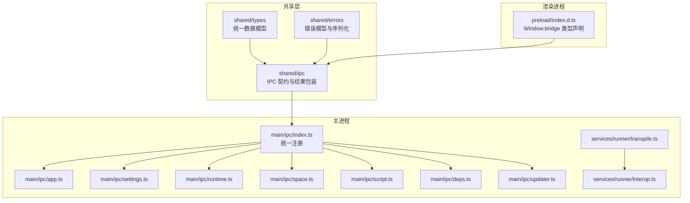
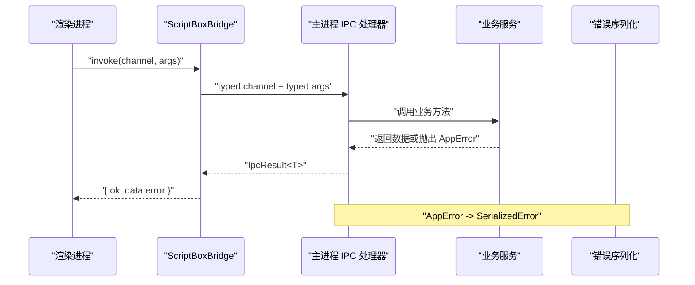
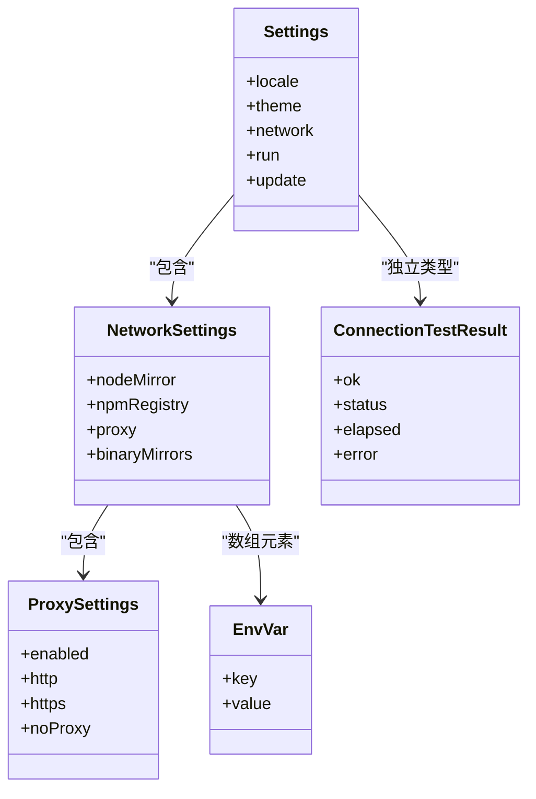
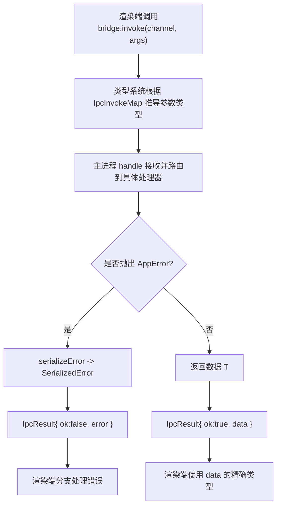
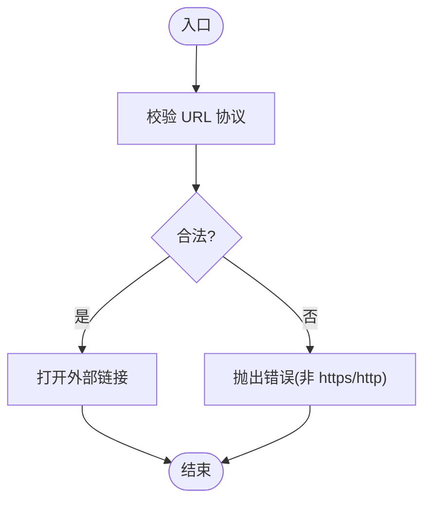
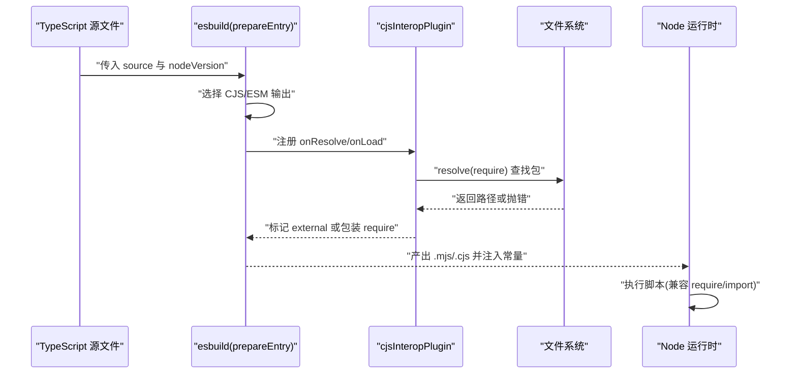
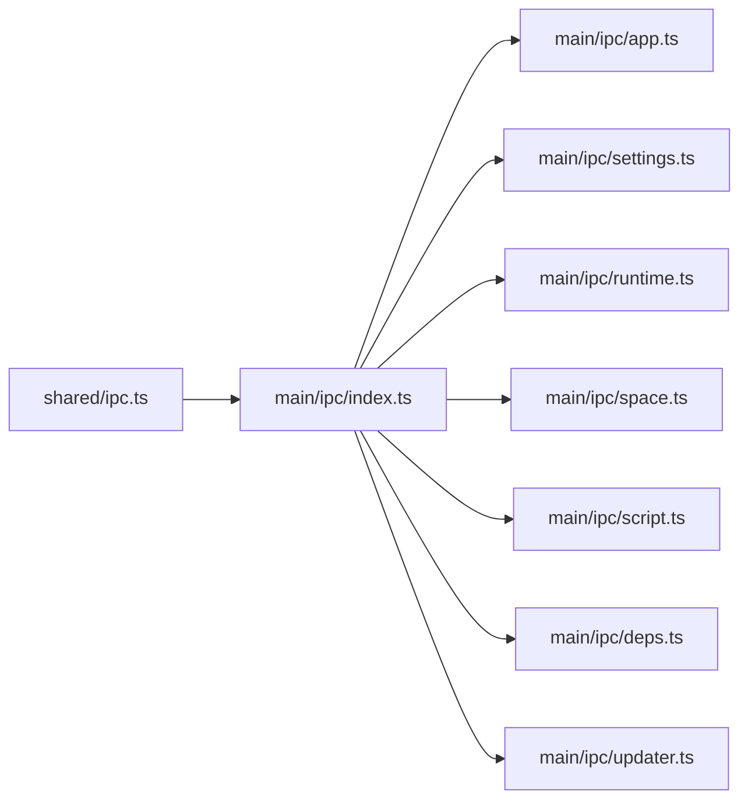

# 类型安全保障

<cite>
**本文引用的文件**   
- [src/shared/types/index.ts](file://src/shared/types/index.ts)
- [src/shared/types/app.ts](file://src/shared/types/app.ts)
- [src/shared/types/run.ts](file://src/shared/types/run.ts)
- [src/shared/types/runtime.ts](file://src/shared/types/runtime.ts)
- [src/shared/types/script.ts](file://src/shared/types/script.ts)
- [src/shared/types/settings.ts](file://src/shared/types/settings.ts)
- [src/shared/types/space.ts](file://src/shared/types/space.ts)
- [src/shared/types/deps.ts](file://src/shared/types/deps.ts)
- [src/shared/ipc.ts](file://src/shared/ipc.ts)
- [src/shared/errors.ts](file://src/shared/errors.ts)
- [src/main/ipc/index.ts](file://src/main/ipc/index.ts)
- [src/main/ipc/app.ts](file://src/main/ipc/app.ts)
- [src/main/ipc/settings.ts](file://src/main/ipc/settings.ts)
- [src/main/ipc/runtime.ts](file://src/main/ipc/runtime.ts)
- [src/main/ipc/space.ts](file://src/main/ipc/space.ts)
- [src/main/ipc/script.ts](file://src/main/ipc/script.ts)
- [src/main/ipc/deps.ts](file://src/main/ipc/deps.ts)
- [src/main/ipc/run.ts](file://src/main/ipc/run.ts)
- [src/main/ipc/updater.ts](file://src/main/ipc/updater.ts)
- [src/main/services/runner/interop.ts](file://src/main/services/runner/interop.ts)
- [src/main/services/runner/transpile.ts](file://src/main/services/runner/transpile.ts)
- [src/preload/index.d.ts](file://src/preload/index.d.ts)
</cite>

## 目录
1. [简介](#简介)
2. [项目结构](#项目结构)
3. [核心组件](#核心组件)
4. [架构总览](#架构总览)
5. [详细组件分析](#详细组件分析)
6. [依赖关系分析](#依赖关系分析)
7. [性能考量](#性能考量)
8. [故障排查指南](#故障排查指南)
9. [结论](#结论)
10. [附录](#附录)

## 简介
本文件系统性说明 Script Box 的类型安全保障机制，覆盖共享类型定义体系、运行时类型验证、TypeScript 与 JavaScript 互操作性、类型测试策略以及最佳实践。重点围绕以下方面展开：
- 接口设计原则与枚举使用规范
- 泛型应用模式（如 DeepPartial）
- 参数校验、错误序列化与降级策略
- IPC 契约的类型安全封装
- TypeScript 编译产物与 Node 运行时的互操作
- 类型声明文件生成与类型推断优化
- 常见类型陷阱与解决方案

## 项目结构
本项目采用“共享类型 + 主进程 IPC + 渲染进程桥接”的分层架构：
- shared/types：集中定义跨进程共享的数据模型与枚举
- shared/ipc：定义 IPC 通道契约与结果包装类型
- main/ipc：注册并实现各业务域 IPC 处理器
- preload：为渲染进程暴露类型安全的 bridge 接口
- runner：负责脚本转译与运行时互操作

**图示来源**
- [src/shared/types/index.ts:1-8](file://src/shared/types/index.ts#L1-L8)
- [src/shared/ipc.ts:1-117](file://src/shared/ipc.ts#L1-L117)
- [src/shared/errors.ts:1-41](file://src/shared/errors.ts#L1-L41)
- [src/main/ipc/index.ts:1-20](file://src/main/ipc/index.ts#L1-L20)
- [src/main/ipc/app.ts:1-36](file://src/main/ipc/app.ts#L1-L36)
- [src/main/ipc/settings.ts:1-15](file://src/main/ipc/settings.ts#L1-L15)
- [src/main/ipc/runtime.ts:1-14](file://src/main/ipc/runtime.ts#L1-L14)
- [src/main/ipc/space.ts:1-26](file://src/main/ipc/space.ts#L1-L26)
- [src/main/ipc/script.ts:1-14](file://src/main/ipc/script.ts#L1-L14)
- [src/main/ipc/deps.ts:1-18](file://src/main/ipc/deps.ts#L1-L18)
- [src/main/ipc/updater.ts:1-12](file://src/main/ipc/updater.ts#L1-L12)
- [src/main/services/runner/interop.ts:1-71](file://src/main/services/runner/interop.ts#L1-L71)
- [src/main/services/runner/transpile.ts:1-67](file://src/main/services/runner/transpile.ts#L1-L67)
- [src/preload/index.d.ts:1-10](file://src/preload/index.d.ts#L1-L10)

**章节来源**
- [src/shared/types/index.ts:1-8](file://src/shared/types/index.ts#L1-L8)
- [src/shared/ipc.ts:1-117](file://src/shared/ipc.ts#L1-L117)
- [src/main/ipc/index.ts:1-20](file://src/main/ipc/index.ts#L1-L20)
- [src/preload/index.d.ts:1-10](file://src/preload/index.d.ts#L1-L10)

## 核心组件
本节聚焦类型保障的核心构件：共享类型、IPC 契约、错误模型与转译/互操作模块。

- 共享类型
  - 领域模型：应用状态、运行记录、运行时版本、脚本元信息、设置项、空间配置、依赖任务等
  - 枚举与联合类型：用于约束状态机与可选值，避免魔法字符串
  - 泛型工具：DeepPartial 支持部分更新设置对象

- IPC 契约
  - IpcInvokeMap/IpcSendMap/IpcEventMap：严格定义请求、发送与事件通道及参数/返回类型
  - IpcResult<T>：统一成功/失败结果包装，便于前端处理错误
  - ScriptBoxBridge：对 invoke/send/on 进行强类型封装，保证调用方参数与返回值类型正确

- 错误模型
  - ErrorCode：集中定义错误码
  - SerializedError：可序列化的错误结构
  - AppError：带 code/message/params 的业务异常
  - serializeError：将任意错误转换为可序列化结构

- 转译与互操作
  - cjsInteropPlugin：在 esbuild 中为 CommonJS 包提供 require 兼容，匹配 tsconfig esModuleInterop
  - prepareEntry：将 TypeScript 源码转译为 Node 可执行的 CJS/ESM，注入 __dirname/__filename/import.meta.url 等常量

**章节来源**
- [src/shared/types/app.ts:1-25](file://src/shared/types/app.ts#L1-L25)
- [src/shared/types/run.ts:1-28](file://src/shared/types/run.ts#L1-L28)
- [src/shared/types/runtime.ts:1-23](file://src/shared/types/runtime.ts#L1-L23)
- [src/shared/types/script.ts:1-13](file://src/shared/types/script.ts#L1-L13)
- [src/shared/types/settings.ts:1-58](file://src/shared/types/settings.ts#L1-L58)
- [src/shared/types/space.ts:1-28](file://src/shared/types/space.ts#L1-L28)
- [src/shared/types/deps.ts:1-30](file://src/shared/types/deps.ts#L1-L30)
- [src/shared/ipc.ts:1-117](file://src/shared/ipc.ts#L1-L117)
- [src/shared/errors.ts:1-41](file://src/shared/errors.ts#L1-L41)
- [src/main/services/runner/interop.ts:1-71](file://src/main/services/runner/interop.ts#L1-L71)
- [src/main/services/runner/transpile.ts:1-67](file://src/main/services/runner/transpile.ts#L1-L67)

## 架构总览
下图展示从渲染进程到主进程的 IPC 类型流，以及错误在跨进程边界的序列化过程。

**图示来源**
- [src/shared/ipc.ts:25-117](file://src/shared/ipc.ts#L25-L117)
- [src/shared/errors.ts:19-41](file://src/shared/errors.ts#L19-L41)
- [src/main/ipc/index.ts:10-19](file://src/main/ipc/index.ts#L10-L19)

## 详细组件分析

### 共享类型定义体系
- 接口设计原则
  - 单一职责：每个接口仅表达一个领域概念（如 RunRecord、Space、Settings）
  - 显式可选：通过 ? 明确可选字段，避免隐式 undefined
  - 组合优于继承：通过引用其他接口（如 EnvVar）复用字段
- 枚举使用规范
  - 使用字面量联合类型表示有限集合（如 UpdateState、RunStatus、RuntimeInstallPhase）
  - 避免裸字符串比较，强制编译器检查
- 泛型应用模式
  - DeepPartial<T>：递归地将所有属性变为可选，用于 settings:update 的部分更新场景
  - IpcResult<T>：统一成功/失败结果包装，配合泛型保持返回类型精确

**图示来源**
- [src/shared/types/settings.ts:1-58](file://src/shared/types/settings.ts#L1-L58)

**章节来源**
- [src/shared/types/settings.ts:1-58](file://src/shared/types/settings.ts#L1-L58)
- [src/shared/types/app.ts:1-25](file://src/shared/types/app.ts#L1-L25)
- [src/shared/types/run.ts:1-28](file://src/shared/types/run.ts#L1-L28)
- [src/shared/types/runtime.ts:1-23](file://src/shared/types/runtime.ts#L1-L23)
- [src/shared/types/script.ts:1-13](file://src/shared/types/script.ts#L1-L13)
- [src/shared/types/space.ts:1-28](file://src/shared/types/space.ts#L1-L28)
- [src/shared/types/deps.ts:1-30](file://src/shared/types/deps.ts#L1-L30)

### IPC 契约与类型安全封装
- 通道类型化
  - IpcInvokeMap：定义 renderer->main 的请求通道及其参数与返回类型
  - IpcSendMap：定义 fire-and-forget 通道
  - IpcEventMap：定义 main->renderer 的事件载荷类型
- 类型安全的桥接
  - ScriptBoxBridge.invoke：基于通道名推导参数与返回类型，返回 IpcResult<T>
  - ScriptBoxBridge.send/on：同样具备通道级类型约束
- 渲染进程类型声明
  - preload/index.d.ts 扩展 Window.bridge 类型为 ScriptBoxBridge，使渲染端获得完整类型提示

**图示来源**
- [src/shared/ipc.ts:25-117](file://src/shared/ipc.ts#L25-L117)
- [src/shared/errors.ts:19-41](file://src/shared/errors.ts#L19-L41)
- [src/preload/index.d.ts:1-10](file://src/preload/index.d.ts#L1-L10)

**章节来源**
- [src/shared/ipc.ts:25-117](file://src/shared/ipc.ts#L25-L117)
- [src/preload/index.d.ts:1-10](file://src/preload/index.d.ts#L1-L10)

### 运行时类型验证与错误处理
- 参数检查机制
  - app:open-external：对外部 URL 做白名单校验，拒绝非 https/http 协议
  - space:remove：在删除前检查是否有活跃运行或依赖任务，防止并发冲突
- 错误序列化
  - AppError 携带 code/message/params，统一被 serializeError 转为 SerializedError
  - 构建失败时，transpile.ts 捕获 esbuild 错误并抛出 BUILD_FAILED
- 降级策略
  - 当 require 解析失败或目标为 ESM-only 包时，cjsInteropPlugin 将其标记为 external，交由 Node 在运行时报错，避免打包期误判
  - 对于未知错误，serializeError 回退为 UNKNOWN 错误码与字符串化消息

**图示来源**
- [src/main/ipc/app.ts:20-24](file://src/main/ipc/app.ts#L20-L24)

**章节来源**
- [src/main/ipc/app.ts:1-36](file://src/main/ipc/app.ts#L1-L36)
- [src/main/ipc/space.ts:15-19](file://src/main/ipc/space.ts#L15-L19)
- [src/shared/errors.ts:1-41](file://src/shared/errors.ts#L1-L41)
- [src/main/services/runner/transpile.ts:58-64](file://src/main/services/runner/transpile.ts#L58-L64)
- [src/main/services/runner/interop.ts:47-62](file://src/main/services/runner/interop.ts#L47-L62)

### TypeScript 与 JavaScript 互操作性
- 转译策略
  - prepareEntry：根据脚本后缀决定输出格式（CJS/ESM），并为 ESM 注入 require 兼容
  - 注入 __dirname/__filename/import.meta.url 等常量，确保相对路径行为一致
- CommonJS 互操作插件
  - cjsInteropPlugin：通过 createRequire 加载 CommonJS 包，模拟 esModuleInterop 行为
  - 对内置模块与已解析为 ESM 的文件直接 external，避免二次包装
- 类型声明与推断
  - preload/index.d.ts 为 Window.bridge 提供类型声明，渲染端获得完整类型推断
  - 依赖类型库扫描（deps:types/node-types）为编辑器提供 .d.ts 内容，提升智能提示

**图示来源**
- [src/main/services/runner/transpile.ts:18-66](file://src/main/services/runner/transpile.ts#L18-L66)
- [src/main/services/runner/interop.ts:11-70](file://src/main/services/runner/interop.ts#L11-L70)

**章节来源**
- [src/main/services/runner/transpile.ts:1-67](file://src/main/services/runner/transpile.ts#L1-L67)
- [src/main/services/runner/interop.ts:1-71](file://src/main/services/runner/interop.ts#L1-L71)
- [src/preload/index.d.ts:1-10](file://src/preload/index.d.ts#L1-L10)

### 类型测试策略
- 契约测试
  - 以 IpcInvokeMap/IpcSendMap/IpcEventMap 作为契约基线，任何通道签名变更都会触发编译错误
  - 建议为关键通道编写单元测试，断言输入/输出结构与错误码
- 边界条件测试
  - 针对 URL 协议校验、空参数、非法脚本名、缺失 Node 版本等场景
  - 针对构建失败、下载失败、校验和失败等错误路径
- 兼容性保证
  - 针对 CJS/ESM 混合导入、Windows 绝对路径、不同 Node 版本的 target 选项进行测试
  - 针对 DeepPartial 的部分更新逻辑进行回归测试

[本节为通用指导，不直接分析具体文件]

### 类型安全的最佳实践
- 避免 any 类型
  - 优先使用联合类型与字面量类型；必要时使用 unknown 并在守卫后收窄
- 使用严格模式
  - 启用 strictNullChecks、strictFunctionTypes 等，尽早发现潜在问题
- 类型守卫函数
  - 对不可信输入（IPC 参数、外部数据）进行运行时校验后再进入业务逻辑
- 最小权限原则
  - IPC 通道只暴露必要能力，减少攻击面

[本节为通用指导，不直接分析具体文件]

### 常见类型陷阱与解决方案
- 陷阱：在 IPC 中使用 any 导致前后端类型脱节
  - 解决：统一通过 IpcInvokeMap 描述通道签名，禁止绕过类型系统
- 陷阱：跨进程错误丢失堆栈与自定义字段
  - 解决：使用 AppError + serializeError 统一序列化，前端按 IpcResult 分支处理
- 陷阱：CJS/ESM 混用导致 import 失败
  - 解决：通过 cjsInteropPlugin 与 prepareEntry 的 require 注入，保持行为一致
- 陷阱：部分更新设置对象时类型不安全
  - 解决：使用 DeepPartial<Settings> 限定 patch 结构

**章节来源**
- [src/shared/ipc.ts:25-117](file://src/shared/ipc.ts#L25-L117)
- [src/shared/errors.ts:1-41](file://src/shared/errors.ts#L1-L41)
- [src/main/services/runner/interop.ts:1-71](file://src/main/services/runner/interop.ts#L1-L71)
- [src/main/services/runner/transpile.ts:18-66](file://src/main/services/runner/transpile.ts#L18-L66)
- [src/shared/types/settings.ts:44-50](file://src/shared/types/settings.ts#L44-L50)

## 依赖关系分析
IPC 注册器聚合各业务域处理器，形成清晰的单向依赖：渲染进程 -> preload -> shared/ipc -> main/ipc -> services。

**图示来源**
- [src/shared/ipc.ts:1-117](file://src/shared/ipc.ts#L1-L117)
- [src/main/ipc/index.ts:1-20](file://src/main/ipc/index.ts#L1-L20)
- [src/main/ipc/app.ts:1-36](file://src/main/ipc/app.ts#L1-L36)
- [src/main/ipc/settings.ts:1-15](file://src/main/ipc/settings.ts#L1-L15)
- [src/main/ipc/runtime.ts:1-14](file://src/main/ipc/runtime.ts#L1-L14)
- [src/main/ipc/space.ts:1-26](file://src/main/ipc/space.ts#L1-L26)
- [src/main/ipc/script.ts:1-14](file://src/main/ipc/script.ts#L1-L14)
- [src/main/ipc/deps.ts:1-18](file://src/main/ipc/deps.ts#L1-L18)
- [src/main/ipc/updater.ts:1-12](file://src/main/ipc/updater.ts#L1-L12)

**章节来源**
- [src/main/ipc/index.ts:1-20](file://src/main/ipc/index.ts#L1-L20)

## 性能考量
- 转译阶段
  - 仅在 TypeScript 源文件时触发构建，JavaScript 直接透传，减少不必要的开销
  - 使用 inline sourcemap 便于调试，但需注意体积影响
- 互操作插件
  - 对内置模块与 ESM 包直接 external，避免重复解析与包装
- IPC 通信
  - 使用 send 通道进行无返回值的推送（如终端写入），降低握手开销

[本节为通用指导，不直接分析具体文件]

## 故障排查指南
- 构建失败
  - 现象：BUILD_FAILED 错误，附带位置信息与文本
  - 排查：检查 TypeScript 语法与类型错误，确认 Node 版本 target 是否匹配
  - 参考：[src/main/services/runner/transpile.ts:58-64](file://src/main/services/runner/transpile.ts#L58-L64)
- 外部链接被拒绝
  - 现象：非 https/http 协议被拒绝
  - 排查：确认 URL 协议是否符合白名单
  - 参考：[src/main/ipc/app.ts:20-24](file://src/main/ipc/app.ts#L20-L24)
- 空间删除失败
  - 现象：SPACE_BUSY 错误
  - 排查：检查是否存在活跃运行或依赖任务
  - 参考：[src/main/ipc/space.ts:15-19](file://src/main/ipc/space.ts#L15-L19)
- 依赖解析失败
  - 现象：CommonJS 包无法按需导入
  - 排查：确认是否为 ESM-only 包或缺失依赖；查看 cjsInteropPlugin 日志
  - 参考：[src/main/services/runner/interop.ts:47-62](file://src/main/services/runner/interop.ts#L47-L62)

**章节来源**
- [src/main/services/runner/transpile.ts:58-64](file://src/main/services/runner/transpile.ts#L58-L64)
- [src/main/ipc/app.ts:20-24](file://src/main/ipc/app.ts#L20-L24)
- [src/main/ipc/space.ts:15-19](file://src/main/ipc/space.ts#L15-L19)
- [src/main/services/runner/interop.ts:47-62](file://src/main/services/runner/interop.ts#L47-L62)

## 结论
Script Box 通过统一的共享类型、严格的 IPC 契约、完善的错误序列化与稳健的转译/互操作机制，构建了端到端的类型安全保障。建议在开发中坚持最小权限、显式类型、契约驱动与严格模式，持续完善契约测试与边界用例，从而在演进过程中保持类型安全与运行稳定性。

[本节为总结性内容，不直接分析具体文件]

## 附录
- 关键类型文件索引
  - 应用与运行：app.ts、run.ts
  - 运行时与依赖：runtime.ts、deps.ts
  - 脚本与空间：script.ts、space.ts
  - 设置与连接：settings.ts
  - IPC 与错误：ipc.ts、errors.ts
  - 转译与互操作：transpile.ts、interop.ts
  - 渲染桥接：preload/index.d.ts

[本节为索引性内容，不直接分析具体文件]