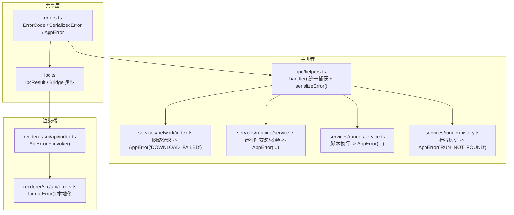
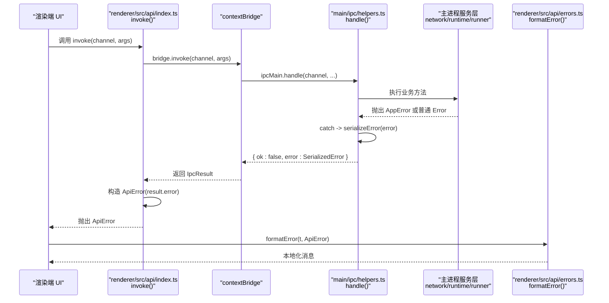
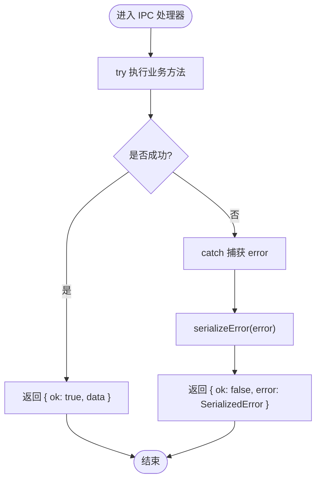
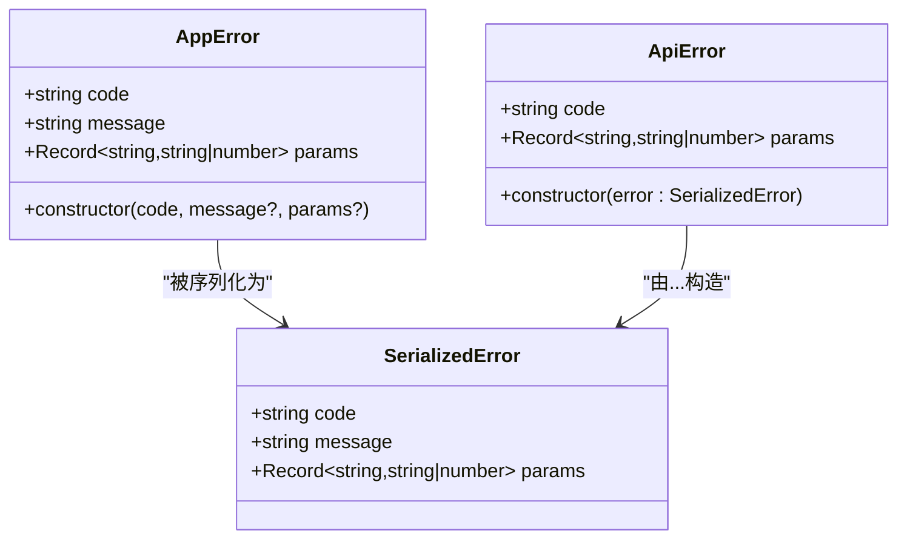
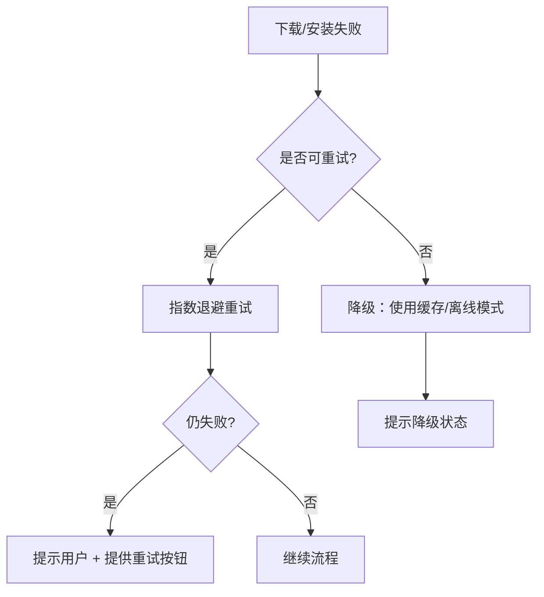
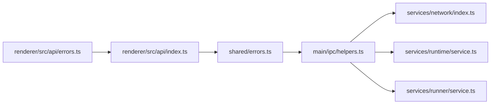

# 错误处理机制

<cite>
**本文引用的文件**   
- [src/shared/errors.ts](file://src/shared/errors.ts)
- [src/shared/ipc.ts](file://src/shared/ipc.ts)
- [src/main/ipc/helpers.ts](file://src/main/ipc/helpers.ts)
- [src/renderer/src/api/index.ts](file://src/renderer/src/api/index.ts)
- [src/renderer/src/api/errors.ts](file://src/renderer/src/api/errors.ts)
- [src/main/services/network/index.ts](file://src/main/services/network/index.ts)
- [src/main/services/runtime/service.ts](file://src/main/services/runtime/service.ts)
- [src/main/services/runner/service.ts](file://src/main/services/runner/service.ts)
- [src/main/services/runner/history.ts](file://src/main/services/runner/history.ts)
</cite>

## 目录
1. [引言](#引言)
2. [项目结构](#项目结构)
3. [核心组件](#核心组件)
4. [架构总览](#架构总览)
5. [详细组件分析](#详细组件分析)
6. [依赖关系分析](#依赖关系分析)
7. [性能与可观测性](#性能与可观测性)
8. [故障排查指南](#故障排查指南)
9. [结论](#结论)
10. [附录：错误分类与恢复策略建议](#附录错误分类与恢复策略建议)

## 引言
本文聚焦 Script Box 在主进程与渲染进程之间的 IPC 错误处理机制，系统性说明以下方面：
- 错误分类：网络错误、文件系统错误、业务逻辑错误、系统错误。
- 错误序列化：SerializedError 结构、跨进程传播、堆栈保留现状与建议。
- 错误恢复策略：重试、降级、用户反馈。
- 错误日志记录：结构化日志、上下文信息、性能监控。
- 错误调试工具：错误追踪、堆栈分析、问题定位。
- 最佳实践：错误边界、用户友好提示、开发者调试信息。

## 项目结构
Script Box 的错误处理贯穿共享类型定义、主进程 IPC 封装、服务层异常抛出以及渲染端 API 包装与国际化展示。关键路径如下：
- 共享层：统一错误码、序列化结构与 AppError 基类。
- 主进程：IPC 通用处理器统一捕获并序列化错误；各服务按领域抛出 AppError。
- 渲染端：API 包装将主进程错误转换为 ApiError，并提供本地化格式化能力。

**图表来源**
- [src/shared/errors.ts:1-40](file://src/shared/errors.ts#L1-L40)
- [src/shared/ipc.ts:105-115](file://src/shared/ipc.ts#L105-L115)
- [src/main/ipc/helpers.ts:17-28](file://src/main/ipc/helpers.ts#L17-L28)
- [src/main/services/network/index.ts:18-37](file://src/main/services/network/index.ts#L18-L37)
- [src/main/services/runtime/service.ts:74-134](file://src/main/services/runtime/service.ts#L74-L134)
- [src/main/services/runner/service.ts:44-48](file://src/main/services/runner/service.ts#L44-L48)
- [src/main/services/runner/history.ts:13-16](file://src/main/services/runner/history.ts#L13-L16)
- [src/renderer/src/api/index.ts:4-27](file://src/renderer/src/api/index.ts#L4-L27)
- [src/renderer/src/api/errors.ts:4-14](file://src/renderer/src/api/errors.ts#L4-L14)

**章节来源**
- [src/shared/errors.ts:1-40](file://src/shared/errors.ts#L1-L40)
- [src/shared/ipc.ts:105-115](file://src/shared/ipc.ts#L105-L115)
- [src/main/ipc/helpers.ts:17-28](file://src/main/ipc/helpers.ts#L17-L28)
- [src/renderer/src/api/index.ts:4-27](file://src/renderer/src/api/index.ts#L4-L27)
- [src/renderer/src/api/errors.ts:4-14](file://src/renderer/src/api/errors.ts#L4-L14)

## 核心组件
- 错误模型与序列化
  - ErrorCode：集中声明所有业务错误码，便于前端 i18n 映射与后端分类统计。
  - SerializedError：跨进程传输的最小错误对象，包含 code、message、params。
  - AppError：主进程抛出的标准业务异常，携带 code、message、params。
  - serializeError：将任意 error 转为 SerializedError，AppError 原样透传，其他错误归一为 UNKNOWN。
- IPC 错误桥接
  - handle(channel, handler)：统一 try/catch，失败时返回 { ok: false, error: SerializedError }。
  - IpcResult<T>：统一成功/失败结果类型，避免 contextBridge 丢失自定义错误字段。
- 渲染端 API 包装
  - ApiError：在渲染端表示来自主进程的错误，携带 code 与 params。
  - invoke(channel, ...args)：调用 bridge.invoke，若 result.ok 为 false 则抛出 ApiError。
  - formatError(t, error)：根据 ApiError.code 选择 i18n key，并将 params 注入模板，UNKNOWN 直接回退 message。

**章节来源**
- [src/shared/errors.ts:1-40](file://src/shared/errors.ts#L1-L40)
- [src/main/ipc/helpers.ts:17-28](file://src/main/ipc/helpers.ts#L17-L28)
- [src/shared/ipc.ts:105-115](file://src/shared/ipc.ts#L105-L115)
- [src/renderer/src/api/index.ts:4-27](file://src/renderer/src/api/index.ts#L4-L27)
- [src/renderer/src/api/errors.ts:4-14](file://src/renderer/src/api/errors.ts#L4-L14)

## 架构总览
下图展示了从渲染端发起调用到主进程服务层抛出错误，再经 IPC 序列化回传到渲染端的完整链路。

**图表来源**
- [src/renderer/src/api/index.ts:19-27](file://src/renderer/src/api/index.ts#L19-L27)
- [src/main/ipc/helpers.ts:17-28](file://src/main/ipc/helpers.ts#L17-L28)
- [src/shared/errors.ts:36-40](file://src/shared/errors.ts#L36-L40)
- [src/renderer/src/api/errors.ts:4-14](file://src/renderer/src/api/errors.ts#L4-L14)

## 详细组件分析

### 错误分类与示例
- 网络错误
  - 典型场景：下载失败、HTTP 非 2xx、校验和失败。
  - 实现位置：网络模块对 fetch 响应进行判断，失败时抛出 DOWNLOAD_FAILED；运行时安装时对 SHASUMS 校验失败抛出 CHECKSUM_MISMATCH。
  - 影响面：影响运行时安装、远程列表获取、更新检查等。
- 文件系统错误
  - 典型场景：空间不存在、脚本不存在、运行记录不存在。
  - 实现位置：路径解析、脚本服务、运行历史存储中抛出 SPACE_NOT_FOUND、SCRIPT_NOT_FOUND、RUN_NOT_FOUND 等。
- 业务逻辑错误
  - 典型场景：未配置 Node 版本、运行时未安装、正在安装中、版本不存在、构建失败、不支持的脚本语言。
  - 实现位置：运行时服务、Runner 服务、语言识别器、转译器等。
- 系统错误
  - 典型场景：未知异常、底层库抛出的非 AppError。
  - 处理方式：serializeError 将其归类为 UNKNOWN，保留原始 message。

**图表来源**
- [src/main/ipc/helpers.ts:17-28](file://src/main/ipc/helpers.ts#L17-L28)
- [src/shared/errors.ts:36-40](file://src/shared/errors.ts#L36-L40)

**章节来源**
- [src/main/services/network/index.ts:18-37](file://src/main/services/network/index.ts#L18-L37)
- [src/main/services/runtime/service.ts:114-149](file://src/main/services/runtime/service.ts#L114-L149)
- [src/main/services/runner/service.ts:44-48](file://src/main/services/runner/service.ts#L44-L48)
- [src/main/services/runner/history.ts:13-16](file://src/main/services/runner/history.ts#L13-L16)

### 错误序列化与跨进程传播
- SerializedError 结构
  - code：枚举化的错误码，用于前端 i18n 与统计。
  - message：人类可读的消息，作为兜底显示。
  - params：可选参数，用于模板插值（如文件名、版本号、URL）。
- 序列化规则
  - 若为 AppError：透传 code、message、params。
  - 否则：code 设为 UNKNOWN，message 取 Error.message 或字符串化。
- 跨进程传播
  - 主进程通过 handle() 统一捕获并返回 IpcResult。
  - 渲染端 invoke() 将 result.error 包装为 ApiError，保持 code 与 params。
- 堆栈保留现状与建议
  - 当前仅序列化 message，不传递 stack。这是出于安全与体积考虑，但会削弱调试体验。
  - 建议：在开发模式下扩展 SerializedError 增加 stack 字段，并在渲染端以“开发者模式”开关控制是否展示。

**图表来源**
- [src/shared/errors.ts:19-40](file://src/shared/errors.ts#L19-L40)
- [src/renderer/src/api/index.ts:4-15](file://src/renderer/src/api/index.ts#L4-L15)

**章节来源**
- [src/shared/errors.ts:19-40](file://src/shared/errors.ts#L19-L40)
- [src/renderer/src/api/index.ts:4-15](file://src/renderer/src/api/index.ts#L4-L15)

### 错误恢复策略
- 重试机制
  - 网络下载：可在上层调用处结合指数退避重试，配合 AbortSignal 支持取消。
  - 运行时安装：已提供 progress 事件，可在 UI 层实现“失败后重试”按钮。
- 降级处理
  - 远程列表缓存：RuntimeService 维护短期缓存，降低远端不可用时的失败概率。
  - 连接测试：testConnection 返回 elapsed 与 error 文本，供 UI 展示连通性问题。
- 用户反馈
  - 渲染端 formatError 基于 ApiError.code 选择 i18n key，并将 params 注入模板；UNKNOWN 直接回退 message。
  - 建议在 UI 层区分“用户可操作错误”（如未安装运行时）与“系统级错误”（如未知异常），分别给出引导与上报入口。

[本图为概念流程图，无需代码来源]

**章节来源**
- [src/main/services/runtime/service.ts:35-56](file://src/main/services/runtime/service.ts#L35-L56)
- [src/main/services/network/index.ts:66-80](file://src/main/services/network/index.ts#L66-L80)
- [src/renderer/src/api/errors.ts:4-14](file://src/renderer/src/api/errors.ts#L4-L14)

### 错误日志记录与性能监控
- 主进程日志
  - IPC 层：handle()/listen() 在 catch 分支打印 [ipc] channel failed，便于快速定位失败的通道。
  - Runner 服务：保存历史记录失败时打印 [runner] failed to save history。
- 结构化日志建议
  - 在 AppError 抛出点附加结构化字段（如 url、status、version、runId），并通过日志框架输出 JSON。
  - 在 IPC 层统一拦截，追加 traceId、channel、timestamp、duration 等元数据。
- 性能监控
  - 网络模块 testConnection 已记录 elapsed，可用于连通性与延迟监控。
  - 下载进度回调 onProgress 可用于吞吐率与卡顿检测。

**章节来源**
- [src/main/ipc/helpers.ts:23-25](file://src/main/ipc/helpers.ts#L23-L25)
- [src/main/services/runner/service.ts:136-141](file://src/main/services/runner/service.ts#L136-L141)
- [src/main/services/network/index.ts:66-80](file://src/main/services/network/index.ts#L66-L80)

### 错误调试工具
- 错误追踪
  - 在渲染端捕获 ApiError，记录 code、params、message，并上报至监控系统。
  - 建议在开发模式下启用更详细的日志（例如打印调用栈）。
- 堆栈分析
  - 当前 SerializedError 不包含 stack。建议在 dev 模式下扩展序列化逻辑，附带 stack 字段，并在 UI 中以折叠面板展示。
- 问题定位
  - 利用 IPC 通道名与错误码快速定位模块（如 runtime:*、script:*、deps:*）。
  - 结合运行历史（historyStore）与终端输出，还原复现场景。

**章节来源**
- [src/renderer/src/api/index.ts:19-27](file://src/renderer/src/api/index.ts#L19-L27)
- [src/main/services/runner/history.ts:18-28](file://src/main/services/runner/history.ts#L18-L28)

## 依赖关系分析
- 耦合与内聚
  - IPC helpers 与 shared errors 低耦合，职责单一：统一捕获与序列化。
  - 各服务层只负责抛出 AppError，不关心 IPC 细节，提升内聚。
- 外部依赖
  - Electron net/session 用于网络与代理设置。
  - node-pty 与 tree-kill 用于子进程管理与终止。
- 潜在循环依赖
  - 当前错误相关依赖方向清晰：shared -> main -> renderer，未见循环引用。

**图表来源**
- [src/shared/errors.ts:1-40](file://src/shared/errors.ts#L1-L40)
- [src/main/ipc/helpers.ts:1-28](file://src/main/ipc/helpers.ts#L1-L28)
- [src/main/services/network/index.ts:1-37](file://src/main/services/network/index.ts#L1-L37)
- [src/main/services/runtime/service.ts:1-134](file://src/main/services/runtime/service.ts#L1-L134)
- [src/main/services/runner/service.ts:1-48](file://src/main/services/runner/service.ts#L1-L48)
- [src/renderer/src/api/index.ts:1-27](file://src/renderer/src/api/index.ts#L1-L27)
- [src/renderer/src/api/errors.ts:1-14](file://src/renderer/src/api/errors.ts#L1-L14)

**章节来源**
- [src/shared/errors.ts:1-40](file://src/shared/errors.ts#L1-L40)
- [src/main/ipc/helpers.ts:1-28](file://src/main/ipc/helpers.ts#L1-L28)
- [src/renderer/src/api/index.ts:1-27](file://src/renderer/src/api/index.ts#L1-L27)

## 性能与可观测性
- 性能
  - 下载进度节流：每 150ms 触发一次 onProgress，减少 UI 重绘压力。
  - 远程列表缓存：10 分钟 TTL，降低频繁远端访问。
- 可观测性
  - 连接测试返回 elapsed，便于绘制延迟分布。
  - 建议在 IPC 层增加耗时埋点，统计各通道 P95/P99 耗时。

**章节来源**
- [src/main/services/network/index.ts:39-58](file://src/main/services/network/index.ts#L39-L58)
- [src/main/services/runtime/service.ts:35-56](file://src/main/services/runtime/service.ts#L35-L56)
- [src/main/services/network/index.ts:66-80](file://src/main/services/network/index.ts#L66-L80)

## 故障排查指南
- 常见问题
  - 下载失败：检查代理设置、镜像地址、网络连通性；查看 DOWNLOAD_FAILED 的 url 与 status。
  - 校验和不匹配：确认 SHASUMS 源与目标文件一致；关注 CHECKSUM_MISMATCH 的 file。
  - 运行时未安装：先安装对应版本；关注 RUNTIME_NOT_INSTALLED 的 version。
  - 脚本不存在：核对脚本名称与路径；关注 SCRIPT_NOT_FOUND 的 name。
  - 运行记录不存在：核对 runId；关注 RUN_NOT_FOUND 的 runId。
- 定位步骤
  1. 在渲染端捕获 ApiError，打印 code、params、message。
  2. 在主进程控制台查找 [ipc] channel failed 日志，确认失败通道。
  3. 结合运行历史与终端输出，还原执行上下文。
  4. 必要时开启开发模式，扩展 SerializedError 包含 stack，辅助定位。

**章节来源**
- [src/main/services/network/index.ts:18-37](file://src/main/services/network/index.ts#L18-L37)
- [src/main/services/runtime/service.ts:114-149](file://src/main/services/runtime/service.ts#L114-L149)
- [src/main/services/runner/service.ts:44-48](file://src/main/services/runner/service.ts#L44-L48)
- [src/main/services/runner/history.ts:13-16](file://src/main/services/runner/history.ts#L13-L16)
- [src/main/ipc/helpers.ts:23-25](file://src/main/ipc/helpers.ts#L23-L25)

## 结论
Script Box 的 IPC 错误处理采用“主进程统一捕获 + 标准化序列化 + 渲染端本地化展示”的分层设计，具备清晰的错误分类与可扩展性。当前实现已覆盖常见网络、文件与业务错误，但在堆栈保留、结构化日志与性能埋点方面仍有优化空间。建议在生产环境保持轻量序列化，在开发环境增强调试信息，同时在 UI 层提供更友好的错误边界与可操作指引。

## 附录：错误分类与恢复策略建议
- 网络错误（DOWNLOAD_FAILED、CHECKSUM_MISMATCH）
  - 重试：指数退避 + 最大重试次数。
  - 降级：使用缓存/离线包；提示用户切换镜像或网络。
- 文件系统错误（SPACE_NOT_FOUND、SCRIPT_NOT_FOUND、RUN_NOT_FOUND）
  - 重试：通常不适用。
  - 降级：提供创建/导入入口；自动修复缺失目录。
- 业务逻辑错误（NO_NODE_VERSION、RUNTIME_NOT_INSTALLED、RUNTIME_INSTALLING、VERSION_NOT_FOUND、BUILD_FAILED、UNSUPPORTED_SCRIPT）
  - 重试：安装失败可重试；构建失败可清理缓存后重试。
  - 降级：提供默认运行时；提示升级或更换脚本语言。
- 系统错误（UNKNOWN）
  - 重试：谨慎使用，避免雪崩。
  - 降级：展示兜底消息；收集诊断信息并引导用户反馈。

[本节为概念性建议，无需代码来源]