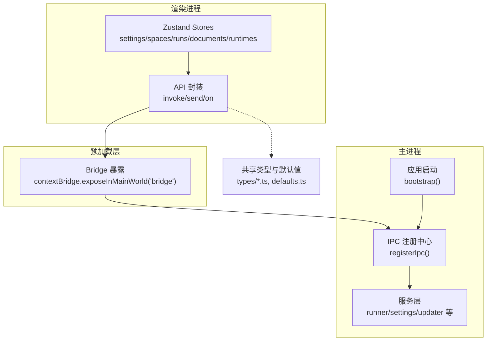
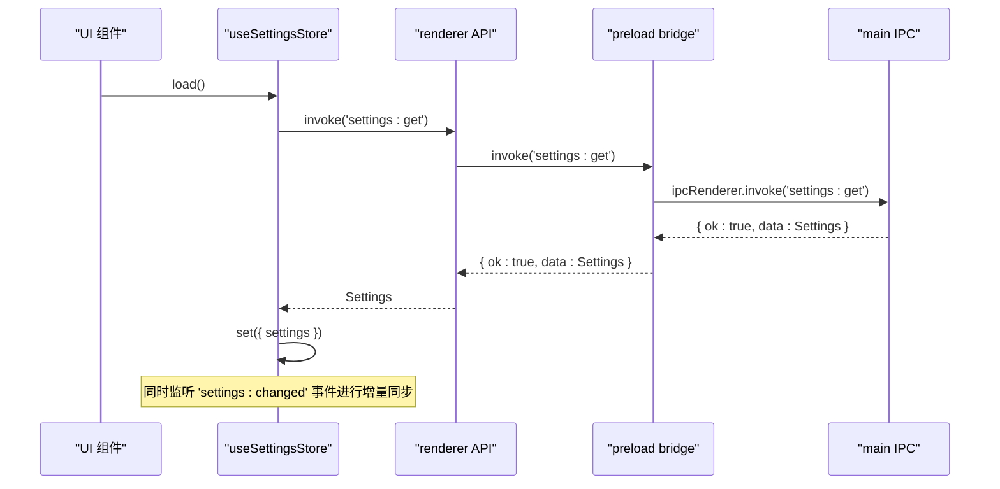
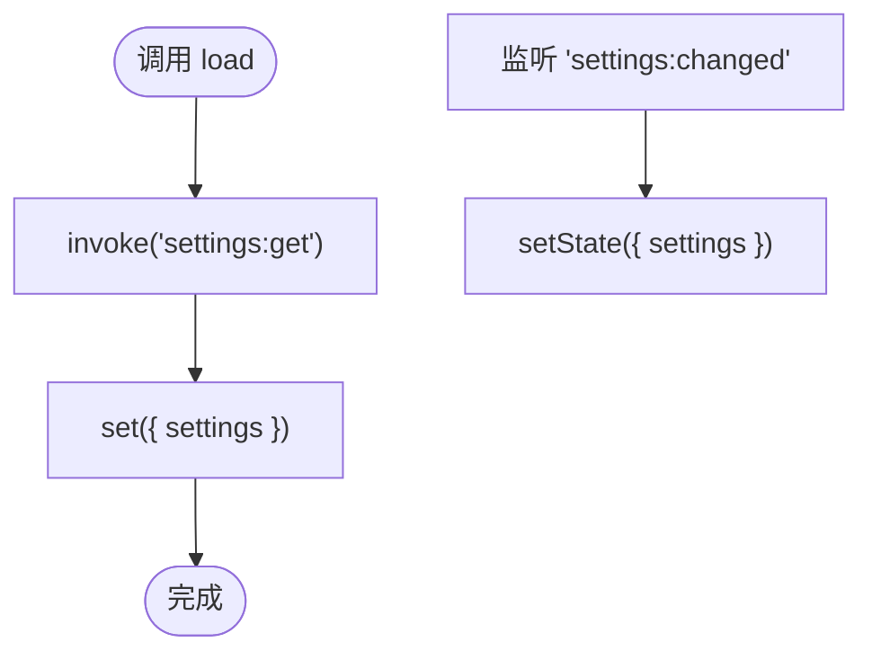
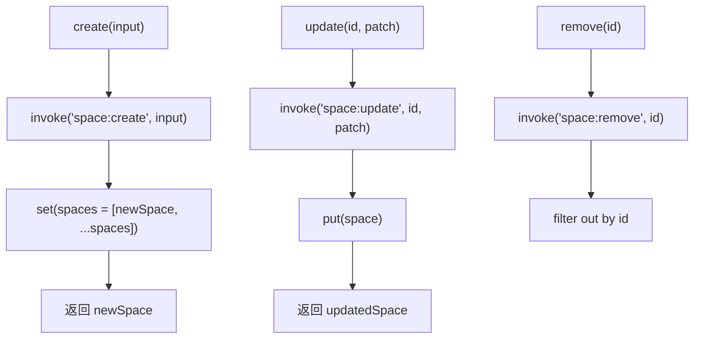
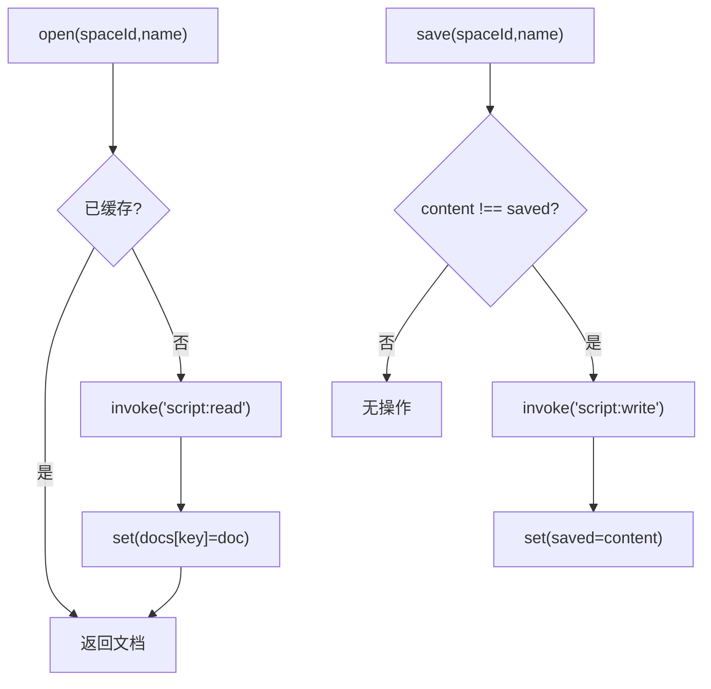
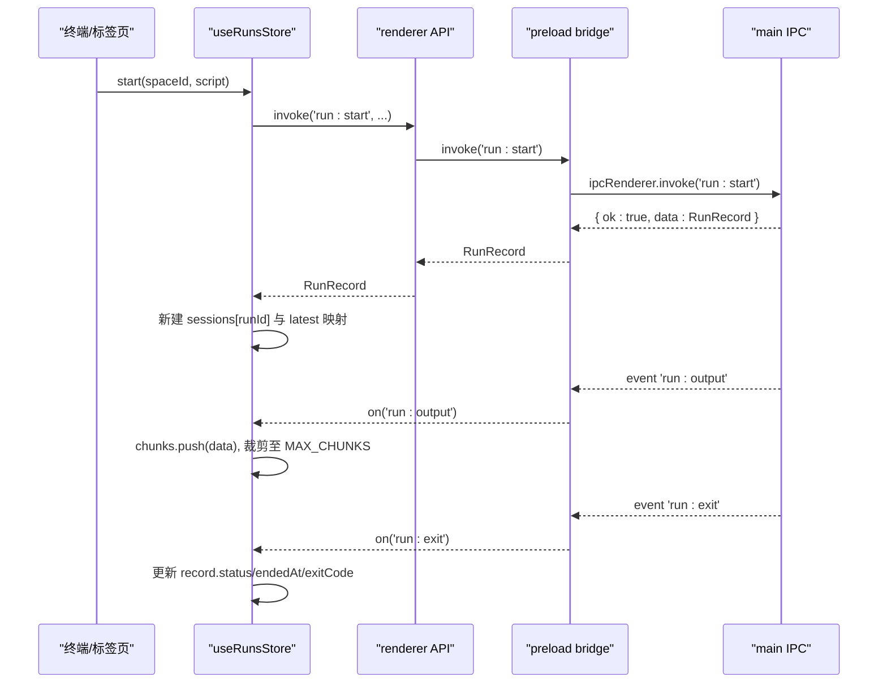
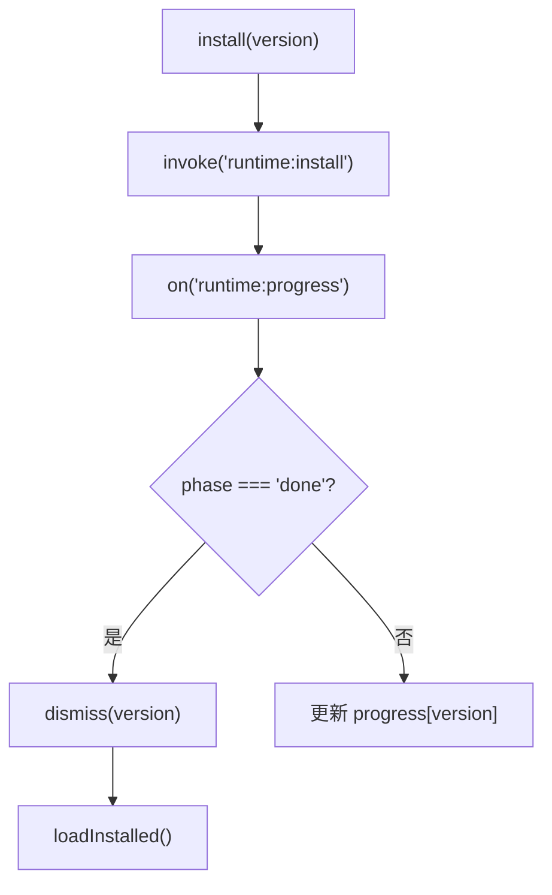
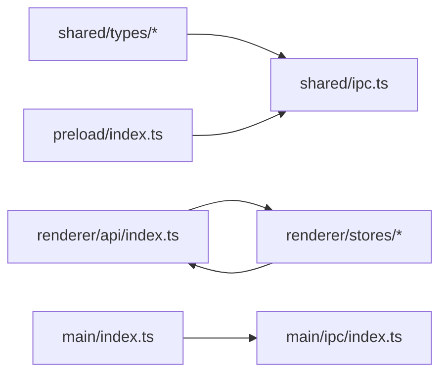

# 数据流设计

<cite>
**本文引用的文件**   
- [src/shared/ipc.ts](file://src/shared/ipc.ts)
- [src/renderer/src/api/index.ts](file://src/renderer/src/api/index.ts)
- [src/preload/index.ts](file://src/preload/index.ts)
- [src/main/index.ts](file://src/main/index.ts)
- [src/main/ipc/index.ts](file://src/main/ipc/index.ts)
- [src/renderer/src/stores/settings.ts](file://src/renderer/src/stores/settings.ts)
- [src/renderer/src/stores/spaces.ts](file://src/renderer/src/stores/spaces.ts)
- [src/renderer/src/stores/runs.ts](file://src/renderer/src/stores/runs.ts)
- [src/renderer/src/stores/documents.ts](file://src/renderer/src/stores/documents.ts)
- [src/renderer/src/stores/runtimes.ts](file://src/renderer/src/stores/runtimes.ts)
- [src/shared/types/settings.ts](file://src/shared/types/settings.ts)
- [src/shared/types/space.ts](file://src/shared/types/space.ts)
- [src/shared/types/run.ts](file://src/shared/types/run.ts)
- [src/shared/types/script.ts](file://src/shared/types/script.ts)
- [src/shared/types/runtime.ts](file://src/shared/types/runtime.ts)
- [src/shared/defaults.ts](file://src/shared/defaults.ts)
</cite>

## 目录
1. [简介](#简介)
2. [项目结构](#项目结构)
3. [核心组件](#核心组件)
4. [架构总览](#架构总览)
5. [详细组件分析](#详细组件分析)
6. [依赖关系分析](#依赖关系分析)
7. [性能与内存管理](#性能与内存管理)
8. [故障排除指南](#故障排除指南)
9. [结论](#结论)

## 简介
本文件面向 Script Box 的数据流设计，系统性阐述前后端数据同步机制、Zustand store 的状态管理与持久化策略、IPC 数据流（请求发起、数据传输、响应处理、错误传播）、数据一致性保证（乐观更新、冲突解决、回滚机制），以及数据流监控、性能优化与调试方法。文档以仓库现有实现为依据，重点覆盖设置、空间、脚本、运行历史、运行时等关键领域的数据流。

## 项目结构
本项目采用 Electron 多进程架构：
- 渲染进程：React + Zustand 状态管理，通过 API 封装调用 IPC。
- 预加载脚本：暴露安全桥接对象 bridge，统一 invoke/send/on。
- 主进程：注册各类 IPC 处理器，协调服务层与文件系统、网络、运行器等资源。
- 共享类型：定义跨进程的类型契约与默认配置。

图表来源
- [src/renderer/src/api/index.ts:19-35](file://src/renderer/src/api/index.ts#L19-L35)
- [src/preload/index.ts:5-18](file://src/preload/index.ts#L5-L18)
- [src/main/index.ts:10-23](file://src/main/index.ts#L10-L23)
- [src/main/ipc/index.ts:10-19](file://src/main/ipc/index.ts#L10-L19)
- [src/shared/types/settings.ts:36-42](file://src/shared/types/settings.ts#L36-L42)

章节来源
- [src/main/index.ts:10-23](file://src/main/index.ts#L10-L23)
- [src/main/ipc/index.ts:10-19](file://src/main/ipc/index.ts#L10-L19)
- [src/preload/index.ts:5-18](file://src/preload/index.ts#L5-L18)
- [src/renderer/src/api/index.ts:19-35](file://src/renderer/src/api/index.ts#L19-L35)

## 核心组件
- 共享 IPC 契约：定义三类通道（invoke/send/on）及事件载荷类型，确保前后端类型一致。
- 渲染端 API 封装：将 bridge.invoke 包装为 Promise，统一错误转换为 ApiError；提供 send/on 能力。
- 预加载 Bridge：在 contextBridge 中暴露 invoke/send/on/getPathForFile，屏蔽底层 ipcRenderer/webUtils。
- 主进程入口：初始化代理、恢复历史、注册 IPC、创建窗口、自动检查更新、退出前停止所有运行任务。
- 渲染端 Store：基于 Zustand 的 settings/spaces/runs/documents/runtimes 五个核心状态模块。

章节来源
- [src/shared/ipc.ts:25-116](file://src/shared/ipc.ts#L25-L116)
- [src/renderer/src/api/index.ts:1-38](file://src/renderer/src/api/index.ts#L1-L38)
- [src/preload/index.ts:1-19](file://src/preload/index.ts#L1-L19)
- [src/main/index.ts:10-54](file://src/main/index.ts#L10-L54)
- [src/renderer/src/stores/settings.ts:1-26](file://src/renderer/src/stores/settings.ts#L1-L26)
- [src/renderer/src/stores/spaces.ts:1-45](file://src/renderer/src/stores/spaces.ts#L1-L45)
- [src/renderer/src/stores/runs.ts:1-79](file://src/renderer/src/stores/runs.ts#L1-L79)
- [src/renderer/src/stores/documents.ts:1-67](file://src/renderer/src/stores/documents.ts#L1-L67)
- [src/renderer/src/stores/runtimes.ts:1-62](file://src/renderer/src/stores/runtimes.ts#L1-L62)

## 架构总览
下图展示一次“设置读取”的端到端数据流：渲染端调用 API -> 预加载桥 -> 主进程 IPC 处理器 -> 返回结果并更新 Store。

图表来源
- [src/renderer/src/stores/settings.ts:11-25](file://src/renderer/src/stores/settings.ts#L11-L25)
- [src/renderer/src/api/index.ts:19-35](file://src/renderer/src/api/index.ts#L19-L35)
- [src/preload/index.ts:5-18](file://src/preload/index.ts#L5-L18)
- [src/shared/ipc.ts:32-34](file://src/shared/ipc.ts#L32-L34)

## 详细组件分析

### 设置模块（settings）
- 状态定义：包含 settings 字段与 load/update 动作。
- 数据同步：
  - 拉取：调用 settings:get 后写入状态。
  - 推送：监听 settings:changed 事件，直接替换当前设置，实现增量同步。
- 错误处理：API 层将主进程错误转为 ApiError，调用方需捕获。
- 持久化：由主进程负责读写磁盘，渲染端仅持有内存快照并通过事件保持最新。

图表来源
- [src/renderer/src/stores/settings.ts:11-25](file://src/renderer/src/stores/settings.ts#L11-L25)
- [src/shared/ipc.ts:32-34](file://src/shared/ipc.ts#L32-L34)

章节来源
- [src/renderer/src/stores/settings.ts:1-26](file://src/renderer/src/stores/settings.ts#L1-L26)
- [src/shared/types/settings.ts:36-42](file://src/shared/types/settings.ts#L36-L42)

### 空间模块（spaces）
- 状态定义：spaces 列表、loaded 标志，以及 create/update/remove/put/load 动作。
- 乐观更新：create/update 成功后立即用服务端返回的最新对象替换本地项，避免闪烁。
- 删除：先调用 space:remove，再过滤本地列表。
- 批量同步：load 使用 space:list 一次性刷新。

图表来源
- [src/renderer/src/stores/spaces.ts:16-44](file://src/renderer/src/stores/spaces.ts#L16-L44)
- [src/shared/ipc.ts:43-48](file://src/shared/ipc.ts#L43-L48)

章节来源
- [src/renderer/src/stores/spaces.ts:1-45](file://src/renderer/src/stores/spaces.ts#L1-L45)
- [src/shared/types/space.ts:13-27](file://src/shared/types/space.ts#L13-L27)

### 脚本文档模块（documents）
- 状态定义：docs 字典，键为 docKey(spaceId/name)，值为 { saved, content }。
- 打开：若未缓存则 script:read 拉取并缓存。
- 编辑：仅当 content 变化时更新内存草稿。
- 保存：对比 saved 与 content，仅在脏标记存在时调用 script:write，成功后更新 saved。
- 重命名/遗忘：支持按空间维度清理或移动草稿。

图表来源
- [src/renderer/src/stores/documents.ts:22-61](file://src/renderer/src/stores/documents.ts#L22-L61)
- [src/shared/ipc.ts:50-53](file://src/shared/ipc.ts#L50-L53)

章节来源
- [src/renderer/src/stores/documents.ts:1-67](file://src/renderer/src/stores/documents.ts#L1-L67)
- [src/shared/types/script.ts:7-12](file://src/shared/types/script.ts#L7-L12)

### 运行会话模块（runs）
- 状态定义：sessions 记录每个 runId 的 RunRecord 与输出 chunks；latest 维护每个脚本的最新运行 ID。
- 启动：run:start 返回 RunRecord，建立 session，必要时清理旧会话。
- 输出增量：监听 run:output，追加到 chunks，超过阈值裁剪以保持内存可控。
- 结束：监听 run:exit，更新 record 状态。
- 同步：run:active 用于挂载后恢复活跃会话。

图表来源
- [src/renderer/src/stores/runs.ts:26-79](file://src/renderer/src/stores/runs.ts#L26-L79)
- [src/shared/ipc.ts:70-77](file://src/shared/ipc.ts#L70-L77)
- [src/shared/types/run.ts:1-27](file://src/shared/types/run.ts#L1-L27)

章节来源
- [src/renderer/src/stores/runs.ts:1-79](file://src/renderer/src/stores/runs.ts#L1-L79)
- [src/shared/types/run.ts:1-27](file://src/shared/types/run.ts#L1-L27)

### 运行时模块（runtimes）
- 状态定义：installed/remote/remoteLoading/progress。
- 安装流程：install/cancel/remove 调用对应 IPC；进度通过 runtime:progress 事件实时更新。
- 完成回调：phase 为 done/canceled 时移除进度；done 时重新拉取已安装列表。

图表来源
- [src/renderer/src/stores/runtimes.ts:19-62](file://src/renderer/src/stores/runtimes.ts#L19-L62)
- [src/shared/ipc.ts:36-41](file://src/shared/ipc.ts#L36-L41)
- [src/shared/types/runtime.ts:14-22](file://src/shared/types/runtime.ts#L14-L22)

章节来源
- [src/renderer/src/stores/runtimes.ts:1-62](file://src/renderer/src/stores/runtimes.ts#L1-L62)
- [src/shared/types/runtime.ts:1-22](file://src/shared/types/runtime.ts#L1-L22)

## 依赖关系分析
- 类型契约：shared/ipc.ts 定义了所有 IPC 通道的参数与返回值类型，作为前后端唯一事实源。
- 渲染端依赖：stores 均依赖 renderer/api 提供的 invoke/send/on；events 通过 on 订阅主进程推送。
- 预加载桥：隔离渲染进程与主进程，统一转发 invoke/send/on。
- 主进程入口：bootstrap 中注册 IPC，并在合适时机执行网络代理、历史恢复、更新检查等。

图表来源
- [src/shared/ipc.ts:25-116](file://src/shared/ipc.ts#L25-L116)
- [src/renderer/src/api/index.ts:1-38](file://src/renderer/src/api/index.ts#L1-L38)
- [src/preload/index.ts:1-19](file://src/preload/index.ts#L1-L19)
- [src/main/index.ts:10-23](file://src/main/index.ts#L10-L23)
- [src/main/ipc/index.ts:10-19](file://src/main/ipc/index.ts#L10-L19)

章节来源
- [src/shared/ipc.ts:25-116](file://src/shared/ipc.ts#L25-L116)
- [src/renderer/src/api/index.ts:1-38](file://src/renderer/src/api/index.ts#L1-L38)
- [src/preload/index.ts:1-19](file://src/preload/index.ts#L1-L19)
- [src/main/index.ts:10-23](file://src/main/index.ts#L10-L23)
- [src/main/ipc/index.ts:10-19](file://src/main/ipc/index.ts#L10-L19)

## 性能与内存管理
- 运行输出节流与裁剪：runs store 对每个会话的输出 chunks 限制最大数量，避免长会话导致内存膨胀。
- 批量加载：spaces 与 runtimes 使用 list 接口一次性刷新，减少多次往返。
- 懒加载与缓存：documents 打开时按需从磁盘读取，后续编辑仅更新内存，避免频繁 IO。
- 事件驱动增量更新：settings、runtimes、runs 通过事件推送增量变更，避免轮询。
- 启动阶段优化：主进程在 bootstrap 中延迟执行更新检查，避免阻塞首屏。

章节来源
- [src/renderer/src/stores/runs.ts:5-6](file://src/renderer/src/stores/runs.ts#L5-L6)
- [src/renderer/src/stores/spaces.ts:19-21](file://src/renderer/src/stores/spaces.ts#L19-L21)
- [src/renderer/src/stores/documents.ts:24-32](file://src/renderer/src/stores/documents.ts#L24-L32)
- [src/renderer/src/stores/runtimes.ts:24-30](file://src/renderer/src/stores/runtimes.ts#L24-L30)
- [src/main/index.ts:21-22](file://src/main/index.ts#L21-L22)

## 故障排除指南
- 错误传播路径：
  - 主进程抛出错误 -> IPC 结果包装为 { ok:false, error } -> 渲染端 API 抛出 ApiError（携带 code/params）。
  - 建议在各 Store 动作外层 try/catch，根据 ApiError.code 做用户提示或重试。
- 常见问题定位：
  - 设置不同步：确认是否监听 settings:changed 事件；检查主进程是否正确广播。
  - 运行输出丢失：检查 run:output 事件是否被正确订阅；确认 MAX_CHUNKS 裁剪逻辑是否符合预期。
  - 运行时安装失败：查看 runtime:progress 的 phase 与 error 字段；完成后是否触发 loadInstalled。
- 调试建议：
  - 在渲染端对 invoke 调用添加日志，打印 channel 与参数。
  - 在主进程 IPC 处理器处记录入参与异常堆栈。
  - 使用浏览器 DevTools 观察 Store 状态变化，结合事件订阅日志定位时序问题。

章节来源
- [src/renderer/src/api/index.ts:4-15](file://src/renderer/src/api/index.ts#L4-L15)
- [src/shared/ipc.ts:105-116](file://src/shared/ipc.ts#L105-L116)
- [src/renderer/src/stores/settings.ts:25-25](file://src/renderer/src/stores/settings.ts#L25-L25)
- [src/renderer/src/stores/runs.ts:63-78](file://src/renderer/src/stores/runs.ts#L63-L78)
- [src/renderer/src/stores/runtimes.ts:52-61](file://src/renderer/src/stores/runtimes.ts#L52-L61)

## 结论
Script Box 的数据流以共享类型契约为核心，通过预加载桥连接渲染端与主进程，采用事件驱动的增量更新与乐观更新策略，保证了良好的用户体验与可维护性。Zustand store 清晰划分职责，配合 API 封装与 IPC 类型系统，形成稳定可靠的前后端数据同步方案。建议在后续迭代中继续强化错误分类与可观测性，完善回滚与冲突解决策略，进一步提升健壮性与可调试性。