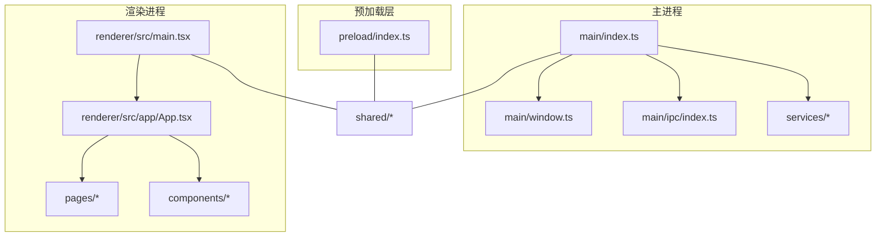
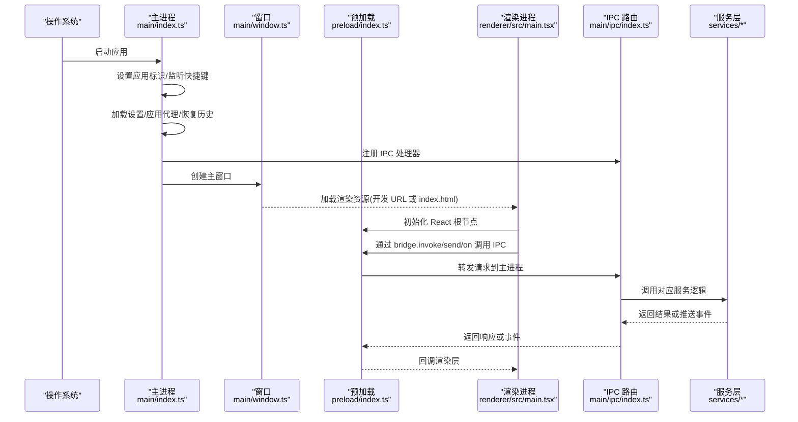
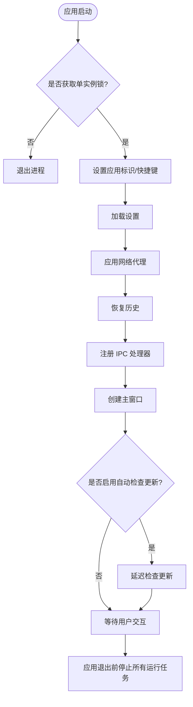
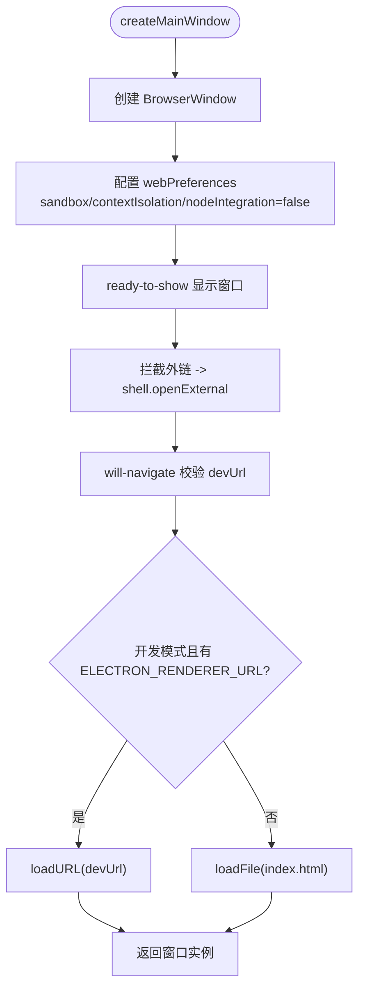
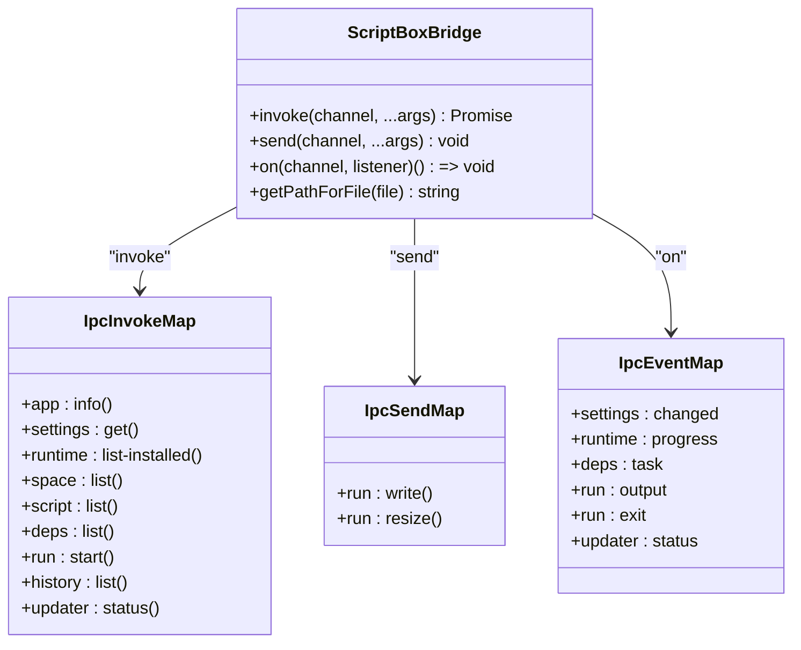
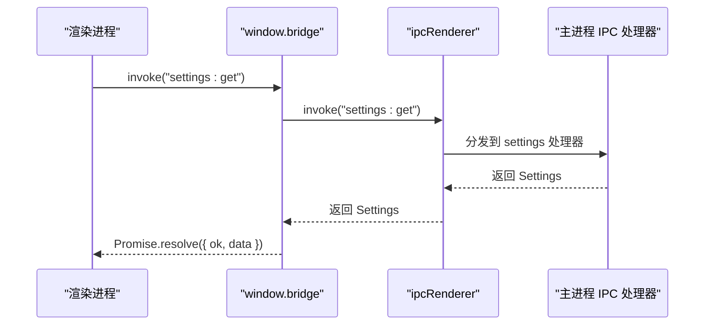
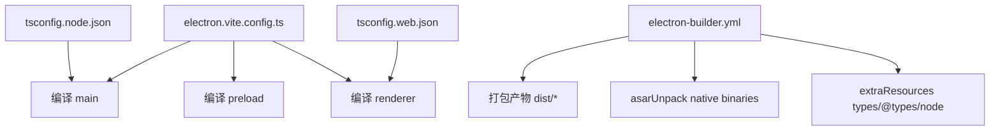
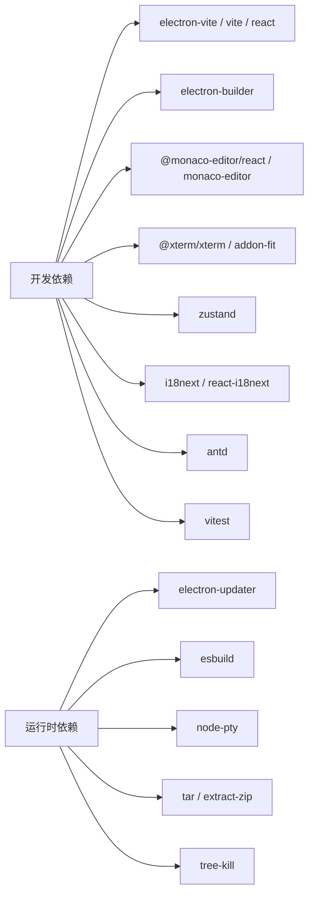

# 整体架构概览

<cite>
**本文引用的文件**   
- [package.json](file://package.json)
- [README.md](file://README.md)
- [electron.vite.config.ts](file://electron.vite.config.ts)
- [tsconfig.json](file://tsconfig.json)
- [tsconfig.node.json](file://tsconfig.node.json)
- [tsconfig.web.json](file://tsconfig.web.json)
- [electron-builder.yml](file://electron-builder.yml)
- [src/main/index.ts](file://src/main/index.ts)
- [src/main/window.ts](file://src/main/window.ts)
- [src/main/ipc/index.ts](file://src/main/ipc/index.ts)
- [src/preload/index.ts](file://src/preload/index.ts)
- [src/renderer/src/main.tsx](file://src/renderer/src/main.tsx)
- [src/shared/ipc.ts](file://src/shared/ipc.ts)
</cite>

## 目录
1. [引言](#引言)
2. [项目结构](#项目结构)
3. [核心组件](#核心组件)
4. [架构总览](#架构总览)
5. [详细组件分析](#详细组件分析)
6. [依赖关系分析](#依赖关系分析)
7. [性能与构建特性](#性能与构建特性)
8. [开发环境搭建指南](#开发环境搭建指南)
9. [常见问题与排错](#常见问题与排错)
10. [结论](#结论)

## 引言
Script Box 是一个基于 Electron + React 的桌面脚本运行器。它通过主进程管理系统能力、运行时环境与持久化数据，通过渲染进程提供基于 React 的用户界面，并通过预加载脚本在两者之间建立类型安全的 IPC 通道。应用支持多运行空间、多 Node.js 版本、交互式终端、依赖管理与自动更新等能力。

技术栈选择原因与优势：
- Electron 提供原生系统集成能力（窗口、文件系统、进程、网络代理、自动更新），适合构建跨平台桌面工具。
- React 提供声明式 UI 与生态丰富的组件库，便于构建复杂的编辑器、终端与设置界面。
- Vite/Electron-Vite 提供快速开发与构建体验，并分别为主进程、预加载脚本和渲染进程配置打包策略。
- TypeScript 保证主/渲染/预加载三端共享类型的类型安全，降低 IPC 调用出错概率。

**章节来源**
- [README.md:1-30](file://README.md#L1-L30)
- [package.json:1-30](file://package.json#L1-L30)

## 项目结构
仓库采用分层与领域混合的组织方式：
- src/shared：主进程与渲染进程共享的类型、IPC 通道定义与默认配置。
- src/main：Electron 主进程入口、窗口管理、IPC 路由与各领域服务（设置、网络、运行时、空间、脚本、依赖、运行器、更新）。
- src/preload：通过 contextBridge 暴露 window.bridge，封装 invoke/send/on 方法。
- src/renderer：React 应用，包含页面、组件、状态存储、国际化与主题。

**图表来源**
- [src/main/index.ts:1-55](file://src/main/index.ts#L1-L55)
- [src/main/window.ts:1-47](file://src/main/window.ts#L1-L47)
- [src/main/ipc/index.ts:1-20](file://src/main/ipc/index.ts#L1-L20)
- [src/preload/index.ts:1-19](file://src/preload/index.ts#L1-L19)
- [src/renderer/src/main.tsx:1-12](file://src/renderer/src/main.tsx#L1-L12)
- [src/shared/ipc.ts:1-117](file://src/shared/ipc.ts#L1-L117)

**章节来源**
- [README.md:78-86](file://README.md#L78-L86)
- [package.json:31-70](file://package.json#L31-L70)

## 核心组件
- 主进程入口：负责应用生命周期、单实例锁、代理初始化、历史恢复、IPC 注册、主窗口创建与自动更新检查。
- 窗口管理：创建 BrowserWindow，配置安全选项（沙箱、上下文隔离、禁用 Node 集成），处理外链打开与导航限制，区分开发/生产资源加载。
- IPC 路由：集中注册各模块的 IPC 处理器，包括应用信息、设置、运行时、空间、脚本、依赖、运行与历史记录、更新。
- 预加载桥：暴露 window.bridge，统一封装 invoke/send/on，并提供文件路径解析能力。
- 渲染入口：使用 React 19 创建根节点，挂载 App 组件，并初始化国际化与样式。

**章节来源**
- [src/main/index.ts:10-54](file://src/main/index.ts#L10-L54)
- [src/main/window.ts:6-45](file://src/main/window.ts#L6-L45)
- [src/main/ipc/index.ts:10-19](file://src/main/ipc/index.ts#L10-L19)
- [src/preload/index.ts:5-18](file://src/preload/index.ts#L5-L18)
- [src/renderer/src/main.tsx:7-11](file://src/renderer/src/main.tsx#L7-L11)

## 架构总览
下图展示应用启动与控制流：主进程引导 → 初始化设置与代理 → 恢复历史 → 注册 IPC → 创建主窗口 → 渲染进程挂载 React → 用户交互触发 IPC → 主进程调度服务 → 事件回推至渲染进程。

**图表来源**
- [src/main/index.ts:10-54](file://src/main/index.ts#L10-L54)
- [src/main/window.ts:6-45](file://src/main/window.ts#L6-L45)
- [src/preload/index.ts:5-18](file://src/preload/index.ts#L5-L18)
- [src/renderer/src/main.tsx:7-11](file://src/renderer/src/main.tsx#L7-L11)
- [src/main/ipc/index.ts:10-19](file://src/main/ipc/index.ts#L10-L19)

## 详细组件分析

### 主进程启动流程与 Bootstrap
- 单实例锁：确保仅一个应用实例运行；重复启动时聚焦已有窗口。
- 应用初始化：设置应用 ID，监听窗口快捷键。
- 设置与代理：从持久化存储加载设置，应用网络代理；失败时记录错误但不中断启动。
- 历史恢复：尝试恢复未完成的运行历史；失败时记录错误。
- IPC 注册：集中注册所有 IPC 处理器。
- 窗口创建：创建主窗口，并在 macOS 上处理 activate 事件。
- 自动更新：根据设置延迟检查更新。
- 退出清理：关闭所有运行中的脚本。

**图表来源**
- [src/main/index.ts:10-54](file://src/main/index.ts#L10-L54)

**章节来源**
- [src/main/index.ts:10-54](file://src/main/index.ts#L10-L54)

### 窗口创建与安全策略
- 窗口尺寸与主题背景：根据系统主题设置背景色，Linux 下设置图标。
- 安全选项：启用沙箱、上下文隔离，禁用 Node 集成，指定预加载脚本路径。
- 外链与导航：外部链接通过系统浏览器打开；阻止应用内非预期导航，开发模式下允许 dev URL。
- 资源加载：开发模式加载 dev server URL，生产模式加载打包后的 index.html。

**图表来源**
- [src/main/window.ts:6-45](file://src/main/window.ts#L6-L45)

**章节来源**
- [src/main/window.ts:6-45](file://src/main/window.ts#L6-L45)

### IPC 通道与类型契约
- 三类通道：
  - 请求/响应：renderer -> main，通过 ipcRenderer.invoke。
  - 单向发送：renderer -> main，通过 ipcRenderer.send。
  - 事件推送：main -> renderer，通过 ipcRenderer.on。
- 类型安全：通过 shared/ipc.ts 定义 IpcInvokeMap/IpcSendMap/IpcEventMap，预加载层暴露 ScriptBoxBridge，渲染层以类型约束调用。
- 错误包装：返回值统一为 { ok, data } 或 { ok, error }，避免 contextBridge 丢失自定义错误字段。

**图表来源**
- [src/shared/ipc.ts:25-116](file://src/shared/ipc.ts#L25-L116)

**章节来源**
- [src/shared/ipc.ts:25-116](file://src/shared/ipc.ts#L25-L116)

### 预加载桥与渲染层接入
- 预加载桥：封装 ipcRenderer.invoke/send/on，提供 on 方法的取消订阅函数；暴露 getPathForFile 用于 File 对象转路径。
- 渲染层接入：React 根节点挂载后，业务代码通过 window.bridge 进行 IPC 调用，保持类型安全与最小权限。

**图表来源**
- [src/preload/index.ts:5-18](file://src/preload/index.ts#L5-L18)
- [src/shared/ipc.ts:107-116](file://src/shared/ipc.ts#L107-L116)

**章节来源**
- [src/preload/index.ts:5-18](file://src/preload/index.ts#L5-L18)
- [src/renderer/src/main.tsx:7-11](file://src/renderer/src/main.tsx#L7-L11)

### 构建系统与打包配置
- electron-vite：分别配置 main、preload、renderer 的别名与插件；renderer 启用 React 插件与 ES worker 格式。
- TypeScript：
  - tsconfig.json 聚合 node/web 两个子配置。
  - tsconfig.node.json 面向主进程与预加载，扩展 @electron-toolkit/tsconfig，启用 composite、baseUrl、paths、types 与 noImplicitAny。
  - tsconfig.web.json 面向渲染进程，启用 jsx react-jsx，paths 指向 renderer 与 shared。
- electron-builder：
  - 产物输出目录 dist，排除源码与配置文件。
  - asarUnpack 保留 native 二进制（node-pty、esbuild）以便直接执行。
  - extraResources 将 @types/node 与 undici-types 打入 types 目录供编辑器离线提示。
  - 平台目标：Windows NSIS、macOS dmg/zip、Linux AppImage/deb。
  - npmRebuild 开启，publish 发布到 GitHub Releases。

**图表来源**
- [electron.vite.config.ts:1-31](file://electron.vite.config.ts#L1-L31)
- [tsconfig.json:1-8](file://tsconfig.json#L1-L8)
- [tsconfig.node.json:1-20](file://tsconfig.node.json#L1-L20)
- [tsconfig.web.json:1-21](file://tsconfig.web.json#L1-L21)
- [electron-builder.yml:1-74](file://electron-builder.yml#L1-L74)

**章节来源**
- [electron.vite.config.ts:1-31](file://electron.vite.config.ts#L1-L31)
- [tsconfig.json:1-8](file://tsconfig.json#L1-L8)
- [tsconfig.node.json:1-20](file://tsconfig.node.json#L1-L20)
- [tsconfig.web.json:1-21](file://tsconfig.web.json#L1-L21)
- [electron-builder.yml:1-74](file://electron-builder.yml#L1-L74)

## 依赖关系分析
- 运行时依赖：
  - electron-updater：自动更新。
  - esbuild：TS 转译。
  - node-pty：伪终端。
  - tar/extract-zip：解压运行时包。
  - tree-kill：终止子进程。
- 开发依赖：
  - electron-vite/vite/react：前端构建与热更新。
  - electron-builder：跨平台打包。
  - monaco-editor/@monaco-editor/react：内置编辑器。
  - xterm/xterm-addon-fit：终端组件。
  - zustand：状态管理。
  - i18next/react-i18next：国际化。
  - antd：UI 组件库。
  - vitest：单元测试。

**图表来源**
- [package.json:31-70](file://package.json#L31-L70)

**章节来源**
- [package.json:31-70](file://package.json#L31-L70)

## 性能与构建特性
- 构建性能：
  - Vite 提供快速 HMR，主/预加载/渲染分别构建，减少不必要重编译。
  - TypeScript 使用 composite 项目引用，提升增量编译效率。
- 运行时性能：
  - 主进程沙箱与上下文隔离，减少渲染进程对系统 API 的直接访问风险。
  - 原生二进制（node-pty、esbuild）通过 asarUnpack 避免在 asar 中执行的性能问题。
  - 共享 npm 缓存减少依赖安装时间。
- 可维护性：
  - shared 类型集中管理，IPC 调用具备强类型约束，降低运行时错误。
  - 模块化 IPC 注册，职责清晰，便于扩展与维护。

[本节为通用指导，不直接分析具体文件]

## 开发环境搭建指南
- 前置条件：Node.js >= 22，pnpm 10。
- 安装依赖：pnpm install（会自动为 Electron 重新编译 node-pty）。
- 开发模式：pnpm dev（启动 electron-vite dev server）。
- 类型检查：pnpm typecheck（同时检查 node 与 web 配置）。
- 测试：pnpm test（基于 vitest）。
- 构建与打包：
  - pnpm build：构建主/预加载/渲染产物。
  - pnpm build:linux / build:win / build:mac：构建并打包对应平台安装包。
- 国内镜像加速：
  - 设置 ELECTRON_MIRROR 环境变量后再安装 Electron。

**章节来源**
- [README.md:63-76](file://README.md#L63-L76)
- [package.json:15-29](file://package.json#L15-L29)

## 常见问题与排错
- 首次启动下载 Node.js 缓慢：
  - 在“设置”中启用“国内镜像”，或在安装阶段设置 ELECTRON_MIRROR。
- macOS 安装包签名问题：
  - 首次打开提示损坏时，在终端执行 xattr -cr "/Applications/Script Box.app"；无签名时自动更新可能不可用。
- 代理配置无效：
  - 确认设置中的 HTTP/HTTPS 代理已正确填写；主进程会在启动时应用代理，失败会记录错误日志。
- 运行时无法执行：
  - 确认 asarUnpack 保留了 node-pty 与 esbuild；生产构建由 electron-builder 处理。
- 编辑器缺少类型提示：
  - 确认 extraResources 已将 @types/node 与 undici-types 打入 types 目录；编辑器会本地加载这些声明。
- 单实例行为异常：
  - 检查 app.requestSingleInstanceLock 与 second-instance 事件处理逻辑是否正确。

**章节来源**
- [README.md:41-46](file://README.md#L41-L46)
- [src/main/index.ts:14-16](file://src/main/index.ts#L14-L16)
- [electron-builder.yml:18-23](file://electron-builder.yml#L18-L23)
- [electron-builder.yml:24-31](file://electron-builder.yml#L24-L31)

## 结论
Script Box 通过 Electron + React 的组合，将系统级能力与现代化前端体验结合，形成清晰的三层架构：主进程负责系统资源与服务编排，预加载层提供类型安全的 IPC 桥，渲染进程专注 UI 与交互。构建系统以 electron-vite 与 electron-builder 为核心，配合 TypeScript 多项目引用，实现高效开发与稳定打包。该架构具备良好的可扩展性与可维护性，适合持续迭代脚本运行器的功能与体验。