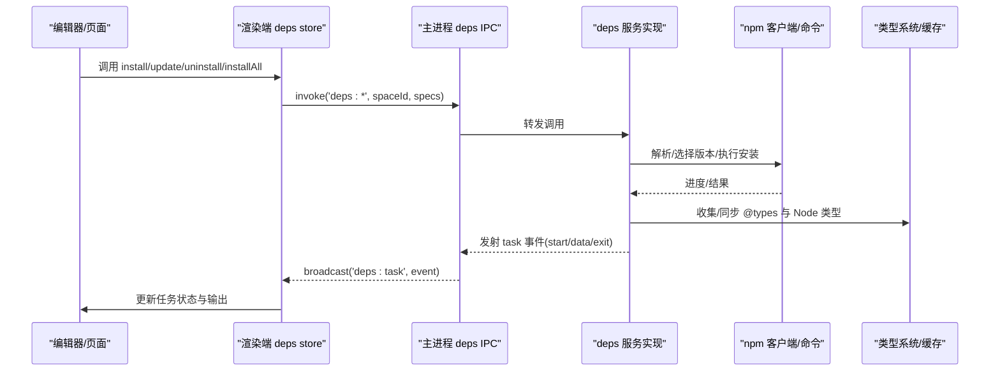
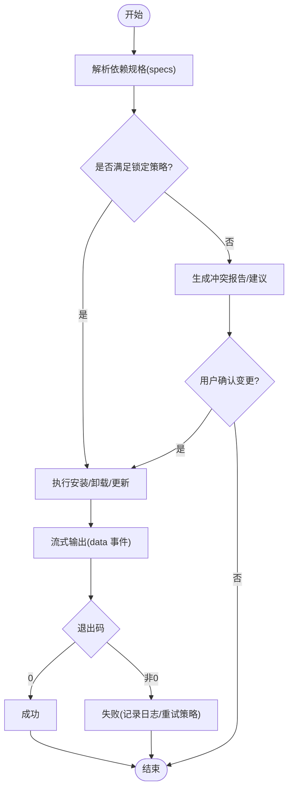
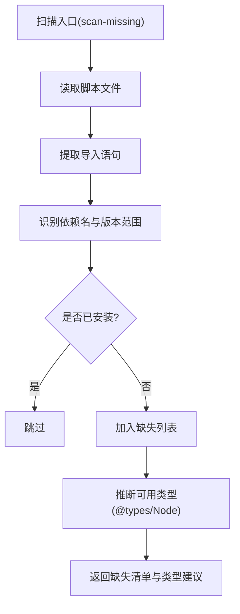
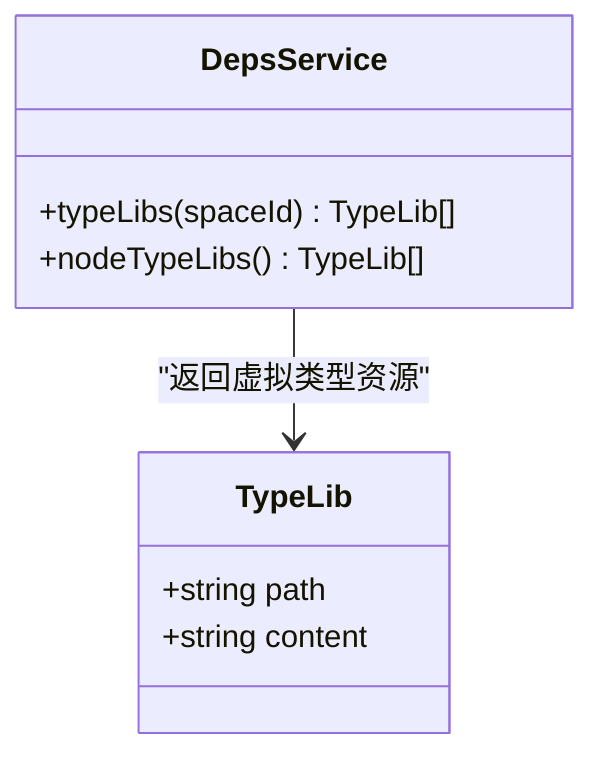
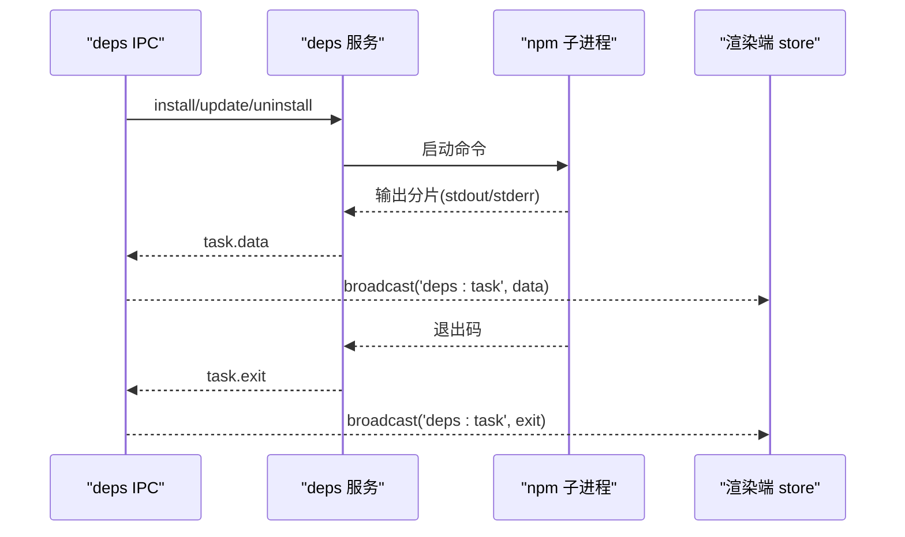
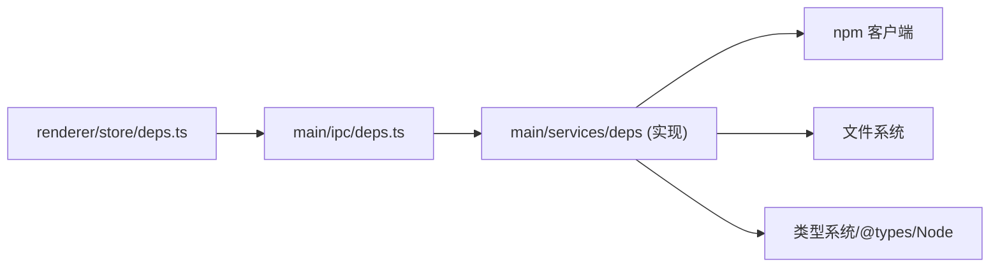

# Deps 服务（依赖管理）

<cite>
**本文引用的文件**   
- [src/main/ipc/deps.ts](file://src/main/ipc/deps.ts)
- [src/renderer/src/stores/deps.ts](file://src/renderer/src/stores/deps.ts)
- [src/shared/types/deps.ts](file://src/shared/types/deps.ts)
- [src/main/ipc/space.ts](file://src/main/ipc/space.ts)
</cite>

## 目录
1. [简介](#简介)
2. [项目结构](#项目结构)
3. [核心组件](#核心组件)
4. [架构总览](#架构总览)
5. [详细组件分析](#详细组件分析)
6. [依赖关系分析](#依赖关系分析)
7. [性能考虑](#性能考虑)
8. [故障排除指南](#故障排除指南)
9. [结论](#结论)

## 简介
本文件为 Script Box 的 Deps 服务提供完整技术文档，聚焦以下职责与能力：
- npm 包管理与依赖解析
- 类型定义注入（含 @types 包管理与 Node 类型库）
- 依赖安装流程（包解析、版本选择、安装执行、冲突解决）
- 依赖扫描机制（代码分析、依赖发现、类型推断）
- npm 集成（命令封装、进度跟踪、错误处理）
- 扩展接口、性能优化策略与故障排除

说明：当前仓库中 deps 服务的实现位于主进程侧 services/deps 目录，但该目录在索引阶段未返回具体文件。本文基于 IPC 层、渲染端状态存储与共享类型定义进行架构与行为分析，并给出可落地的实现建议与最佳实践。

## 项目结构
Deps 相关代码主要分布在以下位置：
- 主进程 IPC 路由：src/main/ipc/deps.ts
- 渲染端状态与事件订阅：src/renderer/src/stores/deps.ts
- 共享类型定义：src/shared/types/deps.ts
- 空间生命周期中的忙闲检查：src/main/ipc/space.ts

```mermaid
graph TB
subgraph "渲染进程"
R_Store["deps.ts<br/>任务状态与事件监听"]
end
subgraph "主进程"
M_IPC["deps.ts<br/>IPC 路由与广播"]
S_Deps["services/deps<br/>依赖服务实现待补充"]
S_Space["space.ts<br/>空间忙闲检查"]
end
R_Store --> |invoke('deps:*')| M_IPC
M_IPC --> |调用| S_Deps
S_Deps --> |task 事件| M_IPC
M_IPC --> |broadcast('deps:task')| R_Store
S_Space --> |isBusy/active| S_Deps
```

图表来源
- [src/main/ipc/deps.ts:4-16](file://src/main/ipc/deps.ts#L4-L16)
- [src/renderer/src/stores/deps.ts:27-64](file://src/renderer/src/stores/deps.ts#L27-L64)
- [src/main/ipc/space.ts:16-16](file://src/main/ipc/space.ts#L16-L16)

章节来源
- [src/main/ipc/deps.ts:1-17](file://src/main/ipc/deps.ts#L1-L17)
- [src/renderer/src/stores/deps.ts:1-65](file://src/renderer/src/stores/deps.ts#L1-L65)
- [src/shared/types/deps.ts:1-30](file://src/shared/types/deps.ts#L1-L30)
- [src/main/ipc/space.ts:1-20](file://src/main/ipc/space.ts#L1-L20)

## 核心组件
- 共享类型模型
  - DependencyInfo：描述包的 wanted/installed/dev 等元信息
  - DepTask/DepTaskEvent：描述安装/卸载/更新/全量安装的任务与事件流
  - TypeLib：虚拟路径与内容，用于类型注入
- IPC 路由层
  - 暴露 list/install/uninstall/update/install-all/cancel/active/scan-missing/types/node-types 等接口
  - 将服务端的 task 事件广播到渲染端
- 渲染端状态层
  - 维护每个 spaceId 的最新任务会话（chunks、exitCode、done）
  - 监听 deps:task 事件，增量拼接输出，并在结束时刷新 revision 以触发 UI 刷新
- 空间集成
  - 在创建或切换空间时，若 runner 或 deps 服务繁忙则阻止操作

章节来源
- [src/shared/types/deps.ts:1-30](file://src/shared/types/deps.ts#L1-L30)
- [src/main/ipc/deps.ts:4-16](file://src/main/ipc/deps.ts#L4-L16)
- [src/renderer/src/stores/deps.ts:27-64](file://src/renderer/src/stores/deps.ts#L27-L64)
- [src/main/ipc/space.ts:16-16](file://src/main/ipc/space.ts#L16-L16)

## 架构总览
Deps 服务采用“渲染端发起 -> 主进程 IPC -> 服务实现 -> 事件回推”的分层架构。渲染端通过 Zustand store 统一调度任务，主进程负责与 npm 生态交互、类型系统对接以及并发控制。



图表来源
- [src/main/ipc/deps.ts:4-16](file://src/main/ipc/deps.ts#L4-L16)
- [src/renderer/src/stores/deps.ts:27-64](file://src/renderer/src/stores/deps.ts#L27-L64)
- [src/shared/types/deps.ts:10-29](file://src/shared/types/deps.ts#L10-L29)

## 详细组件分析

### 依赖安装流程
- 包解析与版本选择
  - 根据 spec 列表与 package.json 约束，解析语义化版本范围
  - 结合 lock 文件与缓存策略确定最终版本
- 安装执行
  - 调用 npm 命令执行安装/卸载/更新
  - 实时回传 data 事件（stdout/stderr），支持中断 cancel
- 冲突解决
  - 当存在版本冲突时，优先遵循 workspace/lock 策略
  - 必要时提示用户手动调整依赖声明



[该图为概念流程图，不直接映射具体源码文件]

章节来源
- [src/main/ipc/deps.ts:4-16](file://src/main/ipc/deps.ts#L4-L16)
- [src/renderer/src/stores/deps.ts:47-64](file://src/renderer/src/stores/deps.ts#L47-L64)
- [src/shared/types/deps.ts:10-23](file://src/shared/types/deps.ts#L10-L23)

### 依赖扫描机制
- 代码分析
  - 对脚本文件进行静态分析，提取 import/require 语句
- 依赖发现
  - 识别缺失依赖，生成 scan-missing 结果
- 类型推断
  - 结合已安装的 @types 包与 Node 类型，推断可用类型资源



[该图为概念流程图，不直接映射具体源码文件]

章节来源
- [src/main/ipc/deps.ts:12-12](file://src/main/ipc/deps.ts#L12-L12)
- [src/shared/types/deps.ts:1-8](file://src/shared/types/deps.ts#L1-L8)

### 类型定义管理
- @types 包管理
  - 根据运行时语言与目标环境，自动关联对应 @types 包
- 类型缓存
  - 对类型内容进行缓存，避免重复解析与 IO
- 版本同步
  - 与依赖版本保持同步，确保类型与运行时代码一致
- Node 类型注入
  - 提供 nodeTypeLibs 接口，注入 Node 内置类型



图表来源
- [src/shared/types/deps.ts:25-29](file://src/shared/types/deps.ts#L25-L29)
- [src/main/ipc/deps.ts:13-14](file://src/main/ipc/deps.ts#L13-L14)

章节来源
- [src/shared/types/deps.ts:25-29](file://src/shared/types/deps.ts#L25-L29)
- [src/main/ipc/deps.ts:13-14](file://src/main/ipc/deps.ts#L13-L14)

### npm 集成
- 命令封装
  - 封装 npm/pnpm/yarn 命令，统一参数与返回值
- 进度跟踪
  - 将 stdout/stderr 分段推送为 data 事件
- 错误处理
  - 捕获异常并转换为 exit 事件，附带退出码与日志片段



图表来源
- [src/main/ipc/deps.ts:4-16](file://src/main/ipc/deps.ts#L4-L16)
- [src/renderer/src/stores/deps.ts:47-64](file://src/renderer/src/stores/deps.ts#L47-L64)

章节来源
- [src/main/ipc/deps.ts:4-16](file://src/main/ipc/deps.ts#L4-L16)
- [src/renderer/src/stores/deps.ts:47-64](file://src/renderer/src/stores/deps.ts#L47-L64)

### 服务扩展接口
- 新增任务类型
  - 在 DepTaskKind 中添加新枚举值，并在 IPC 层注册对应路由
- 自定义类型提供者
  - 扩展 typeLibs 方法，接入第三方类型源
- 钩子与事件
  - 在关键阶段（解析/安装/完成）发射自定义事件，供外部监听

章节来源
- [src/shared/types/deps.ts:10-18](file://src/shared/types/deps.ts#L10-L18)
- [src/main/ipc/deps.ts:4-16](file://src/main/ipc/deps.ts#L4-L16)

## 依赖关系分析
- 模块耦合
  - IPC 层仅作为路由与广播，低耦合于服务实现
  - 渲染端 store 仅依赖 IPC 与共享类型，便于测试与替换
- 外部依赖
  - npm 客户端（命令执行）
  - 文件系统（package.json、node_modules、类型缓存）
  - 类型系统（@types、Node 类型）



图表来源
- [src/renderer/src/stores/deps.ts:27-64](file://src/renderer/src/stores/deps.ts#L27-L64)
- [src/main/ipc/deps.ts:4-16](file://src/main/ipc/deps.ts#L4-L16)

章节来源
- [src/renderer/src/stores/deps.ts:1-65](file://src/renderer/src/stores/deps.ts#L1-L65)
- [src/main/ipc/deps.ts:1-17](file://src/main/ipc/deps.ts#L1-L17)

## 性能考虑
- 并发控制
  - 同一 spaceId 下串行执行任务，避免并行安装导致锁竞争
- 增量更新
  - 使用 lock 文件与缓存减少网络请求与磁盘 IO
- 类型缓存
  - 对 TypeLib 内容做哈希缓存，避免重复解析
- 流式输出
  - 大输出按分片推送，降低内存占用与渲染压力
- 空闲检测
  - 在空间切换/创建时检查 isBusy，避免阻塞用户操作

章节来源
- [src/main/ipc/space.ts:16-16](file://src/main/ipc/space.ts#L16-L16)
- [src/renderer/src/stores/deps.ts:47-64](file://src/renderer/src/stores/deps.ts#L47-L64)

## 故障排除指南
- 常见问题
  - 安装失败：检查退出码与 data 日志片段，定位网络或权限问题
  - 类型缺失：确认 @types 包是否安装且版本匹配
  - 任务卡住：调用 cancel 取消任务，清理残留进程
- 诊断步骤
  - 查看 active 任务列表，确认是否存在冲突任务
  - 使用 scan-missing 获取缺失依赖清单
  - 校验 types 接口返回的 TypeLib 列表是否包含预期类型
- 恢复策略
  - 清理缓存后重试
  - 降级依赖版本或调整约束范围

章节来源
- [src/main/ipc/deps.ts:10-14](file://src/main/ipc/deps.ts#L10-L14)
- [src/renderer/src/stores/deps.ts:47-64](file://src/renderer/src/stores/deps.ts#L47-L64)

## 结论
Deps 服务通过清晰的 IPC 分层与渲染端状态管理，提供了完整的 npm 依赖管理与类型注入能力。其设计强调可扩展性、可观测性与性能优化，适合在复杂脚本环境中稳定运行。建议在实现 services/deps 时严格遵循本文的流程与规范，以确保与现有 IPC 与 UI 层的无缝协作。