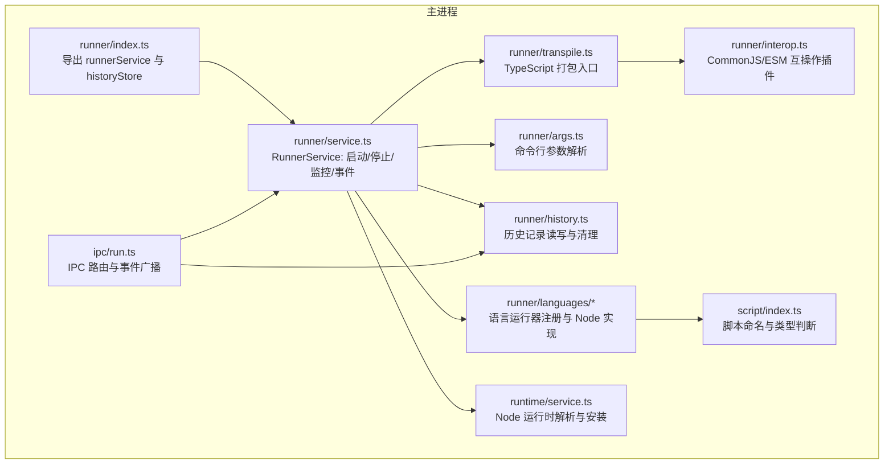
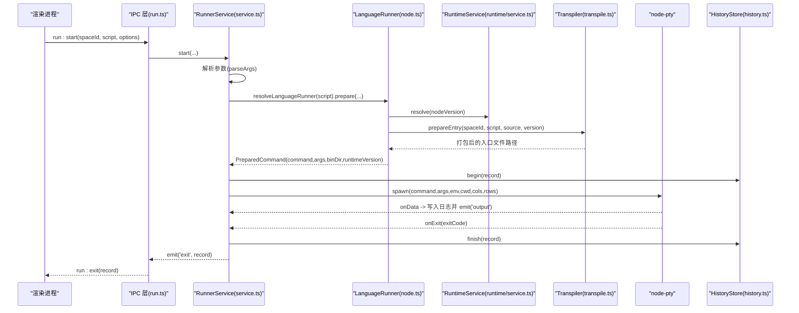
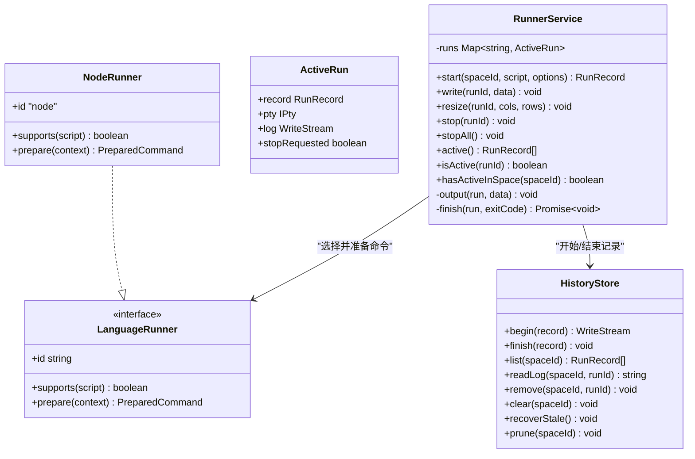
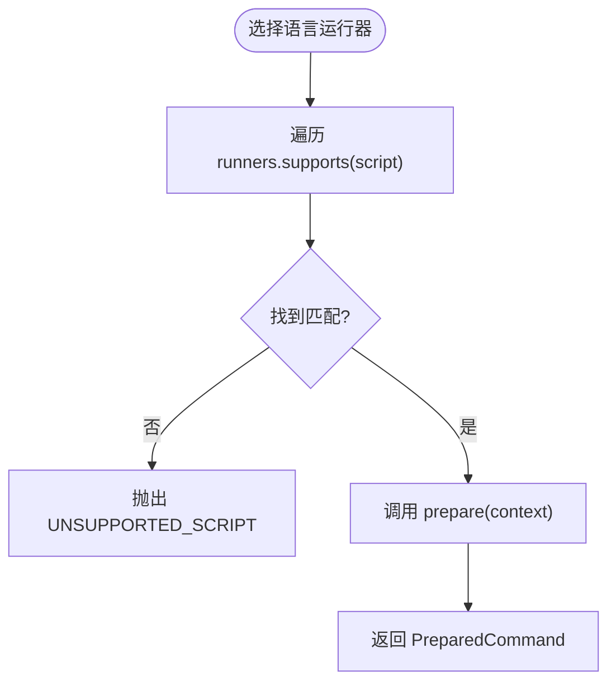
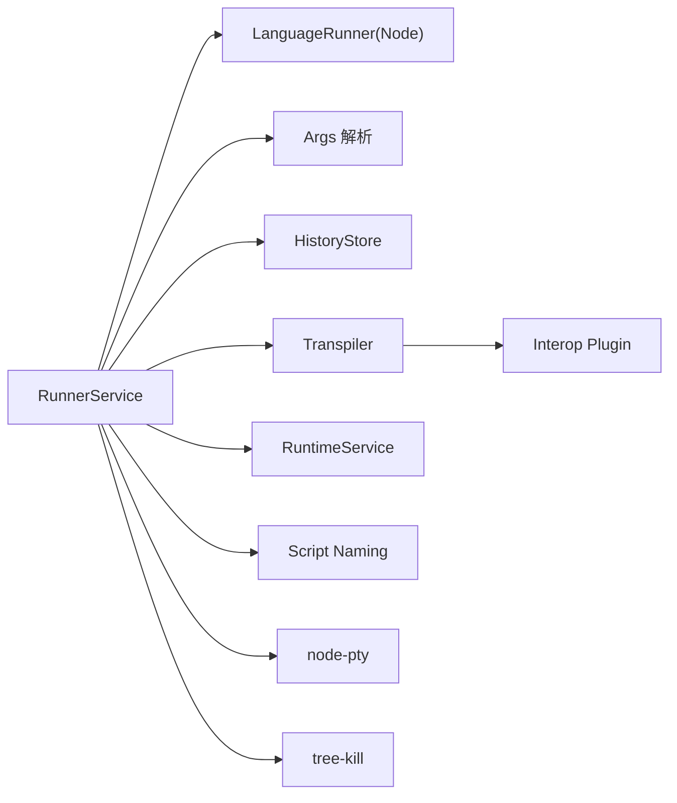

# Runner 服务（脚本运行器）

<cite>
**本文引用的文件**   
- [src/main/services/runner/index.ts](file://src/main/services/runner/index.ts)
- [src/main/services/runner/service.ts](file://src/main/services/runner/service.ts)
- [src/main/services/runner/languages/index.ts](file://src/main/services/runner/languages/index.ts)
- [src/main/services/runner/languages/types.ts](file://src/main/services/runner/languages/types.ts)
- [src/main/services/runner/languages/node.ts](file://src/main/services/runner/languages/node.ts)
- [src/main/services/runner/args.ts](file://src/main/services/runner/args.ts)
- [src/main/services/runner/history.ts](file://src/main/services/runner/history.ts)
- [src/main/services/runner/transpile.ts](file://src/main/services/runner/transpile.ts)
- [src/main/services/runner/interop.ts](file://src/main/services/runner/interop.ts)
- [src/main/ipc/run.ts](file://src/main/ipc/run.ts)
- [src/shared/types/run.ts](file://src/shared/types/run.ts)
- [src/main/services/runtime/service.ts](file://src/main/services/runtime/service.ts)
- [src/main/services/script/index.ts](file://src/main/services/script/index.ts)
</cite>

## 目录
1. [简介](#简介)
2. [项目结构](#项目结构)
3. [核心组件](#核心组件)
4. [架构总览](#架构总览)
5. [详细组件分析](#详细组件分析)
6. [依赖关系分析](#依赖关系分析)
7. [性能与扩展性](#性能与扩展性)
8. [故障排查指南](#故障排查指南)
9. [结论](#结论)

## 简介
Runner 服务是 Script Box 的主进程脚本执行引擎，负责：
- 解析脚本参数、构建运行环境、选择语言运行器
- 创建并管理终端进程（PTY），处理实时输出、标准输入和窗口大小调整
- 并发管理多个脚本任务，提供优雅退出与信号处理
- 持久化运行历史、状态跟踪与基础性能统计
- 通过 IPC 暴露运行控制接口，供渲染进程调用

该文档面向希望理解或扩展 Runner 服务的开发者，既包含高层架构说明，也深入到关键实现细节。

## 项目结构
Runner 相关代码集中在主进程的 services/runner 目录，并通过 ipc/run.ts 向渲染进程暴露 API。

图表来源
- [src/main/services/runner/index.ts:1-3](file://src/main/services/runner/index.ts#L1-L3)
- [src/main/services/runner/service.ts:1-147](file://src/main/services/runner/service.ts#L1-L147)
- [src/main/services/runner/languages/index.ts:1-15](file://src/main/services/runner/languages/index.ts#L1-L15)
- [src/main/services/runner/languages/node.ts:1-20](file://src/main/services/runner/languages/node.ts#L1-L20)
- [src/main/services/runner/args.ts:1-49](file://src/main/services/runner/args.ts#L1-L49)
- [src/main/services/runner/history.ts:1-94](file://src/main/services/runner/history.ts#L1-L94)
- [src/main/services/runner/transpile.ts:1-67](file://src/main/services/runner/transpile.ts#L1-L67)
- [src/main/services/runner/interop.ts:1-71](file://src/main/services/runner/interop.ts#L1-L71)
- [src/main/ipc/run.ts:1-19](file://src/main/ipc/run.ts#L1-L19)
- [src/main/services/runtime/service.ts:1-155](file://src/main/services/runtime/service.ts#L1-L155)
- [src/main/services/script/index.ts:1-3](file://src/main/services/script/index.ts#L1-L3)

章节来源
- [src/main/services/runner/index.ts:1-3](file://src/main/services/runner/index.ts#L1-L3)
- [src/main/ipc/run.ts:1-19](file://src/main/ipc/run.ts#L1-L19)

## 核心组件
- RunnerService：脚本执行生命周期管理、PTY 进程控制、事件广播、并发任务表
- LanguageRunner 抽象与 Node 实现：根据脚本名选择运行器，准备命令与环境
- Args 解析器：支持引号与转义的命令行参数拆分
- HistoryStore：运行记录元数据与日志持久化、裁剪与恢复
- Transpiler：TypeScript 到 JS 的打包与路径注入
- Interop 插件：CommonJS/ESM 互操作，兼容 require/import
- RuntimeService：Node 版本解析与安装（被 Runner 间接使用）
- IPC 层：run:start/stop/active/write/resize 等接口与事件转发

章节来源
- [src/main/services/runner/service.ts:1-147](file://src/main/services/runner/service.ts#L1-L147)
- [src/main/services/runner/languages/types.ts:1-26](file://src/main/services/runner/languages/types.ts#L1-L26)
- [src/main/services/runner/languages/node.ts:1-20](file://src/main/services/runner/languages/node.ts#L1-L20)
- [src/main/services/runner/args.ts:1-49](file://src/main/services/runner/args.ts#L1-L49)
- [src/main/services/runner/history.ts:1-94](file://src/main/services/runner/history.ts#L1-L94)
- [src/main/services/runner/transpile.ts:1-67](file://src/main/services/runner/transpile.ts#L1-L67)
- [src/main/services/runner/interop.ts:1-71](file://src/main/services/runner/interop.ts#L1-L71)
- [src/main/services/runtime/service.ts:1-155](file://src/main/services/runtime/service.ts#L1-L155)
- [src/main/ipc/run.ts:1-19](file://src/main/ipc/run.ts#L1-L19)

## 架构总览
Runner 服务作为“脚本执行中枢”，协调参数解析、环境构建、语言运行器选择、PTY 进程创建与监控，并将输出与退出事件广播给前端。

图表来源
- [src/main/ipc/run.ts:1-19](file://src/main/ipc/run.ts#L1-L19)
- [src/main/services/runner/service.ts:44-88](file://src/main/services/runner/service.ts#L44-L88)
- [src/main/services/runner/languages/node.ts:6-19](file://src/main/services/runner/languages/node.ts#L6-L19)
- [src/main/services/runner/transpile.ts:18-66](file://src/main/services/runner/transpile.ts#L18-L66)
- [src/main/services/runtime/service.ts:74-81](file://src/main/services/runtime/service.ts#L74-L81)
- [src/main/services/runner/history.ts:18-28](file://src/main/services/runner/history.ts#L18-L28)

## 详细组件分析

### RunnerService：脚本执行引擎与进程管理
- 职责
  - 维护活跃运行任务 Map，支持 active()/isActive()/hasActiveInSpace()
  - start() 完成脚本校验、参数解析、语言运行器准备、环境变量构建、PTY 创建与事件绑定
  - write()/resize() 提供标准输入与终端尺寸调整
  - stop()/stopAll() 优雅终止，Windows 直接 kill，其他平台先 SIGTERM，再 3s 后 SIGKILL
  - output()/finish() 统一输出与结束逻辑，更新记录状态、计算耗时、持久化历史、触发 exit 事件
- 并发模型
  - 基于内存 Map 的多任务并发，按 runId 隔离
- 终端交互
  - 使用 node-pty 创建 xterm-256color 终端，支持颜色输出
  - onData 回调将输出同时写入日志流并广播
- 错误与健壮性
  - 脚本不存在抛出应用错误
  - 历史保存失败仅记录日志，不中断正常流程
  - 进程退出时根据 stopRequested 区分用户主动停止与异常退出

图表来源
- [src/main/services/runner/service.ts:20-147](file://src/main/services/runner/service.ts#L20-L147)
- [src/main/services/runner/languages/types.ts:1-26](file://src/main/services/runner/languages/types.ts#L1-L26)
- [src/main/services/runner/languages/node.ts:1-20](file://src/main/services/runner/languages/node.ts#L1-L20)
- [src/main/services/runner/history.ts:1-94](file://src/main/services/runner/history.ts#L1-L94)

章节来源
- [src/main/services/runner/service.ts:20-147](file://src/main/services/runner/service.ts#L20-L147)

### 语言运行器体系：可扩展的语言支持
- 设计要点
  - LanguageRunner 定义统一的 supports()/prepare() 接口
  - languages/index.ts 维护 runners 列表，resolveLanguageRunner() 按脚本名匹配
  - 当前内置 NodeRunner，支持 .js/.ts/.mjs/.cts 等脚本
- 扩展方式
  - 新增语言只需实现 LanguageRunner 接口，并在 runners 数组中注册
  - prepare() 返回 command/args/binDir/runtimeVersion，由 RunnerService 统一创建进程

图表来源
- [src/main/services/runner/languages/index.ts:1-15](file://src/main/services/runner/languages/index.ts#L1-L15)
- [src/main/services/runner/languages/types.ts:1-26](file://src/main/services/runner/languages/types.ts#L1-L26)
- [src/main/services/runner/languages/node.ts:1-20](file://src/main/services/runner/languages/node.ts#L1-L20)

章节来源
- [src/main/services/runner/languages/index.ts:1-15](file://src/main/services/runner/languages/index.ts#L1-L15)
- [src/main/services/runner/languages/types.ts:1-26](file://src/main/services/runner/languages/types.ts#L1-L26)
- [src/main/services/runner/languages/node.ts:1-20](file://src/main/services/runner/languages/node.ts#L1-L20)

### 参数解析：安全可靠的命令行拆分
- 功能特性
  - 支持单引号/双引号包裹的参数
  - 支持反斜杠转义（POSIX 风格，无变量展开）
  - 逐字符扫描，时间复杂度 O(n)，空间复杂度 O(k)（k 为参数个数）
- 适用场景
  - 从脚本配置 args 字段解析用户输入的命令行参数

章节来源
- [src/main/services/runner/args.ts:1-49](file://src/main/services/runner/args.ts#L1-L49)

### 历史存储：日志持久化、状态跟踪与清理
- 能力
  - begin(): 初始化记录元数据与日志流
  - finish(): 写回最终状态，触发 prune 清理
  - list/readLog/remove/clear/recoverStale/prune
- 策略
  - 大日志只读取尾部 MAX_LOG_READ 字节，避免阻塞
  - 启动恢复 stale 记录为 stopped，防止崩溃残留
  - 基于 settings.run.historyLimit 裁剪历史

章节来源
- [src/main/services/runner/history.ts:1-94](file://src/main/services/runner/history.ts#L1-L94)

### TypeScript 打包与路径注入
- 目标
  - 将 TS 脚本打包为 .mjs 或 .cjs，保留 __dirname/__filename/import.meta.url 语义
  - 对 ESM 输出注入全局 require，兼容混合模块写法
- 关键点
  - 使用 esbuild 进行打包，target 对齐 Node 主版本
  - 通过 interop 插件解决 CommonJS 包在 ESM 下的 named import 问题
  - 打包失败抛出 BUILD_FAILED，附带编译错误信息

章节来源
- [src/main/services/runner/transpile.ts:1-67](file://src/main/services/runner/transpile.ts#L1-L67)
- [src/main/services/runner/interop.ts:1-71](file://src/main/services/runner/interop.ts#L1-L71)

### IPC 接口与事件广播
- 控制接口
  - run:start / run:stop / run:active
  - run:write / run:resize
- 历史接口
  - history:list / history:log / history:remove / history:clear
- 事件
  - run:output（实时输出）
  - run:exit（进程退出）

章节来源
- [src/main/ipc/run.ts:1-19](file://src/main/ipc/run.ts#L1-L19)

### 数据类型契约
- RunRecord：运行记录（id/spaceId/script/args/nodeVersion/startedAt/endedAt/exitCode/status）
- RunStartOptions：PTY 初始行列数
- RunOutputEvent/RunExitEvent：输出与退出事件载荷

章节来源
- [src/shared/types/run.ts:1-28](file://src/shared/types/run.ts#L1-L28)

## 依赖关系分析
Runner 服务依赖以下子系统：
- runtime/service.ts：解析 Node 运行时路径与版本
- script/index.ts：脚本命名规则与类型判断
- history.ts：历史持久化
- transpile.ts/interop.ts：TS 打包与模块互操作
- node-pty：PTY 进程与终端交互
- tree-kill：跨平台优雅终止

图表来源
- [src/main/services/runner/service.ts:1-147](file://src/main/services/runner/service.ts#L1-L147)
- [src/main/services/runner/languages/node.ts:1-20](file://src/main/services/runner/languages/node.ts#L1-L20)
- [src/main/services/runner/transpile.ts:1-67](file://src/main/services/runner/transpile.ts#L1-L67)
- [src/main/services/runner/interop.ts:1-71](file://src/main/services/runner/interop.ts#L1-L71)
- [src/main/services/runtime/service.ts:1-155](file://src/main/services/runtime/service.ts#L1-L155)
- [src/main/services/script/index.ts:1-3](file://src/main/services/script/index.ts#L1-L3)

章节来源
- [src/main/services/runner/service.ts:1-147](file://src/main/services/runner/service.ts#L1-L147)

## 性能与扩展性

### 性能特征与优化建议
- 多任务并发
  - 使用内存 Map 管理活跃任务，查询与插入均为 O(1)
  - 建议限制同空间并发数量，避免资源争用
- 日志 IO
  - 采用追加写模式，避免频繁刷新；读取大日志时仅取尾部
  - 建议开启异步写入缓冲，减少主线程阻塞
- 打包阶段
  - TypeScript 仅在首次或变更时打包；可引入增量构建或缓存策略
  - 合理设置 esbuild target，避免不必要的 polyfill
- 进程终止
  - 优雅终止优先 SIGTERM，超时强制 SIGKILL，避免僵尸进程
  - Windows 下直接 kill，避免信号差异导致的不一致行为

### 扩展机制：新语言支持与自定义处理器
- 新增语言步骤
  - 实现 LanguageRunner 接口（id/supports/prepare）
  - 在 languages/index.ts 的 runners 数组中注册
  - 若需要打包或预处理，可在 prepare() 中调用 transpile 或其他工具
- 自定义处理器
  - 可通过扩展 prepare() 注入额外环境变量、工作目录或前置命令
  - 结合 runtime/service.ts 管理不同语言的运行时版本

章节来源
- [src/main/services/runner/languages/types.ts:1-26](file://src/main/services/runner/languages/types.ts#L1-L26)
- [src/main/services/runner/languages/index.ts:1-15](file://src/main/services/runner/languages/index.ts#L1-L15)
- [src/main/services/runner/transpile.ts:1-67](file://src/main/services/runner/transpile.ts#L1-L67)

## 故障排查指南

### 常见问题与定位
- 脚本未找到
  - 现象：启动时报 SCRIPT_NOT_FOUND
  - 排查：确认 spaceId 与 script 名称是否正确，路径是否可访问
- 不支持的脚本类型
  - 现象：启动时报 UNSUPPORTED_SCRIPT
  - 排查：检查脚本后缀是否在支持的运行器范围内
- 构建失败
  - 现象：TypeScript 打包报错 BUILD_FAILED
  - 排查：查看错误堆栈中的行号与列号，修正语法或依赖
- 运行时未安装
  - 现象：resolve 时报 RUNTIME_NOT_INSTALLED
  - 排查：通过 runtimeService 安装对应 Node 版本
- 历史损坏或残留
  - 现象：存在 running 状态的旧记录
  - 处理：调用 recoverStale() 修复，必要时手动清理

### 调试技巧
- 启用颜色输出
  - 已设置 FORCE_COLOR=1 与 COLORTERM=truecolor，确保终端支持 truecolor
- 观察实时输出
  - 监听 run:output 事件，过滤特定 runId 的输出
- 验证参数解析
  - 使用 parseArgs 测试复杂参数组合，确保引号与转义符合预期
- 进程终止验证
  - 在 stop() 后检查进程树，确认 SIGTERM/SIGKILL 生效

章节来源
- [src/main/services/runner/service.ts:44-147](file://src/main/services/runner/service.ts#L44-L147)
- [src/main/services/runner/transpile.ts:58-66](file://src/main/services/runner/transpile.ts#L58-L66)
- [src/main/services/runner/history.ts:73-92](file://src/main/services/runner/history.ts#L73-L92)

## 结论
Runner 服务以 RunnerService 为核心，串联参数解析、语言运行器选择、环境构建、PTY 进程管理与历史持久化，形成稳定且可扩展的脚本执行引擎。其模块化设计便于新增语言支持，事件驱动与 IPC 集成使前后端协作顺畅。通过合理的并发控制、日志策略与优雅终止机制，Runner 能够在多任务环境下保持高可用性与可观测性。