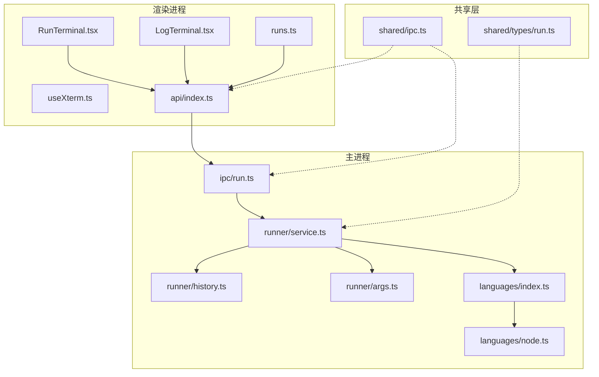
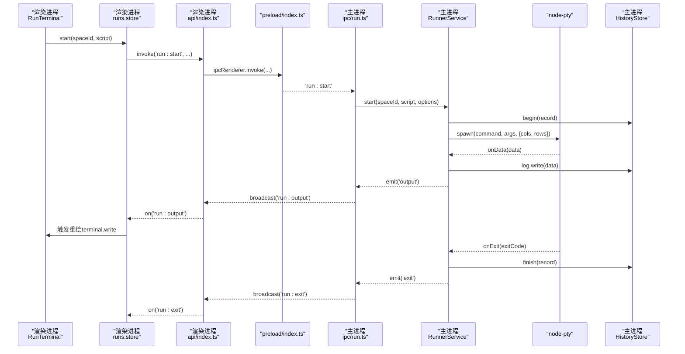
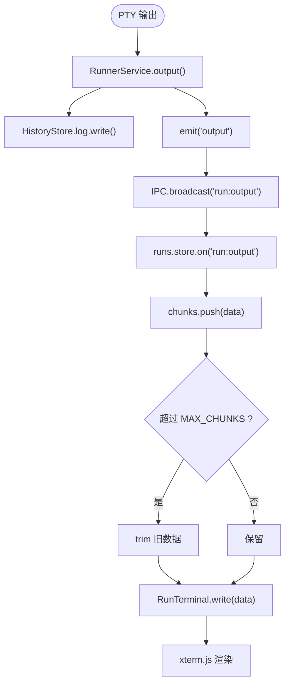
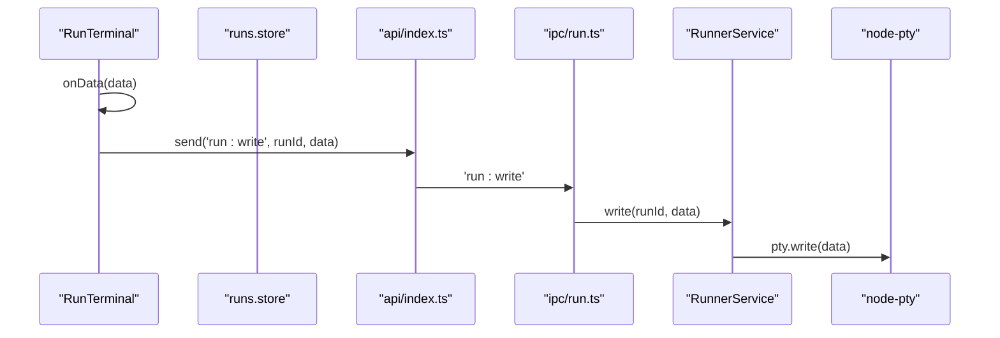
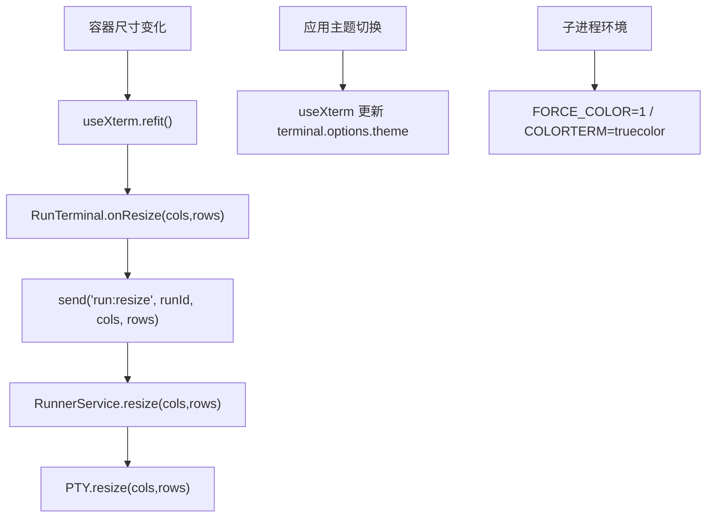
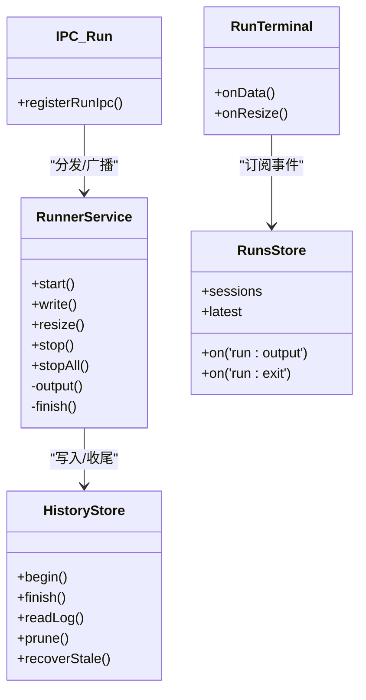
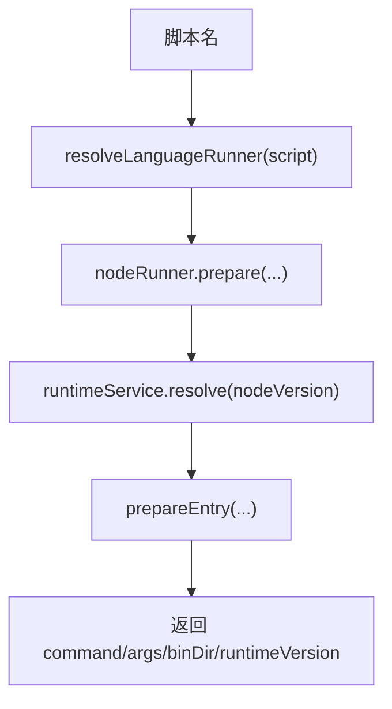
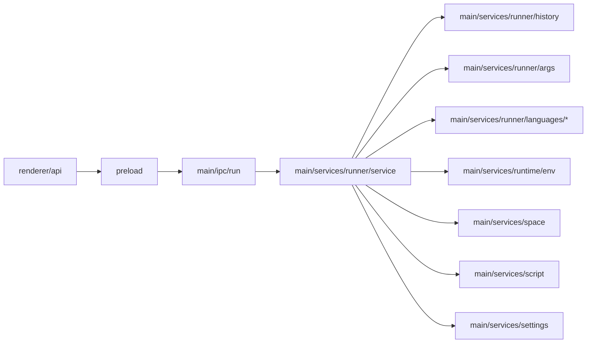

# 终端交互系统

<cite>
**本文引用的文件**   
- [service.ts](file://src/main/services/runner/service.ts)
- [run.ts](file://src/main/ipc/run.ts)
- [index.ts](file://src/main/services/runner/index.ts)
- [args.ts](file://src/main/services/runner/args.ts)
- [history.ts](file://src/main/services/runner/history.ts)
- [node.ts](file://src/main/services/runner/languages/node.ts)
- [index.ts](file://src/main/services/runner/languages/index.ts)
- [useXterm.ts](file://src/renderer/src/components/terminal/useXterm.ts)
- [RunTerminal.tsx](file://src/renderer/src/components/terminal/RunTerminal.tsx)
- [LogTerminal.tsx](file://src/renderer/src/components/terminal/LogTerminal.tsx)
- [runs.ts](file://src/renderer/src/stores/runs.ts)
- [index.ts](file://src/renderer/src/api/index.ts)
- [index.ts](file://src/preload/index.ts)
- [ipc.ts](file://src/shared/ipc.ts)
- [run.ts](file://src/shared/types/run.ts)
</cite>

## 目录
1. [简介](#简介)
2. [项目结构](#项目结构)
3. [核心组件](#核心组件)
4. [架构总览](#架构总览)
5. [详细组件分析](#详细组件分析)
6. [依赖关系分析](#依赖关系分析)
7. [性能考虑](#性能考虑)
8. [故障排查指南](#故障排查指南)
9. [结论](#结论)
10. [附录](#附录)

## 简介
本文件面向 Runner 服务的终端交互子系统，系统性阐述以下方面：
- 实时输出处理：数据流监听、缓冲区管理、渲染优化
- 标准输入处理：用户输入捕获、命令解析、管道传输
- 终端属性管理：窗口大小调整、颜色支持、字符编码处理
- 事件驱动架构：数据事件、退出事件、错误事件的统一处理
- 性能优化策略：大数据量处理、内存管理、异步 I/O 优化
- 终端仿真兼容性与调试工具使用指南

该子系统由主进程（Node.js + node-pty）与渲染进程（xterm.js + React）协作完成，通过 IPC 通道进行双向通信。

## 项目结构
围绕终端交互的关键路径如下：
- 主进程侧
  - runner.service：脚本执行、PTY 生命周期、输出转发、退出处理、历史持久化
  - ipc.run：IPC 路由与事件广播
  - history.store：运行记录与日志的读写、清理与恢复
  - args.parser：命令行参数解析
  - languages.node：语言运行时准备（以 Node 为例）
- 渲染进程侧
  - useXterm：xterm.js 实例化、主题适配、尺寸自适应
  - RunTerminal：交互式终端（读/写、resize、事件订阅）
  - LogTerminal：只读日志终端
  - runs.store：运行会话状态、输出缓冲、事件同步
  - api：IPC 调用封装
- 共享层
  - shared.ipc：IPC 通道类型定义
  - shared.types.run：运行记录与事件类型

图表来源
- [RunTerminal.tsx:1-45](file://src/renderer/src/components/terminal/RunTerminal.tsx#L1-L45)
- [LogTerminal.tsx:1-33](file://src/renderer/src/components/terminal/LogTerminal.tsx#L1-L33)
- [useXterm.ts:1-60](file://src/renderer/src/components/terminal/useXterm.ts#L1-L60)
- [runs.ts:1-79](file://src/renderer/src/stores/runs.ts#L1-L79)
- [index.ts](file://src/renderer/src/api/index.ts)
- [run.ts](file://src/main/ipc/run.ts)
- [service.ts](file://src/main/services/runner/service.ts)
- [history.ts](file://src/main/services/runner/history.ts)
- [args.ts](file://src/main/services/runner/args.ts)
- [index.ts](file://src/main/services/runner/languages/index.ts)
- [node.ts](file://src/main/services/runner/languages/node.ts)
- [ipc.ts](file://src/shared/ipc.ts)
- [run.ts](file://src/shared/types/run.ts)

章节来源
- [service.ts:1-147](file://src/main/services/runner/service.ts#L1-L147)
- [run.ts:1-19](file://src/main/ipc/run.ts#L1-L19)
- [index.ts](file://src/main/services/runner/index.ts)
- [args.ts:1-49](file://src/main/services/runner/args.ts#L1-L49)
- [history.ts:1-94](file://src/main/services/runner/history.ts#L1-L94)
- [node.ts:1-20](file://src/main/services/runner/languages/node.ts#L1-L20)
- [index.ts](file://src/main/services/runner/languages/index.ts)
- [useXterm.ts:1-60](file://src/renderer/src/components/terminal/useXterm.ts#L1-L60)
- [RunTerminal.tsx:1-45](file://src/renderer/src/components/terminal/RunTerminal.tsx#L1-L45)
- [LogTerminal.tsx:1-33](file://src/renderer/src/components/terminal/LogTerminal.tsx#L1-L33)
- [runs.ts:1-79](file://src/renderer/src/stores/runs.ts#L1-L79)
- [index.ts](file://src/renderer/src/api/index.ts)
- [index.ts](file://src/preload/index.ts)
- [ipc.ts:1-117](file://src/shared/ipc.ts#L1-L117)
- [run.ts:1-28](file://src/shared/types/run.ts#L1-L28)

## 核心组件
- RunnerService（主进程）
  - 负责启动脚本、创建 PTY、监听 stdout/stderr、写入历史、终止进程、派发 output/exit 事件
  - 提供 write/resize/stop/stopAll 等控制接口
- IPC 路由（主进程）
  - 将渲染进程的 run:start/stop/active/write/resize 等请求分发到 RunnerService
  - 将 RunnerService 的 output/exit 事件广播给所有渲染进程
- HistoryStore（主进程）
  - 管理每个运行的元数据与日志文件，支持读取尾部日志、清理过期记录、崩溃恢复
- 语言运行器（主进程）
  - 根据脚本选择对应语言运行器（当前实现为 Node），准备命令与环境变量
- xterm 终端（渲染进程）
  - useXterm：初始化 Terminal、FitAddon、主题切换、尺寸自适应
  - RunTerminal：绑定单个运行会话，转发键盘输入、接收输出、响应 resize
  - LogTerminal：只读日志展示，支持增量 follow
- RunsStore（渲染进程）
  - 维护运行会话、输出 chunks 缓存、最新运行映射、同步活跃会话
- IPC 桥（渲染进程）
  - 封装 invoke/send/on，统一错误包装与事件订阅

章节来源
- [service.ts:20-147](file://src/main/services/runner/service.ts#L20-L147)
- [run.ts:1-19](file://src/main/ipc/run.ts#L1-L19)
- [history.ts:18-94](file://src/main/services/runner/history.ts#L18-L94)
- [node.ts:6-19](file://src/main/services/runner/languages/node.ts#L6-L19)
- [useXterm.ts:16-59](file://src/renderer/src/components/terminal/useXterm.ts#L16-L59)
- [RunTerminal.tsx:8-44](file://src/renderer/src/components/terminal/RunTerminal.tsx#L8-L44)
- [LogTerminal.tsx:15-32](file://src/renderer/src/components/terminal/LogTerminal.tsx#L15-L32)
- [runs.ts:26-79](file://src/renderer/src/stores/runs.ts#L26-L79)
- [index.ts](file://src/renderer/src/api/index.ts)

## 架构总览
下图展示了从渲染进程发起运行到终端显示输出的完整链路，包括事件回传与状态更新。

图表来源
- [RunTerminal.tsx:12-41](file://src/renderer/src/components/terminal/RunTerminal.tsx#L12-L41)
- [runs.ts:29-79](file://src/renderer/src/stores/runs.ts#L29-L79)
- [index.ts](file://src/renderer/src/api/index.ts)
- [index.ts](file://src/preload/index.ts)
- [run.ts:4-17](file://src/main/ipc/run.ts#L4-L17)
- [service.ts:44-143](file://src/main/services/runner/service.ts#L44-L143)
- [history.ts:19-28](file://src/main/services/runner/history.ts#L19-L28)

## 详细组件分析

### 实时输出处理：数据流监听、缓冲区管理、渲染优化
- 数据流监听
  - RunnerService 在 PTY 上注册 onData 回调，将原始字节串直接写入历史日志并派发 output 事件
  - IPC 层将 output 事件广播至渲染进程
- 缓冲区管理
  - 渲染端 runs.store 对每个运行维护 chunks 数组，限制最大长度（MAX_CHUNKS），避免无限增长
  - 新挂载的终端会一次性回放已有 chunks，随后仅消费后续增量事件
- 渲染优化
  - xterm.js 使用 FitAddon 自动适配容器尺寸；ResizeObserver 监听容器变化
  - 主题切换时动态更新 terminal.options.theme
  - LogTerminal 启用 convertEol 与 disableStdin，适合只读日志场景

图表来源
- [service.ts:122-125](file://src/main/services/runner/service.ts#L122-L125)
- [history.ts:19-23](file://src/main/services/runner/history.ts#L19-L23)
- [run.ts:16-17](file://src/main/ipc/run.ts#L16-L17)
- [runs.ts:63-71](file://src/renderer/src/stores/runs.ts#L63-L71)
- [RunTerminal.tsx:19-22](file://src/renderer/src/components/terminal/RunTerminal.tsx#L19-L22)
- [useXterm.ts:32-44](file://src/renderer/src/components/terminal/useXterm.ts#L32-L44)

章节来源
- [service.ts:84-88](file://src/main/services/runner/service.ts#L84-L88)
- [service.ts:122-125](file://src/main/services/runner/service.ts#L122-L125)
- [history.ts:19-23](file://src/main/services/runner/history.ts#L19-L23)
- [run.ts:16-17](file://src/main/ipc/run.ts#L16-L17)
- [runs.ts:63-71](file://src/renderer/src/stores/runs.ts#L63-L71)
- [useXterm.ts:32-44](file://src/renderer/src/components/terminal/useXterm.ts#L32-L44)

### 标准输入处理：用户输入捕获、命令解析、管道传输
- 用户输入捕获
  - RunTerminal 通过 terminal.onData 捕获按键，仅在运行中转发给主进程
- 命令解析
  - RunnerService 使用 parseArgs 解析脚本配置中的命令行参数，支持引号与转义
- 管道传输
  - 渲染进程通过 send('run:write', runId, data) 将输入发送至主进程
  - 主进程 RunnerService.write 将数据写入 PTY

图表来源
- [RunTerminal.tsx:24-27](file://src/renderer/src/components/terminal/RunTerminal.tsx#L24-L27)
- [index.ts](file://src/renderer/src/api/index.ts)
- [run.ts:8-9](file://src/main/ipc/run.ts#L8-L9)
- [service.ts:91-93](file://src/main/services/runner/service.ts#L91-L93)
- [args.ts:5-47](file://src/main/services/runner/args.ts#L5-L47)

章节来源
- [RunTerminal.tsx:24-27](file://src/renderer/src/components/terminal/RunTerminal.tsx#L24-L27)
- [args.ts:5-47](file://src/main/services/runner/args.ts#L5-L47)
- [run.ts:8-9](file://src/main/ipc/run.ts#L8-L9)
- [service.ts:91-93](file://src/main/services/runner/service.ts#L91-L93)

### 终端属性管理：窗口大小调整、颜色支持、字符编码处理
- 窗口大小调整
  - 渲染端 useXterm 使用 FitAddon + ResizeObserver 自适应容器尺寸
  - RunTerminal 监听 terminal.onResize，向主进程发送 resize 事件
  - RunnerService.resize 校验行列数后调用 PTY.resize
- 颜色支持
  - 主进程设置环境变量 FORCE_COLOR=1、COLORTERM=truecolor，确保子进程输出彩色
  - 渲染端根据应用主题切换 dark/light 终端主题
- 字符编码处理
  - 渲染端 LogTerminal 开启 convertEol，提升换行兼容性
  - 历史日志读取使用 UTF-8 解码

图表来源
- [useXterm.ts:32-44](file://src/renderer/src/components/terminal/useXterm.ts#L32-L44)
- [useXterm.ts:53-56](file://src/renderer/src/components/terminal/useXterm.ts#L53-L56)
- [RunTerminal.tsx:28-33](file://src/renderer/src/components/terminal/RunTerminal.tsx#L28-L33)
- [service.ts:95-99](file://src/main/services/runner/service.ts#L95-L99)
- [service.ts:54-60](file://src/main/services/runner/service.ts#L54-L60)
- [LogTerminal.tsx:17](file://src/renderer/src/components/terminal/LogTerminal.tsx#L17)
- [history.ts:49-55](file://src/main/services/runner/history.ts#L49-L55)

章节来源
- [useXterm.ts:32-44](file://src/renderer/src/components/terminal/useXterm.ts#L32-L44)
- [useXterm.ts:53-56](file://src/renderer/src/components/terminal/useXterm.ts#L53-L56)
- [RunTerminal.tsx:28-33](file://src/renderer/src/components/terminal/RunTerminal.tsx#L28-L33)
- [service.ts:54-60](file://src/main/services/runner/service.ts#L54-L60)
- [service.ts:95-99](file://src/main/services/runner/service.ts#L95-L99)
- [LogTerminal.tsx:17](file://src/renderer/src/components/terminal/LogTerminal.tsx#L17)
- [history.ts:49-55](file://src/main/services/runner/history.ts#L49-L55)

### 事件驱动架构：数据事件、退出事件、错误事件的统一处理
- 数据事件
  - RunnerService 在 onData 时派发 output，IPC 层广播 run:output
- 退出事件
  - PTY onExit 触发 RunnerService.finish，更新记录状态、结束日志流、派发 exit
- 错误事件
  - 渲染端 API 将主进程错误包装为 ApiError，包含 code 与 params
  - 历史保存失败在主进程侧记录日志，不影响主流程

图表来源
- [service.ts:29-143](file://src/main/services/runner/service.ts#L29-L143)
- [run.ts:4-17](file://src/main/ipc/run.ts#L4-L17)
- [history.ts:19-94](file://src/main/services/runner/history.ts#L19-L94)
- [runs.ts:63-79](file://src/renderer/src/stores/runs.ts#L63-L79)
- [RunTerminal.tsx:19-33](file://src/renderer/src/components/terminal/RunTerminal.tsx#L19-L33)

章节来源
- [service.ts:86-88](file://src/main/services/runner/service.ts#L86-L88)
- [service.ts:127-143](file://src/main/services/runner/service.ts#L127-L143)
- [run.ts:16-17](file://src/main/ipc/run.ts#L16-L17)
- [runs.ts:63-79](file://src/renderer/src/stores/runs.ts#L63-L79)
- [index.ts](file://src/renderer/src/api/index.ts)

### 语言运行器与脚本准备
- 语言选择
  - resolveLanguageRunner 根据脚本名匹配支持的语言运行器（当前仅 Node）
- Node 运行器
  - 解析目标 Node 版本，准备入口文件，返回命令、参数、binDir 与运行时版本
- 环境变量
  - 合并网络设置、强制颜色、脚本自定义环境变量

图表来源
- [index.ts](file://src/main/services/runner/languages/index.ts)
- [node.ts:6-19](file://src/main/services/runner/languages/node.ts#L6-L19)
- [service.ts:52-60](file://src/main/services/runner/service.ts#L52-L60)

章节来源
- [index.ts](file://src/main/services/runner/languages/index.ts)
- [node.ts:6-19](file://src/main/services/runner/languages/node.ts#L6-L19)
- [service.ts:52-60](file://src/main/services/runner/service.ts#L52-L60)

## 依赖关系分析
- 模块耦合
  - RunnerService 依赖 history、runtime/env、script、settings、space、args、languages
  - IPC 层仅作为 RunnerService 与渲染进程的代理
  - 渲染端 RunTerminal 依赖 useXterm、runs.store、api
- 外部依赖
  - node-pty：PTY 创建、数据与退出事件
  - tree-kill：跨平台优雅终止进程树
  - xterm.js：终端仿真与渲染

图表来源
- [index.ts](file://src/renderer/src/api/index.ts)
- [index.ts](file://src/preload/index.ts)
- [run.ts:1-19](file://src/main/ipc/run.ts#L1-L19)
- [service.ts:1-18](file://src/main/services/runner/service.ts#L1-L18)
- [history.ts:1-9](file://src/main/services/runner/history.ts#L1-L9)
- [args.ts:1-4](file://src/main/services/runner/args.ts#L1-L4)
- [index.ts](file://src/main/services/runner/languages/index.ts)
- [node.ts:1-4](file://src/main/services/runner/languages/node.ts#L1-L4)

章节来源
- [service.ts:1-18](file://src/main/services/runner/service.ts#L1-L18)
- [run.ts:1-19](file://src/main/ipc/run.ts#L1-L19)
- [index.ts](file://src/renderer/src/api/index.ts)
- [index.ts](file://src/preload/index.ts)

## 性能考虑
- 大数据量处理
  - 历史日志读取采用“尾部读取”策略，限制最大读取大小，避免大文件阻塞
  - 渲染端 chunks 上限裁剪，减少内存占用与重绘压力
- 内存管理
  - runs.store 对每个运行维护固定长度的 chunks 数组，及时淘汰旧数据
  - 历史清理 prune 按配置限制保留数量
- 异步 I/O 优化
  - 历史文件操作使用 Promise 化的 fs/promises
  - PTY 事件驱动，避免轮询
- 渲染优化
  - FitAddon 按需计算布局，隐藏标签页跳过 fit
  - 主题切换批量更新 terminal.options.theme

章节来源
- [history.ts:43-60](file://src/main/services/runner/history.ts#L43-L60)
- [history.ts:88-92](file://src/main/services/runner/history.ts#L88-L92)
- [runs.ts:5-6](file://src/renderer/src/stores/runs.ts#L5-L6)
- [runs.ts:63-71](file://src/renderer/src/stores/runs.ts#L63-L71)
- [useXterm.ts:36-44](file://src/renderer/src/components/terminal/useXterm.ts#L36-L44)
- [useXterm.ts:53-56](file://src/renderer/src/components/terminal/useXterm.ts#L53-L56)

## 故障排查指南
- 无法启动运行
  - 检查脚本是否存在、语言是否受支持、Node 版本是否已安装
  - 查看 IPC 错误码与参数（ApiError.code/params）
- 无输出或输出乱码
  - 确认子进程环境变量 FORCE_COLOR/COLORTERM 已设置
  - 检查渲染端 LogTerminal 的 convertEol 与终端主题
- 终端不响应输入
  - 确认运行状态为 running，且未禁用 stdin
  - 检查 RunTerminal 的 onData 是否在运行中转发
- 窗口尺寸异常
  - 检查容器是否可见（offsetWidth/Height > 0）
  - 确认 resize 事件正确传递至 RunnerService.resize
- 历史日志缺失或过大
  - 使用 history:log 读取尾部日志，注意 MAX_LOG_READ 限制
  - 清理过期记录：history:clear 或等待 prune 生效
- 进程无法正常停止
  - Windows 使用 kill，非 Windows 使用 SIGTERM，3 秒后强制 SIGKILL
  - 若仍残留，检查是否有子进程未跟随终止

章节来源
- [service.ts:44-88](file://src/main/services/runner/service.ts#L44-L88)
- [service.ts:101-115](file://src/main/services/runner/service.ts#L101-L115)
- [service.ts:127-143](file://src/main/services/runner/service.ts#L127-L143)
- [history.ts:43-60](file://src/main/services/runner/history.ts#L43-L60)
- [history.ts:88-92](file://src/main/services/runner/history.ts#L88-L92)
- [index.ts](file://src/renderer/src/api/index.ts)

## 结论
该终端交互系统通过主进程 RunnerService 与渲染进程 xterm.js 协同工作，实现了高吞吐的实时输出、可靠的输入转发、完善的终端属性管理与健壮的事件驱动架构。结合历史持久化、内存裁剪与异步 I/O，系统在大数据量与长时间运行场景下具备良好稳定性与可维护性。

## 附录
- 关键类型
  - RunRecord：运行记录（id、spaceId、script、args、nodeVersion、startedAt、endedAt、exitCode、status）
  - RunStartOptions：启动选项（cols、rows）
  - RunOutputEvent/RunExitEvent：输出与退出事件
- IPC 通道
  - 请求：run:start、run:stop、run:active、history:*
  - 事件：run:output、run:exit
  - 单向：run:write、run:resize

章节来源
- [run.ts:1-28](file://src/shared/types/run.ts#L1-L28)
- [ipc.ts:70-99](file://src/shared/ipc.ts#L70-L99)