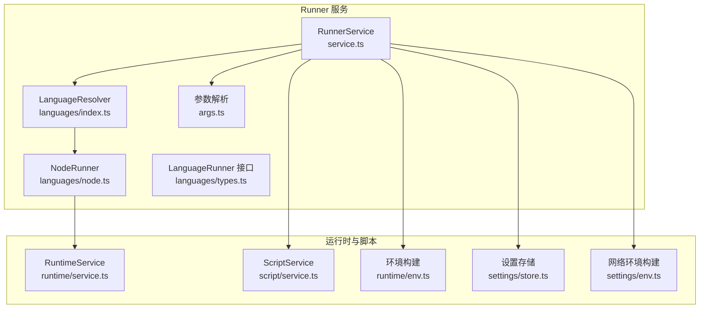
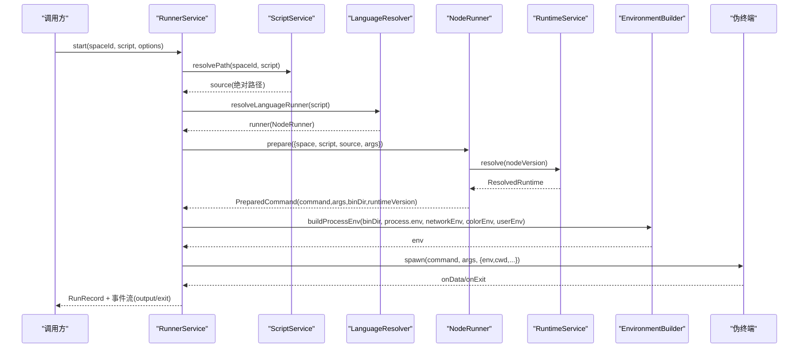
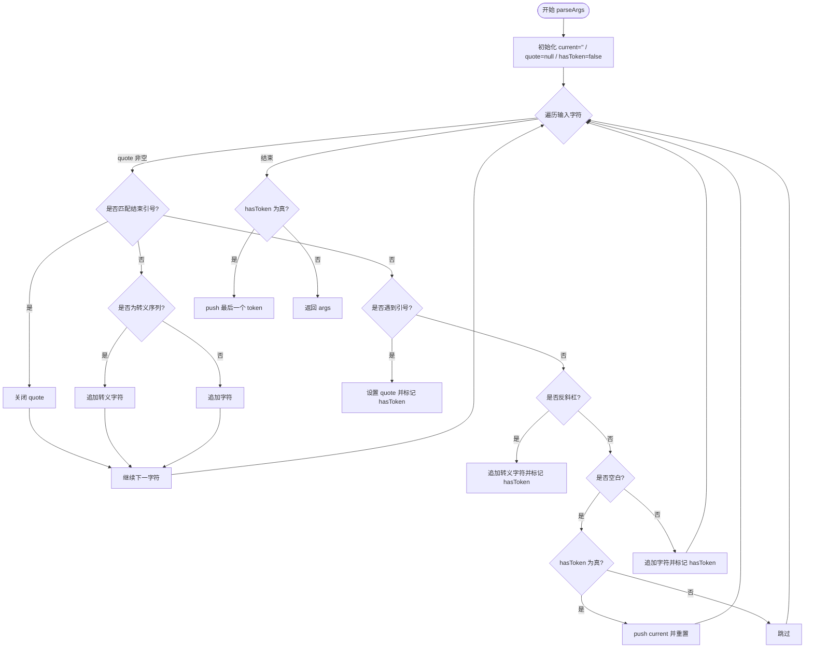
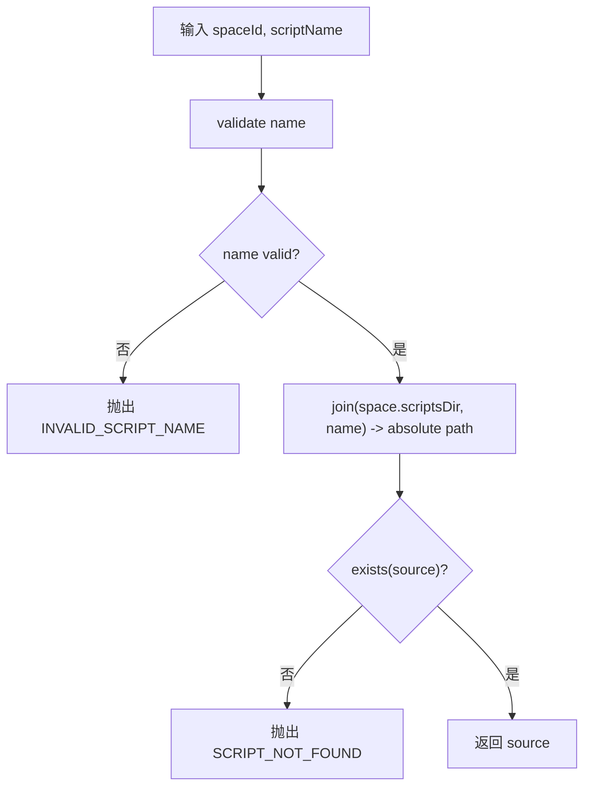
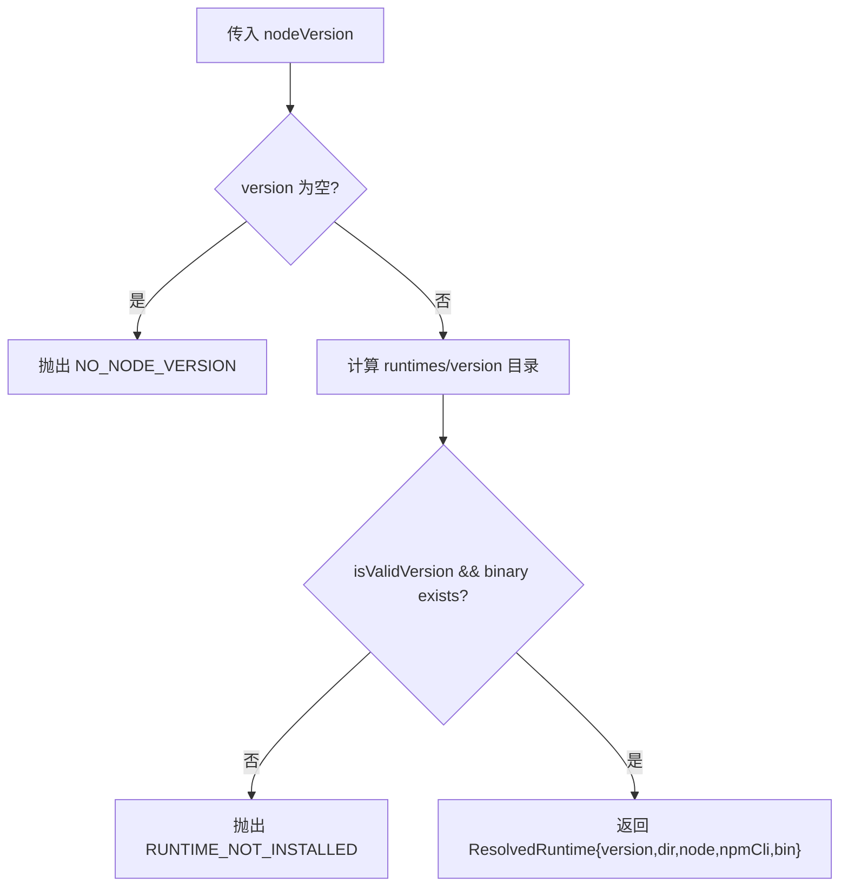
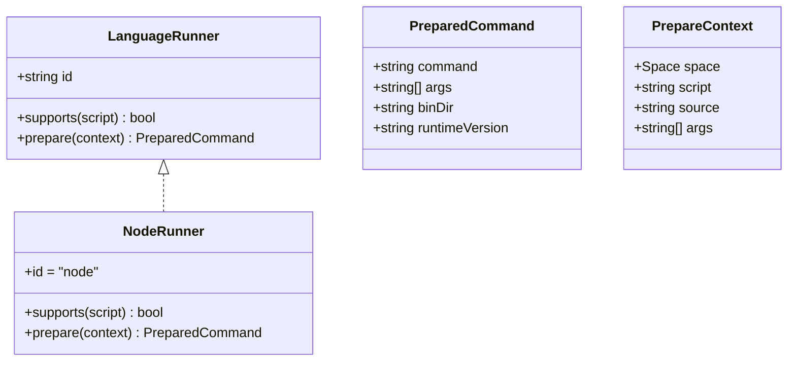
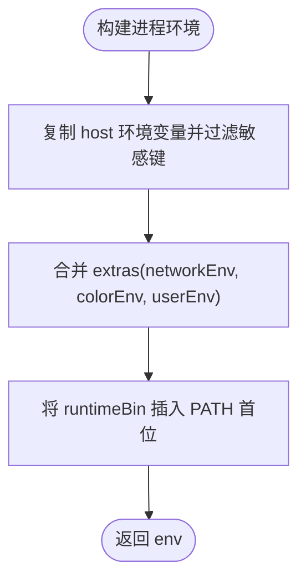
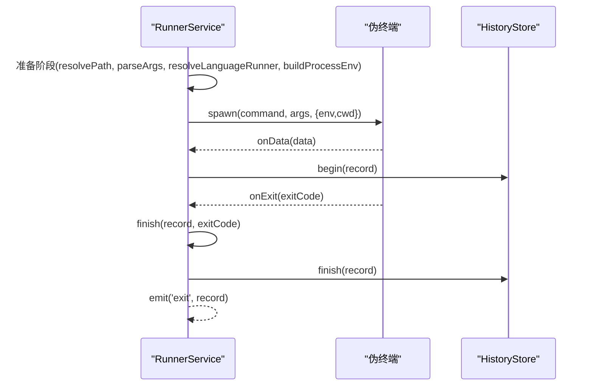
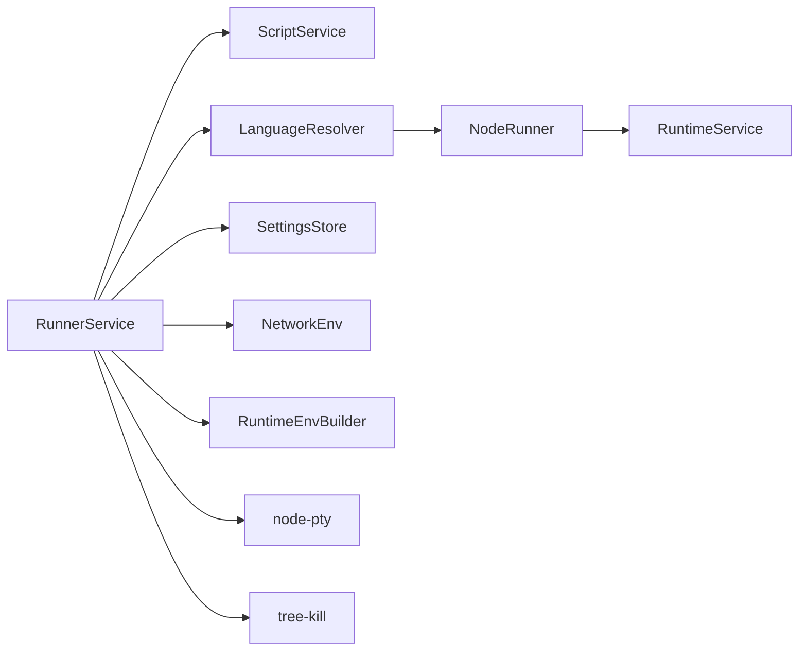

# 脚本执行引擎

<cite>
**本文引用的文件**   
- [src/main/services/runner/index.ts](file://src/main/services/runner/index.ts)
- [src/main/services/runner/service.ts](file://src/main/services/runner/service.ts)
- [src/main/services/runner/languages/types.ts](file://src/main/services/runner/languages/types.ts)
- [src/main/services/runner/languages/index.ts](file://src/main/services/runner/languages/index.ts)
- [src/main/services/runner/languages/node.ts](file://src/main/services/runner/languages/node.ts)
- [src/main/services/runner/args.ts](file://src/main/services/runner/args.ts)
- [src/main/services/runtime/env.ts](file://src/main/services/runtime/env.ts)
- [src/main/services/runtime/service.ts](file://src/main/services/runtime/service.ts)
- [src/main/services/script/service.ts](file://src/main/services/script/service.ts)
- [src/main/services/settings/store.ts](file://src/main/services/settings/store.ts)
- [src/main/services/settings/env.ts](file://src/main/services/settings/env.ts)
- [src/shared/types/run.ts](file://src/shared/types/run.ts)
- [src/shared/types/settings.ts](file://src/shared/types/settings.ts)
</cite>

## 目录
1. [简介](#简介)
2. [项目结构](#项目结构)
3. [核心组件](#核心组件)
4. [架构总览](#架构总览)
5. [详细组件分析](#详细组件分析)
6. [依赖关系分析](#依赖关系分析)
7. [性能与扩展性](#性能与扩展性)
8. [故障排查指南](#故障排查指南)
9. [结论](#结论)

## 简介
本文件面向 Runner 服务的“脚本执行引擎”，系统性说明从参数解析、环境构建、语言运行器选择，到脚本验证、路径解析、依赖检查、多语言支持架构、环境变量注入以及脚本执行生命周期（准备、执行、清理）的完整流程。文档同时给出错误处理策略与调试技巧，帮助读者快速定位问题并安全扩展新的语言运行器。

## 项目结构
Runner 服务位于主进程侧，围绕以下关键模块组织：
- 运行器服务：负责启动、监控、停止脚本进程，维护运行记录与日志。
- 语言运行器抽象与实现：定义统一接口，当前提供 Node.js 运行器。
- 运行时服务：管理 Node.js 版本安装、校验与解析。
- 脚本服务：负责脚本命名、路径解析、读取与配置保存。
- 设置存储与环境构建：合并系统环境变量、网络代理与镜像配置、用户自定义环境变量。

图表来源
- [src/main/services/runner/service.ts:44-88](file://src/main/services/runner/service.ts#L44-L88)
- [src/main/services/runner/languages/index.ts:5-12](file://src/main/services/runner/languages/index.ts#L5-L12)
- [src/main/services/runner/languages/node.ts:6-18](file://src/main/services/runner/languages/node.ts#L6-L18)
- [src/main/services/runner/languages/types.ts:20-25](file://src/main/services/runner/languages/types.ts#L20-L25)
- [src/main/services/runner/args.ts:5-48](file://src/main/services/runner/args.ts#L5-L48)
- [src/main/services/runtime/service.ts:74-81](file://src/main/services/runtime/service.ts#L74-L81)
- [src/main/services/script/service.ts:16-21](file://src/main/services/script/service.ts#L16-L21)
- [src/main/services/runtime/env.ts:10-26](file://src/main/services/runtime/env.ts#L10-L26)
- [src/main/services/settings/env.ts:21-50](file://src/main/services/settings/env.ts#L21-L50)
- [src/main/services/settings/store.ts:17-19](file://src/main/services/settings/store.ts#L17-L19)

章节来源
- [src/main/services/runner/index.ts:1-3](file://src/main/services/runner/index.ts#L1-L3)
- [src/main/services/runner/service.ts:1-147](file://src/main/services/runner/service.ts#L1-L147)

## 核心组件
- RunnerService：封装脚本启动、输出转发、终止与历史记录写入。
- LanguageRunner 接口与 NodeRunner：统一语言适配层，NodeRunner 将脚本转换为可执行的 node 命令。
- RuntimeService：解析已安装的 Node 版本，确保二进制可用。
- ScriptService：脚本命名校验、路径解析与配置读写。
- SettingsStore 与 NetworkEnv：加载设置、生成 npm 与脚本的网络环境变量。
- ProcessEnvBuilder：合并宿主环境变量、过滤敏感变量、注入 PATH。

章节来源
- [src/main/services/runner/service.ts:29-146](file://src/main/services/runner/service.ts#L29-L146)
- [src/main/services/runner/languages/types.ts:3-25](file://src/main/services/runner/languages/types.ts#L3-L25)
- [src/main/services/runner/languages/node.ts:6-18](file://src/main/services/runner/languages/node.ts#L6-L18)
- [src/main/services/runtime/service.ts:37-81](file://src/main/services/runtime/service.ts#L37-L81)
- [src/main/services/script/service.ts:16-21](file://src/main/services/script/service.ts#L16-L21)
- [src/main/services/settings/store.ts:8-29](file://src/main/services/settings/store.ts#L8-L29)
- [src/main/services/settings/env.ts:21-50](file://src/main/services/settings/env.ts#L21-L50)
- [src/main/services/runtime/env.ts:10-26](file://src/main/services/runtime/env.ts#L10-L26)

## 架构总览
Runner 服务作为入口，协调脚本服务、运行时服务、设置存储与环境构建，最终通过伪终端启动子进程，并将标准输出与退出事件回传给调用方。

图表来源
- [src/main/services/runner/service.ts:44-88](file://src/main/services/runner/service.ts#L44-L88)
- [src/main/services/runner/languages/index.ts:7-12](file://src/main/services/runner/languages/index.ts#L7-L12)
- [src/main/services/runner/languages/node.ts:9-17](file://src/main/services/runner/languages/node.ts#L9-L17)
- [src/main/services/runtime/service.ts:74-81](file://src/main/services/runtime/service.ts#L74-L81)
- [src/main/services/runtime/env.ts:10-26](file://src/main/services/runtime/env.ts#L10-L26)
- [src/main/services/settings/env.ts:21-50](file://src/main/services/settings/env.ts#L21-L50)

## 详细组件分析

### 参数解析
- 功能：将命令行字符串按 POSIX shell 风格拆分为参数数组，支持单双引号与反斜杠转义。
- 关键点：
  - 忽略未闭合的引号状态下的空白分隔。
  - 在双引号内支持转义字符。
  - 返回稳定的字符串数组，便于后续传递给子进程。

图表来源
- [src/main/services/runner/args.ts:5-48](file://src/main/services/runner/args.ts#L5-L48)

章节来源
- [src/main/services/runner/args.ts:1-49](file://src/main/services/runner/args.ts#L1-L49)

### 脚本文件验证与路径解析
- 名称校验：脚本名需符合命名规则，否则抛出无效脚本名错误。
- 路径解析：基于工作区空间根目录拼接脚本绝对路径。
- 存在性检查：启动前再次确认脚本文件存在，不存在则抛出未找到错误。

图表来源
- [src/main/services/script/service.ts:11-21](file://src/main/services/script/service.ts#L11-L21)
- [src/main/services/runner/service.ts:45-48](file://src/main/services/runner/service.ts#L45-L48)

章节来源
- [src/main/services/script/service.ts:16-21](file://src/main/services/script/service.ts#L16-L21)
- [src/main/services/runner/service.ts:45-48](file://src/main/services/runner/service.ts#L45-L48)

### 依赖检查与运行时解析
- 版本要求：必须指定 Node 版本；若未设置或对应版本未安装，会抛出相应错误。
- 本地校验：检查 Node 二进制是否存在，且版本号合法。
- 远程列表与缓存：支持远程版本索引缓存，避免频繁网络请求。

图表来源
- [src/main/services/runtime/service.ts:74-81](file://src/main/services/runtime/service.ts#L74-L81)

章节来源
- [src/main/services/runtime/service.ts:74-81](file://src/main/services/runtime/service.ts#L74-L81)

### 多语言支持架构
- 语言运行器接口：
  - id：运行器标识。
  - supports：根据脚本名判断是否支持。
  - prepare：将脚本上下文转换为具体命令、参数、PATH 前缀与运行时版本标签。
- 运行器注册与选择：
  - 集中维护 runners 列表，按 supports 顺序匹配首个运行器。
  - 若无匹配，抛出不支持脚本错误。
- Node.js 运行器实现：
  - 使用运行时服务解析 Node 版本。
  - 通过 transpile 工具准备入口文件。
  - 返回 node 命令、入口参数、bin 目录与版本标签。

图表来源
- [src/main/services/runner/languages/types.ts:3-25](file://src/main/services/runner/languages/types.ts#L3-L25)
- [src/main/services/runner/languages/node.ts:6-18](file://src/main/services/runner/languages/node.ts#L6-L18)
- [src/main/services/runner/languages/index.ts:5-12](file://src/main/services/runner/languages/index.ts#L5-L12)

章节来源
- [src/main/services/runner/languages/types.ts:1-26](file://src/main/services/runner/languages/types.ts#L1-L26)
- [src/main/services/runner/languages/index.ts:1-15](file://src/main/services/runner/languages/index.ts#L1-L15)
- [src/main/services/runner/languages/node.ts:1-20](file://src/main/services/runner/languages/node.ts#L1-L20)

### 环境变量构建逻辑
- 系统环境变量合并：
  - 继承宿主进程的环境变量，但过滤可能干扰子 Node 进程的变量（如 Electron、Node、npm、Vite 相关）。
  - 将运行时 bin 目录置于 PATH 首位，确保优先使用受管版本的 Node/npm。
- 网络配置注入：
  - 根据设置中的 npm registry、代理与二进制镜像，生成 npm 与脚本可用的环境变量。
  - 支持 http/https/noProxy 及 npm 专用变量。
- 用户自定义环境变量：
  - 从脚本运行配置中读取键值对，过滤空键，覆盖到最终环境。
- 颜色输出增强：
  - 强制启用彩色输出以改善终端体验。

图表来源
- [src/main/services/runtime/env.ts:10-26](file://src/main/services/runtime/env.ts#L10-L26)
- [src/main/services/settings/env.ts:21-50](file://src/main/services/settings/env.ts#L21-L50)
- [src/main/services/runner/service.ts:50-60](file://src/main/services/runner/service.ts#L50-L60)

章节来源
- [src/main/services/runtime/env.ts:1-28](file://src/main/services/runtime/env.ts#L1-L28)
- [src/main/services/settings/env.ts:1-73](file://src/main/services/settings/env.ts#L1-L73)
- [src/main/services/runner/service.ts:50-60](file://src/main/services/runner/service.ts#L50-L60)

### 脚本执行生命周期管理
- 准备阶段：
  - 解析脚本路径并校验存在性。
  - 解析参数与语言运行器，准备命令与参数。
  - 构建最终环境变量。
- 执行阶段：
  - 创建伪终端进程，设置列行数与工作目录。
  - 转发标准输出到历史存储与事件总线。
- 清理阶段：
  - 捕获退出码，更新运行记录状态（成功/失败/被停止）。
  - 结束日志流，持久化历史记录，触发 exit 事件。
  - 支持优雅终止（SIGTERM）与强制终止（SIGKILL）。

图表来源
- [src/main/services/runner/service.ts:44-88](file://src/main/services/runner/service.ts#L44-L88)
- [src/main/services/runner/service.ts:122-143](file://src/main/services/runner/service.ts#L122-L143)

章节来源
- [src/main/services/runner/service.ts:44-88](file://src/main/services/runner/service.ts#L44-L88)
- [src/main/services/runner/service.ts:101-115](file://src/main/services/runner/service.ts#L101-L115)
- [src/main/services/runner/service.ts:122-143](file://src/main/services/runner/service.ts#L122-L143)

## 依赖关系分析
- RunnerService 依赖：
  - ScriptService：脚本路径解析与配置读取。
  - LanguageResolver/LanguageRunner：语言适配与命令准备。
  - RuntimeService：Node 版本解析。
  - SettingsStore/NetworkEnv：网络与代理设置。
  - RuntimeEnvBuilder：进程环境构建。
- 外部集成点：
  - node-pty：伪终端进程管理与 IO 转发。
  - tree-kill：跨平台进程终止。

图表来源
- [src/main/services/runner/service.ts:1-18](file://src/main/services/runner/service.ts#L1-L18)
- [src/main/services/runner/languages/index.ts:1-12](file://src/main/services/runner/languages/index.ts#L1-L12)
- [src/main/services/runner/languages/node.ts:1-4](file://src/main/services/runner/languages/node.ts#L1-L4)
- [src/main/services/runtime/service.ts:1-10](file://src/main/services/runtime/service.ts#L1-L10)
- [src/main/services/settings/store.ts:1-6](file://src/main/services/settings/store.ts#L1-L6)
- [src/main/services/settings/env.ts:1-5](file://src/main/services/settings/env.ts#L1-L5)
- [src/main/services/runtime/env.ts:1-4](file://src/main/services/runtime/env.ts#L1-L4)

章节来源
- [src/main/services/runner/service.ts:1-18](file://src/main/services/runner/service.ts#L1-L18)
- [src/main/services/runner/languages/index.ts:1-12](file://src/main/services/runner/languages/index.ts#L1-L12)
- [src/main/services/runner/languages/node.ts:1-4](file://src/main/services/runner/languages/node.ts#L1-L4)
- [src/main/services/runtime/service.ts:1-10](file://src/main/services/runtime/service.ts#L1-L10)
- [src/main/services/settings/store.ts:1-6](file://src/main/services/settings/store.ts#L1-L6)
- [src/main/services/settings/env.ts:1-5](file://src/main/services/settings/env.ts#L1-L5)
- [src/main/services/runtime/env.ts:1-4](file://src/main/services/runtime/env.ts#L1-L4)

## 性能与扩展性
- 性能要点：
  - 远程版本列表缓存，减少网络开销。
  - 环境变量构建采用增量合并，避免重复分配。
  - 伪终端按需调整行列数，降低渲染压力。
- 扩展建议：
  - 新增语言运行器：实现 LanguageRunner 接口，并在 runners 列表中注册。
  - 优化 prepare：对于静态脚本可直接返回命令与参数，避免额外转译。
  - 环境变量策略：如需注入更多运行时变量，可在 extras 中追加。

[本节为通用指导，不直接分析具体文件]

## 故障排查指南
- 常见错误与定位：
  - 脚本未找到：检查脚本名是否有效、路径是否正确、文件是否存在。
  - 不受支持的脚本：确认脚本后缀是否被语言运行器支持。
  - 运行时未安装：确认 Node 版本是否已安装且二进制存在。
  - 校验和失败：检查网络镜像与 SHASUMS 文件可用性。
- 调试技巧：
  - 查看运行记录与日志：关注 stdout 输出与退出码。
  - 打印环境变量：确认 PATH、代理与镜像变量是否正确注入。
  - 手动复现：在终端中执行生成的命令与参数，观察差异。
  - 终止行为：Windows 下使用 kill，Unix 下先 SIGTERM 后 SIGKILL，必要时检查进程树。

章节来源
- [src/main/services/runner/service.ts:44-88](file://src/main/services/runner/service.ts#L44-L88)
- [src/main/services/runner/service.ts:101-115](file://src/main/services/runner/service.ts#L101-L115)
- [src/main/services/runner/service.ts:122-143](file://src/main/services/runner/service.ts#L122-L143)
- [src/main/services/runtime/service.ts:114-150](file://src/main/services/runtime/service.ts#L114-L150)

## 结论
Runner 服务通过统一的语言运行器接口与完善的生命周期管理，实现了脚本的可插拔执行与稳定运行。结合运行时版本管理与网络环境注入，保证了在多平台与多网络场景下的可靠性。遵循本文档的流程与最佳实践，可快速定位问题并安全扩展新的语言支持。