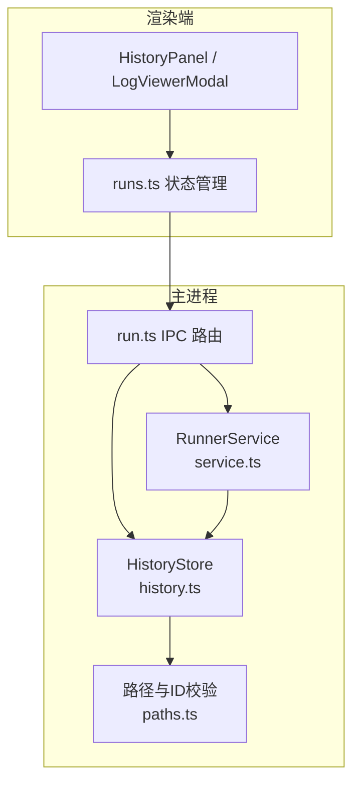
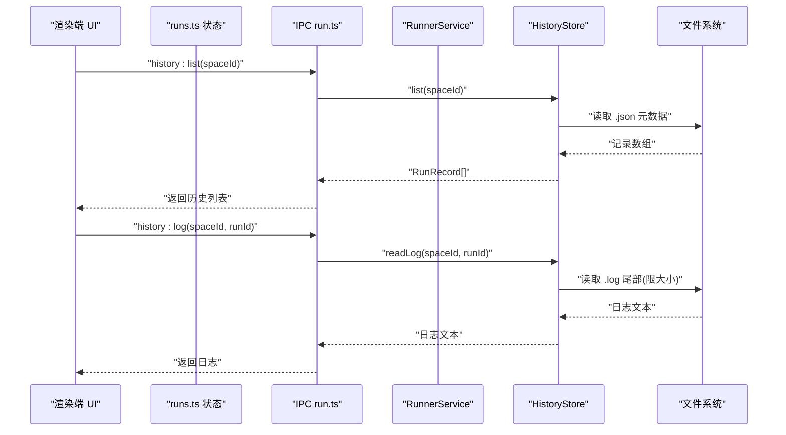
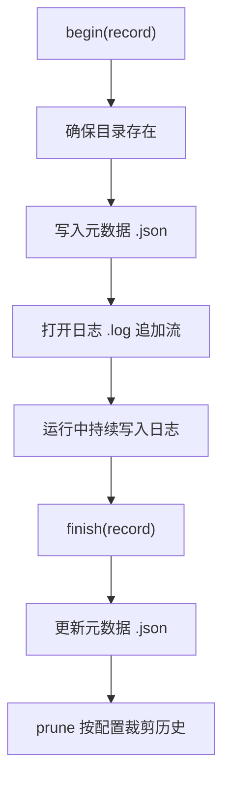
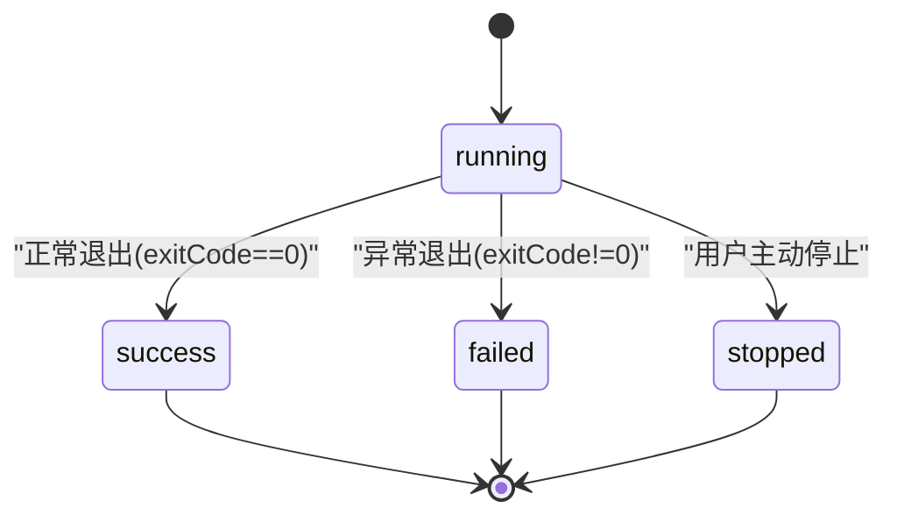
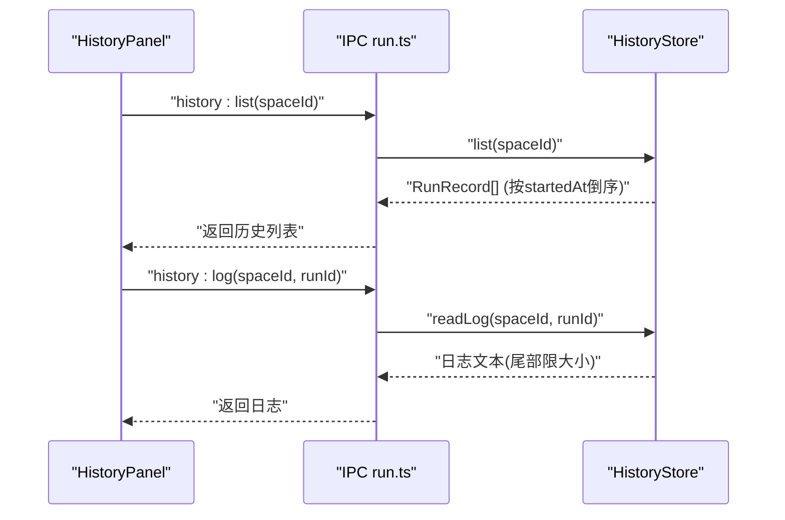
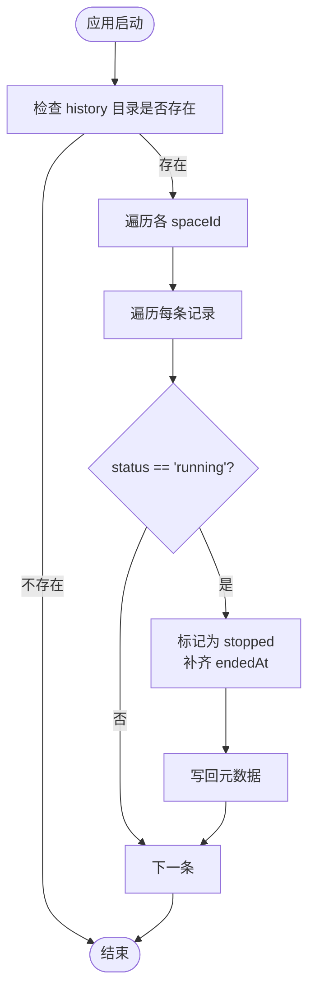
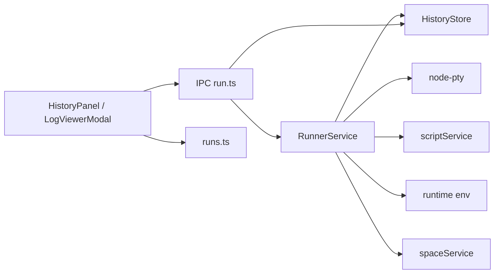

# 运行历史记录

<cite>
**本文引用的文件**   
- [history.ts](file://src/main/services/runner/history.ts)
- [service.ts](file://src/main/services/runner/service.ts)
- [run.ts](file://src/shared/types/run.ts)
- [paths.ts](file://src/main/paths.ts)
- [run.ts](file://src/main/ipc/run.ts)
- [runs.ts](file://src/renderer/src/stores/runs.ts)
- [HistoryPanel.tsx](file://src/renderer/src/components/history/HistoryPanel.tsx)
- [LogViewerModal.tsx](file://src/renderer/src/components/history/LogViewerModal.tsx)
</cite>

## 目录
1. [简介](#简介)
2. [项目结构](#项目结构)
3. [核心组件](#核心组件)
4. [架构总览](#架构总览)
5. [详细组件分析](#详细组件分析)
6. [依赖关系分析](#依赖关系分析)
7. [性能与存储特性](#性能与存储特性)
8. [查询、检索与导出](#查询检索与导出)
9. [数据清理与空间管理](#数据清理与空间管理)
10. [故障排查](#故障排查)
11. [结论](#结论)

## 简介
本文件面向 Runner 服务的“运行历史记录”能力，系统性说明历史数据模型、日志持久化机制、状态跟踪、查询检索、导出方式以及清理策略。目标是帮助开发者快速理解并扩展该功能，同时为使用者提供清晰的运维与排障指引。

## 项目结构
运行历史记录涉及主进程服务、IPC 通道、共享类型定义与渲染端 UI 四个层面：
- 主进程服务层：RunnerService 负责脚本执行、状态变更与日志写入；HistoryStore 负责元数据与日志文件的读写、清理与恢复。
- IPC 层：将前端请求映射到 RunnerService 与 HistoryStore 的方法。
- 共享类型层：RunRecord 等类型定义跨进程共享。
- 渲染端：HistoryPanel 展示历史列表，LogViewerModal 查看日志内容。



**图表来源**
- [run.ts:1-19](file://src/main/ipc/run.ts#L1-L19)
- [service.ts:29-147](file://src/main/services/runner/service.ts#L29-L147)
- [history.ts:18-93](file://src/main/services/runner/history.ts#L18-L93)
- [paths.ts:31-56](file://src/main/paths.ts#L31-L56)

**章节来源**
- [run.ts:1-19](file://src/main/ipc/run.ts#L1-L19)
- [service.ts:29-147](file://src/main/services/runner/service.ts#L29-L147)
- [history.ts:18-93](file://src/main/services/runner/history.ts#L18-L93)
- [paths.ts:31-56](file://src/main/paths.ts#L31-L56)

## 核心组件
- RunRecord：描述一次运行的完整上下文与结果。
- RunnerService：生命周期管理（启动、输出、停止、退出），驱动历史持久化。
- HistoryStore：历史元数据与日志的持久化、读取、清理与异常恢复。
- IPC run.ts：暴露 history:list、history:log、history:remove、history:clear 等接口。
- 渲染端 runs.ts、HistoryPanel.tsx、LogViewerModal.tsx：历史列表展示与日志查看。

**章节来源**
- [run.ts:1-28](file://src/shared/types/run.ts#L1-L28)
- [service.ts:29-147](file://src/main/services/runner/service.ts#L29-L147)
- [history.ts:18-93](file://src/main/services/runner/history.ts#L18-L93)
- [run.ts:1-19](file://src/main/ipc/run.ts#L1-L19)
- [runs.ts:1-79](file://src/renderer/src/stores/runs.ts#L1-L79)
- [HistoryPanel.tsx:1-126](file://src/renderer/src/components/history/HistoryPanel.tsx#L1-L126)
- [LogViewerModal.tsx:1-51](file://src/renderer/src/components/history/LogViewerModal.tsx#L1-L51)

## 架构总览
下图展示了从前端触发到历史落盘的端到端流程。



**图表来源**
- [run.ts:11-14](file://src/main/ipc/run.ts#L11-L14)
- [history.ts:30-60](file://src/main/services/runner/history.ts#L30-L60)

## 详细组件分析

### 历史数据模型：RunRecord
RunRecord 是历史记录的统一数据结构，贯穿运行期与持久化阶段。

```mermaid
classDiagram
class RunRecord {
+string id
+string spaceId
+string script
+string[] args
+string nodeVersion
+number startedAt
+number endedAt
+number exitCode
+RunStatus status
}
class RunStatus {
<<enum>>
"running"
"success"
"failed"
"stopped"
}
RunRecord --> RunStatus : "使用"
```

字段含义与用途：
- id：唯一标识一次运行，用于定位元数据与日志文件。
- spaceId：所属工作区，用于历史目录隔离。
- script：被执行的脚本名称。
- args：运行时参数数组。
- nodeVersion：使用的 Node 版本。
- startedAt：开始时间戳（毫秒）。
- endedAt：结束时间戳（毫秒），可能为空表示仍在运行。
- exitCode：进程退出码，可能为空。
- status：运行状态，包含 running/success/failed/stopped。

**图表来源**
- [run.ts:1-13](file://src/shared/types/run.ts#L1-L13)

**章节来源**
- [run.ts:1-13](file://src/shared/types/run.ts#L1-L13)

### 日志持久化：文件存储格式、压缩与归档
- 存储位置：每个 spaceId 对应一个历史目录，位于应用用户数据目录下的 history 子目录。
- 文件命名：
  - 元数据：{safeId(runId)}.json
  - 日志：{safeId(runId)}.log
- 元数据内容：即 RunRecord 序列化后的 JSON。
- 日志内容：终端输出的原始文本流，追加写入。
- 读取策略：readLog 仅读取日志尾部最多固定字节数，避免大文件拖慢 UI。
- 压缩与归档：当前实现未对日志进行压缩或归档，仅通过数量限制 prune 控制历史规模。



**图表来源**
- [history.ts:19-28](file://src/main/services/runner/history.ts#L19-L28)
- [history.ts:88-92](file://src/main/services/runner/history.ts#L88-L92)

**章节来源**
- [history.ts:19-28](file://src/main/services/runner/history.ts#L19-L28)
- [history.ts:44-60](file://src/main/services/runner/history.ts#L44-L60)
- [history.ts:88-92](file://src/main/services/runner/history.ts#L88-L92)
- [paths.ts:52-56](file://src/main/paths.ts#L52-L56)

### 状态跟踪机制：运行状态变更、时间戳与指标
- 启动时：RunnerService.start 生成 RunRecord，status=running，startedAt=当前时间，endedAt=null，exitCode=null，并通过 historyStore.begin 创建元数据与日志流。
- 运行中：pty 输出通过 RunnerService.output 同时写入日志流与事件总线。
- 退出时：RunnerService.finish 设置 endedAt、exitCode，并根据是否主动停止决定 status（stopped/success/failed），随后调用 historyStore.finish 持久化并触发 prune。
- 崩溃恢复：HistoryStore.recoverStale 在启动后扫描所有历史，将仍为 running 的记录标记为 stopped，并补齐 endedAt。



**图表来源**
- [service.ts:62-88](file://src/main/services/runner/service.ts#L62-L88)
- [service.ts:127-143](file://src/main/services/runner/service.ts#L127-L143)
- [history.ts:73-86](file://src/main/services/runner/history.ts#L73-L86)

**章节来源**
- [service.ts:62-88](file://src/main/services/runner/service.ts#L62-L88)
- [service.ts:127-143](file://src/main/services/runner/service.ts#L127-L143)
- [history.ts:73-86](file://src/main/services/runner/history.ts#L73-L86)

### 查询与检索：时间范围、脚本过滤与关键词搜索
- 当前能力：
  - 列出某 spaceId 下全部历史（按 startedAt 倒序）。
  - 读取指定 runId 的日志尾部文本。
  - 删除单条历史或清空非 running 的历史。
- 前端展示：
  - HistoryPanel 展示状态、脚本名、参数、Node 版本、开始时间、持续时间、退出码，并提供查看日志、删除、清空等操作。
  - LogViewerModal 通过 history:log 拉取日志并在终端组件中显示。
- 尚未内置的高级筛选：
  - 按时间范围筛选、按脚本精确过滤、关键词搜索未在现有代码中实现。可在 HistoryPanel 中增加过滤逻辑，或在 IPC 层扩展新的查询方法。



**图表来源**
- [run.ts:11-14](file://src/main/ipc/run.ts#L11-L14)
- [history.ts:30-60](file://src/main/services/runner/history.ts#L30-L60)
- [HistoryPanel.tsx:27-47](file://src/renderer/src/components/history/HistoryPanel.tsx#L27-L47)
- [LogViewerModal.tsx:22-32](file://src/renderer/src/components/history/LogViewerModal.tsx#L22-L32)

**章节来源**
- [history.ts:30-60](file://src/main/services/runner/history.ts#L30-L60)
- [HistoryPanel.tsx:27-99](file://src/renderer/src/components/history/HistoryPanel.tsx#L27-L99)
- [LogViewerModal.tsx:22-49](file://src/renderer/src/components/history/LogViewerModal.tsx#L22-L49)

### 数据导出：格式转换、批量导出与 API 访问
- 当前导出方式：
  - 通过 history:list 获取 RunRecord 数组，可转换为 CSV/JSON 供外部工具处理。
  - 通过 history:log 获取日志文本，可直接保存为 .log 文件。
- 批量导出：
  - 前端可对 history:list 的结果进行遍历，逐条调用 history:log 收集日志并打包下载（需在前端实现聚合逻辑）。
- API 访问：
  - IPC 已暴露 history:list、history:log、history:remove、history:clear，可作为内部 API 被其他模块复用。

注意：当前未提供服务端侧的统一导出 API（如 zip 打包），如需批量导出建议在前端聚合或新增后端导出接口。

**章节来源**
- [run.ts:11-14](file://src/main/ipc/run.ts#L11-L14)
- [history.ts:30-60](file://src/main/services/runner/history.ts#L30-L60)

### 数据清理策略与存储空间管理
- 自动裁剪：每次 finish 后调用 prune，根据 settings.run.historyLimit 保留最近 N 条已完成的历史，超出部分删除。
- 手动清理：
  - clear：删除某 spaceId 下所有非 running 的历史。
  - remove：删除指定 runId 的元数据与日志。
- 异常恢复：recoverStale 启动后扫描历史，将仍处于 running 的记录修正为 stopped，并补齐 endedAt，防止“僵尸运行”。



**图表来源**
- [history.ts:73-86](file://src/main/services/runner/history.ts#L73-L86)

**章节来源**
- [history.ts:68-92](file://src/main/services/runner/history.ts#L68-L92)

## 依赖关系分析
- RunnerService 依赖：
  - HistoryStore：用于 begin/finish 历史持久化。
  - Script/Runtime/Space 服务：解析脚本路径、构建运行环境、确定工作目录。
  - node-pty：创建伪终端，捕获 stdout/stderr。
- HistoryStore 依赖：
  - paths：计算 history 目录与文件路径，并对 ID 做安全校验。
  - settingsStore：读取 historyLimit 以进行裁剪。
- IPC run.ts 依赖：
  - RunnerService：转发 run:start/stop/active/write/resize 等命令。
  - HistoryStore：转发 history:list/log/remove/clear 等查询与管理命令。
- 渲染端依赖：
  - runs.ts：维护运行会话与最新运行映射，监听 output/exit 事件。
  - HistoryPanel/LogViewerModal：消费 IPC 提供的历史查询与日志查看能力。



**图表来源**
- [service.ts:1-18](file://src/main/services/runner/service.ts#L1-L18)
- [history.ts:1-9](file://src/main/services/runner/history.ts#L1-L9)
- [run.ts:1-19](file://src/main/ipc/run.ts#L1-L19)
- [runs.ts:1-79](file://src/renderer/src/stores/runs.ts#L1-L79)

**章节来源**
- [service.ts:1-18](file://src/main/services/runner/service.ts#L1-L18)
- [history.ts:1-9](file://src/main/services/runner/history.ts#L1-L9)
- [run.ts:1-19](file://src/main/ipc/run.ts#L1-L19)
- [runs.ts:1-79](file://src/renderer/src/stores/runs.ts#L1-L79)

## 性能与存储特性
- 日志读取优化：readLog 仅读取日志尾部最大固定字节数，避免大文件 IO 阻塞。
- 内存限制：渲染端 runs.ts 对每个运行会话的输出 chunk 数量做了上限控制，避免长时间运行导致内存增长。
- 文件 I/O：
  - 元数据采用 JSON 文件，读写简单可靠。
  - 日志采用追加写入，减少频繁重建开销。
- 压缩与归档：当前未实现压缩与归档，可通过外部工具或后续扩展实现。
- 可扩展点：
  - 引入分片日志（按时间或大小切分）以降低单次读取成本。
  - 引入压缩归档（如 gzip）降低磁盘占用。
  - 引入索引（如 SQLite）提升复杂查询性能。

[本节为通用性能讨论，不直接分析具体文件]

## 查询、检索与导出
- 可用能力：
  - 列出历史：history:list(spaceId)
  - 查看日志：history:log(spaceId, runId)
  - 删除历史：history:remove(spaceId, runId)
  - 清空历史：history:clear(spaceId)
- 前端交互：
  - HistoryPanel 支持刷新、清空、删除、查看日志。
  - LogViewerModal 加载日志并以终端形式展示。
- 建议增强：
  - 增加按时间范围筛选、按脚本名过滤、关键词搜索的前端过滤或后端 API。
  - 提供批量导出（CSV/ZIP）API，简化前端聚合逻辑。

**章节来源**
- [run.ts:11-14](file://src/main/ipc/run.ts#L11-L14)
- [HistoryPanel.tsx:27-126](file://src/renderer/src/components/history/HistoryPanel.tsx#L27-L126)
- [LogViewerModal.tsx:22-49](file://src/renderer/src/components/history/LogViewerModal.tsx#L22-L49)

## 数据清理与空间管理
- 自动裁剪：基于 settings.run.historyLimit 保留最近 N 条已完成历史。
- 手动清理：
  - clear：删除非 running 的历史。
  - remove：删除指定 runId。
- 异常恢复：recoverStale 修复因崩溃导致的“悬挂运行”记录。
- 建议：
  - 提供按时间范围清理的策略（例如只保留最近 X 天）。
  - 提供统计信息（历史总数、总磁盘占用）以便监控。

**章节来源**
- [history.ts:68-92](file://src/main/services/runner/history.ts#L68-L92)

## 故障排查
- 无法列出历史：
  - 检查 history 目录是否存在，确认 spaceId 是否有效。
  - 确认 history:list 是否正确返回空数组或报错。
- 日志为空：
  - 确认 readLog 是否成功读取，检查日志文件大小与权限。
  - 若日志过大，确认是否仅读取了尾部片段。
- 历史未清理：
  - 检查 settings.run.historyLimit 配置值。
  - 确认 finish 是否被调用，prune 是否执行。
- 状态异常（running 未结束）：
  - 检查 recoverStale 是否已将悬挂记录修正为 stopped。
  - 检查 RunnerService.finish 是否正常设置 endedAt 与 status。

**章节来源**
- [history.ts:44-60](file://src/main/services/runner/history.ts#L44-L60)
- [history.ts:68-92](file://src/main/services/runner/history.ts#L68-L92)
- [service.ts:127-143](file://src/main/services/runner/service.ts#L127-L143)

## 结论
运行历史记录功能以简洁可靠的文件存储为基础，结合 RunnerService 的状态管理与 HistoryStore 的持久化能力，提供了完整的运行生命周期追踪与日志查看体验。当前实现聚焦于基础能力：元数据与日志分离、尾部日志读取、数量裁剪与异常恢复。未来可在查询检索、压缩归档、批量导出等方面进一步增强，以满足更大规模与更复杂的运维需求。