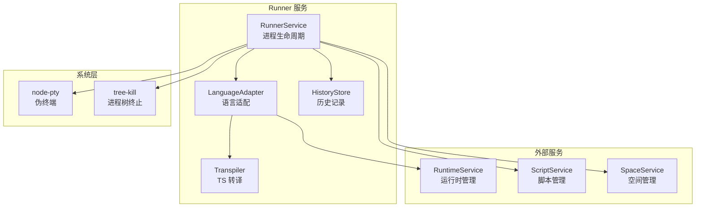
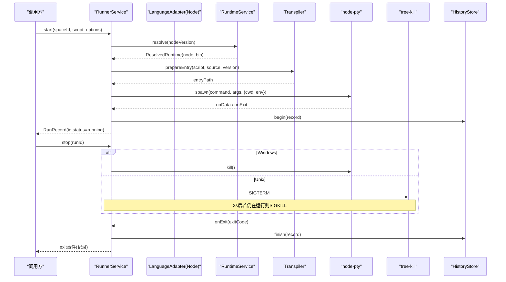
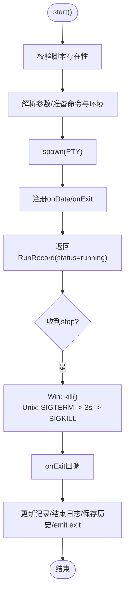
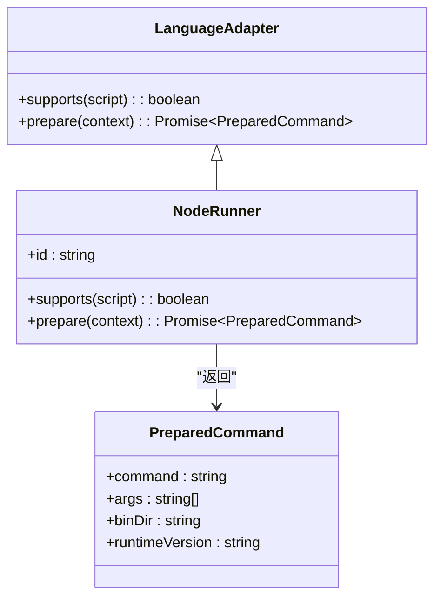
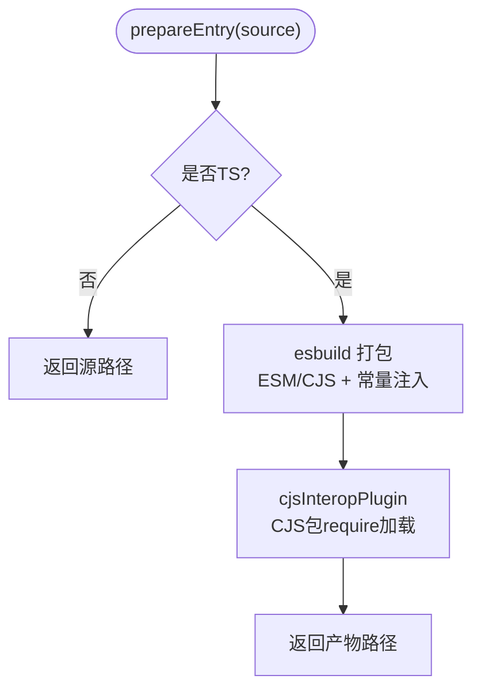
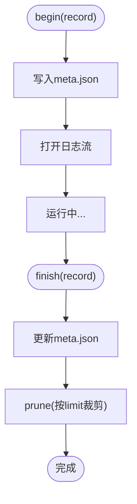
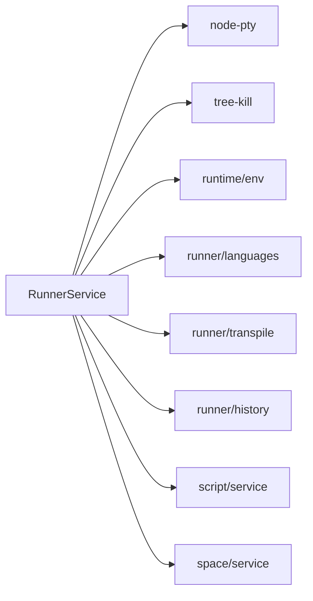

# 进程生命周期管理

<cite>
**本文引用的文件**   
- [service.ts](file://src/main/services/runner/service.ts)
- [args.ts](file://src/main/services/runner/args.ts)
- [index.ts](file://src/main/services/runner/index.ts)
- [languages/index.ts](file://src/main/services/runner/languages/index.ts)
- [languages/node.ts](file://src/main/services/runner/languages/node.ts)
- [languages/types.ts](file://src/main/services/runner/languages/types.ts)
- [transpile.ts](file://src/main/services/runner/transpile.ts)
- [interop.ts](file://src/main/services/runner/interop.ts)
- [history.ts](file://src/main/services/runner/history.ts)
- [env.ts](file://src/main/services/runtime/env.ts)
- [runtime/service.ts](file://src/main/services/runtime/service.ts)
- [script/service.ts](file://src/main/services/script/service.ts)
- [space/service.ts](file://src/main/services/space/service.ts)
- [run.ts](file://src/shared/types/run.ts)
- [space.ts](file://src/shared/types/space.ts)
</cite>

## 目录
1. [引言](#引言)
2. [项目结构](#项目结构)
3. [核心组件](#核心组件)
4. [架构总览](#架构总览)
5. [详细组件分析](#详细组件分析)
6. [依赖关系分析](#依赖关系分析)
7. [性能与资源优化](#性能与资源优化)
8. [故障排查指南](#故障排查指南)
9. [结论](#结论)

## 引言
本文围绕 Runner 服务的进程生命周期管理展开，系统性阐述以下主题：
- 进程创建机制：PTY 伪终端初始化、命令与参数解析、工作目录与环境变量注入。
- 进程监控：运行状态跟踪、日志输出、退出处理与历史记录持久化。
- 进程控制：优雅停止、强制终止、跨平台信号处理（Windows 与 Unix）。
- 多任务并发：活动进程集合管理、隔离策略与内存占用控制。
- 语言适配与转译：Node 运行时选择、TypeScript 打包与 CJS/ESM 互操作。
- 崩溃恢复与清理：历史记录的陈旧状态修复、日志裁剪与临时文件清理。

## 项目结构
Runner 服务位于主进程模块中，负责脚本执行的生命周期管理；其依赖运行时服务、脚本服务、空间服务以及共享类型定义。关键路径如下：
- Runner 服务入口与导出：[index.ts](file://src/main/services/runner/index.ts)
- Runner 核心实现：[service.ts](file://src/main/services/runner/service.ts)
- 参数解析：[args.ts](file://src/main/services/runner/args.ts)
- 语言适配器：[languages/index.ts](file://src/main/services/runner/languages/index.ts)、[languages/node.ts](file://src/main/services/runner/languages/node.ts)、[languages/types.ts](file://src/main/services/runner/languages/types.ts)
- TypeScript 转译与打包：[transpile.ts](file://src/main/services/runner/transpile.ts)、[interop.ts](file://src/main/services/runner/interop.ts)
- 历史记录存储：[history.ts](file://src/main/services/runner/history.ts)
- 环境变量构建：[env.ts](file://src/main/services/runtime/env.ts)
- 运行时服务：[runtime/service.ts](file://src/main/services/runtime/service.ts)
- 脚本服务：[script/service.ts](file://src/main/services/script/service.ts)
- 空间服务：[space/service.ts](file://src/main/services/space/service.ts)
- 共享类型：[run.ts](file://src/shared/types/run.ts)、[space.ts](file://src/shared/types/space.ts)

**图表来源** 
- [service.ts:29-146](file://src/main/services/runner/service.ts#L29-L146)
- [languages/index.ts:1-15](file://src/main/services/runner/languages/index.ts#L1-L15)
- [transpile.ts:18-66](file://src/main/services/runner/transpile.ts#L18-L66)
- [history.ts:18-93](file://src/main/services/runner/history.ts#L18-L93)
- [runtime/service.ts:74-81](file://src/main/services/runtime/service.ts#L74-L81)
- [script/service.ts:16-21](file://src/main/services/script/service.ts#L16-L21)
- [space/service.ts:26-31](file://src/main/services/space/service.ts#L26-L31)

**章节来源**
- [index.ts:1-3](file://src/main/services/runner/index.ts#L1-L3)
- [service.ts:29-146](file://src/main/services/runner/service.ts#L29-L146)

## 核心组件
- RunnerService：管理活动进程集合、启动/停止/调整终端尺寸、输出转发与退出收尾。
- LanguageAdapter：根据脚本类型选择具体语言运行器（当前为 Node），准备命令、参数、bin 目录与运行时版本。
- Transpiler：对 TypeScript 进行打包，生成 ESM/CJS 产物并注入 __dirname/__filename/import.meta.url 等常量。
- HistoryStore：记录每次运行的元数据与日志，支持读取尾部日志、清理与陈旧状态恢复。
- RuntimeService：解析已安装的 Node 运行时，提供 node 二进制路径与 npm 工具链。
- ScriptService/SpaceService：脚本与空间的元数据与文件系统访问。

**章节来源**
- [service.ts:20-146](file://src/main/services/runner/service.ts#L20-L146)
- [languages/types.ts:1-26](file://src/main/services/runner/languages/types.ts#L1-L26)
- [languages/node.ts:6-19](file://src/main/services/runner/languages/node.ts#L6-L19)
- [transpile.ts:18-66](file://src/main/services/runner/transpile.ts#L18-L66)
- [history.ts:18-93](file://src/main/services/runner/history.ts#L18-L93)
- [runtime/service.ts:74-81](file://src/main/services/runtime/service.ts#L74-L81)
- [script/service.ts:16-21](file://src/main/services/script/service.ts#L16-L21)
- [space/service.ts:26-31](file://src/main/services/space/service.ts#L26-L31)

## 架构总览
Runner 服务通过 node-pty 创建伪终端进程，结合 tree-kill 完成跨平台终止；在启动前，由语言适配器与转译器准备可执行命令与环境，再由运行时服务定位 Node 二进制。

**图表来源** 
- [service.ts:44-89](file://src/main/services/runner/service.ts#L44-L89)
- [service.ts:101-115](file://src/main/services/runner/service.ts#L101-L115)
- [service.ts:127-143](file://src/main/services/runner/service.ts#L127-L143)
- [languages/node.ts:9-17](file://src/main/services/runner/languages/node.ts#L9-L17)
- [transpile.ts:18-66](file://src/main/services/runner/transpile.ts#L18-L66)
- [runtime/service.ts:74-81](file://src/main/services/runtime/service.ts#L74-L81)
- [history.ts:19-28](file://src/main/services/runner/history.ts#L19-L28)

## 详细组件分析

### RunnerService：进程生命周期中枢
- 进程创建
  - 使用 node-pty 的 spawn 创建伪终端，设置终端名称、行列数与工作目录（空间根目录）。
  - 环境变量通过 buildProcessEnv 注入，优先将运行时 bin 目录置于 PATH 首位，并过滤可能干扰子进程的宿主环境变量。
  - 脚本参数经 parseArgs 解析，支持引号与转义。
- 状态跟踪与输出
  - 维护 ActiveRun 映射，包含记录、pty、日志流与停止标志。
  - onData 回调将输出写入日志流并触发 output 事件；onExit 回调更新记录状态并触发 exit 事件。
- 进程控制
  - Windows 直接调用 pty.kill()；Unix 先发送 SIGTERM，3 秒后若进程仍存在则 SIGKILL。
  - stopAll 遍历所有活动进程逐一停止。
- 资源清理
  - finish 阶段关闭日志流、删除活动映射、保存历史记录并抛出异常时记录错误日志。

**图表来源** 
- [service.ts:44-89](file://src/main/services/runner/service.ts#L44-L89)
- [service.ts:101-115](file://src/main/services/runner/service.ts#L101-L115)
- [service.ts:127-143](file://src/main/services/runner/service.ts#L127-L143)

**章节来源**
- [service.ts:20-146](file://src/main/services/runner/service.ts#L20-L146)
- [args.ts:5-48](file://src/main/services/runner/args.ts#L5-L48)
- [env.ts:10-27](file://src/main/services/runtime/env.ts#L10-L27)

### 语言适配器与 Node 运行器
- 语言选择
  - resolveLanguageRunner 按脚本名匹配支持的运行器（当前仅 Node）。
- Node 运行器
  - 通过 runtimeService.resolve 获取 Node 二进制与 bin 目录。
  - 通过 transpile.prepareEntry 生成入口文件（TS→ESM/CJS），并将用户参数追加到命令参数数组。
  - 返回 PreparedCommand（command、args、binDir、runtimeVersion）供 RunnerService 使用。

**图表来源** 
- [languages/types.ts:1-26](file://src/main/services/runner/languages/types.ts#L1-L26)
- [languages/node.ts:6-19](file://src/main/services/runner/languages/node.ts#L6-L19)
- [languages/index.ts:1-15](file://src/main/services/runner/languages/index.ts#L1-L15)

**章节来源**
- [languages/index.ts:1-15](file://src/main/services/runner/languages/index.ts#L1-L15)
- [languages/node.ts:6-19](file://src/main/services/runner/languages/node.ts#L6-L19)
- [runtime/service.ts:74-81](file://src/main/services/runtime/service.ts#L74-L81)

### TypeScript 转译与 CJS/ESM 互操作
- 转译流程
  - 非 TS 脚本直接返回源路径；TS 脚本通过 esbuild 打包到 .scriptbox/build 目录，输出 ESM 或 CJS。
  - 注入 __dirname/__filename/import.meta.url 等常量，保证相对路径行为一致。
  - 为 ESM 输出提供 require 兼容包装，使混合 require/import 代码可用。
- CJS 互操作插件
  - 对裸模块导入进行解析，区分 ES Module 与 CommonJS，必要时通过 require 加载以匹配 TypeScript 的 esModuleInterop 行为。
  - 跳过 Windows 绝对路径与内置模块，避免误判。

**图表来源** 
- [transpile.ts:18-66](file://src/main/services/runner/transpile.ts#L18-L66)
- [interop.ts:42-70](file://src/main/services/runner/interop.ts#L42-L70)

**章节来源**
- [transpile.ts:18-66](file://src/main/services/runner/transpile.ts#L18-L66)
- [interop.ts:1-71](file://src/main/services/runner/interop.ts#L1-L71)

### 历史记录与崩溃恢复
- 开始与结束
  - begin 创建历史记录 JSON 与日志流；finish 更新记录并裁剪历史。
- 日志读取
  - readLog 只读取尾部最大固定大小，避免大文件导致内存压力。
- 陈旧状态恢复
  - recoverStale 扫描历史，将仍标记为 running 的记录修正为 stopped，并补齐结束时间。
- 清理策略
  - prune 根据配置限制保留最近的历史条目数量。

**图表来源** 
- [history.ts:19-28](file://src/main/services/runner/history.ts#L19-L28)
- [history.ts:44-60](file://src/main/services/runner/history.ts#L44-L60)
- [history.ts:74-92](file://src/main/services/runner/history.ts#L74-L92)

**章节来源**
- [history.ts:18-93](file://src/main/services/runner/history.ts#L18-L93)

### 环境变量与路径优先级
- 构建规则
  - 继承宿主环境变量但屏蔽 ELECTRON_/NODE_OPTIONS/NODE_PATH/npm_/VITE_ 等可能影响子进程行为的变量。
  - 将运行时 bin 目录插入 PATH 首位，确保优先使用受管 Node 版本。
  - 支持额外环境变量叠加（如网络代理、颜色输出开关、用户自定义脚本环境）。

**章节来源**
- [env.ts:1-28](file://src/main/services/runtime/env.ts#L1-L28)
- [service.ts:54-60](file://src/main/services/runner/service.ts#L54-L60)

### 参数解析与安全
- 支持单双引号与反斜杠转义，按 POSIX shell 风格拆分命令行参数，避免非法字符导致的命令注入风险。
- 参数最终作为字符串数组传递给子进程，不经过 shell 解释，降低安全风险。

**章节来源**
- [args.ts:1-49](file://src/main/services/runner/args.ts#L1-L49)

## 依赖关系分析
Runner 服务与多个子系统协作，形成清晰的职责边界：
- RunnerService 依赖：
  - node-pty：创建伪终端进程。
  - tree-kill：跨平台进程树终止。
  - runtime/env：构建安全的环境变量。
  - script/space：脚本与空间元数据访问。
  - runner/languages：语言适配与命令准备。
  - runner/transpile：TS 转译与打包。
  - runner/history：历史记录持久化。

**图表来源** 
- [service.ts:1-18](file://src/main/services/runner/service.ts#L1-L18)

**章节来源**
- [service.ts:1-18](file://src/main/services/runner/service.ts#L1-L18)

## 性能与资源优化
- 日志 I/O
  - 使用 WriteStream 追加写入，避免全量加载；readLog 仅读取尾部固定长度，减少内存占用。
- 转译缓存
  - 每次构建前删除旧产物，避免残留；inline sourcemap 便于调试但不显著增加体积。
- 进程终止
  - 先 SIGTERM 再 SIGKILL，给予进程优雅退出机会；超时强制终止防止僵尸进程。
- 环境变量最小化
  - 屏蔽不必要的环境变量，减少子进程初始化开销与潜在冲突。
- 活动进程管理
  - 使用 Map 存储活动进程，O(1) 查找与删除；active()/isActive() 提供快速查询。

[本节为通用指导，无需特定文件引用]

## 故障排查指南
- 脚本未找到
  - 检查脚本名称与空间路径是否正确；确认 scriptService.resolvePath 返回的路径存在。
- 运行时未安装
  - 确认 runtimeService.resolve 能解析到 Node 二进制；必要时安装目标版本。
- 构建失败
  - 查看 transpile 抛出的 BUILD_FAILED 错误信息，检查 TypeScript 语法与依赖。
- 进程未退出
  - 观察 stop 逻辑：Windows 下直接 kill；Unix 下 SIGTERM 后 3 秒 SIGKILL；检查进程是否忽略信号。
- 历史状态异常
  - 使用 history.recoverStale 修复仍标记为 running 的记录；检查 prune 配置是否过少。
- 环境变量问题
  - 检查 buildProcessEnv 是否屏蔽了必要变量；确认 PATH 首位为运行时 bin 目录。

**章节来源**
- [service.ts:44-89](file://src/main/services/runner/service.ts#L44-L89)
- [service.ts:101-115](file://src/main/services/runner/service.ts#L101-L115)
- [transpile.ts:58-64](file://src/main/services/runner/transpile.ts#L58-L64)
- [history.ts:74-92](file://src/main/services/runner/history.ts#L74-L92)
- [env.ts:10-27](file://src/main/services/runtime/env.ts#L10-L27)

## 结论
Runner 服务通过 PTY 伪终端与跨平台终止机制，实现了稳健的进程生命周期管理；结合语言适配器与转译器，提供了灵活的脚本执行能力；历史记录与恢复机制确保了运行状态的可靠性。在多任务并发场景下，RunnerService 的活动进程映射与资源清理策略有效控制了内存与文件句柄的使用。未来可在进程池设计与更细粒度的资源隔离方面进一步优化，以提升大规模并发执行的稳定性与效率。