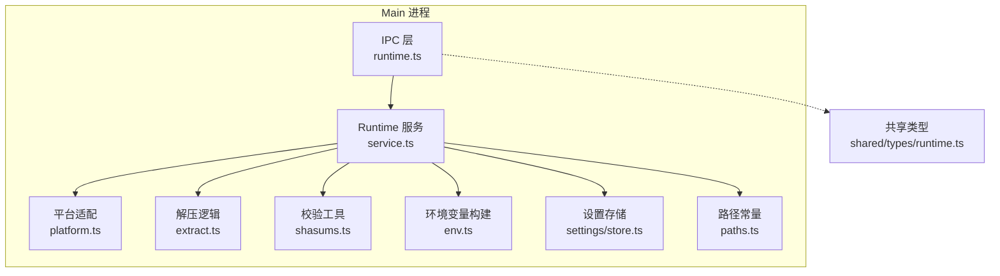
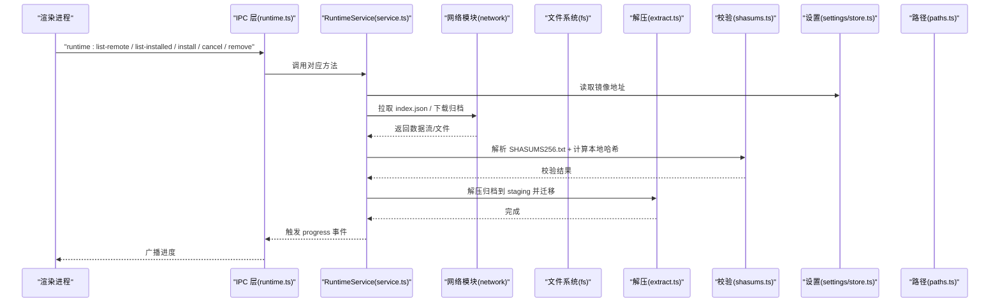
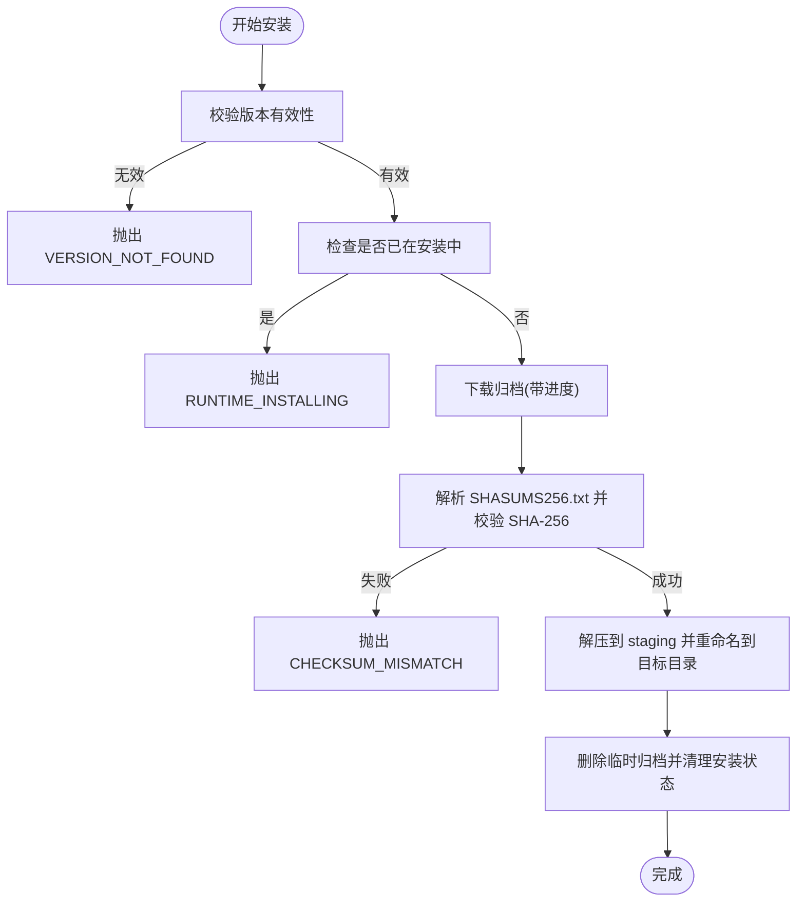
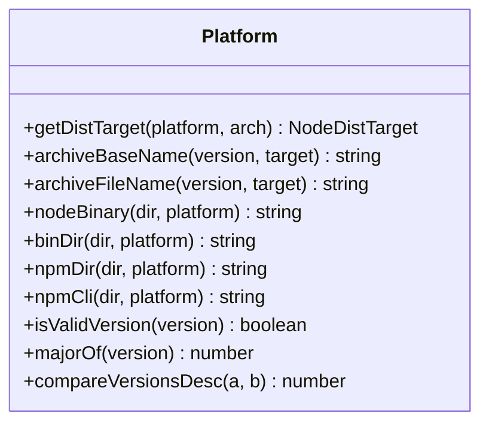
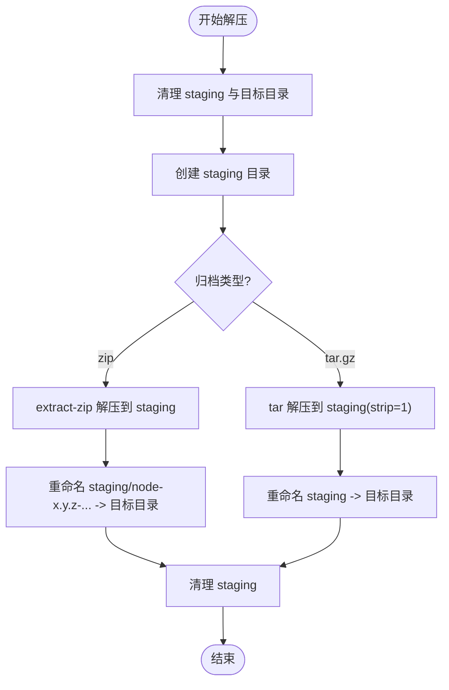
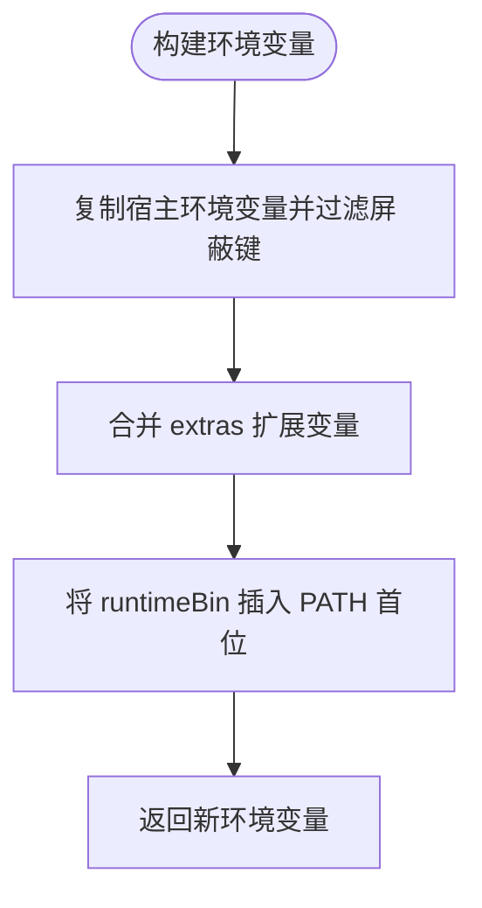
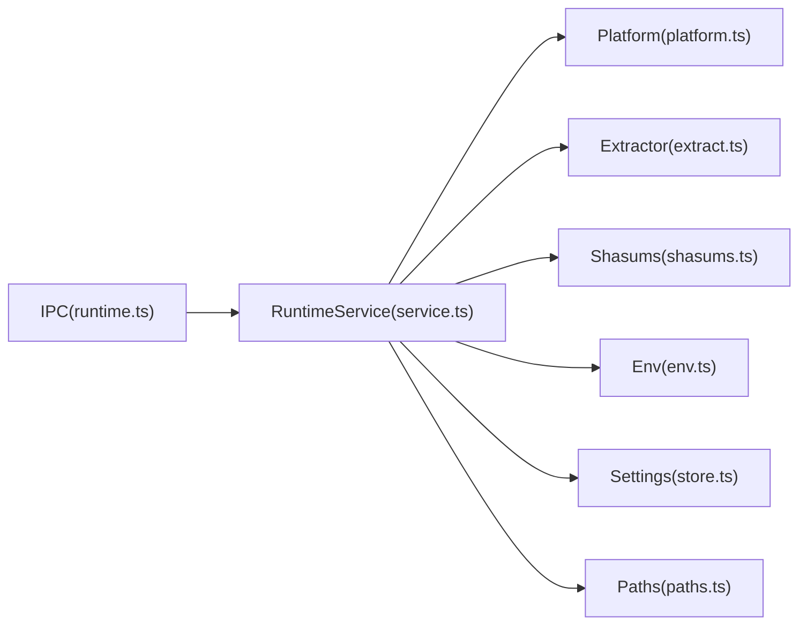

# Runtime 服务（运行时管理）

<cite>
**本文引用的文件**   
- [src/main/services/runtime/service.ts](file://src/main/services/runtime/service.ts)
- [src/main/services/runtime/platform.ts](file://src/main/services/runtime/platform.ts)
- [src/main/services/runtime/extract.ts](file://src/main/services/runtime/extract.ts)
- [src/main/services/runtime/env.ts](file://src/main/services/runtime/env.ts)
- [src/main/services/runtime/shasums.ts](file://src/main/services/runtime/shasums.ts)
- [src/main/ipc/runtime.ts](file://src/main/ipc/runtime.ts)
- [src/shared/types/runtime.ts](file://src/shared/types/runtime.ts)
- [src/main/services/settings/store.ts](file://src/main/services/settings/store.ts)
- [src/main/paths.ts](file://src/main/paths.ts)
</cite>

## 目录
1. [简介](#简介)
2. [项目结构](#项目结构)
3. [核心组件](#核心组件)
4. [架构总览](#架构总览)
5. [详细组件分析](#详细组件分析)
6. [依赖关系分析](#依赖关系分析)
7. [性能与缓存](#性能与缓存)
8. [故障排除指南](#故障排除指南)
9. [结论](#结论)

## 简介
本技术文档聚焦 Script Box 的 Runtime 服务，围绕 Node.js 版本管理与安装生命周期展开，覆盖以下关键能力：
- 版本发现、下载安装、完整性校验、环境配置
- 跨平台适配、路径处理与权限边界
- 压缩包解压、目录结构验证与清理
- 环境变量构建、PATH 注入与隔离
- 镜像源、代理与安全校验等可配置项
- 故障排查与性能优化建议

Runtime 服务通过 IPC 暴露给渲染进程，提供远程版本列表、已安装版本查询、安装/取消/卸载等操作，并以事件形式推送安装进度。

## 项目结构
Runtime 相关代码主要位于 main 进程的 services/runtime 目录，并通过 ipc/runtime.ts 暴露 IPC 接口；类型定义位于 shared/types/runtime.ts；设置读取来自 settings/store.ts；路径常量由 paths.ts 提供。

图表来源
- [src/main/ipc/runtime.ts:1-14](file://src/main/ipc/runtime.ts#L1-L14)
- [src/main/services/runtime/service.ts:1-155](file://src/main/services/runtime/service.ts#L1-L155)
- [src/main/services/runtime/platform.ts:1-83](file://src/main/services/runtime/platform.ts#L1-L83)
- [src/main/services/runtime/extract.ts:1-37](file://src/main/services/runtime/extract.ts#L1-L37)
- [src/main/services/runtime/shasums.ts:1-26](file://src/main/services/runtime/shasums.ts#L1-L26)
- [src/main/services/runtime/env.ts:1-28](file://src/main/services/runtime/env.ts#L1-L28)
- [src/main/services/settings/store.ts:1-30](file://src/main/services/settings/store.ts#L1-L30)
- [src/main/paths.ts:1-62](file://src/main/paths.ts#L1-L62)
- [src/shared/types/runtime.ts:1-23](file://src/shared/types/runtime.ts#L1-L23)

章节来源
- [src/main/ipc/runtime.ts:1-14](file://src/main/ipc/runtime.ts#L1-L14)
- [src/main/services/runtime/service.ts:1-155](file://src/main/services/runtime/service.ts#L1-L155)
- [src/main/services/runtime/platform.ts:1-83](file://src/main/services/runtime/platform.ts#L1-L83)
- [src/main/services/runtime/extract.ts:1-37](file://src/main/services/runtime/extract.ts#L1-L37)
- [src/main/services/runtime/shasums.ts:1-26](file://src/main/services/runtime/shasums.ts#L1-L26)
- [src/main/services/runtime/env.ts:1-28](file://src/main/services/runtime/env.ts#L1-L28)
- [src/main/services/settings/store.ts:1-30](file://src/main/services/settings/store.ts#L1-L30)
- [src/main/paths.ts:1-62](file://src/main/paths.ts#L1-L62)
- [src/shared/types/runtime.ts:1-23](file://src/shared/types/runtime.ts#L1-L23)

## 核心组件
- RuntimeService：版本发现、安装调度、进度上报、错误处理、取消与卸载。
- Platform 适配：目标平台与架构映射、归档文件名、二进制与 npm CLI 路径解析、版本格式与排序。
- Extractor：统一解压 zip/tar.gz，原子化写入 staging 目录并迁移到最终目录。
- Shasums：解析 SHASUMS256.txt 与计算本地文件 SHA-256。
- EnvBuilder：构建子进程环境变量，屏蔽干扰变量，优先注入 runtime bin 到 PATH。
- SettingsStore：读取用户设置（含网络镜像等）。
- Paths：应用数据目录、runtimes 目录、临时目录等路径常量。
- IPC 适配器：将前端调用映射到 RuntimeService 方法，并广播进度事件。

章节来源
- [src/main/services/runtime/service.ts:1-155](file://src/main/services/runtime/service.ts#L1-L155)
- [src/main/services/runtime/platform.ts:1-83](file://src/main/services/runtime/platform.ts#L1-L83)
- [src/main/services/runtime/extract.ts:1-37](file://src/main/services/runtime/extract.ts#L1-L37)
- [src/main/services/runtime/shasums.ts:1-26](file://src/main/services/runtime/shasums.ts#L1-L26)
- [src/main/services/runtime/env.ts:1-28](file://src/main/services/runtime/env.ts#L1-L28)
- [src/main/services/settings/store.ts:1-30](file://src/main/services/settings/store.ts#L1-L30)
- [src/main/paths.ts:1-62](file://src/main/paths.ts#L1-L62)
- [src/main/ipc/runtime.ts:1-14](file://src/main/ipc/runtime.ts#L1-L14)

## 架构总览
Runtime 服务在 Electron 主进程中运行，对外暴露 IPC 接口，内部组合下载、校验、解压与环境构建等模块，同时依赖设置存储与路径常量。

图表来源
- [src/main/ipc/runtime.ts:1-14](file://src/main/ipc/runtime.ts#L1-L14)
- [src/main/services/runtime/service.ts:45-151](file://src/main/services/runtime/service.ts#L45-L151)
- [src/main/services/runtime/extract.ts:13-36](file://src/main/services/runtime/extract.ts#L13-L36)
- [src/main/services/runtime/shasums.ts:5-25](file://src/main/services/runtime/shasums.ts#L5-L25)
- [src/main/services/settings/store.ts:11-25](file://src/main/services/settings/store.ts#L11-L25)
- [src/main/paths.ts:7-29](file://src/main/paths.ts#L7-L29)

## 详细组件分析

### 版本管理：发现、安装、切换与缓存
- 远程版本发现
  - 从设置中读取镜像地址，拼接 index.json 获取远程版本列表。
  - 对 index.json 进行过滤，仅保留当前平台/架构对应的条目。
  - 使用内存缓存避免频繁请求，TTL 为 10 分钟。
- 已安装版本列举
  - 扫描 runtimes 目录，按语义版本降序排列。
  - 跳过正在安装的版本或不存在 node 二进制的目录。
  - 尝试读取 npm package.json 以获取 npm 版本。
- 版本解析与切换
  - resolve 方法校验版本是否有效、是否已安装，返回 ResolvedRuntime（包含 version/dir/node/npmCli/bin）。
  - 若未安装或无效版本，抛出明确错误码以便上层处理。
- 安装流程
  - 防重复安装：同一版本并发安装会被拒绝。
  - 下载阶段：根据平台/架构生成归档名，从镜像下载，实时上报进度。
  - 校验阶段：解析 SHASUMS256.txt，对比本地文件的 SHA-256。
  - 解压阶段：解压到 staging 目录后原子重命名为最终目录。
  - 清理阶段：删除临时归档，移除安装记录，最终上报 done/canceled/error。
- 取消与卸载
  - 支持通过 AbortController 取消下载。
  - 支持递归删除指定版本的运行时目录。

图表来源
- [src/main/services/runtime/service.ts:88-151](file://src/main/services/runtime/service.ts#L88-L151)
- [src/main/services/runtime/shasums.ts:5-25](file://src/main/services/runtime/shasums.ts#L5-L25)
- [src/main/services/runtime/extract.ts:13-36](file://src/main/services/runtime/extract.ts#L13-L36)

章节来源
- [src/main/services/runtime/service.ts:45-151](file://src/main/services/runtime/service.ts#L45-L151)
- [src/shared/types/runtime.ts:1-23](file://src/shared/types/runtime.ts#L1-L23)

### 平台适配机制：跨平台兼容、路径处理与权限
- 平台与架构映射
  - 将 process.arch 映射到发行包所需架构标识，不支持的架构直接报错。
  - 针对 win/darwin/linux 分别返回不同的 ext 与 indexKey。
- 归档与二进制路径
  - archiveFileName 根据版本、平台、架构与扩展名生成归档名。
  - nodeBinary 区分 Windows 与非 Windows 的二进制路径。
  - binDir/npmDir/npmCli 提供不同平台下的 bin 与 npm CLI 路径。
- 版本格式与排序
  - 使用正则校验 vX.Y.Z 格式。
  - compareVersionsDesc 实现“新版本优先”的排序比较器。

图表来源
- [src/main/services/runtime/platform.ts:3-83](file://src/main/services/runtime/platform.ts#L3-L83)

章节来源
- [src/main/services/runtime/platform.ts:1-83](file://src/main/services/runtime/platform.ts#L1-L83)

### 文件提取过程：解压、目录结构与完整性
- 解压策略
  - 使用 extract-zip 处理 zip 包，tar 处理 tar.gz 包。
  - 先解压到 staging 目录，再重命名为最终目录，确保原子性。
- 目录结构
  - 解压后期望 dest 下直接包含 bin/ 或 node.exe（Windows），以及 lib/ 等运行时资源。
- 完整性保障
  - 解压前已完成 SHA-256 校验，防止损坏或篡改的归档被使用。

图表来源
- [src/main/services/runtime/extract.ts:13-36](file://src/main/services/runtime/extract.ts#L13-L36)

章节来源
- [src/main/services/runtime/extract.ts:1-37](file://src/main/services/runtime/extract.ts#L1-L37)

### 环境变量构建：PATH 配置、依赖注入与隔离
- 变量屏蔽
  - 屏蔽 ELECTRON_/NODE_OPTIONS/NODE_PATH/npm_*/VITE_* 等可能影响子进程行为的变量。
- PATH 注入
  - 将运行时 bin 目录置于 PATH 最前面，确保优先使用该版本的 node/npm。
- 扩展变量
  - 支持传入 extras 对象合并到环境变量，便于脚本运行时的额外注入。

图表来源
- [src/main/services/runtime/env.ts:1-28](file://src/main/services/runtime/env.ts#L1-L28)

章节来源
- [src/main/services/runtime/env.ts:1-28](file://src/main/services/runtime/env.ts#L1-L28)

### 安全校验：SHASUMS 解析与文件哈希
- SHASUMS 解析
  - 支持标准行格式，忽略二进制模式标记符，输出 filename -> hash 映射。
- 本地哈希计算
  - 基于 Node crypto 流式计算 SHA-256，避免一次性加载大文件。

章节来源
- [src/main/services/runtime/shasums.ts:1-26](file://src/main/services/runtime/shasums.ts#L1-L26)

### 设置与镜像源：网络配置与安全
- 镜像源
  - 从 settingsStore 读取 network.nodeMirror，自动去除尾部斜杠。
- 设置持久化
  - SettingsStore 负责默认值合并、读写与变更事件。
- 代理与安全
  - 具体代理与安全校验逻辑由网络模块实现，Runtime 服务通过其 API 进行下载与 JSON 文本拉取。

章节来源
- [src/main/services/runtime/service.ts:41-56](file://src/main/services/runtime/service.ts#L41-L56)
- [src/main/services/settings/store.ts:1-30](file://src/main/services/settings/store.ts#L1-L30)

### IPC 接口与事件
- 暴露接口
  - runtime:list-remote、runtime:list-installed、runtime:installing、runtime:install、runtime:cancel、runtime:remove。
- 进度事件
  - 监听 RuntimeService 的 progress 事件，广播给渲染进程。

章节来源
- [src/main/ipc/runtime.ts:1-14](file://src/main/ipc/runtime.ts#L1-L14)

## 依赖关系分析
Runtime 服务依赖网络、设置、路径与平台适配等模块，形成清晰的单向依赖关系，避免循环依赖。

图表来源
- [src/main/services/runtime/service.ts:1-22](file://src/main/services/runtime/service.ts#L1-L22)
- [src/main/ipc/runtime.ts:1-14](file://src/main/ipc/runtime.ts#L1-L14)

章节来源
- [src/main/services/runtime/service.ts:1-22](file://src/main/services/runtime/service.ts#L1-L22)
- [src/main/ipc/runtime.ts:1-14](file://src/main/ipc/runtime.ts#L1-L14)

## 性能与缓存
- 远程索引缓存
  - 使用内存缓存 remoteCache，TTL 为 10 分钟，减少重复网络请求。
- 并行与取消
  - 每个安装任务拥有独立 AbortController，支持取消下载，避免阻塞。
- 解压效率
  - 使用 streaming 方式计算哈希，避免大文件内存占用。
- 目录操作
  - 使用 staging 目录+重命名的原子替换，降低中间态风险。

[本节为通用性能建议，不直接分析具体文件]

## 故障排除指南
- 无法列出远程版本
  - 检查镜像地址是否正确，确认网络可达。
  - 查看是否命中缓存导致旧数据，可强制刷新。
- 安装失败
  - 下载中断：检查网络与代理设置，必要时重试。
  - 校验失败：CHECKSUM_MISMATCH 表示归档损坏或被篡改，请重新下载。
  - 解压失败：确认磁盘空间与权限，确保 staging 与目标目录可写。
- 找不到已安装版本
  - 确认版本号格式符合 vX.Y.Z，且目录下存在 node 二进制。
  - 若目录不完整，请删除该版本后重新安装。
- 环境变量异常
  - 检查 PATH 是否被外部工具修改，确保 runtime bin 在最前面。
  - 避免 NODE_OPTIONS/NODE_PATH 等变量污染子进程。

章节来源
- [src/main/services/runtime/service.ts:74-151](file://src/main/services/runtime/service.ts#L74-L151)
- [src/main/services/runtime/shasums.ts:5-25](file://src/main/services/runtime/shasums.ts#L5-L25)
- [src/main/services/runtime/env.ts:1-28](file://src/main/services/runtime/env.ts#L1-L28)

## 结论
Runtime 服务以清晰的分层与职责划分，实现了 Node.js 版本的全生命周期管理：从远程发现、安全下载到解压部署与环境注入。通过平台适配与严格的完整性校验，保证了跨平台的一致性与安全性；借助设置与路径抽象，提供了良好的可扩展性与可维护性。结合 IPC 与进度事件，为上层 UI 提供了流畅的用户体验。建议在后续迭代中继续完善网络层的代理与证书校验能力，并考虑引入更细粒度的缓存策略以提升大规模场景下的性能表现。