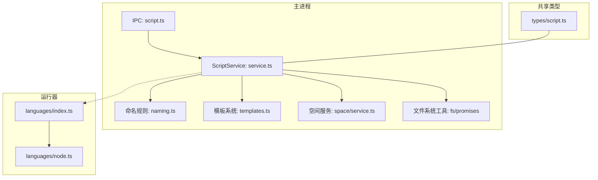
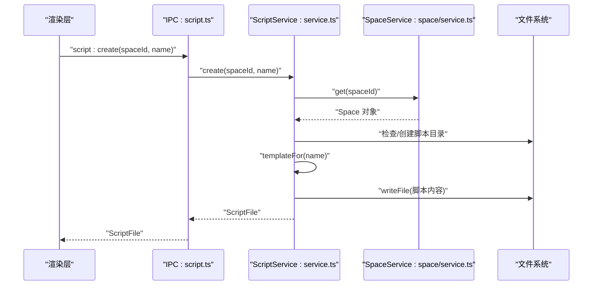
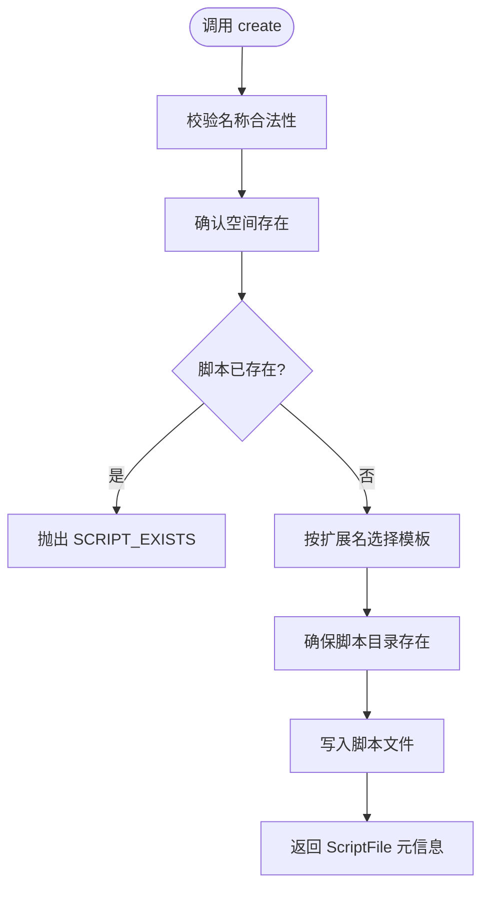
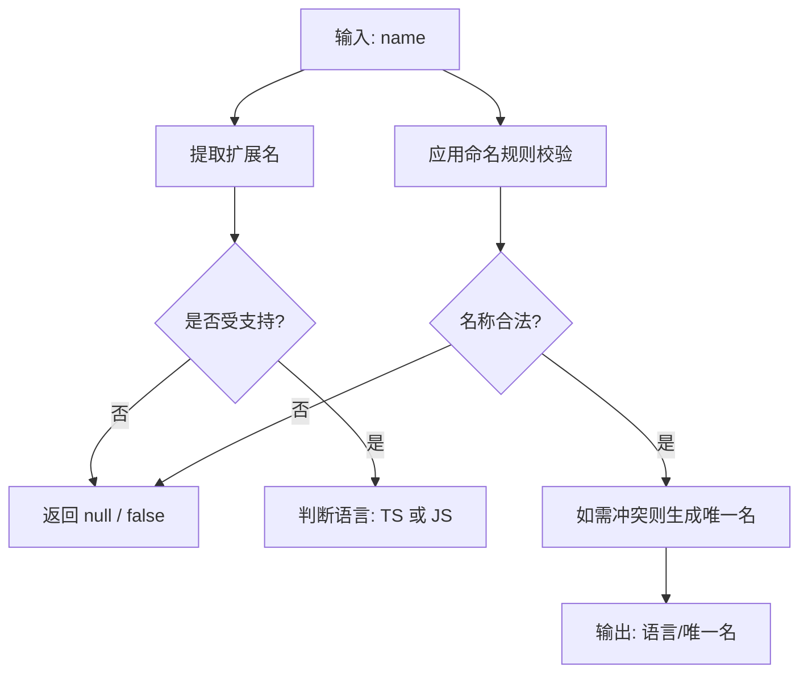
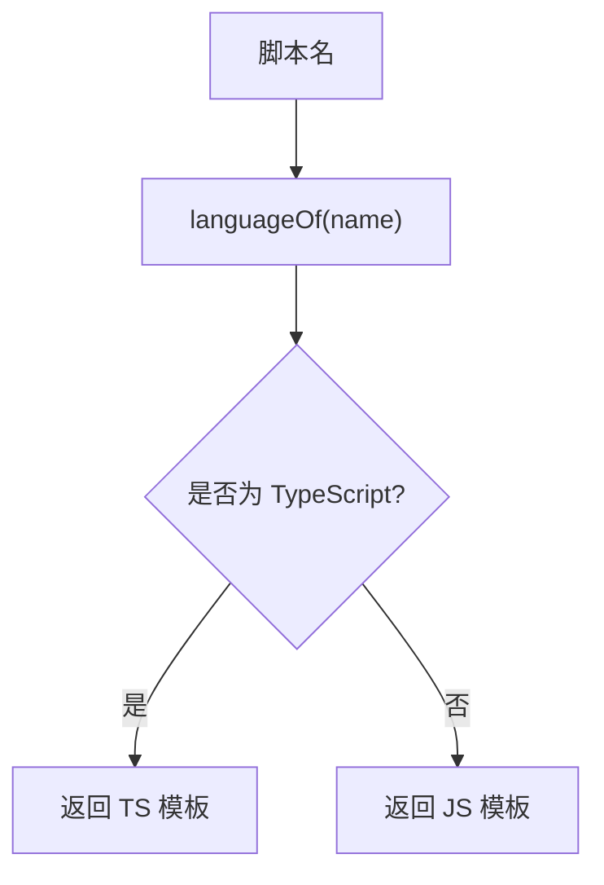
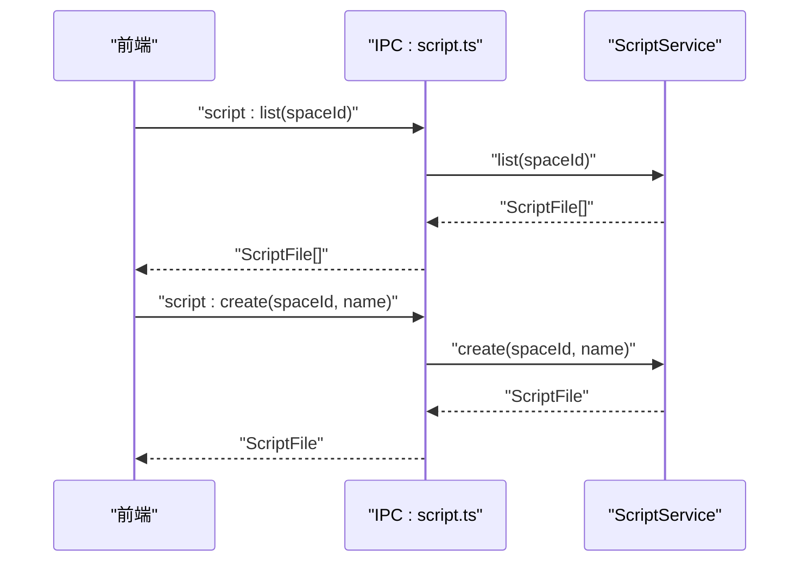
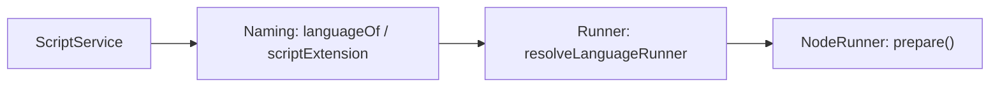
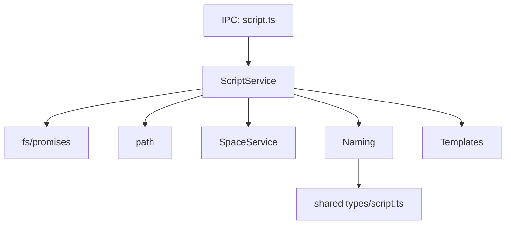

# Script 服务（脚本管理）

<cite>
**本文引用的文件**   
- [service.ts](file://src/main/services/script/service.ts)
- [naming.ts](file://src/main/services/script/naming.ts)
- [templates.ts](file://src/main/services/script/templates.ts)
- [script.ts](file://src/main/ipc/script.ts)
- [script.ts](file://src/shared/types/script.ts)
- [service.ts](file://src/main/services/space/service.ts)
- [index.ts](file://src/main/services/runner/languages/index.ts)
- [node.ts](file://src/main/services/runner/languages/node.ts)
</cite>

## 目录
1. [简介](#简介)
2. [项目结构](#项目结构)
3. [核心组件](#核心组件)
4. [架构总览](#架构总览)
5. [详细组件分析](#详细组件分析)
6. [依赖关系分析](#依赖关系分析)
7. [性能与可扩展性](#性能与可扩展性)
8. [错误处理机制](#错误处理机制)
9. [接口规范](#接口规范)
10. [最佳实践](#最佳实践)
11. [故障排查](#故障排查)
12. [结论](#结论)

## 简介
本技术文档聚焦于 Script Box 的 Script 服务，围绕以下目标展开：
- 脚本文件管理：创建、读取、更新、删除、导入导出。
- 命名规则引擎：自动命名、冲突解决、路径解析。
- 模板系统：内置模板、扩展名驱动的语言选择、变量替换能力说明。
- 脚本类型识别：语言检测、语法分析与运行器集成、依赖扫描现状与建议。
- 服务接口规范、错误处理机制与最佳实践指南。

该服务位于主进程侧，通过 IPC 暴露给渲染层使用，负责在“空间”下安全地管理脚本文件，并与空间元数据保持一致。

## 项目结构
Script 服务相关代码主要分布在以下位置：
- 主进程服务实现：`src/main/services/script/`
- IPC 接口注册：`src/main/ipc/script.ts`
- 共享类型定义：`src/shared/types/script.ts`
- 空间服务协作：`src/main/services/space/service.ts`
- 运行器语言适配：`src/main/services/runner/languages/`

图表来源
- [script.ts:1-14](file://src/main/ipc/script.ts#L1-L14)
- [service.ts:1-110](file://src/main/services/script/service.ts#L1-L110)
- [naming.ts:1-47](file://src/main/services/script/naming.ts#L1-L47)
- [templates.ts:1-16](file://src/main/services/script/templates.ts#L1-L16)
- [service.ts:1-91](file://src/main/services/space/service.ts#L1-L91)
- [index.ts:1-14](file://src/main/services/runner/languages/index.ts#L1-L14)
- [node.ts:1-19](file://src/main/services/runner/languages/node.ts#L1-L19)

章节来源
- [service.ts:1-110](file://src/main/services/script/service.ts#L1-L110)
- [script.ts:1-14](file://src/main/ipc/script.ts#L1-L14)
- [script.ts:1-13](file://src/shared/types/script.ts#L1-L13)

## 核心组件
- ScriptService：提供脚本文件的 CRUD、导入、重命名、运行配置保存等能力。
- Naming 模块：负责脚本扩展名识别、语言推断、名称合法性校验、唯一名生成。
- Templates 模块：根据扩展名返回 JavaScript 或 TypeScript 的默认模板。
- IPC 层：将 Service 方法映射为 IPC 通道，供前端调用。
- SpaceService 协作：确保脚本归属的空间存在，并同步脚本元信息到空间元数据。

章节来源
- [service.ts:16-109](file://src/main/services/script/service.ts#L16-L109)
- [naming.ts:8-46](file://src/main/services/script/naming.ts#L8-L46)
- [templates.ts:13-15](file://src/main/services/script/templates.ts#L13-L15)
- [script.ts:4-13](file://src/main/ipc/script.ts#L4-L13)

## 架构总览
Script 服务采用“服务 + 工具模块 + IPC 桥接”的分层设计：
- IPC 层仅做参数转发与结果返回，不承载业务逻辑。
- Service 层封装文件操作、命名校验、模板注入、空间元数据同步。
- Naming 与 Templates 作为纯函数工具模块，职责单一、可测试性强。
- 与 Runner 层解耦：Script 服务不负责执行脚本，但会参与语言识别与构建入口准备。

图表来源
- [script.ts:4-13](file://src/main/ipc/script.ts#L4-L13)
- [service.ts:49-58](file://src/main/services/script/service.ts#L49-L58)
- [service.ts:26-31](file://src/main/services/space/service.ts#L26-L31)

## 详细组件分析

### ScriptService：脚本文件管理
职责范围
- 路径解析：基于空间 ID 与脚本名计算绝对路径，并在解析前进行名称合法性校验。
- 列表：列出空间内所有受支持的脚本文件，附带语言、大小、修改时间，并按名称排序。
- 读取：按名称读取脚本内容，不存在时抛出未找到错误。
- 写入：覆盖写入指定脚本内容。
- 创建：校验空间存在、名称合法且无冲突后，按语言选择模板写入。
- 导入：从外部路径批量复制脚本到空间，自动清理非法字符、生成唯一名、校验最终名称。
- 重命名：原子重命名文件，并同步更新空间元数据中的键。
- 删除：删除文件并从空间元数据中移除对应项。
- 运行配置保存：保存每个脚本的运行参数与环境变量到空间元数据。

关键流程要点
- 所有写操作均先通过 `assertName` 校验名称合法性。
- 列表与导入会复用 `isScriptFile` 过滤非脚本文件。
- 导入时通过 `uniqueName` 避免同名冲突，保留扩展名递增后缀。
- 重命名与删除都会调用 `spaceService.mutate` 保证元数据一致性。

图表来源
- [service.ts:49-58](file://src/main/services/script/service.ts#L49-L58)
- [service.ts:11-14](file://src/main/services/script/service.ts#L11-L14)

章节来源
- [service.ts:16-109](file://src/main/services/script/service.ts#L16-L109)

### Naming 模块：命名规则引擎
功能点
- 扩展名识别：支持 `.js`, `.mjs`, `.cjs`, `.ts`, `.mts`, `.cts`。
- 语言推断：TS 扩展名映射为 TypeScript，其余为 JavaScript。
- 名称合法性校验：
  - 不允许空值、长度超过 128、以 `.` 开头、包含 `..`。
  - 禁止控制字符与文件系统危险字符。
  - 必须去除首尾空白。
  - 必须具有受支持的扩展名。
- 唯一名生成：当名称被占用时，追加 `-1`, `-2` 等后缀，保持扩展名不变。

复杂度分析
- `isValidScriptName`：正则匹配与字符串检查，时间复杂度 O(n)。
- `uniqueName`：最坏情况下循环查找，平均 O(k)，k 为冲突次数。

图表来源
- [naming.ts:8-46](file://src/main/services/script/naming.ts#L8-L46)

章节来源
- [naming.ts:1-47](file://src/main/services/script/naming.ts#L1-L47)
- [script.ts:1-13](file://src/shared/types/script.ts#L1-L13)

### Templates 模块：模板系统
行为说明
- 根据脚本扩展名选择 JavaScript 或 TypeScript 模板。
- 当前为静态模板，不包含运行时变量替换。
- 未来可扩展为动态模板引擎，支持变量注入（如空间名、Node 版本等）。

图表来源
- [templates.ts:13-15](file://src/main/services/script/templates.ts#L13-L15)
- [naming.ts:17-20](file://src/main/services/script/naming.ts#L17-L20)

章节来源
- [templates.ts:1-16](file://src/main/services/script/templates.ts#L1-L16)

### IPC 层：服务接口规范
暴露的通道与方法
- `script:list`：传入空间 ID，返回脚本列表。
- `script:read`：读取脚本内容。
- `script:write`：写入脚本内容。
- `script:create`：创建脚本。
- `script:import`：批量导入脚本。
- `script:rename`：重命名脚本。
- `script:remove`：删除脚本。
- `script:save-run-config`：保存脚本运行配置。

图表来源
- [script.ts:4-13](file://src/main/ipc/script.ts#L4-L13)
- [service.ts:23-58](file://src/main/services/script/service.ts#L23-L58)

章节来源
- [script.ts:1-14](file://src/main/ipc/script.ts#L1-L14)

### 与运行器的协作：类型识别与执行准备
- Script 服务通过 `languageOf` 和 `scriptExtension` 完成基础语言识别。
- 运行器层通过 `resolveLanguageRunner` 选择具体语言运行器（当前为 Node）。
- Node 运行器进一步借助 transpile 准备入口文件，并调用 Node 二进制执行。

图表来源
- [service.ts:8-9](file://src/main/services/script/service.ts#L8-L9)
- [index.ts:7-11](file://src/main/services/runner/languages/index.ts#L7-L11)
- [node.ts:6-18](file://src/main/services/runner/languages/node.ts#L6-L18)

章节来源
- [index.ts:1-14](file://src/main/services/runner/languages/index.ts#L1-L14)
- [node.ts:1-19](file://src/main/services/runner/languages/node.ts#L1-L19)

## 依赖关系分析
- ScriptService 依赖：
  - 文件系统 API：`fs/promises` 用于读写、统计、重命名、删除。
  - 路径工具：`path.join`、`basename`。
  - 空间服务：校验空间存在、持久化脚本元数据。
  - 命名模块：名称校验、语言推断、唯一名生成。
  - 模板模块：按语言选择默认模板。
- 命名模块依赖：
  - 共享类型：`SCRIPT_EXTENSIONS` 常量。
- IPC 层依赖：
  - ScriptService 实例。
  - IPC 辅助函数 `handle`。

图表来源
- [service.ts:1-9](file://src/main/services/script/service.ts#L1-L9)
- [naming.ts:1-4](file://src/main/services/script/naming.ts#L1-L4)
- [script.ts:1-3](file://src/main/ipc/script.ts#L1-L3)
- [script.ts:1-13](file://src/shared/types/script.ts#L1-L13)

章节来源
- [service.ts:1-109](file://src/main/services/script/service.ts#L1-L109)
- [naming.ts:1-47](file://src/main/services/script/naming.ts#L1-L47)
- [script.ts:1-14](file://src/main/ipc/script.ts#L1-L14)
- [script.ts:1-13](file://src/shared/types/script.ts#L1-L13)

## 性能与可扩展性
- 列表操作：对目录条目并行 stat，整体复杂度接近 O(n log n)（含排序），适合中等规模脚本集。
- 导入操作：逐文件复制并去重，I/O 密集；建议批量 IO 优化与并发限制。
- 模板系统：当前为静态模板，零开销；若引入变量替换，需考虑缓存策略。
- 可扩展方向：
  - 模板引擎：支持变量注入（如 `${spaceName}`, `${nodeVersion}`）。
  - 依赖扫描：结合 Node 包管理器或 AST 分析，收集依赖清单。
  - 多语言运行器：新增语言时仅需扩展 Runner 层，不影响 Script 服务。

[本节为通用指导，不直接分析具体文件]

## 错误处理机制
统一通过 `AppError` 抛出结构化错误，常见错误码：
- `INVALID_SCRIPT_NAME`：脚本名称不符合命名规则。
- `SCRIPT_NOT_FOUND`：读取脚本时文件不存在。
- `SCRIPT_EXISTS`：创建或重命名时目标已存在。
- `UNSUPPORTED_SCRIPT`：导入的文件不被识别为脚本。

错误传播路径
- IPC 层透传 Service 抛出的错误。
- 前端通过错误格式化函数展示用户友好提示。

章节来源
- [service.ts:11-14](file://src/main/services/script/service.ts#L11-L14)
- [service.ts:38-43](file://src/main/services/script/service.ts#L38-L43)
- [service.ts:49-58](file://src/main/services/script/service.ts#L49-L58)
- [service.ts:61-76](file://src/main/services/script/service.ts#L61-L76)
- [service.ts:78-92](file://src/main/services/script/service.ts#L78-L92)

## 接口规范
以下为 IPC 接口摘要（面向调用方）：
- `script:list(spaceId)`
  - 入参：空间 ID
  - 返回：脚本数组，每项包含名称、语言、大小、修改时间
- `script:read(spaceId, name)`
  - 入参：空间 ID、脚本名
  - 返回：脚本文本内容
- `script:write(spaceId, name, content)`
  - 入参：空间 ID、脚本名、内容
  - 返回：无
- `script:create(spaceId, name)`
  - 入参：空间 ID、脚本名
  - 返回：脚本元信息
- `script:import(spaceId, paths[])`
  - 入参：空间 ID、外部文件路径数组
  - 返回：实际导入后的脚本名数组
- `script:rename(spaceId, from, to)`
  - 入参：空间 ID、原名称、新名称
  - 返回：无
- `script:remove(spaceId, name)`
  - 入参：空间 ID、脚本名
  - 返回：无
- `script:save-run-config(spaceId, name, config)`
  - 入参：空间 ID、脚本名、运行配置（参数与环境变量）
  - 返回：更新后的空间对象

章节来源
- [script.ts:4-13](file://src/main/ipc/script.ts#L4-L13)
- [service.ts:23-105](file://src/main/services/script/service.ts#L23-L105)

## 最佳实践
- 命名规范
  - 使用受支持的扩展名，明确语言类型。
  - 避免特殊字符与空白，保持名称简洁可读。
  - 遇到冲突时优先使用唯一名生成，避免手动编号。
- 模板使用
  - 新建脚本时直接使用模板，减少样板代码。
  - 如需变量注入，可在模板层扩展变量替换逻辑。
- 导入策略
  - 批量导入前先校验文件扩展名，提前失败。
  - 对大量文件导入时，注意磁盘 I/O 压力与并发控制。
- 元数据一致性
  - 重命名或删除脚本后，务必通过空间服务更新元数据。
  - 运行配置变更应通过 `saveRunConfig` 持久化。
- 错误处理
  - 捕获并区分不同错误码，向用户提供明确修复建议。
  - 对“文件不存在”“名称无效”等错误进行前置校验，减少异常路径。

[本节为通用指导，不直接分析具体文件]

## 故障排查
常见问题与定位思路
- 无法创建脚本
  - 检查名称是否符合命名规则，是否存在非法字符或过长。
  - 确认空间存在且未被锁定。
- 读取失败
  - 确认脚本名与文件名完全一致，包括扩展名。
  - 检查文件权限与路径是否正确。
- 导入失败
  - 确认导入文件扩展名受支持。
  - 检查目标空间是否有写入权限。
- 重命名后列表不更新
  - 确认空间元数据已通过 `mutate` 同步。
  - 刷新前端脚本树或重新调用 list。

章节来源
- [service.ts:11-14](file://src/main/services/script/service.ts#L11-L14)
- [service.ts:38-43](file://src/main/services/script/service.ts#L38-L43)
- [service.ts:61-76](file://src/main/services/script/service.ts#L61-L76)
- [service.ts:78-92](file://src/main/services/script/service.ts#L78-L92)

## 结论
Script 服务以清晰的职责边界与稳健的错误处理机制，提供了完整的脚本文件管理能力。命名规则引擎保证了文件名的安全性与唯一性，模板系统简化了脚本初始化流程。尽管当前模板系统为静态模板，但具备良好的扩展性，可平滑演进为变量注入的动态模板。与运行器的解耦设计使得语言扩展与维护成本可控。建议在后续迭代中补充依赖扫描与更丰富的模板变量，以提升开发体验与工程化能力。

[本节为总结性内容，不直接分析具体文件]