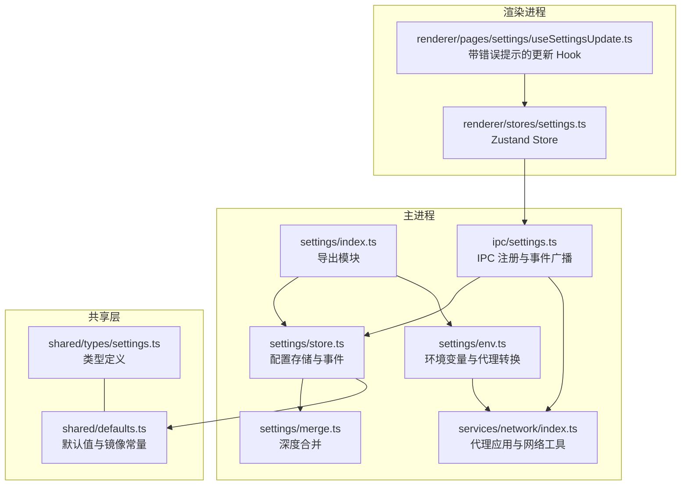
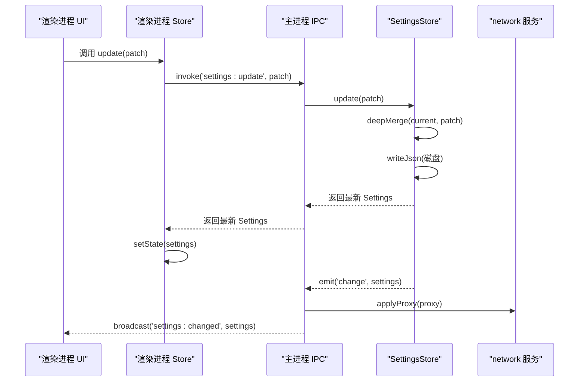
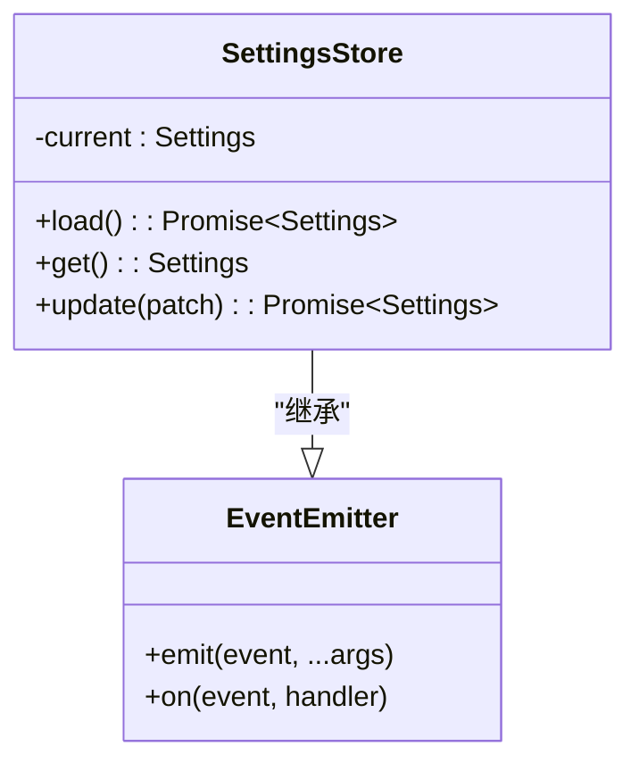
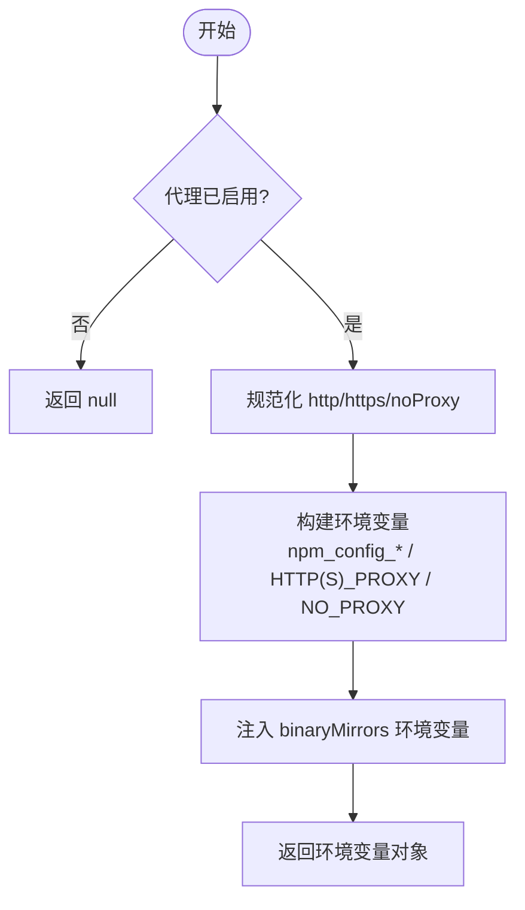
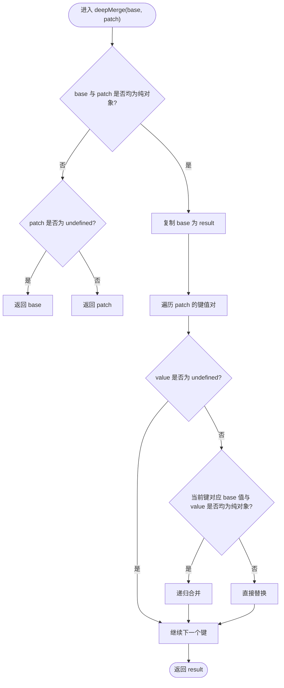
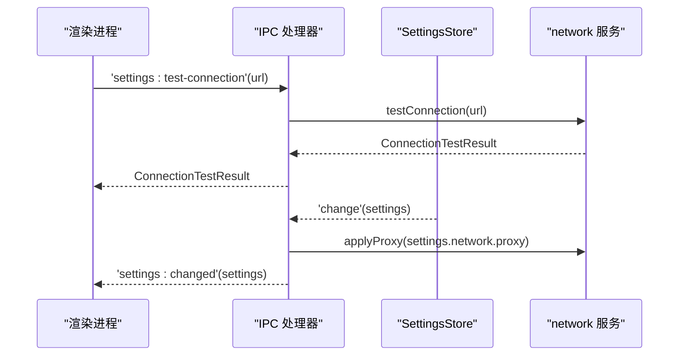
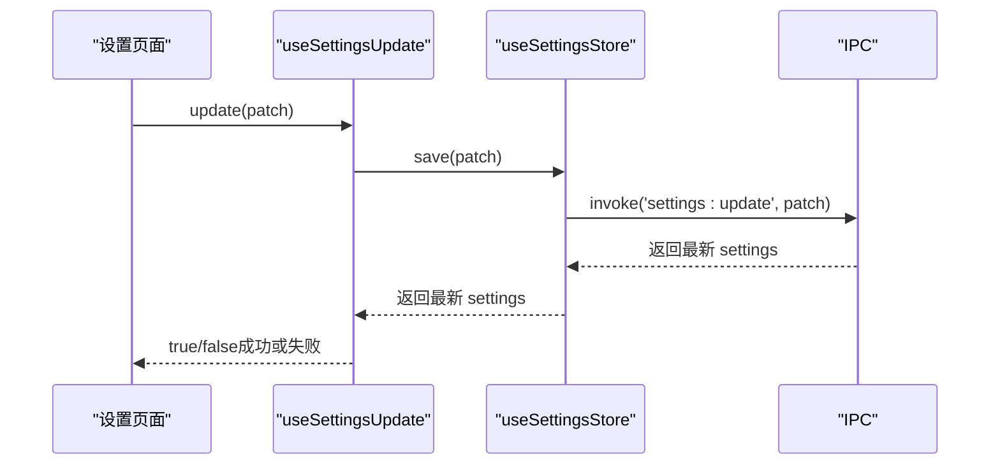
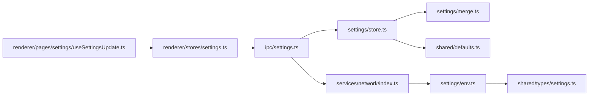

# Settings 服务（配置管理）

<cite>
**本文引用的文件**   
- [src/main/services/settings/index.ts](file://src/main/services/settings/index.ts)
- [src/main/services/settings/store.ts](file://src/main/services/settings/store.ts)
- [src/main/services/settings/env.ts](file://src/main/services/settings/env.ts)
- [src/main/services/settings/merge.ts](file://src/main/services/settings/merge.ts)
- [src/shared/types/settings.ts](file://src/shared/types/settings.ts)
- [src/shared/defaults.ts](file://src/shared/defaults.ts)
- [src/main/ipc/settings.ts](file://src/main/ipc/settings.ts)
- [src/main/services/network/index.ts](file://src/main/services/network/index.ts)
- [src/renderer/src/stores/settings.ts](file://src/renderer/src/stores/settings.ts)
- [src/renderer/src/pages/settings/useSettingsUpdate.ts](file://src/renderer/src/pages/settings/useSettingsUpdate.ts)
</cite>

## 目录
1. [简介](#简介)
2. [项目结构](#项目结构)
3. [核心组件](#核心组件)
4. [架构总览](#架构总览)
5. [详细组件分析](#详细组件分析)
6. [依赖关系分析](#依赖关系分析)
7. [性能与行为特性](#性能与行为特性)
8. [故障排查指南](#故障排查指南)
9. [结论](#结论)
10. [附录：API 与数据模型](#附录api-与数据模型)

## 简介
本技术文档聚焦于 Script Box 的 Settings 服务，系统性阐述其职责边界、实现机制与使用方式。Settings 服务负责：
- 配置存储：持久化到本地 JSON 文件，并在内存中维护当前状态，支持变更监听。
- 环境变量处理：根据网络配置生成 npm、脚本运行所需的环境变量，并转换为 Electron 代理配置。
- 配置合并：基于默认值与用户设置进行深度合并，保证向后兼容与最小侵入更新。
- 网络配置：代理设置、镜像源配置、安全选项（超时、错误封装）。
- 服务 API：通过 IPC 暴露获取、更新、连接测试能力；前端 store 订阅变更并驱动 UI。

该服务贯穿主进程与渲染进程，是应用“可观测、可配置、可迁移”的基础设施。

## 项目结构
Settings 相关代码分布在主进程服务层、共享类型与默认值、IPC 桥接以及渲染端 Store 与 Hook 中。整体组织遵循“服务 + 类型 + IPC + 前端消费”的分层模式。

**图表来源**
- [src/main/services/settings/index.ts:1-3](file://src/main/services/settings/index.ts#L1-L3)
- [src/main/services/settings/store.ts:1-30](file://src/main/services/settings/store.ts#L1-L30)
- [src/main/services/settings/env.ts:1-73](file://src/main/services/settings/env.ts#L1-L73)
- [src/main/services/settings/merge.ts:1-22](file://src/main/services/settings/merge.ts#L1-L22)
- [src/main/ipc/settings.ts:1-15](file://src/main/ipc/settings.ts#L1-L15)
- [src/main/services/network/index.ts:1-81](file://src/main/services/network/index.ts#L1-L81)
- [src/shared/types/settings.ts:1-58](file://src/shared/types/settings.ts#L1-L58)
- [src/shared/defaults.ts:1-44](file://src/shared/defaults.ts#L1-L44)
- [src/renderer/src/stores/settings.ts:1-26](file://src/renderer/src/stores/settings.ts#L1-L26)
- [src/renderer/src/pages/settings/useSettingsUpdate.ts:1-27](file://src/renderer/src/pages/settings/useSettingsUpdate.ts#L1-L27)

**章节来源**
- [src/main/services/settings/index.ts:1-3](file://src/main/services/settings/index.ts#L1-L3)
- [src/main/services/settings/store.ts:1-30](file://src/main/services/settings/store.ts#L1-L30)
- [src/main/services/settings/env.ts:1-73](file://src/main/services/settings/env.ts#L1-L73)
- [src/main/services/settings/merge.ts:1-22](file://src/main/services/settings/merge.ts#L1-L22)
- [src/shared/types/settings.ts:1-58](file://src/shared/types/settings.ts#L1-L58)
- [src/shared/defaults.ts:1-44](file://src/shared/defaults.ts#L1-L44)
- [src/main/ipc/settings.ts:1-15](file://src/main/ipc/settings.ts#L1-L15)
- [src/main/services/network/index.ts:1-81](file://src/main/services/network/index.ts#L1-L81)
- [src/renderer/src/stores/settings.ts:1-26](file://src/renderer/src/stores/settings.ts#L1-L26)
- [src/renderer/src/pages/settings/useSettingsUpdate.ts:1-27](file://src/renderer/src/pages/settings/useSettingsUpdate.ts#L1-L27)

## 核心组件
- 配置存储（SettingsStore）
  - 职责：加载、读取、更新配置；持久化到磁盘；触发变更事件。
  - 关键行为：启动时从磁盘读取并合并默认值；更新时写盘并广播 change。
- 环境变量构建（buildNetworkEnv / resolveProxy / toElectronProxyConfig）
  - 职责：将网络配置转换为 npm/脚本环境变量和 Electron 代理配置。
  - 关键行为：统一清理 URL 尾斜杠；按 http/https/noProxy 映射多套环境变量；生成 Electron ProxyConfig。
- 配置合并（deepMerge）
  - 职责：递归合并补丁对象与基础对象；数组与基本类型直接替换。
  - 关键行为：undefined 跳过；仅对纯对象进行递归合并。
- IPC 桥接（registerSettingsIpc）
  - 职责：注册 settings:get/update/test-connection 接口；监听 change 事件并应用代理、广播给渲染端。
- 网络工具（applyProxy / testConnection）
  - 职责：应用 Electron 全局代理；发起连接测试并返回结果。
- 前端 Store 与 Hook
  - 职责：调用 IPC 获取/更新配置；订阅 settings:changed 事件；提供带错误提示的更新方法。

**章节来源**
- [src/main/services/settings/store.ts:1-30](file://src/main/services/settings/store.ts#L1-L30)
- [src/main/services/settings/env.ts:1-73](file://src/main/services/settings/env.ts#L1-L73)
- [src/main/services/settings/merge.ts:1-22](file://src/main/services/settings/merge.ts#L1-L22)
- [src/main/ipc/settings.ts:1-15](file://src/main/ipc/settings.ts#L1-L15)
- [src/main/services/network/index.ts:1-81](file://src/main/services/network/index.ts#L1-L81)
- [src/renderer/src/stores/settings.ts:1-26](file://src/renderer/src/stores/settings.ts#L1-L26)
- [src/renderer/src/pages/settings/useSettingsUpdate.ts:1-27](file://src/renderer/src/pages/settings/useSettingsUpdate.ts#L1-L27)

## 架构总览
Settings 服务在主进程中以单例形式存在，对外暴露 IPC 接口；渲染进程通过 Zustand Store 调用 IPC 并订阅变更事件。网络相关能力由 network 服务提供，Settings 服务通过 env 工具将其转化为环境变量与代理配置。

**图表来源**
- [src/renderer/src/stores/settings.ts:11-25](file://src/renderer/src/stores/settings.ts#L11-L25)
- [src/main/ipc/settings.ts:5-13](file://src/main/ipc/settings.ts#L5-L13)
- [src/main/services/settings/store.ts:21-25](file://src/main/services/settings/store.ts#L21-L25)
- [src/main/services/network/index.ts:12-16](file://src/main/services/network/index.ts#L12-L16)

## 详细组件分析

### 配置存储（SettingsStore）
- 设计要点
  - 继承 EventEmitter，事件名为 change，携带最新 Settings。
  - 内存缓存 current，避免频繁 IO。
  - load() 从磁盘读取后与默认值合并，确保字段完整性。
  - update() 先合并再落盘，最后触发 change。
- 复杂度
  - 时间复杂度：O(n) 取决于配置对象层级与键数量（受 deepMerge 影响）。
  - 空间复杂度：O(1) 额外空间（忽略合并产物）。
- 错误处理
  - 读写异常由底层 fs 工具抛出，上层未捕获，建议调用方在 IPC 层统一处理。
- 扩展点
  - 可通过重写 load()/update() 接入其他后端（如远程配置中心）。

**图表来源**
- [src/main/services/settings/store.ts:8-27](file://src/main/services/settings/store.ts#L8-L27)

**章节来源**
- [src/main/services/settings/store.ts:1-30](file://src/main/services/settings/store.ts#L1-L30)
- [src/main/services/settings/merge.ts:1-22](file://src/main/services/settings/merge.ts#L1-L22)
- [src/shared/defaults.ts:22-43](file://src/shared/defaults.ts#L22-L43)

### 环境变量与代理处理（env.ts）
- 职责拆分
  - resolveProxy：校验并规范化代理配置，返回 http/https/noProxy。
  - buildNetworkEnv：生成 npm 与脚本运行的环境变量（npm_config_*、HTTP_PROXY、HTTPS_PROXY、NO_PROXY 等），并注入 binaryMirrors。
  - toElectronProxyConfig：将代理配置转为 Electron session.setProxy 接受的格式。
- 规则说明
  - https 为空时回退到 http。
  - noProxy 逗号分隔，去除空白项。
  - 二进制镜像 key/value 直接注入环境变量，便于第三方包下载加速。
- 典型流程

**图表来源**
- [src/main/services/settings/env.ts:7-50](file://src/main/services/settings/env.ts#L7-L50)

**章节来源**
- [src/main/services/settings/env.ts:1-73](file://src/main/services/settings/env.ts#L1-L73)
- [src/shared/types/settings.ts:9-25](file://src/shared/types/settings.ts#L9-L25)

### 配置合并（deepMerge）
- 行为特征
  - 仅对纯对象进行递归合并；数组和基本类型直接覆盖。
  - undefined 值被忽略，保留原值。
- 适用场景
  - 默认值与用户设置的合并。
  - 增量更新 patch 的应用。
- 复杂度
  - 时间复杂度 O(N)，N 为参与合并的对象键总数。
  - 空间复杂度 O(D)，D 为嵌套深度。

**图表来源**
- [src/main/services/settings/merge.ts:3-21](file://src/main/services/settings/merge.ts#L3-L21)

**章节来源**
- [src/main/services/settings/merge.ts:1-22](file://src/main/services/settings/merge.ts#L1-L22)

### IPC 与服务集成（ipc/settings.ts）
- 暴露接口
  - settings:get：返回当前 Settings。
  - settings:update：接收 DeepPartial<Settings> 并返回最新 Settings。
  - settings:test-connection：调用网络服务测试连通性。
- 事件流
  - 监听 SettingsStore.change，自动应用代理并广播 settings:changed。
- 错误处理
  - 应用代理失败会打印错误日志，不影响后续广播。

**图表来源**
- [src/main/ipc/settings.ts:5-13](file://src/main/ipc/settings.ts#L5-L13)
- [src/main/services/network/index.ts:66-80](file://src/main/services/network/index.ts#L66-L80)

**章节来源**
- [src/main/ipc/settings.ts:1-15](file://src/main/ipc/settings.ts#L1-L15)
- [src/main/services/network/index.ts:12-16](file://src/main/services/network/index.ts#L12-L16)

### 前端 Store 与 Hook（渲染进程）
- useSettingsStore
  - 提供 load/update 方法，调用 IPC 获取或更新配置。
  - 订阅 settings:changed 事件，保持 UI 与主进程一致。
- useSettingsUpdate
  - 包装 update，失败时通过消息提示展示错误信息。

**图表来源**
- [src/renderer/src/stores/settings.ts:11-25](file://src/renderer/src/stores/settings.ts#L11-L25)
- [src/renderer/src/pages/settings/useSettingsUpdate.ts:14-23](file://src/renderer/src/pages/settings/useSettingsUpdate.ts#L14-L23)

**章节来源**
- [src/renderer/src/stores/settings.ts:1-26](file://src/renderer/src/stores/settings.ts#L1-L26)
- [src/renderer/src/pages/settings/useSettingsUpdate.ts:1-27](file://src/renderer/src/pages/settings/useSettingsUpdate.ts#L1-L27)

## 依赖关系分析
- 内聚性
  - settings 子模块内部高内聚：store/env/merge 职责清晰，index.ts 仅做聚合导出。
- 耦合度
  - ipc/settings.ts 耦合 network 服务用于应用代理；settings/env.ts 输出供 network 服务使用。
  - 前端 Store 与 IPC 解耦，通过 invoke/on 抽象通信。
- 外部依赖
  - Electron net/session 用于网络请求与代理设置。
  - Node.js events/fs/stream 用于事件、文件系统与流式下载。
- 循环依赖
  - 未发现循环导入；settings 不反向依赖 ipc。

**图表来源**
- [src/main/services/settings/store.ts:1-30](file://src/main/services/settings/store.ts#L1-L30)
- [src/main/services/settings/env.ts:1-73](file://src/main/services/settings/env.ts#L1-L73)
- [src/main/ipc/settings.ts:1-15](file://src/main/ipc/settings.ts#L1-L15)
- [src/main/services/network/index.ts:1-81](file://src/main/services/network/index.ts#L1-L81)
- [src/renderer/src/stores/settings.ts:1-26](file://src/renderer/src/stores/settings.ts#L1-L26)
- [src/renderer/src/pages/settings/useSettingsUpdate.ts:1-27](file://src/renderer/src/pages/settings/useSettingsUpdate.ts#L1-L27)

**章节来源**
- [src/main/services/settings/index.ts:1-3](file://src/main/services/settings/index.ts#L1-L3)
- [src/main/services/settings/store.ts:1-30](file://src/main/services/settings/store.ts#L1-L30)
- [src/main/services/settings/env.ts:1-73](file://src/main/services/settings/env.ts#L1-L73)
- [src/main/services/settings/merge.ts:1-22](file://src/main/services/settings/merge.ts#L1-L22)
- [src/main/ipc/settings.ts:1-15](file://src/main/ipc/settings.ts#L1-L15)
- [src/main/services/network/index.ts:1-81](file://src/main/services/network/index.ts#L1-L81)
- [src/renderer/src/stores/settings.ts:1-26](file://src/renderer/src/stores/settings.ts#L1-L26)
- [src/renderer/src/pages/settings/useSettingsUpdate.ts:1-27](file://src/renderer/src/pages/settings/useSettingsUpdate.ts#L1-L27)

## 性能与行为特性
- 配置加载与更新
  - 首次加载执行一次磁盘读取；后续更新仅在变更时写盘，减少 IO。
  - 变更事件广播为异步，避免阻塞主线程。
- 合并策略
  - 深度合并避免重复赋值，降低不必要的重渲染。
- 网络代理
  - 应用代理时会关闭所有现有连接，确保新代理立即生效。
- 连接测试
  - 默认超时 10 秒，避免长时间阻塞；失败返回结构化结果而非抛错。

[本节为通用指导，无需具体文件引用]

## 故障排查指南
- 代理未生效
  - 检查 ProxySettings.enabled 是否为 true，且 http/https 是否正确。
  - 确认 toElectronProxyConfig 生成的 proxyRules 是否符合预期。
  - 查看 applyProxy 是否抛出异常（控制台会有错误日志）。
- 环境变量未注入
  - 确认 network.binaryMirrors 中的 key/value 是否有效。
  - 检查 buildNetworkEnv 输出的环境变量是否被下游进程正确继承。
- 配置未持久化
  - 检查 paths.settings 指向的文件路径是否存在且可写。
  - 确认 writeJson 是否成功执行。
- 连接测试失败
  - 检查目标 URL 可达性与证书情况。
  - 查看 ConnectionTestResult.error 字段定位原因。

**章节来源**
- [src/main/services/settings/env.ts:7-72](file://src/main/services/settings/env.ts#L7-L72)
- [src/main/services/network/index.ts:12-16](file://src/main/services/network/index.ts#L12-L16)
- [src/main/services/network/index.ts:66-80](file://src/main/services/network/index.ts#L66-L80)
- [src/main/ipc/settings.ts:10-13](file://src/main/ipc/settings.ts#L10-L13)

## 结论
Settings 服务以清晰的职责划分与稳健的实现，提供了可靠的配置管理能力。通过默认值与深度合并，保证了配置的向后兼容；通过环境变量与代理转换，打通了 npm、脚本与 Electron 的网络通道；通过 IPC 与事件机制，实现了前后端一致的响应式体验。建议在后续迭代中：
- 增加配置版本与迁移钩子，支持平滑升级。
- 引入配置校验器，提升输入健壮性。
- 对大对象变更采用增量同步策略，减少广播开销。

[本节为总结性内容，无需具体文件引用]

## 附录：API 与数据模型

### IPC API
- settings:get
  - 入参：无
  - 出参：Settings
  - 用途：获取当前完整配置
- settings:update
  - 入参：DeepPartial<Settings>
  - 出参：Settings
  - 用途：增量更新配置并返回最新值
- settings:test-connection
  - 入参：string（URL）
  - 出参：ConnectionTestResult
  - 用途：测试网络连通性

**章节来源**
- [src/main/ipc/settings.ts:5-8](file://src/main/ipc/settings.ts#L5-L8)
- [src/main/services/network/index.ts:66-80](file://src/main/services/network/index.ts#L66-L80)

### 数据模型
- Settings
  - locale：语言设置
  - theme：主题模式
  - network：网络配置（含代理、镜像、registry）
  - run：运行相关设置
  - update：更新相关设置
- NetworkSettings
  - nodeMirror：Node 二进制镜像
  - npmRegistry：npm 仓库地址
  - proxy：代理设置
  - binaryMirrors：二进制镜像环境变量列表
- ProxySettings
  - enabled：是否启用
  - http：HTTP 代理地址
  - https：HTTPS 代理地址（为空时回退 http）
  - noProxy：绕过代理的主机列表（逗号分隔）
- EnvVar
  - key：环境变量名
  - value：环境变量值
- ConnectionTestResult
  - ok：是否成功
  - status：HTTP 状态码（可选）
  - elapsed：耗时（毫秒）
  - error：错误信息（可选）

**章节来源**
- [src/shared/types/settings.ts:1-58](file://src/shared/types/settings.ts#L1-L58)

### 默认值与镜像常量
- DEFAULT_SETTINGS：应用初始配置
- NODE_MIRROR_OFFICIAL / NODE_MIRROR_CN：Node 官方与国内镜像
- NPM_REGISTRY_OFFICIAL / NPM_REGISTRY_CN：npm 官方与国内镜像
- CN_BINARY_MIRRORS：常用二进制国内镜像环境变量集合

**章节来源**
- [src/shared/defaults.ts:1-44](file://src/shared/defaults.ts#L1-L44)