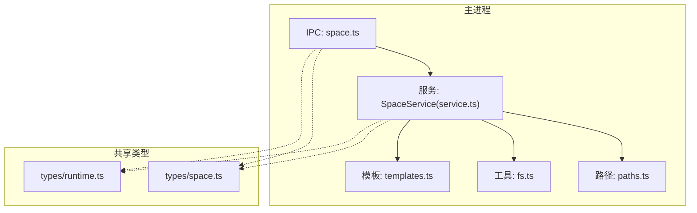
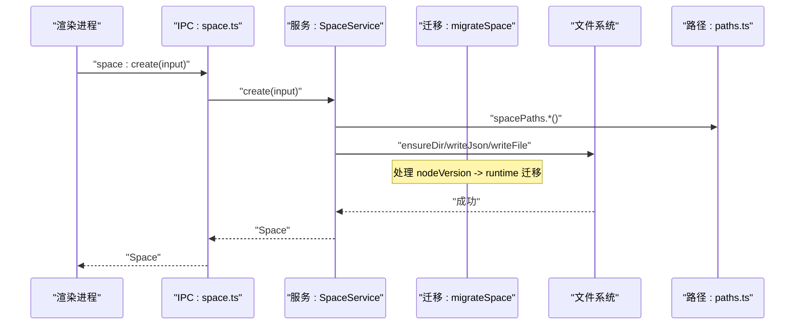
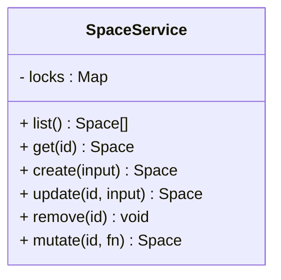
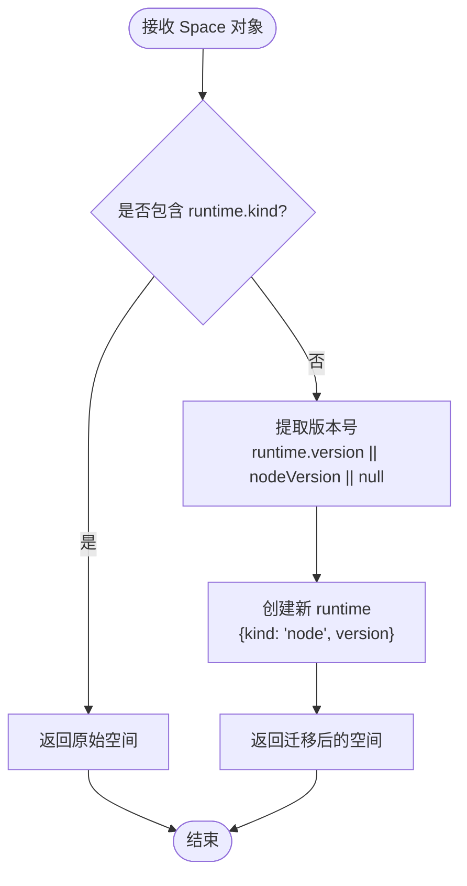
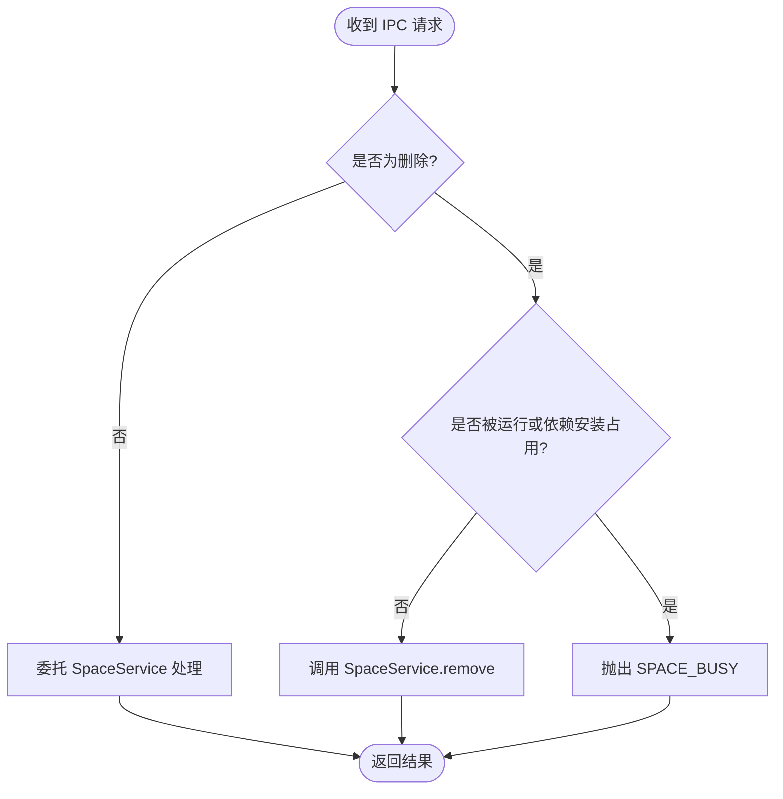
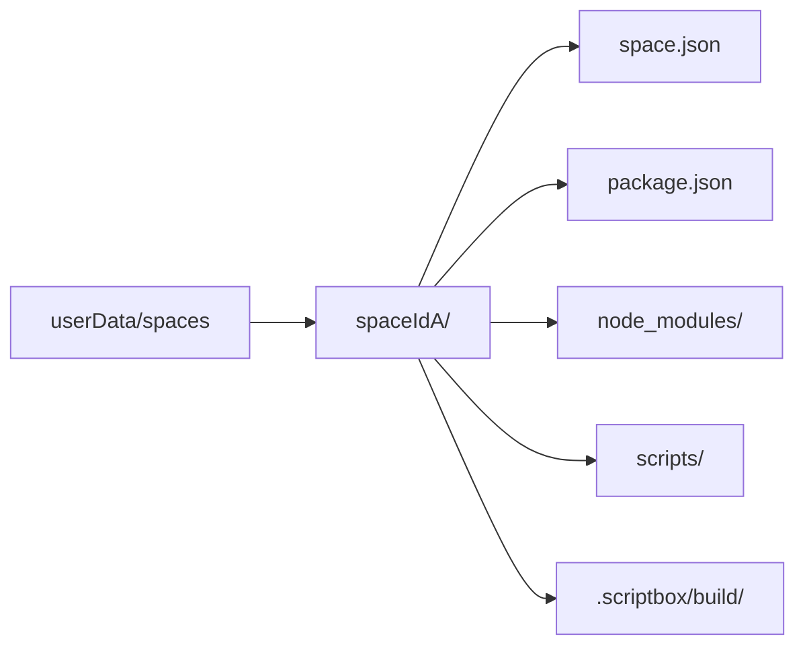
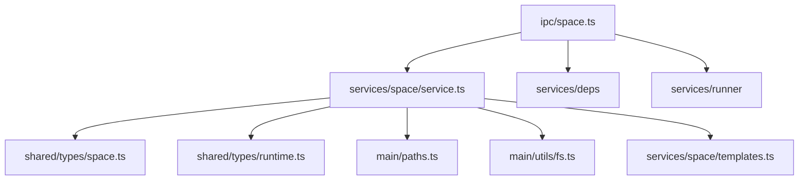

# Space 服务（项目空间）

<cite>
**本文引用的文件**   
- [src/main/services/space/service.ts](file://src/main/services/space/service.ts)
- [src/main/services/space/templates.ts](file://src/main/services/space/templates.ts)
- [src/main/ipc/space.ts](file://src/main/ipc/space.ts)
- [src/shared/types/space.ts](file://src/shared/types/space.ts)
- [src/shared/types/runtime.ts](file://src/shared/types/runtime.ts)
- [src/main/paths.ts](file://src/main/paths.ts)
- [src/main/utils/fs.ts](file://src/main/utils/fs.ts)
</cite>

## 更新摘要
**变更内容**   
- 增强了空间迁移逻辑，新增 `migrateSpace` 函数处理从旧版 `nodeVersion` 字段到新统一运行时模型的过渡
- 完善了运行时验证和版本解析机制，确保数据完整性
- 扩展了模板系统，增加 Python 项目支持和多语言运行时管理
- 改进了空间创建流程，支持 Node.js 和 Python 两种运行时的自动初始化

## 目录
1. [简介](#简介)
2. [项目结构](#项目结构)
3. [核心组件](#核心组件)
4. [架构总览](#架构总览)
5. [详细组件分析](#详细组件分析)
6. [依赖关系分析](#依赖关系分析)
7. [性能与并发特性](#性能与并发特性)
8. [错误处理策略](#错误处理策略)
9. [数据迁移方案](#数据迁移方案)
10. [故障排查指南](#故障排查指南)
11. [结论](#结论)

## 简介
Space 服务负责 Script Box 中的"项目空间"全生命周期管理，提供空间元数据的创建、读取、更新、删除等能力，并通过 IPC 暴露给渲染进程。其职责包括：
- 项目空间管理：为每个空间维护独立目录、脚本集合与运行配置。
- 数据隔离：通过路径与文件系统实现空间之间的隔离，避免相互干扰。
- 配置文件管理：自动初始化 package.json、pyproject.toml、.npmrc 与欢迎脚本，便于后续依赖安装与版本控制。
- 多语言运行时支持：统一管理 Node.js 和 Python 运行时的版本和配置。

当前实现聚焦于空间元数据与基础文件结构；模板系统已支持预定义模板和自定义模板扩展点，具备多语言运行时管理能力。

## 项目结构
Space 相关代码主要分布在以下位置：
- 主进程服务层：space/service.ts 实现核心业务逻辑和迁移功能。
- IPC 接口层：ipc/space.ts 将前端调用映射到服务方法。
- 类型定义：shared/types/space.ts 定义 Space、ScriptMeta、RunConfig 等数据结构；shared/types/runtime.ts 定义运行时类型。
- 路径与工具：main/paths.ts 提供安全的路径构造；main/utils/fs.ts 提供安全的 JSON 读写与目录操作。
- 模板资源：services/space/templates.ts 提供 .npmrc、pyproject.toml 与欢迎脚本模板。

图表来源
- [src/main/ipc/space.ts:1-26](file://src/main/ipc/space.ts#L1-L26)
- [src/main/services/space/service.ts:1-213](file://src/main/services/space/service.ts#L1-L213)
- [src/main/paths.ts:1-62](file://src/main/paths.ts#L1-L62)
- [src/main/utils/fs.ts:1-35](file://src/main/utils/fs.ts#L1-L35)
- [src/main/services/space/templates.ts:1-35](file://src/main/services/space/templates.ts#L1-L35)
- [src/shared/types/space.ts:1-120](file://src/shared/types/space.ts#L1-L120)
- [src/shared/types/runtime.ts:1-38](file://src/shared/types/runtime.ts#L1-L38)

章节来源
- [src/main/services/space/service.ts:1-213](file://src/main/services/space/service.ts#L1-L213)
- [src/main/ipc/space.ts:1-26](file://src/main/ipc/space.ts#L1-L26)
- [src/main/paths.ts:1-62](file://src/main/paths.ts#L1-L62)
- [src/main/utils/fs.ts:1-35](file://src/main/utils/fs.ts#L1-L35)
- [src/main/services/space/templates.ts:1-35](file://src/main/services/space/templates.ts#L1-L35)
- [src/shared/types/space.ts:1-120](file://src/shared/types/space.ts#L1-L120)
- [src/shared/types/runtime.ts:1-38](file://src/shared/types/runtime.ts#L1-L38)

## 核心组件
- SpaceService：封装空间的 CRUD、并发安全更新、以及空间根目录与脚本目录的初始化。
- migrateSpace：处理从旧版 nodeVersion 字段到新统一运行时模型的迁移逻辑。
- IPC 注册器：将渲染进程的调用桥接到 SpaceService，并增加"空间忙"校验。
- 路径与安全：ID 白名单校验、路径拼接与子目录访问保护。
- 文件系统工具：原子化 JSON 写入、目录存在性检查与创建。
- 模板系统：默认 .npmrc、pyproject.toml 与欢迎脚本模板，支持多语言。

章节来源
- [src/main/services/space/service.ts:18-213](file://src/main/services/space/service.ts#L18-L213)
- [src/main/ipc/space.ts:9-25](file://src/main/ipc/space.ts#L9-L25)
- [src/main/paths.ts:31-50](file://src/main/paths.ts#L31-L50)
- [src/main/utils/fs.ts:4-34](file://src/main/utils/fs.ts#L4-L34)
- [src/main/services/space/templates.ts:1-35](file://src/main/services/space/templates.ts#L1-L35)

## 架构总览
Space 服务采用"IPC + Service + Paths/Utils"的分层结构。渲染进程通过 IPC 调用空间接口，主进程在 service 中完成业务逻辑，使用 paths 生成安全路径，借助 fs 工具进行安全的文件读写。新增的迁移层确保向后兼容性，支持从旧版数据结构平滑升级到新的统一运行时模型。

图表来源
- [src/main/ipc/space.ts:9-13](file://src/main/ipc/space.ts#L9-L13)
- [src/main/services/space/service.ts:31-87](file://src/main/services/space/service.ts#L31-L87)
- [src/main/services/space/service.ts:18-24](file://src/main/services/space/service.ts#L18-L24)
- [src/main/paths.ts:43-50](file://src/main/paths.ts#L43-L50)
- [src/main/utils/fs.ts:14-34](file://src/main/utils/fs.ts#L14-L34)

## 详细组件分析

### SpaceService：空间 CRUD 与并发安全
- list：扫描 spaces 根目录，过滤合法 ID，并行读取各空间 meta 文件，应用迁移逻辑后按更新时间倒序返回。
- get：校验 ID 合法性后读取 space.json，应用迁移逻辑，不存在则抛出未找到错误。
- create：生成唯一 ID，根据运行时类型初始化 scripts 目录、package.json/pyproject.toml、.npmrc、欢迎脚本，最后写入 space.json。
- update：基于 mutate 串行化更新，仅更新传入字段，并刷新 updatedAt。
- remove：先校验存在，再递归删除空间根目录与对应历史目录。
- mutate：基于 per-space Promise 链保证同一空间的多次写操作串行执行，避免竞态条件。

图表来源
- [src/main/services/space/service.ts:26-213](file://src/main/services/space/service.ts#L26-L213)

章节来源
- [src/main/services/space/service.ts:31-213](file://src/main/services/space/service.ts#L31-L213)

### migrateSpace：运行时模型迁移
- 检测空间是否已包含新的 runtime.kind 字段，若存在则直接返回原空间。
- 从旧版 nodeVersion 字段或新版 runtime.version 中提取版本号，默认为 null。
- 将旧版数据结构转换为新的统一运行时模型，设置 kind 为 'node'。
- 确保数据完整性，兼容空值和缺失字段的场景。

图表来源
- [src/main/services/space/service.ts:18-24](file://src/main/services/space/service.ts#L18-L24)

章节来源
- [src/main/services/space/service.ts:18-24](file://src/main/services/space/service.ts#L18-L24)

### IPC 接口：空间 API 暴露
- space:list / space:get / space:create / space:update：直接委托 SpaceService。
- space:remove：在执行删除前检查是否有活跃运行任务或依赖安装任务占用该空间，若占用则拒绝删除。
- space:open-dir：打开空间根目录以便用户手动编辑。

图表来源
- [src/main/ipc/space.ts:9-25](file://src/main/ipc/space.ts#L9-L25)

章节来源
- [src/main/ipc/space.ts:9-25](file://src/main/ipc/space.ts#L9-L25)

### 路径与安全：文件系统隔离
- 所有空间位于 userData/spaces 下，每个空间一个子目录。
- ID 必须匹配白名单正则，防止路径穿越。
- 关键路径：
  - 根目录：spacePaths.root(id)
  - 元数据：spacePaths.meta(id) -> space.json
  - 包配置：spacePaths.pkg(id) -> package.json
  - 依赖目录：spacePaths.nodeModules(id) -> node_modules
  - 脚本目录：spacePaths.scripts(id) -> scripts
  - 构建缓存：spacePaths.build(id) -> .scriptbox/build

图表来源
- [src/main/paths.ts:20-50](file://src/main/paths.ts#L20-L50)

章节来源
- [src/main/paths.ts:31-50](file://src/main/paths.ts#L31-L50)

### 模板系统：预定义模板与多语言支持
- 预定义模板：
  - .npmrc：禁用 fund/audit/update-notifier，启用 package-lock。
  - pyproject.toml：Python 项目配置模板，自动生成项目名称、版本和 Python 版本要求。
  - 欢迎脚本：hello.ts（Node.js）和 hello.py（Python），演示交互输入和运行时版本输出。
- 自定义模板与模板继承：可在 create 流程中引入模板工厂与模板解析器以实现扩展。

章节来源
- [src/main/services/space/templates.ts:1-35](file://src/main/services/space/templates.ts#L1-L35)
- [src/main/services/space/service.ts:79-84](file://src/main/services/space/service.ts#L79-L84)
- [src/main/services/space/service.ts:202-209](file://src/main/services/space/service.ts#L202-L209)

### 数据隔离机制
- 文件系统隔离：每个空间拥有独立目录，脚本、依赖、构建产物均隔离。
- 依赖隔离：每个空间独立的 node_modules 目录，配合各自 package.json 与 .npmrc。
- 环境变量隔离：RunConfig.env 用于脚本运行时注入，属于脚本级配置；空间级环境未在 Space 模型中体现，但可通过 RunConfig.env 实现脚本运行时的变量隔离。
- 运行时隔离：通过 SpaceRuntime 统一管理不同语言的运行时版本，确保环境一致性。

章节来源
- [src/main/paths.ts:43-50](file://src/main/paths.ts#L43-L50)
- [src/shared/types/space.ts:16-37](file://src/shared/types/space.ts#L16-L37)
- [src/shared/types/runtime.ts:1-38](file://src/shared/types/runtime.ts#L1-L38)

### 配置文件管理
- package.json：创建 Node.js 空间时自动生成私有包描述，名称包含空间 ID 前缀，初始无依赖。
- pyproject.toml：创建 Python 空间时自动生成项目配置，包含项目名称、版本和 Python 版本要求。
- .npmrc：创建 Node.js 空间时写入默认配置，关闭不必要的网络行为，启用 lockfile。
- 版本控制集成：由于每个空间有独立配置文件，可纳入版本控制；建议忽略 node_modules 与 .scriptbox 目录。

章节来源
- [src/main/services/space/service.ts:79-84](file://src/main/services/space/service.ts#L79-L84)
- [src/main/services/space/service.ts:202-209](file://src/main/services/space/service.ts#L202-L209)
- [src/main/services/space/templates.ts:1-35](file://src/main/services/space/templates.ts#L1-L35)

### 服务间通信接口
- 渲染进程通过 IPC 调用空间接口，主进程在 ipc/space.ts 中注册处理器。
- 删除前会查询 runnerService 与 depsService 的状态，确保空间未被占用。

章节来源
- [src/main/ipc/space.ts:1-25](file://src/main/ipc/space.ts#L1-L25)

## 依赖关系分析
- SpaceService 依赖：
  - shared/types：Space、ScriptMeta、RunConfig、SpaceRuntime 等类型。
  - main/paths：空间与历史路径构造。
  - main/utils/fs：安全的 JSON 读写与目录操作。
  - services/space/templates：默认模板常量。
- IPC 层依赖：
  - services/deps、services/runner：用于删除前的占用检查。
  - electron.shell：打开系统文件管理器。

图表来源
- [src/main/ipc/space.ts:1-25](file://src/main/ipc/space.ts#L1-L25)
- [src/main/services/space/service.ts:1-213](file://src/main/services/space/service.ts#L1-L213)
- [src/shared/types/space.ts:1-120](file://src/shared/types/space.ts#L1-L120)
- [src/shared/types/runtime.ts:1-38](file://src/shared/types/runtime.ts#L1-L38)
- [src/main/paths.ts:1-62](file://src/main/paths.ts#L1-L62)
- [src/main/utils/fs.ts:1-35](file://src/main/utils/fs.ts#L1-L35)
- [src/main/services/space/templates.ts:1-35](file://src/main/services/space/templates.ts#L1-L35)

章节来源
- [src/main/ipc/space.ts:1-25](file://src/main/ipc/space.ts#L1-L25)
- [src/main/services/space/service.ts:1-213](file://src/main/services/space/service.ts#L1-L213)

## 性能与并发特性
- 列表查询：对多个空间 meta 文件进行并行读取，提升 IO 吞吐。
- 更新串行化：per-space Promise 链保证同一空间的多次更新顺序执行，避免覆盖。
- 原子写入：JSON 写入通过临时文件+重命名实现，降低崩溃导致的不完整文件风险。
- 迁移优化：migrateSpace 函数轻量高效，仅在读取空间时执行，不影响写入性能。

优化建议
- 列表分页：当空间数量较大时，考虑分页或增量同步。
- 缓存热点：对频繁访问的空间元数据进行内存缓存，减少磁盘 IO。
- 批量操作：如需批量更新，可合并为单次事务式写入，减少锁竞争。
- 迁移缓存：对已迁移的空间进行标记，避免重复迁移计算。

章节来源
- [src/main/services/space/service.ts:31-55](file://src/main/services/space/service.ts#L31-L55)
- [src/main/services/space/service.ts:155-168](file://src/main/services/space/service.ts#L155-L168)
- [src/main/utils/fs.ts:28-34](file://src/main/utils/fs.ts#L28-L34)
- [src/main/services/space/service.ts:18-24](file://src/main/services/space/service.ts#L18-L24)

## 错误处理策略
- 未找到空间：get 失败时抛出 SPACE_NOT_FOUND。
- 空间忙：删除前检查 runnerService.hasActiveInSpace 与 depsService.isBusy，任一为真则抛出 SPACE_BUSY。
- 路径安全：非法 ID 触发路径构造保护，抛出 SPACE_NOT_FOUND。
- 迁移异常：migrateSpace 函数设计为幂等操作，不会抛出异常，确保数据完整性。

建议
- 统一错误码与消息格式，便于前端展示与日志追踪。
- 对 I/O 异常进行捕获与重试（如幂等写入）。
- 添加迁移失败的监控和告警机制。

章节来源
- [src/main/services/space/service.ts:57-62](file://src/main/services/space/service.ts#L57-L62)
- [src/main/ipc/space.ts:15-18](file://src/main/ipc/space.ts#L15-L18)
- [src/main/paths.ts:31-38](file://src/main/paths.ts#L31-L38)
- [src/main/services/space/service.ts:18-24](file://src/main/services/space/service.ts#L18-L24)

## 数据迁移方案
**新增** 空间数据迁移是 Space 服务的核心功能之一，确保从旧版数据结构平滑升级到新的统一运行时模型。

### 迁移策略
- **向后兼容**：migrateSpace 函数检测空间是否已包含新的 runtime.kind 字段，若存在则跳过迁移。
- **版本解析**：优先使用 runtime.version，回退到 nodeVersion，最终默认为 null。
- **类型转换**：将旧版的 nodeVersion 字符串转换为新的 SpaceRuntime 对象，设置 kind 为 'node'。
- **幂等性**：迁移操作可重复执行，不会产生副作用。

### 迁移流程
1. 读取空间元数据 space.json。
2. 调用 migrateSpace 进行数据转换。
3. 在 list 和 get 操作中自动应用迁移。
4. 保持向后兼容，支持混合新旧格式的空间。

### 版本演进
- 当前 Space 模型包含 id、name、description、runtime、pythonManager、pythonVersionSource、createdAt、updatedAt、scripts 字段。
- nodeVersion 作为遗留字段保留，仅用于迁移过程。
- 未来可通过 schemaVersion 字段实现更复杂的迁移管线。

章节来源
- [src/main/services/space/service.ts:18-24](file://src/main/services/space/service.ts#L18-L24)
- [src/main/services/space/service.ts:40-42](file://src/main/services/space/service.ts#L40-L42)
- [src/main/services/space/service.ts:61](file://src/main/services/space/service.ts#L61)
- [src/shared/types/space.ts:35-36](file://src/shared/types/space.ts#L35-L36)

## 故障排查指南
- 无法列出空间：
  - 检查 userData/spaces 是否存在与可读。
  - 确认空间目录名符合 ID_PATTERN。
- 删除失败：
  - 检查是否有运行中的脚本或依赖安装任务占用该空间。
  - 查看 runnerService 与 depsService 状态。
- 空间文件损坏：
  - 检查 space.json 是否完整（writeJson 原子写入可降低风险）。
  - 验证 package.json、pyproject.toml 与 .npmrc 是否被外部修改。
- 权限问题：
  - 确保应用对 userData 目录具有读写权限。
- 迁移问题：
  - 检查 migrateSpace 是否正确处理了 nodeVersion 到 runtime 的转换。
  - 验证 SpaceRuntime 类型定义是否与预期一致。

章节来源
- [src/main/services/space/service.ts:31-55](file://src/main/services/space/service.ts#L31-L55)
- [src/main/ipc/space.ts:15-18](file://src/main/ipc/space.ts#L15-L18)
- [src/main/utils/fs.ts:28-34](file://src/main/utils/fs.ts#L28-L34)
- [src/main/services/space/service.ts:18-24](file://src/main/services/space/service.ts#L18-L24)

## 结论
Space 服务提供了稳定、安全且可扩展的项目空间管理能力。通过严格的 ID 校验与路径隔离，结合原子写入与并发串行化，保证了多空间场景下的数据一致性与安全性。**新增的迁移机制确保了从旧版 nodeVersion 字段到新统一运行时模型的平滑过渡，提升了系统的向后兼容性和数据完整性**。当前模板系统已支持 Node.js 和 Python 双语言环境，内置模板与自动化初始化功能便于依赖管理与版本控制。服务间通信通过 IPC 清晰解耦，错误处理策略明确，具备良好可维护性。未来的扩展点包括自定义模板系统、模板继承机制以及更复杂的数据迁移管线。