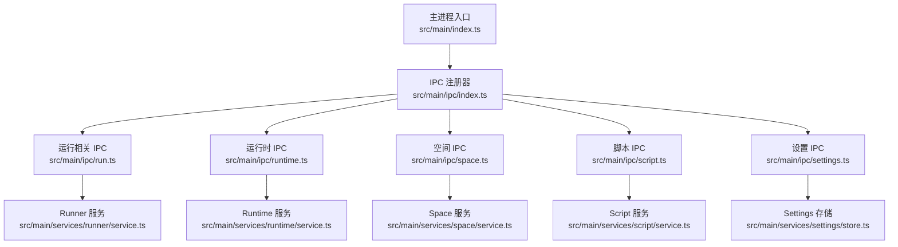
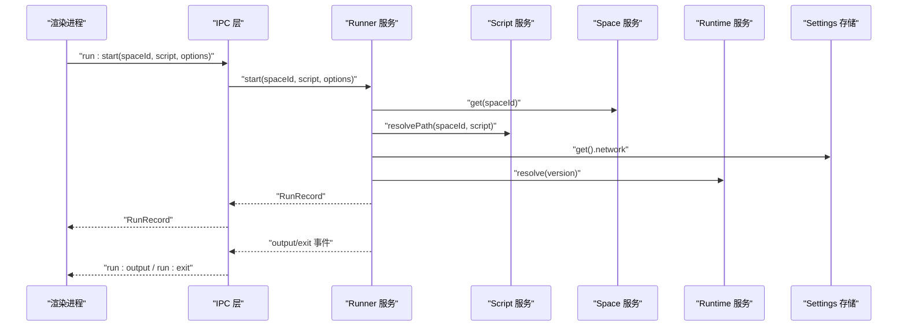
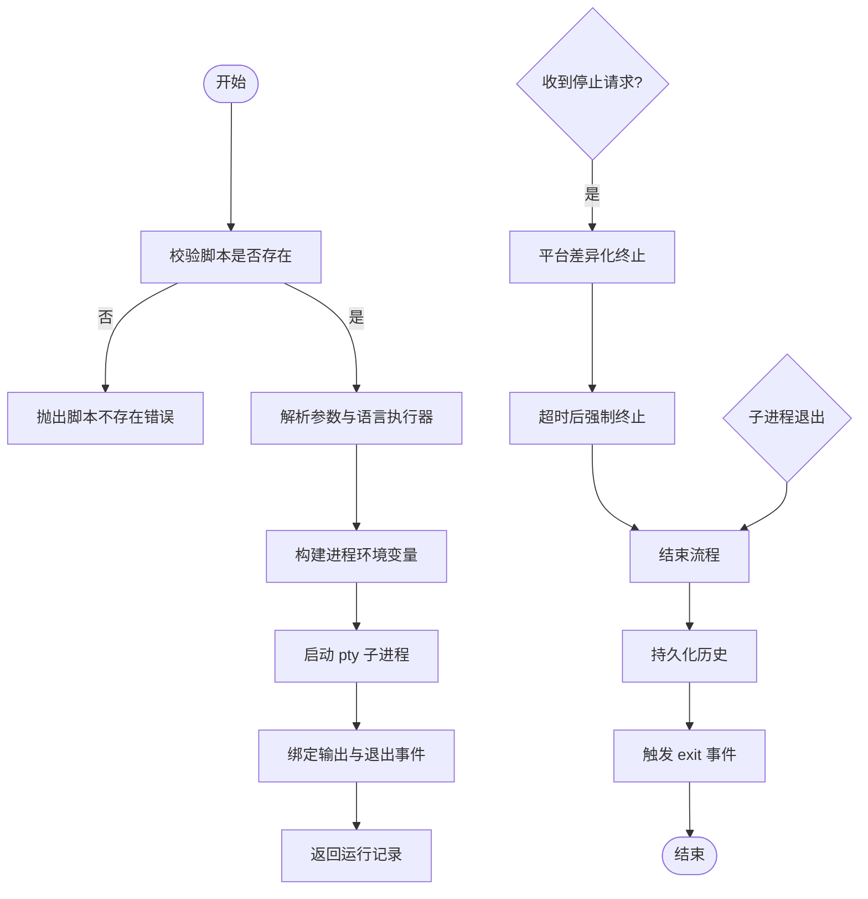
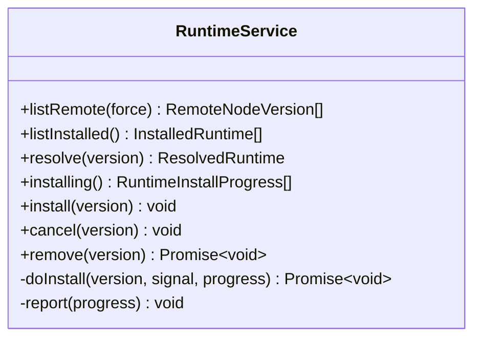
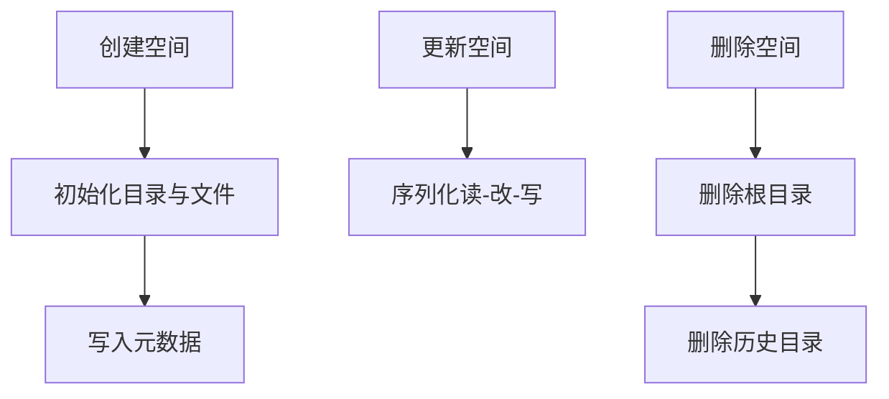
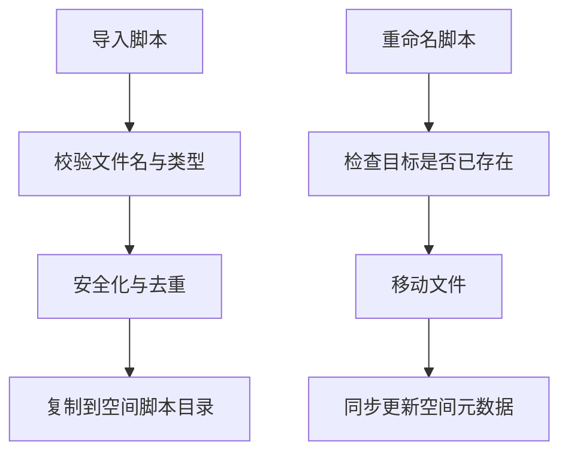
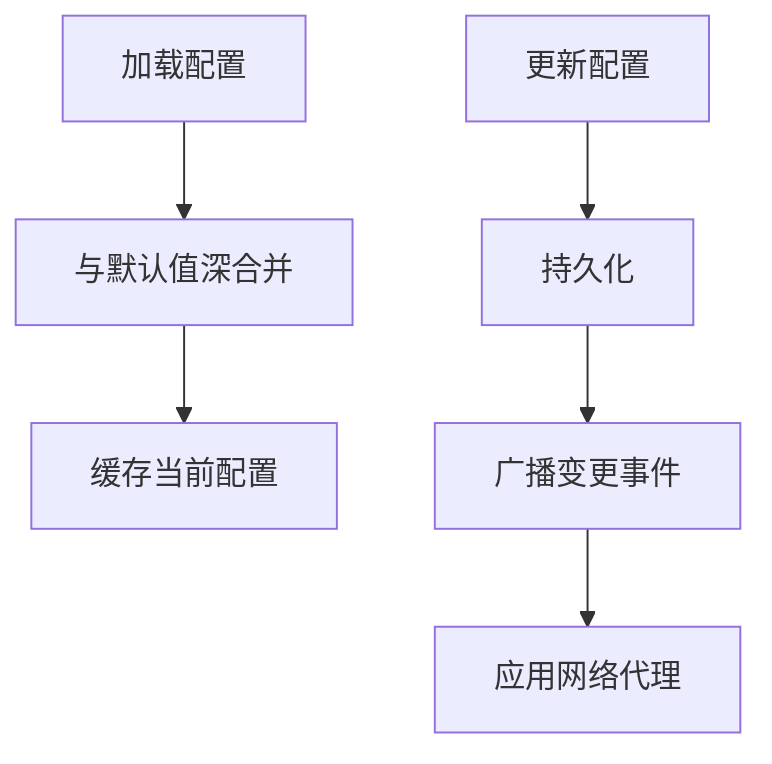
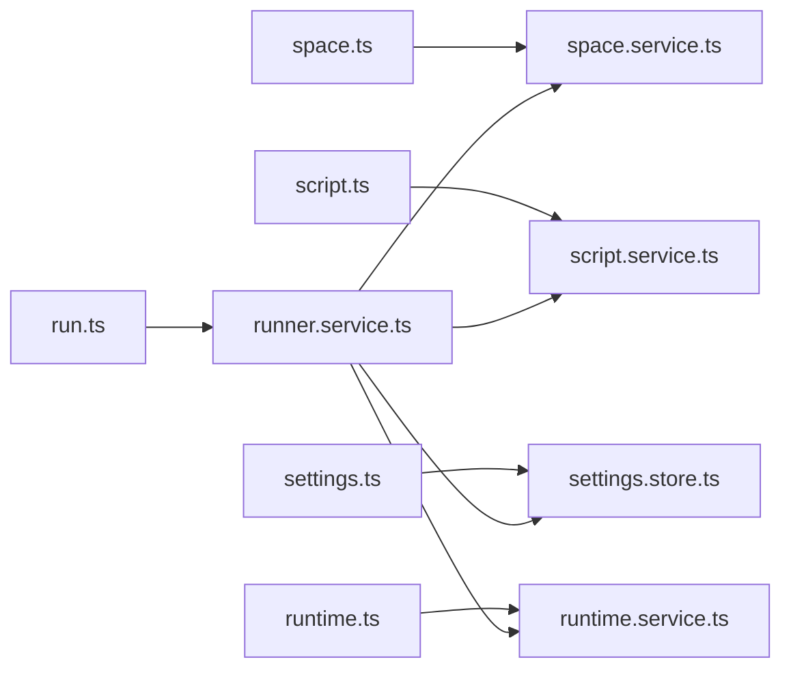

# 服务层架构

<cite>
**本文引用的文件**   
- [src/main/index.ts](file://src/main/index.ts)
- [src/main/ipc/index.ts](file://src/main/ipc/index.ts)
- [src/main/ipc/run.ts](file://src/main/ipc/run.ts)
- [src/main/ipc/runtime.ts](file://src/main/ipc/runtime.ts)
- [src/main/ipc/space.ts](file://src/main/ipc/space.ts)
- [src/main/ipc/script.ts](file://src/main/ipc/script.ts)
- [src/main/ipc/settings.ts](file://src/main/ipc/settings.ts)
- [src/main/services/runner/service.ts](file://src/main/services/runner/service.ts)
- [src/main/services/runtime/service.ts](file://src/main/services/runtime/service.ts)
- [src/main/services/space/service.ts](file://src/main/services/space/service.ts)
- [src/main/services/script/service.ts](file://src/main/services/script/service.ts)
- [src/main/services/settings/store.ts](file://src/main/services/settings/store.ts)
</cite>

## 目录
1. [引言](#引言)
2. [项目结构](#项目结构)
3. [核心组件](#核心组件)
4. [架构总览](#架构总览)
5. [详细组件分析](#详细组件分析)
6. [依赖关系分析](#依赖关系分析)
7. [性能考量](#性能考量)
8. [故障排查指南](#故障排查指南)
9. [结论](#结论)
10. [附录](#附录)

## 引言
本设计文档聚焦 Script Box 的主进程服务层，围绕单一职责、依赖注入与接口抽象三大理念，系统阐述 Runner（脚本运行）、Runtime（环境管理）、Space（项目空间）、Script（脚本管理）、Settings（配置管理）等核心服务的职责边界、协作关系、生命周期管理与扩展机制。文档同时提供开发规范与最佳实践，帮助开发者在保持低耦合与高内聚的前提下进行功能扩展与第三方集成。

## 项目结构
主进程入口负责应用引导、IPC 注册、窗口创建与全局事件处理；IPC 层按领域拆分路由到对应服务；服务层以类封装业务逻辑并通过单例导出，供 IPC 与上层调用。

图表来源
- [src/main/index.ts:10-28](file://src/main/index.ts#L10-L28)
- [src/main/ipc/index.ts:10-19](file://src/main/ipc/index.ts#L10-L19)

章节来源
- [src/main/index.ts:10-28](file://src/main/index.ts#L10-L28)
- [src/main/ipc/index.ts:10-19](file://src/main/ipc/index.ts#L10-L19)

## 核心组件
- Runner（脚本运行）：负责解析语言执行器、构建进程环境变量、启动子进程、输出日志、记录历史、停止与清理。
- Runtime（环境管理）：负责远程版本列表获取、本地已安装版本枚举、指定版本解析、下载/校验/解压 Node 运行时、进度上报与取消。
- Space（项目空间）：负责空间元数据 CRUD、并发安全的序列化读写、初始化 npm 包与欢迎脚本。
- Script（脚本管理）：负责脚本文件命名校验、路径解析、读取/写入/导入/重命名/删除、保存运行配置。
- Settings（配置管理）：负责默认配置合并、持久化读写、变更事件广播、网络代理动态生效。

章节来源
- [src/main/services/runner/service.ts:29-146](file://src/main/services/runner/service.ts#L29-L146)
- [src/main/services/runtime/service.ts:37-154](file://src/main/services/runtime/service.ts#L37-L154)
- [src/main/services/space/service.ts:10-90](file://src/main/services/space/service.ts#L10-L90)
- [src/main/services/script/service.ts:16-109](file://src/main/services/script/service.ts#L16-L109)
- [src/main/services/settings/store.ts:8-29](file://src/main/services/settings/store.ts#L8-L29)

## 架构总览
服务层采用“IPC 路由 -> 服务单例”的单向依赖结构。IPC 仅做参数透传与事件转发，不承载业务逻辑；服务之间通过显式导入的单例进行协作，避免循环依赖并便于测试替换。

图表来源
- [src/main/ipc/run.ts:4-18](file://src/main/ipc/run.ts#L4-L18)
- [src/main/services/runner/service.ts:44-89](file://src/main/services/runner/service.ts#L44-L89)
- [src/main/services/space/service.ts:26-31](file://src/main/services/space/service.ts#L26-L31)
- [src/main/services/script/service.ts:18-21](file://src/main/services/script/service.ts#L18-L21)
- [src/main/services/settings/store.ts:17-19](file://src/main/services/settings/store.ts#L17-L19)
- [src/main/services/runtime/service.ts:74-81](file://src/main/services/runtime/service.ts#L74-L81)

## 详细组件分析

### Runner（脚本运行）
- 职责
  - 根据脚本名称解析语言执行器与环境变量。
  - 使用 pty 启动子进程，实时输出日志并持久化历史。
  - 支持写输入、终端尺寸调整、优雅停止与强制终止。
  - 维护活跃运行任务集合，提供查询与批量停止能力。
- 关键流程
  - 启动：校验脚本存在 -> 解析参数与语言执行器 -> 构建进程环境 -> 启动 pty -> 绑定输出与退出回调 -> 返回运行记录。
  - 停止：请求标记 -> 平台差异化终止 -> 超时后强制终止 -> 清理资源。
  - 结束：计算耗时与状态 -> 关闭日志流 -> 持久化历史 -> 触发 exit 事件。
- 错误处理
  - 脚本不存在抛出明确错误。
  - 历史持久化失败不影响主流程但记录错误日志。
- 性能要点
  - 活跃任务以 Map 管理，O(1) 查找。
  - 日志写入与事件发射分离，避免阻塞主线程。

图表来源
- [src/main/services/runner/service.ts:44-89](file://src/main/services/runner/service.ts#L44-L89)
- [src/main/services/runner/service.ts:101-143](file://src/main/services/runner/service.ts#L101-L143)

章节来源
- [src/main/services/runner/service.ts:29-146](file://src/main/services/runner/service.ts#L29-L146)
- [src/main/ipc/run.ts:4-18](file://src/main/ipc/run.ts#L4-L18)

### Runtime（环境管理）
- 职责
  - 拉取远程 Node 版本索引并缓存。
  - 枚举本地已安装版本及其 npm 版本。
  - 解析目标版本为可执行路径与 bin 目录。
  - 后台下载安装、校验 SHA256、解压归档、进度上报与取消。
- 关键流程
  - 安装：校验版本 -> 创建 AbortController -> 下载 -> 校验 -> 解压 -> 完成/错误/取消 -> 清理临时文件。
  - 列表：远程列表带镜像与 TTL 缓存；本地列表过滤无效版本与正在安装的版本。
- 错误处理
  - 未安装、版本不存在、校验失败均抛出结构化错误。
  - 取消与错误统一通过 progress 事件回传。
- 性能要点
  - 远程列表缓存减少网络开销。
  - 安装过程异步且可中断，避免阻塞 UI。

图表来源
- [src/main/services/runtime/service.ts:37-154](file://src/main/services/runtime/service.ts#L37-L154)

章节来源
- [src/main/services/runtime/service.ts:37-154](file://src/main/services/runtime/service.ts#L37-L154)
- [src/main/ipc/runtime.ts:4-13](file://src/main/ipc/runtime.ts#L4-L13)

### Space（项目空间）
- 职责
  - 空间元数据的增删改查。
  - 并发安全的序列化读写（同一空间互斥）。
  - 初始化 npm 包、.npmrc 与欢迎脚本。
- 关键流程
  - 创建：生成 ID -> 初始化目录与文件 -> 写入元数据。
  - 更新：字段校验与赋值 -> 更新时间戳 -> 持久化。
  - 删除：校验存在 -> 递归删除根目录与历史目录。
- 并发控制
  - 使用 per-space 的 Promise 链保证读-改-写的串行化，避免竞态条件。

图表来源
- [src/main/services/space/service.ts:33-55](file://src/main/services/space/service.ts#L33-L55)
- [src/main/services/space/service.ts:58-87](file://src/main/services/space/service.ts#L58-L87)
- [src/main/services/space/service.ts:69-73](file://src/main/services/space/service.ts#L69-L73)

章节来源
- [src/main/services/space/service.ts:10-90](file://src/main/services/space/service.ts#L10-L90)
- [src/main/ipc/space.ts:9-25](file://src/main/ipc/space.ts#L9-L25)

### Script（脚本管理）
- 职责
  - 脚本命名与类型识别、绝对路径解析。
  - 脚本文件的读取、写入、创建、导入、重命名、删除。
  - 保存脚本的运行参数与环境变量配置。
- 关键流程
  - 导入：校验文件名 -> 安全化命名 -> 去重 -> 复制到空间脚本目录。
  - 重命名：校验目标不存在 -> 移动文件 -> 同步更新空间元数据中的键名。
- 约束与校验
  - 非法脚本名直接拒绝。
  - 重复创建或覆盖保护。

图表来源
- [src/main/services/script/service.ts:60-76](file://src/main/services/script/service.ts#L60-L76)
- [src/main/services/script/service.ts:78-92](file://src/main/services/script/service.ts#L78-L92)

章节来源
- [src/main/services/script/service.ts:16-109](file://src/main/services/script/service.ts#L16-L109)
- [src/main/ipc/script.ts:4-13](file://src/main/ipc/script.ts#L4-L13)

### Settings（配置管理）
- 职责
  - 加载默认配置与用户配置，深合并后作为当前配置。
  - 提供 get/update 接口，并在变更后持久化与广播事件。
  - 监听变更并动态应用网络代理。
- 关键流程
  - 加载：读取配置文件 -> 与默认值合并 -> 缓存当前配置。
  - 更新：合并补丁 -> 持久化 -> 触发 change 事件。
  - 代理：变更时调用网络模块应用代理，失败仅记录日志。

图表来源
- [src/main/services/settings/store.ts:11-25](file://src/main/services/settings/store.ts#L11-L25)
- [src/main/ipc/settings.ts:5-14](file://src/main/ipc/settings.ts#L5-L14)

章节来源
- [src/main/services/settings/store.ts:8-29](file://src/main/services/settings/store.ts#L8-L29)
- [src/main/ipc/settings.ts:5-14](file://src/main/ipc/settings.ts#L5-L14)

## 依赖关系分析
- 服务间依赖
  - Runner 依赖 Space、Script、Settings、Runtime（用于解析运行环境）。
  - Space 与 Script 相互独立，但 Script 会读取 Space 元数据。
  - Runtime 依赖 Settings（镜像地址）与网络模块。
  - Settings 独立，仅依赖文件系统与默认配置。
- IPC 与服务映射
  - run.ts -> runnerService/historyStore
  - runtime.ts -> runtimeService
  - space.ts -> spaceService（并检查 runnerService 与 depsService 占用）
  - script.ts -> scriptService
  - settings.ts -> settingsStore（并触发 applyProxy）

图表来源
- [src/main/ipc/run.ts:1-18](file://src/main/ipc/run.ts#L1-L18)
- [src/main/ipc/runtime.ts:1-13](file://src/main/ipc/runtime.ts#L1-L13)
- [src/main/ipc/space.ts:1-25](file://src/main/ipc/space.ts#L1-L25)
- [src/main/ipc/script.ts:1-13](file://src/main/ipc/script.ts#L1-L13)
- [src/main/ipc/settings.ts:1-14](file://src/main/ipc/settings.ts#L1-L14)
- [src/main/services/runner/service.ts:10-18](file://src/main/services/runner/service.ts#L10-L18)

章节来源
- [src/main/ipc/run.ts:1-18](file://src/main/ipc/run.ts#L1-L18)
- [src/main/ipc/runtime.ts:1-13](file://src/main/ipc/runtime.ts#L1-L13)
- [src/main/ipc/space.ts:1-25](file://src/main/ipc/space.ts#L1-L25)
- [src/main/ipc/script.ts:1-13](file://src/main/ipc/script.ts#L1-L13)
- [src/main/ipc/settings.ts:1-14](file://src/main/ipc/settings.ts#L1-L14)
- [src/main/services/runner/service.ts:10-18](file://src/main/services/runner/service.ts#L10-L18)

## 性能考量
- Runner
  - 活跃任务 Map 访问 O(1)。
  - 日志写入与事件发射解耦，避免阻塞。
  - 停止策略兼顾优雅与强制，防止僵尸进程。
- Runtime
  - 远程版本列表缓存（TTL）降低网络压力。
  - 安装过程异步、可中断，进度事件驱动 UI 更新。
- Space
  - 并发安全的序列化读写避免锁竞争与数据损坏。
- Script
  - 批量操作前预检与去重，减少无效 IO。
- Settings
  - 深合并仅在更新时执行，读取走内存缓存。

[本节为通用指导，不直接分析具体文件]

## 故障排查指南
- 无法删除空间
  - 现象：删除空间时报错提示空间忙。
  - 原因：该空间仍有活跃运行任务或依赖安装进行中。
  - 处理：先停止所有运行任务，等待依赖安装完成后再删除。
  - 参考实现：空间删除前检查 runnerService.hasActiveInSpace 与 depsService.isBusy。
- 脚本运行找不到文件
  - 现象：启动运行报脚本不存在。
  - 原因：脚本名非法或路径解析失败。
  - 处理：确认脚本名合法且存在于目标空间脚本目录。
  - 参考实现：Runner.start 中 resolvePath 与 exists 校验。
- 运行时版本未安装
  - 现象：解析运行时抛出版本未安装错误。
  - 原因：目标版本未下载或未正确解压。
  - 处理：通过 runtime install 安装并等待完成。
  - 参考实现：Runtime.resolve 校验 nodeBinary 存在性。
- 配置变更后代理未生效
  - 现象：修改代理设置后网络请求仍走旧代理。
  - 原因：代理应用失败被捕获但未阻断流程。
  - 处理：查看控制台错误日志，修正代理配置后重试。
  - 参考实现：Settings 变更事件中 applyProxy 的错误捕获。

章节来源
- [src/main/ipc/space.ts:15-19](file://src/main/ipc/space.ts#L15-L19)
- [src/main/services/runner/service.ts:44-49](file://src/main/services/runner/service.ts#L44-L49)
- [src/main/services/runtime/service.ts:74-81](file://src/main/services/runtime/service.ts#L74-L81)
- [src/main/ipc/settings.ts:10-12](file://src/main/ipc/settings.ts#L10-L12)

## 结论
本服务层以清晰的职责划分与显式依赖关系实现了高内聚、低耦合的系统结构。Runner、Runtime、Space、Script、Settings 各司其职，通过 IPC 层暴露稳定接口，既保证了可扩展性，也便于测试与维护。建议在后续扩展中继续遵循单一职责原则，优先通过接口抽象与事件机制进行解耦，确保新增功能对现有链路影响最小。

[本节为总结性内容，不直接分析具体文件]

## 附录

### 服务生命周期管理
- 初始化
  - 主进程启动时加载 Settings、应用代理、恢复历史、注册 IPC、创建主窗口。
- 启动
  - 按需检查更新；激活窗口时确保至少一个主窗口存在。
- 停止
  - 应用退出前调用 runnerService.stopAll 停止所有运行任务。
- 重启
  - 当前无内置热重载；如需重启，应释放资源后重新 bootstrap。

章节来源
- [src/main/index.ts:10-28](file://src/main/index.ts#L10-L28)
- [src/main/index.ts:48-54](file://src/main/index.ts#L48-L54)

### 服务扩展机制与插件架构建议
- 语言执行器扩展
  - 在 Runner 的语言解析处注册新的语言适配器，实现 prepare 钩子以返回命令与参数。
- 运行时镜像扩展
  - 通过 Settings 配置不同镜像源，Runtime 自动适配下载与校验流程。
- 第三方集成
  - 通过 Settings 的网络代理与镜像配置接入企业内网资源。
  - 通过 IPC 暴露新的事件通道，将后端服务事件推送到渲染进程。

[本节为概念性说明，不直接分析具体文件]

### 服务开发规范与最佳实践
- 单一职责
  - 每个服务只负责一个领域的能力，跨领域调用通过显式导入的服务单例。
- 依赖注入
  - 对外暴露稳定的方法签名，便于单元测试替换依赖。
- 接口抽象
  - 对易变的外部能力（如网络、文件系统）尽量抽象为接口或服务，避免硬编码。
- 错误处理
  - 使用结构化错误类型，包含错误码与上下文信息；对不可恢复错误向上抛出，对可恢复错误降级并记录日志。
- 并发安全
  - 共享状态变更需加锁或使用串行队列，避免竞态条件。
- 事件驱动
  - 长耗时或异步操作通过事件通知 UI，避免阻塞主线程。
- 可观测性
  - 关键路径埋点日志，结合 IPC 事件向渲染进程推送诊断信息。

[本节为通用指导，不直接分析具体文件]