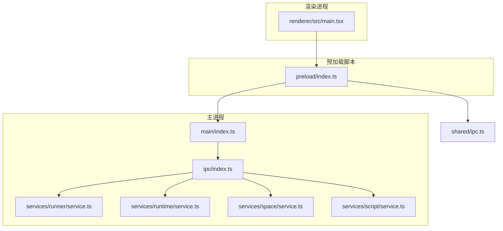
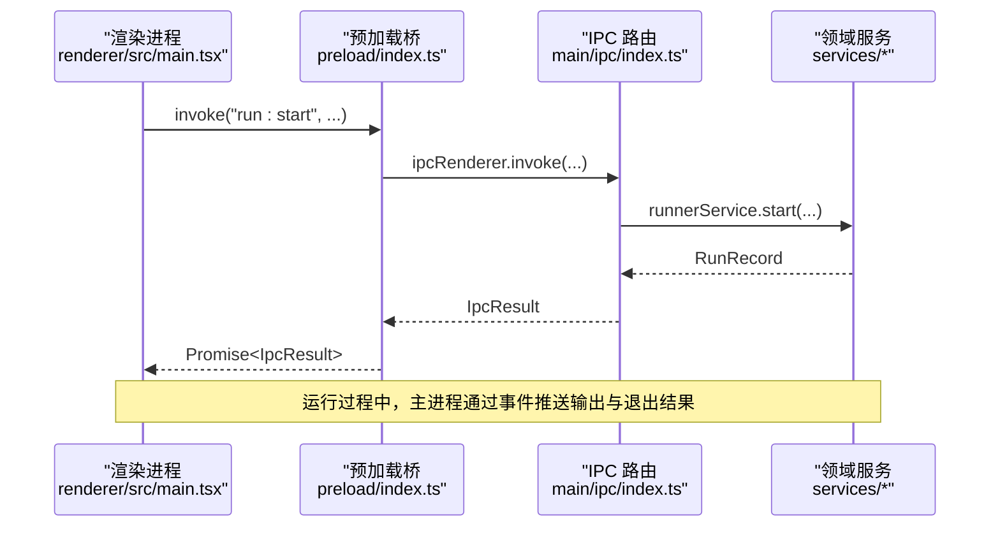
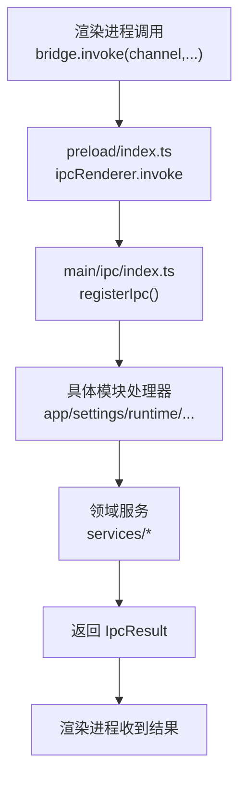
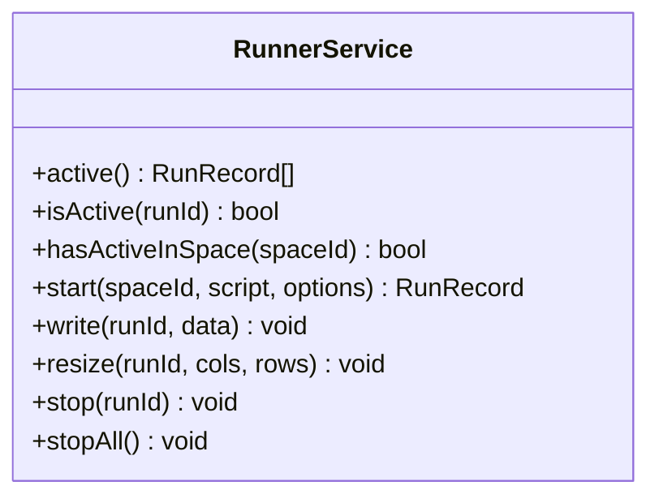
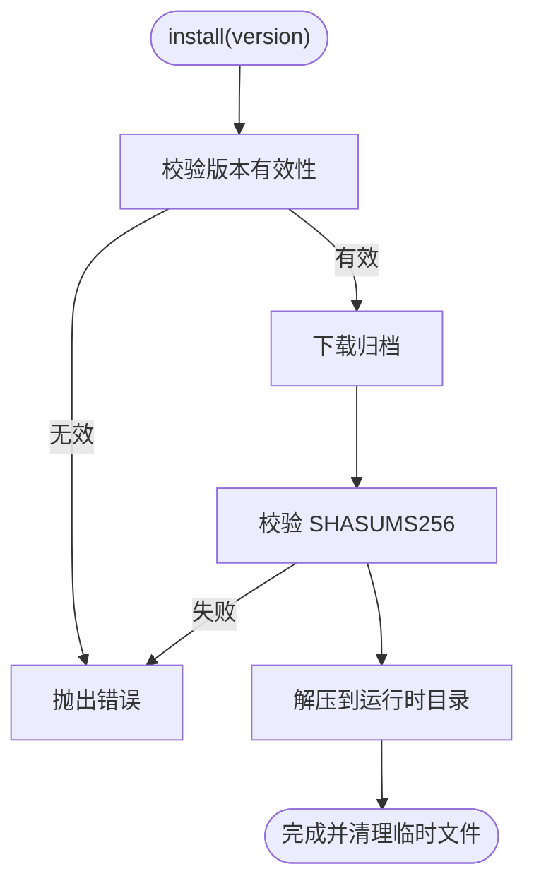
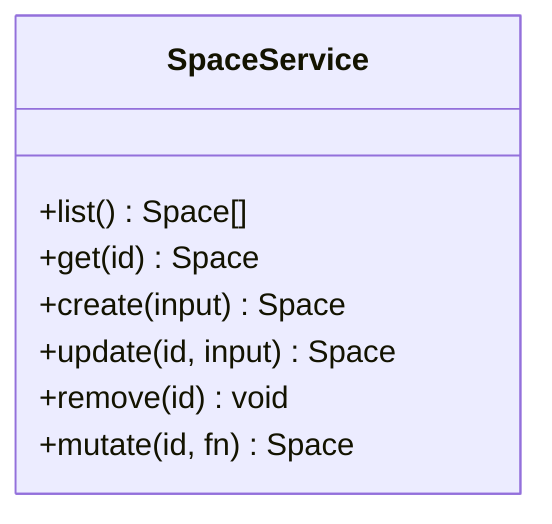
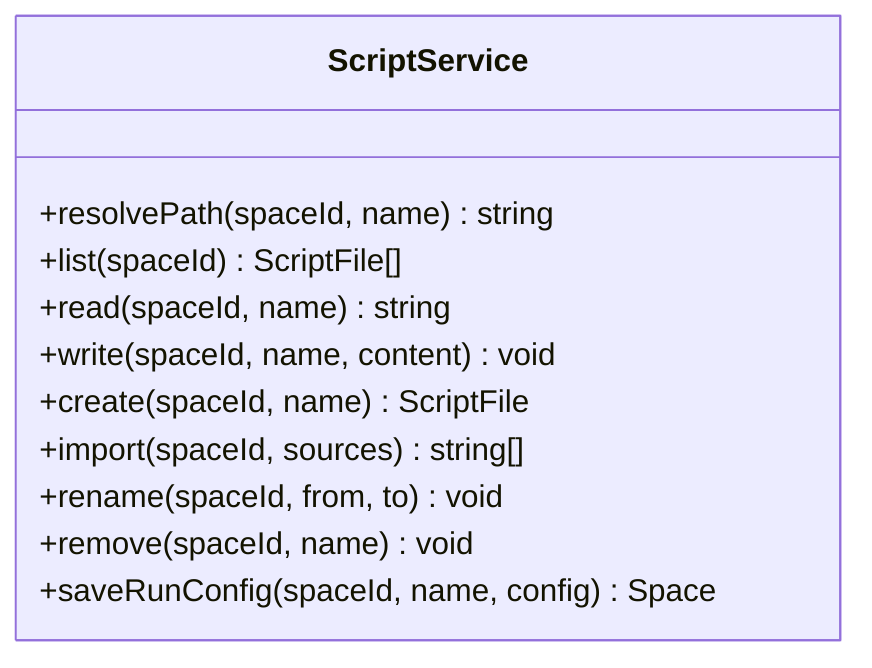
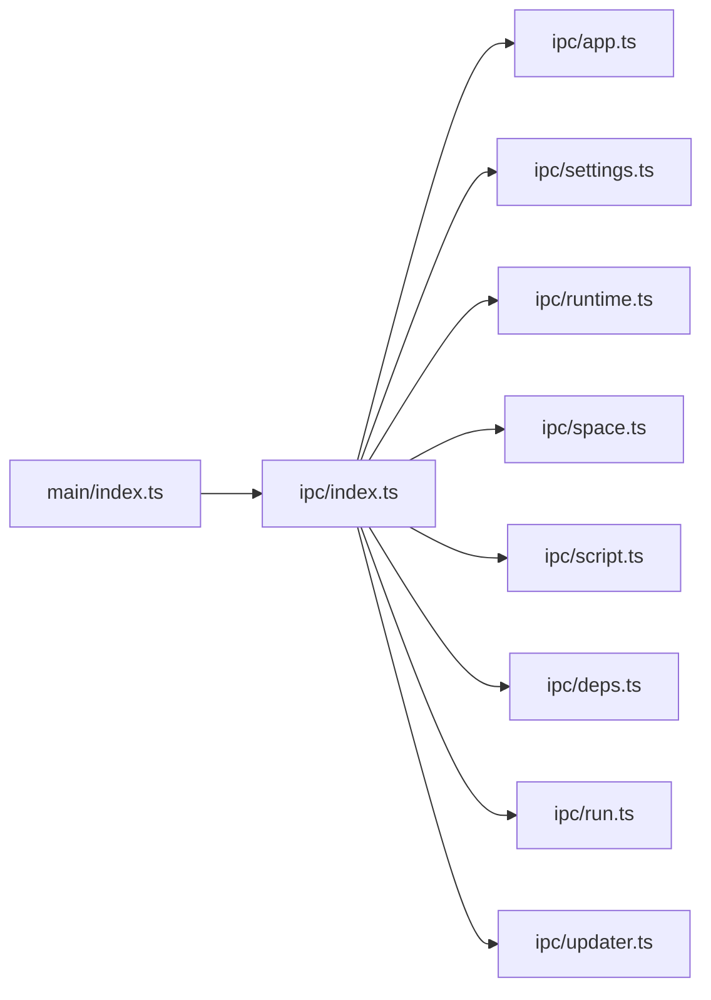

# 架构设计

<cite>
**本文引用的文件**   
- [README.md](file://README.md)
- [src/main/index.ts](file://src/main/index.ts)
- [src/preload/index.ts](file://src/preload/index.ts)
- [src/renderer/src/main.tsx](file://src/renderer/src/main.tsx)
- [src/shared/ipc.ts](file://src/shared/ipc.ts)
- [src/main/ipc/index.ts](file://src/main/ipc/index.ts)
- [src/main/ipc/app.ts](file://src/main/ipc/app.ts)
- [src/main/ipc/settings.ts](file://src/main/ipc/settings.ts)
- [src/main/ipc/runtime.ts](file://src/main/ipc/runtime.ts)
- [src/main/ipc/space.ts](file://src/main/ipc/space.ts)
- [src/main/ipc/script.ts](file://src/main/ipc/script.ts)
- [src/main/ipc/deps.ts](file://src/main/ipc/deps.ts)
- [src/main/ipc/run.ts](file://src/main/ipc/run.ts)
- [src/main/ipc/updater.ts](file://src/main/ipc/updater.ts)
- [src/main/services/runner/service.ts](file://src/main/services/runner/service.ts)
- [src/main/services/runtime/service.ts](file://src/main/services/runtime/service.ts)
- [src/main/services/space/service.ts](file://src/main/services/space/service.ts)
- [src/main/services/script/service.ts](file://src/main/services/script/service.ts)
</cite>

## 目录
1. [简介](#简介)
2. [项目结构](#项目结构)
3. [核心组件](#核心组件)
4. [架构总览](#架构总览)
5. [详细组件分析](#详细组件分析)
6. [依赖关系分析](#依赖关系分析)
7. [性能考虑](#性能考虑)
8. [故障排查指南](#故障排查指南)
9. [结论](#结论)

## 简介
本文件为 Script Box 的架构文档，聚焦 Electron 应用的三层架构（主进程、渲染进程、预加载脚本）与进程间通信机制（IPC），并梳理服务层职责划分（Runner、Runtime、Space、Script、Settings、Deps 等）。同时总结关键设计模式（单例、观察者、策略等）、数据流设计与交互模式，辅以架构图和数据流图，帮助读者快速理解系统全貌。

## 项目结构
仓库采用清晰的三层分层：
- shared：主进程与渲染进程共享的类型定义、IPC 通道契约和默认配置
- main：Electron 主进程入口、IPC 路由与各领域服务（settings、runtime、space、script、deps、runner、updater）
- preload：通过 contextBridge 暴露类型安全的 window.bridge API
- renderer：React 19 + Ant Design 界面

图示来源
- [src/main/index.ts:10-28](file://src/main/index.ts#L10-L28)
- [src/main/ipc/index.ts:10-19](file://src/main/ipc/index.ts#L10-L19)
- [src/preload/index.ts:5-18](file://src/preload/index.ts#L5-L18)
- [src/renderer/src/main.tsx:7-11](file://src/renderer/src/main.tsx#L7-L11)
- [src/shared/ipc.ts:25-99](file://src/shared/ipc.ts#L25-L99)

章节来源
- [README.md:78-86](file://README.md#L78-L86)
- [src/main/index.ts:10-28](file://src/main/index.ts#L10-L28)
- [src/preload/index.ts:5-18](file://src/preload/index.ts#L5-L18)
- [src/renderer/src/main.tsx:7-11](file://src/renderer/src/main.tsx#L7-L11)
- [src/shared/ipc.ts:25-99](file://src/shared/ipc.ts#L25-L99)

## 核心组件
- 主进程引导与生命周期管理：应用启动、代理初始化、窗口创建、更新检查、退出清理
- IPC 路由与广播：统一注册各模块 IPC 处理器，桥接事件到渲染进程
- 预加载桥：在渲染进程中暴露类型安全的 bridge.invoke/send/on API
- 领域服务：
  - RunnerService：脚本运行、pty 终端、输出与历史持久化
  - RuntimeService：Node.js 运行时下载、校验、安装、版本解析
  - SpaceService：运行空间元数据与目录结构管理
  - ScriptService：脚本文件的 CRUD、导入、重命名、运行配置保存
  - SettingsStore：设置读取、更新、代理生效与变更广播
  - DepsService：依赖安装/卸载/更新、缺失扫描、类型库注入（由 deps 模块导出）
  - UpdaterService：自动更新状态与操作（由 updater 模块导出）

章节来源
- [src/main/index.ts:10-28](file://src/main/index.ts#L10-L28)
- [src/main/ipc/index.ts:10-19](file://src/main/ipc/index.ts#L10-L19)
- [src/preload/index.ts:5-18](file://src/preload/index.ts#L5-L18)
- [src/main/services/runner/service.ts:29-146](file://src/main/services/runner/service.ts#L29-L146)
- [src/main/services/runtime/service.ts:37-154](file://src/main/services/runtime/service.ts#L37-L154)
- [src/main/services/space/service.ts:10-90](file://src/main/services/space/service.ts#L10-L90)
- [src/main/services/script/service.ts:16-109](file://src/main/services/script/service.ts#L16-L109)

## 架构总览
整体采用“渲染进程 UI → 预加载桥 → 主进程 IPC → 领域服务”的分层模型。IPC 通道以类型化的 channel 名组织，支持请求/响应、单向发送与主进程推送三类消息。

图示来源
- [src/renderer/src/main.tsx:7-11](file://src/renderer/src/main.tsx#L7-L11)
- [src/preload/index.ts:5-18](file://src/preload/index.ts#L5-L18)
- [src/main/ipc/index.ts:10-19](file://src/main/ipc/index.ts#L10-L19)
- [src/main/services/runner/service.ts:44-88](file://src/main/services/runner/service.ts#L44-L88)

## 详细组件分析

### 进程间通信（IPC）与桥接
- 通道契约：shared/ipc.ts 定义了 IpcInvokeMap、IpcSendMap、IpcEventMap，明确三类通道及参数/返回类型
- 预加载桥：preload/index.ts 暴露 bridge.invoke/send/on，封装 electron.ipcRenderer，并提供 on 的取消订阅能力
- 主进程路由：main/ipc/index.ts 统一注册 app/settings/runtime/space/script/deps/run/updater 等模块处理器
- 事件广播：helpers.broadcast 将主进程 EventEmitter 事件转发至渲染进程

图示来源
- [src/shared/ipc.ts:25-99](file://src/shared/ipc.ts#L25-L99)
- [src/preload/index.ts:5-18](file://src/preload/index.ts#L5-L18)
- [src/main/ipc/index.ts:10-19](file://src/main/ipc/index.ts#L10-L19)

章节来源
- [src/shared/ipc.ts:25-99](file://src/shared/ipc.ts#L25-L99)
- [src/preload/index.ts:5-18](file://src/preload/index.ts#L5-L18)
- [src/main/ipc/index.ts:10-19](file://src/main/ipc/index.ts#L10-L19)

### Runner 服务（脚本执行与终端）
- 职责：根据空间与脚本解析运行环境，构造命令与环境变量，使用 node-pty 启动子进程，实时输出日志，记录历史
- 关键流程：start → 解析语言运行器 → 构建环境变量 → 启动 pty → onData/onExit → finish 写入历史并广播退出事件
- 并发控制：内部 Map 维护活跃运行实例；stopAll 在应用退出时调用

图示来源
- [src/main/services/runner/service.ts:29-146](file://src/main/services/runner/service.ts#L29-L146)

章节来源
- [src/main/services/runner/service.ts:44-146](file://src/main/services/runner/service.ts#L44-L146)

### Runtime 服务（运行时管理与下载）
- 职责：远程版本列表获取与缓存、已安装版本枚举、版本解析、下载/校验/解压、进度事件上报
- 安全与可靠性：SHASUMS256.txt 校验、AbortController 支持取消、临时文件清理
- 事件模型：progress 事件经 IPC 广播给渲染进程

图示来源
- [src/main/services/runtime/service.ts:87-151](file://src/main/services/runtime/service.ts#L87-L151)

章节来源
- [src/main/services/runtime/service.ts:37-154](file://src/main/services/runtime/service.ts#L37-L154)

### Space 服务（运行空间）
- 职责：空间元数据读写、目录结构初始化（package.json、.npmrc、欢迎脚本）、按 ID 序列化读写避免并发覆盖
- 保护性删除：删除前校验是否仍有活跃运行或依赖任务

图示来源
- [src/main/services/space/service.ts:10-90](file://src/main/services/space/service.ts#L10-L90)

章节来源
- [src/main/services/space/service.ts:10-90](file://src/main/services/space/service.ts#L10-L90)

### Script 服务（脚本文件管理）
- 职责：脚本路径解析、CRUD、导入外部脚本、重命名、删除、保存运行配置（参数与环境变量）
- 名称规范：内置命名校验与模板生成，确保文件名合法且唯一

图示来源
- [src/main/services/script/service.ts:16-109](file://src/main/services/script/service.ts#L16-L109)

章节来源
- [src/main/services/script/service.ts:16-109](file://src/main/services/script/service.ts#L16-L109)

### Settings 与网络代理
- SettingsStore：提供 get/update 接口，并在变更时触发 change 事件
- 代理生效：settings 变更时调用 applyProxy 使全局网络代理生效
- 连接测试：testConnection 用于验证镜像/代理连通性

章节来源
- [src/main/ipc/settings.ts:5-14](file://src/main/ipc/settings.ts#L5-L14)
- [src/main/services/settings/index.ts:1-3](file://src/main/services/settings/index.ts#L1-L3)

### 依赖管理（Deps）
- 功能：安装/卸载/更新依赖、一键安装全部、扫描缺失依赖、类型库注入（含 Node 类型）
- 事件：task 事件经 IPC 广播，供前端展示进度与状态

章节来源
- [src/main/ipc/deps.ts:4-17](file://src/main/ipc/deps.ts#L4-L17)
- [src/main/services/deps/index.ts:1-3](file://src/main/services/deps/index.ts#L1-L3)

### 自动更新（Updater）
- 功能：查询状态、检查更新、下载与安装
- 事件：status 事件经 IPC 广播

章节来源
- [src/main/ipc/updater.ts:4-11](file://src/main/ipc/updater.ts#L4-L11)

## 依赖关系分析
- 主进程入口负责初始化设置、代理、恢复历史、注册 IPC、创建主窗口、启动更新检查，并在退出时停止所有运行中的脚本
- IPC 模块作为门面，聚合各业务模块处理器，屏蔽底层服务细节
- 领域服务之间松耦合，通过 shared 类型与 IPC 契约协作

图示来源
- [src/main/index.ts:10-28](file://src/main/index.ts#L10-L28)
- [src/main/ipc/index.ts:10-19](file://src/main/ipc/index.ts#L10-L19)

章节来源
- [src/main/index.ts:10-28](file://src/main/index.ts#L10-L28)
- [src/main/ipc/index.ts:10-19](file://src/main/ipc/index.ts#L10-L19)

## 性能考虑
- 远程版本列表缓存：RuntimeService 对远程 index.json 做短时缓存，减少频繁网络请求
- 并行 IO：SpaceService.list 使用 Promise.all 并行读取空间元数据
- 终端输出缓冲：RunnerService 通过 pty 实时输出，避免阻塞 UI
- 依赖缓存：共享 npm 缓存，同名同版本包只下载一次（见 README）

[本节为通用指导，不直接分析具体文件]

## 故障排查指南
- 运行时未安装：RuntimeService.resolve 会抛出 RUNTIME_NOT_INSTALLED，需先安装对应版本
- 脚本不存在：RunnerService.start 与 ScriptService.read 会抛出 SCRIPT_NOT_FOUND
- 空间忙：SpaceService.remove 前若存在活跃运行或依赖任务，将抛出 SPACE_BUSY
- 代理失效：settings 变更时会尝试 applyProxy，失败会在控制台打印错误日志
- 更新失败：UpdaterService 的状态变化会通过事件广播，可在前端监听 updater:status

章节来源
- [src/main/services/runtime/service.ts:74-81](file://src/main/services/runtime/service.ts#L74-L81)
- [src/main/services/runner/service.ts:44-49](file://src/main/services/runner/service.ts#L44-L49)
- [src/main/services/script/service.ts:38-42](file://src/main/services/script/service.ts#L38-L42)
- [src/main/ipc/space.ts:15-18](file://src/main/ipc/space.ts#L15-L18)
- [src/main/ipc/settings.ts:10-13](file://src/main/ipc/settings.ts#L10-L13)
- [src/main/ipc/updater.ts:4-11](file://src/main/ipc/updater.ts#L4-L11)

## 结论
Script Box 采用清晰的主进程/预加载/渲染三层架构，通过强类型的 IPC 契约实现稳定可靠的跨进程通信。领域服务职责单一、边界清晰，配合观察者模式的事件广播与策略模式的语言运行器选择，形成高内聚、低耦合的系统结构。该设计在保证用户体验的同时，兼顾了可维护性与可扩展性。