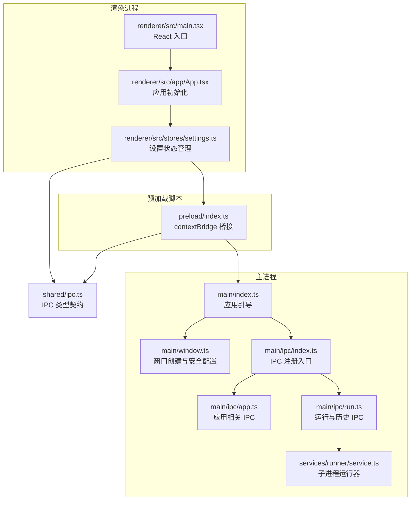
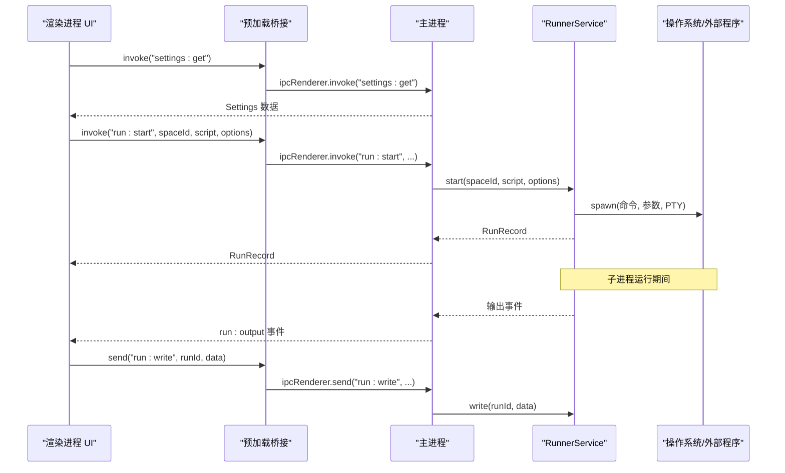
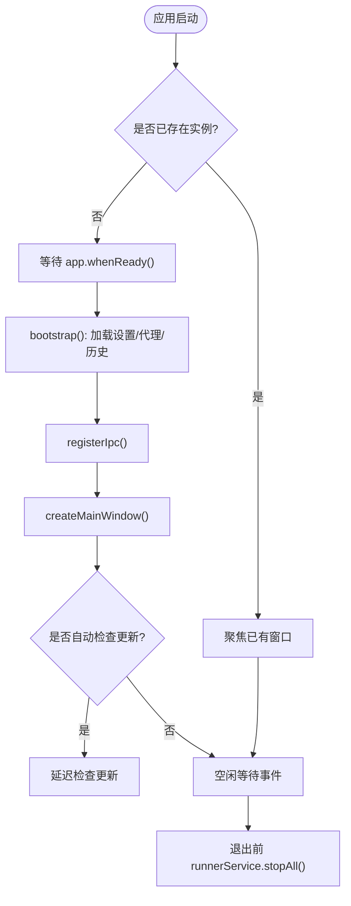
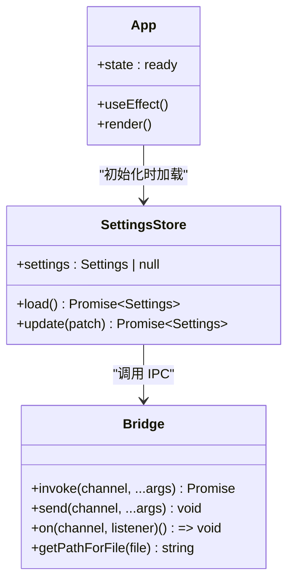
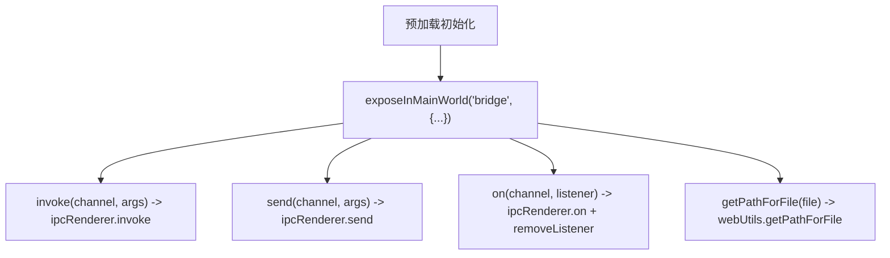
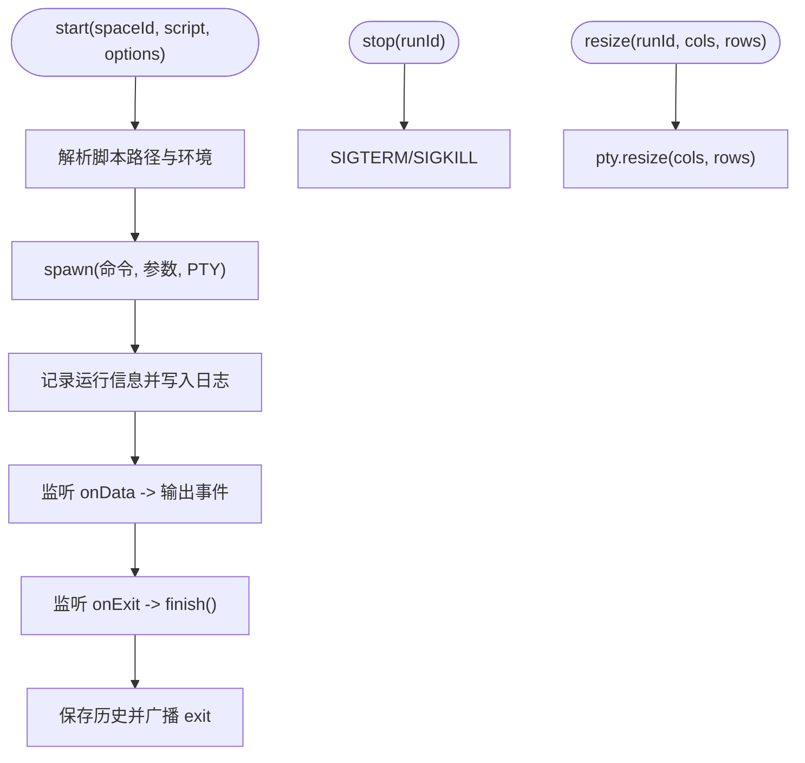
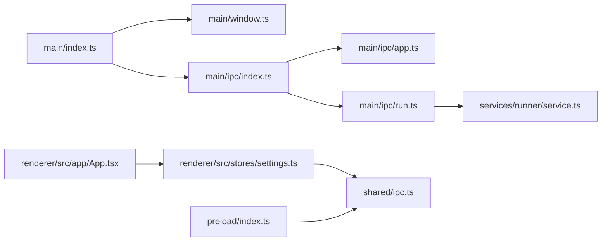

# 进程模型详解

<cite>
**本文引用的文件**   
- [src/main/index.ts](file://src/main/index.ts)
- [src/main/window.ts](file://src/main/window.ts)
- [src/preload/index.ts](file://src/preload/index.ts)
- [src/renderer/src/main.tsx](file://src/renderer/src/main.tsx)
- [src/shared/ipc.ts](file://src/shared/ipc.ts)
- [src/main/ipc/index.ts](file://src/main/ipc/index.ts)
- [src/main/ipc/app.ts](file://src/main/ipc/app.ts)
- [src/main/ipc/run.ts](file://src/main/ipc/run.ts)
- [src/main/services/runner/service.ts](file://src/main/services/runner/service.ts)
- [src/renderer/src/app/App.tsx](file://src/renderer/src/app/App.tsx)
- [src/renderer/src/stores/settings.ts](file://src/renderer/src/stores/settings.ts)
- [package.json](file://package.json)
</cite>

## 目录
1. [引言](#引言)
2. [项目结构](#项目结构)
3. [核心组件](#核心组件)
4. [架构总览](#架构总览)
5. [详细组件分析](#详细组件分析)
6. [依赖关系分析](#依赖关系分析)
7. [性能与内存隔离](#性能与内存隔离)
8. [调试与排错指南](#调试与排错指南)
9. [结论](#结论)

## 引言
本文面向 Script Box 的进程模型，系统性梳理 Electron 主进程、预加载脚本与渲染进程的职责边界、数据流与安全策略。重点覆盖：
- 主进程职责：应用生命周期管理、原生 API 访问、文件系统操作、进程间通信协调、外部子进程运行与日志持久化。
- 渲染进程职责：UI 渲染、用户交互、状态管理、通过桥接调用 IPC。
- 预加载脚本桥梁：安全暴露最小 API、权限控制、上下文隔离。
- 进程间内存隔离机制、安全性考虑与性能优化策略。
- 调试技巧与常见问题排查方法。

## 项目结构
Script Box 采用典型的 Electron 三进程架构：
- 主进程（Main）：负责应用启动、窗口创建、IPC 路由、系统能力访问、子进程管理与更新。
- 预加载脚本（Preload）：在渲染进程上下文中注入受控桥接对象，屏蔽底层 ipcRenderer/webUtils。
- 渲染进程（Renderer）：基于 React 的前端界面，使用 Zustand 进行状态管理，通过桥接对象发起 IPC。

**图表来源**
- [src/main/index.ts:10-53](file://src/main/index.ts#L10-L53)
- [src/main/window.ts:6-45](file://src/main/window.ts#L6-L45)
- [src/main/ipc/index.ts:10-19](file://src/main/ipc/index.ts#L10-L19)
- [src/main/ipc/app.ts:5-35](file://src/main/ipc/app.ts#L5-L35)
- [src/main/ipc/run.ts:4-18](file://src/main/ipc/run.ts#L4-L18)
- [src/main/services/runner/service.ts:29-146](file://src/main/services/runner/service.ts#L29-L146)
- [src/preload/index.ts:5-18](file://src/preload/index.ts#L5-L18)
- [src/renderer/src/main.tsx:7-11](file://src/renderer/src/main.tsx#L7-L11)
- [src/renderer/src/app/App.tsx:13-33](file://src/renderer/src/app/App.tsx#L13-L33)
- [src/renderer/src/stores/settings.ts:11-25](file://src/renderer/src/stores/settings.ts#L11-L25)
- [src/shared/ipc.ts:25-116](file://src/shared/ipc.ts#L25-L116)

**章节来源**
- [src/main/index.ts:10-53](file://src/main/index.ts#L10-L53)
- [src/main/window.ts:6-45](file://src/main/window.ts#L6-L45)
- [src/preload/index.ts:5-18](file://src/preload/index.ts#L5-L18)
- [src/renderer/src/main.tsx:7-11](file://src/renderer/src/main.tsx#L7-L11)
- [src/shared/ipc.ts:25-116](file://src/shared/ipc.ts#L25-L116)

## 核心组件
- 主进程引导与生命周期：单实例锁、ready 引导、激活事件处理、退出前清理。
- 窗口与安全：启用沙箱、上下文隔离、禁用 Node 集成、限制导航与外链打开。
- IPC 契约与路由：统一类型定义、请求/响应、单向事件、发送通道。
- 预加载桥接：仅暴露 invoke/send/on/getPathForFile，隐藏原始 ipcRenderer。
- 渲染状态管理：Zustand store 封装 IPC 调用，订阅主进程事件。
- 运行器服务：子进程 PTY 管理、输出转发、历史记录持久化、停止与强制终止。

**章节来源**
- [src/main/index.ts:10-53](file://src/main/index.ts#L10-L53)
- [src/main/window.ts:17-43](file://src/main/window.ts#L17-L43)
- [src/shared/ipc.ts:25-116](file://src/shared/ipc.ts#L25-L116)
- [src/preload/index.ts:5-18](file://src/preload/index.ts#L5-L18)
- [src/renderer/src/stores/settings.ts:11-25](file://src/renderer/src/stores/settings.ts#L11-L25)
- [src/main/services/runner/service.ts:29-146](file://src/main/services/runner/service.ts#L29-L146)

## 架构总览
Electron 进程模型在 Script Box 中的体现如下：
- 主进程作为唯一可信执行环境，持有所有原生能力与系统资源。
- 预加载脚本通过 contextBridge 暴露最小 API，确保渲染进程无法直接访问 Node/Electron 内部对象。
- 渲染进程通过桥接对象发起 IPC，主进程根据 channel 路由到具体处理器。
- 运行器在主进程中拉起子进程，将标准输入输出映射到 PTY，并通过 IPC 推送给渲染进程展示。

**图表来源**
- [src/preload/index.ts:5-18](file://src/preload/index.ts#L5-L18)
- [src/shared/ipc.ts:25-116](file://src/shared/ipc.ts#L25-L116)
- [src/main/ipc/run.ts:4-18](file://src/main/ipc/run.ts#L4-L18)
- [src/main/services/runner/service.ts:44-88](file://src/main/services/runner/service.ts#L44-L88)

## 详细组件分析

### 主进程（Main Process）
- 应用生命周期管理
  - 单实例锁：防止重复启动；二次实例聚焦已有窗口。
  - ready 引导：加载设置、恢复历史、注册 IPC、创建主窗口、按需检查更新。
  - 激活与关闭：macOS 下保持应用存活；非 macOS 关闭窗口即退出；退出前停止所有运行任务。
- 原生 API 访问
  - 通过 electron.app/electron.shell/dialog 等模块实现路径打开、外链打开、文件选择。
  - 对外链 URL 做白名单校验，拒绝非 http/https 协议。
- 文件系统操作
  - 脚本读取/写入、空间目录操作由对应 IPC 处理器委托至 services 层完成。
- 进程间通信协调
  - 集中注册各模块 IPC：app、settings、runtime、space、script、deps、run、updater。
  - 提供 handle/listen/broadcast 工具函数封装 ipcMain.handle 与 ipcMain.on。

**图表来源**
- [src/main/index.ts:10-53](file://src/main/index.ts#L10-L53)
- [src/main/ipc/index.ts:10-19](file://src/main/ipc/index.ts#L10-L19)

**章节来源**
- [src/main/index.ts:10-53](file://src/main/index.ts#L10-L53)
- [src/main/ipc/app.ts:5-35](file://src/main/ipc/app.ts#L5-L35)
- [src/main/ipc/index.ts:10-19](file://src/main/ipc/index.ts#L10-L19)

### 渲染进程（Renderer Process）
- UI 渲染与用户交互
  - React 应用入口挂载根节点，StrictMode 包裹 App。
  - App 组件在启动时并行加载设置、空间、运行时、运行记录与依赖状态，完成后显示路由。
- 状态管理
  - 使用 Zustand store 封装 IPC 调用，如 settings store 提供 load/update 方法并订阅 settings:changed 事件。
- IPC 调用封装
  - 通过 @renderer/api 提供的 invoke/on 方法，实际由预加载桥接暴露的 bridge 对象驱动。

**图表来源**
- [src/renderer/src/main.tsx:7-11](file://src/renderer/src/main.tsx#L7-L11)
- [src/renderer/src/app/App.tsx:13-33](file://src/renderer/src/app/App.tsx#L13-L33)
- [src/renderer/src/stores/settings.ts:11-25](file://src/renderer/src/stores/settings.ts#L11-L25)
- [src/preload/index.ts:5-18](file://src/preload/index.ts#L5-L18)

**章节来源**
- [src/renderer/src/main.tsx:7-11](file://src/renderer/src/main.tsx#L7-L11)
- [src/renderer/src/app/App.tsx:13-33](file://src/renderer/src/app/App.tsx#L13-L33)
- [src/renderer/src/stores/settings.ts:11-25](file://src/renderer/src/stores/settings.ts#L11-L25)

### 预加载脚本（Preload Script）
- 桥梁作用
  - 通过 contextBridge.exposeInMainWorld 暴露 bridge 对象，包含 invoke/send/on/getPathForFile。
  - 对 on 监听返回取消订阅函数，避免内存泄漏。
- 安全与权限控制
  - 不直接暴露 ipcRenderer/webUtils，仅暴露必要能力。
  - getPathForFile 用于将 File 对象转换为本地路径，便于后续文件操作。
- 上下文隔离
  - 渲染进程启用 contextIsolation=true，bridge 是唯一可访问的扩展点。

**图表来源**
- [src/preload/index.ts:5-18](file://src/preload/index.ts#L5-L18)

**章节来源**
- [src/preload/index.ts:5-18](file://src/preload/index.ts#L5-L18)

### 运行器服务（Runner Service）
- 子进程管理
  - 使用 node-pty 创建 PTY，支持终端尺寸调整与数据读写。
  - 维护 ActiveRun 集合，跟踪运行记录、PTY、日志流与停止标志。
- 环境与参数
  - 解析脚本运行配置，合并网络环境变量与颜色相关变量，构建子进程环境。
- 输出与历史
  - 将 PTY 输出写入日志文件，同时广播 run:output 事件。
  - 进程结束时更新记录状态，保存历史并广播 run:exit。
- 停止策略
  - 优先 SIGTERM，Windows 下直接 kill；3 秒后若未退出则 SIGKILL 强制终止。

**图表来源**
- [src/main/services/runner/service.ts:44-146](file://src/main/services/runner/service.ts#L44-L146)

**章节来源**
- [src/main/services/runner/service.ts:29-146](file://src/main/services/runner/service.ts#L29-L146)
- [src/main/ipc/run.ts:4-18](file://src/main/ipc/run.ts#L4-L18)

## 依赖关系分析
- 主进程依赖
  - electron 模块：app/BrowserWindow/shell/dialog/nativeTheme 等。
  - 内部 services：runner、settings、space、script、runtime、updater。
  - shared/ipc 类型契约：保证前后端类型一致。
- 渲染进程依赖
  - React、Zustand、antd、react-router 等前端库。
  - @renderer/api 封装 IPC 调用（由 preload 暴露）。
- 预加载脚本依赖
  - electron.contextBridge/ipcRenderer/webUtils。
  - shared/ipc 类型契约。

**图表来源**
- [src/main/index.ts:10-53](file://src/main/index.ts#L10-L53)
- [src/main/window.ts:6-45](file://src/main/window.ts#L6-L45)
- [src/main/ipc/index.ts:10-19](file://src/main/ipc/index.ts#L10-L19)
- [src/main/ipc/app.ts:5-35](file://src/main/ipc/app.ts#L5-L35)
- [src/main/ipc/run.ts:4-18](file://src/main/ipc/run.ts#L4-L18)
- [src/main/services/runner/service.ts:29-146](file://src/main/services/runner/service.ts#L29-L146)
- [src/renderer/src/app/App.tsx:13-33](file://src/renderer/src/app/App.tsx#L13-L33)
- [src/renderer/src/stores/settings.ts:11-25](file://src/renderer/src/stores/settings.ts#L11-L25)
- [src/preload/index.ts:5-18](file://src/preload/index.ts#L5-L18)
- [src/shared/ipc.ts:25-116](file://src/shared/ipc.ts#L25-L116)

**章节来源**
- [src/main/index.ts:10-53](file://src/main/index.ts#L10-L53)
- [src/main/ipc/index.ts:10-19](file://src/main/ipc/index.ts#L10-L19)
- [src/shared/ipc.ts:25-116](file://src/shared/ipc.ts#L25-L116)

## 性能与内存隔离
- 内存隔离
  - 渲染进程启用 sandbox=true 与 contextIsolation=true，禁用 nodeIntegration，确保渲染进程无直接 Node/Electron 访问能力。
  - 预加载脚本通过 contextBridge 暴露最小 API，减少攻击面。
- 性能优化
  - 渲染进程启动时并行加载多份状态（设置、空间、运行时、运行记录、依赖），提升首屏体验。
  - 运行器使用 PTY 高效处理大量终端输出，避免阻塞主线程。
  - 历史日志以流式写入，避免频繁磁盘 IO。
- 安全策略
  - 外链打开仅允许 http/https，其他协议被拒绝。
  - 窗口导航限制，防止应用页面被意外跳转。
  - 单实例锁避免重复实例导致的状态不一致。

**章节来源**
- [src/main/window.ts:17-43](file://src/main/window.ts#L17-L43)
- [src/main/ipc/app.ts:20-23](file://src/main/ipc/app.ts#L20-L23)
- [src/renderer/src/app/App.tsx:16-23](file://src/renderer/src/app/App.tsx#L16-L23)
- [src/main/services/runner/service.ts:74-88](file://src/main/services/runner/service.ts#L74-L88)

## 调试与排错指南
- 主进程调试
  - 查看 bootstrap 错误日志：当 whenReady 失败或代理/历史恢复失败时打印错误并退出。
  - 关注 before-quit 钩子：确认 runnerService.stopAll 是否正常执行。
- 渲染进程调试
  - 检查 App 初始化的 Promise.allSettled 结果，定位某项状态加载失败的原因。
  - 通过 console 输出或浏览器开发者工具观察 Zustand store 变化。
- IPC 问题排查
  - 核对 shared/ipc.ts 中 channel 名称与参数类型是否与主处理器一致。
  - 确认预加载桥接是否正确暴露 invoke/send/on，且渲染端正确订阅事件。
- 运行器问题排查
  - 检查脚本路径是否存在，不存在会抛出 SCRIPT_NOT_FOUND。
  - 观察 PTY 输出与日志文件，确认子进程是否按预期启动与结束。
  - 停止流程：Windows 下直接 kill，其他平台先 SIGTERM，3 秒后 SIGKILL。

**章节来源**
- [src/main/index.ts:43-53](file://src/main/index.ts#L43-L53)
- [src/renderer/src/app/App.tsx:16-23](file://src/renderer/src/app/App.tsx#L16-L23)
- [src/shared/ipc.ts:25-116](file://src/shared/ipc.ts#L25-L116)
- [src/main/services/runner/service.ts:44-146](file://src/main/services/runner/service.ts#L44-L146)

## 结论
Script Box 的进程模型严格遵循 Electron 最佳实践：主进程集中管理原生能力与系统资源，预加载脚本提供最小化安全桥接，渲染进程专注 UI 与状态管理。通过共享类型契约与清晰的 IPC 路由，系统在安全性、可维护性与性能之间取得平衡。运行器服务在主进程中安全地管理外部子进程，结合 PTY 与日志持久化，为脚本执行提供稳定可靠的体验。