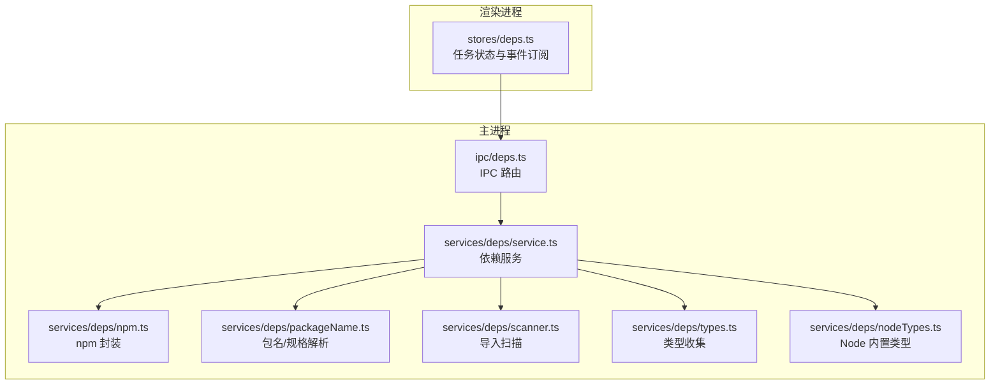
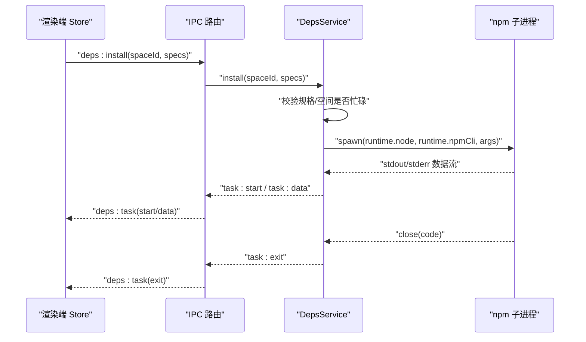
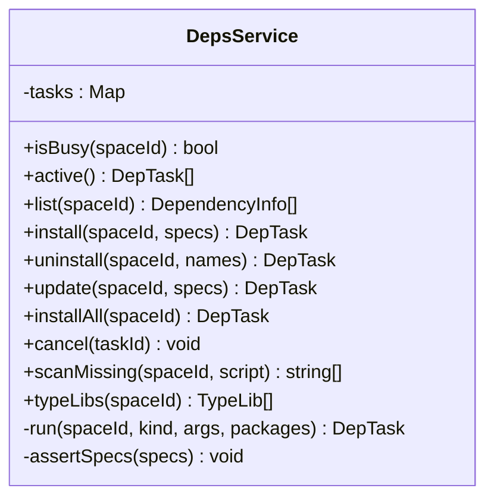
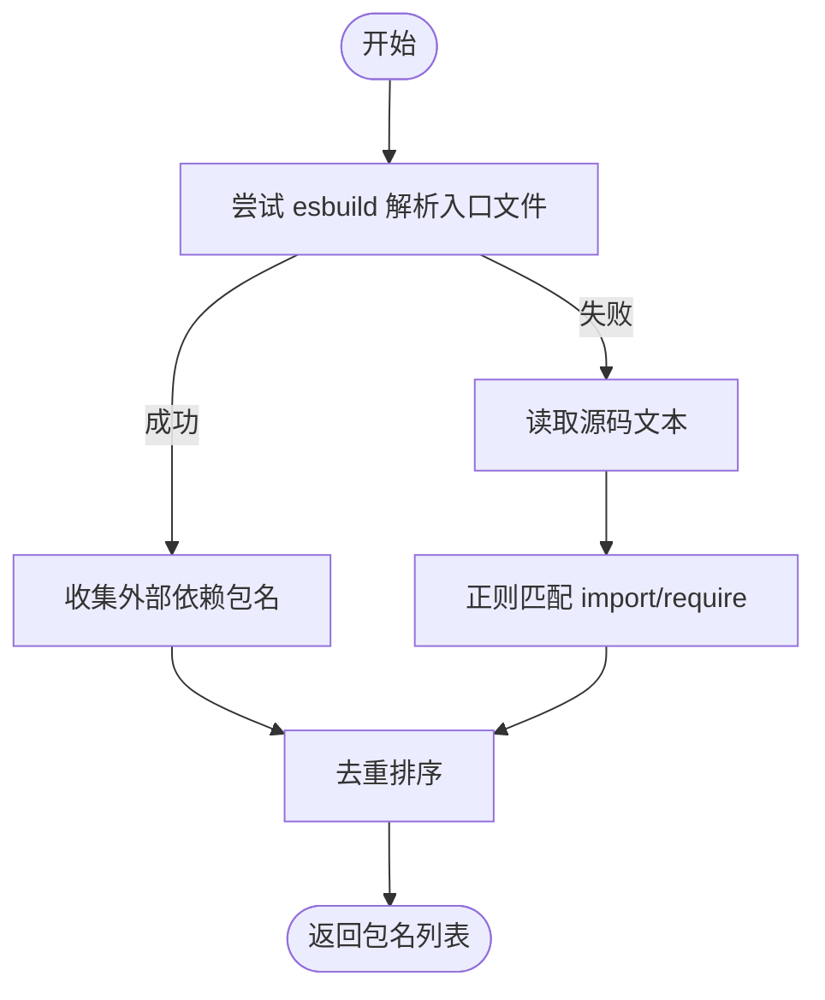
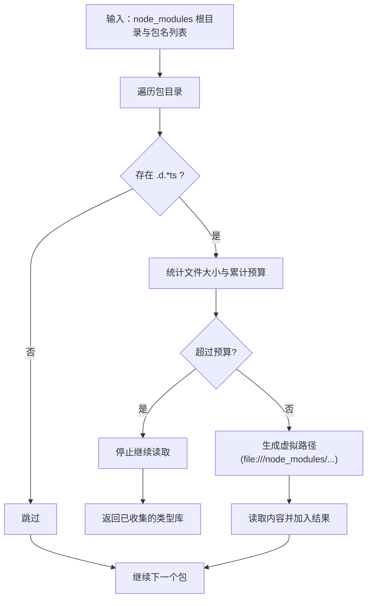
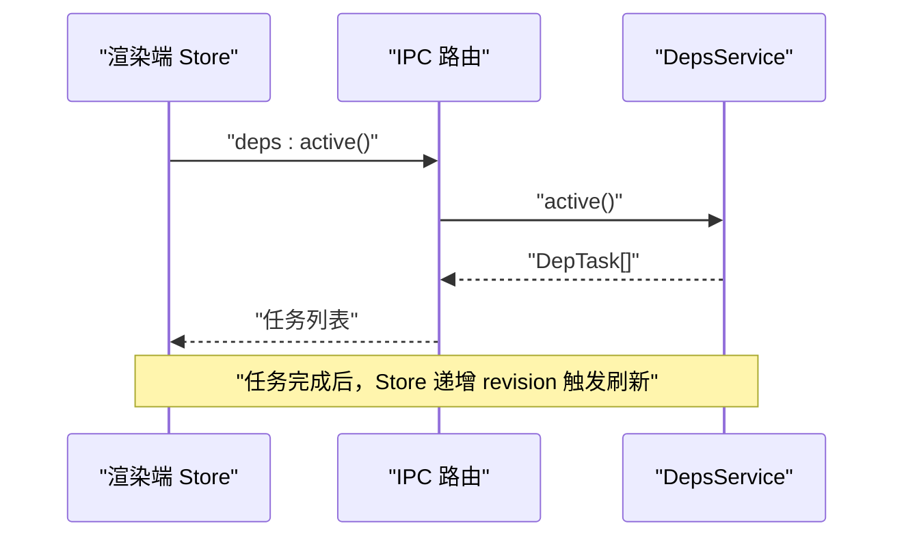
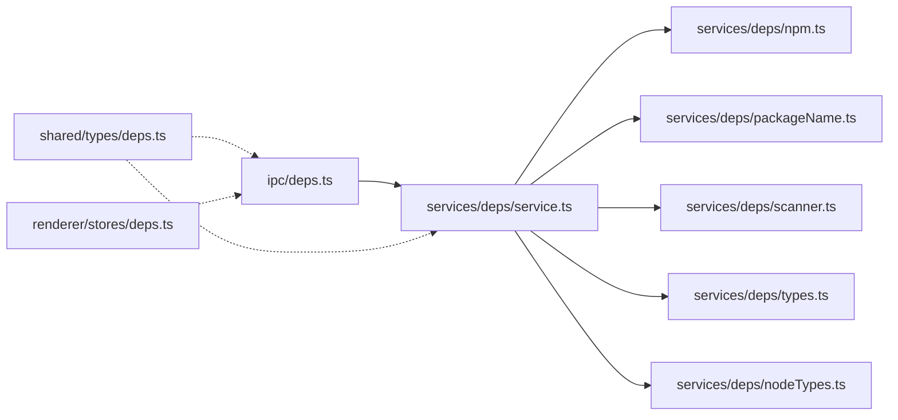

# Deps 服务（依赖包管理）

<cite>
**本文引用的文件**   
- [src/main/ipc/deps.ts](file://src/main/ipc/deps.ts)
- [src/main/services/deps/index.ts](file://src/main/services/deps/index.ts)
- [src/main/services/deps/service.ts](file://src/main/services/deps/service.ts)
- [src/main/services/deps/npm.ts](file://src/main/services/deps/npm.ts)
- [src/main/services/deps/packageName.ts](file://src/main/services/deps/packageName.ts)
- [src/main/services/deps/scanner.ts](file://src/main/services/deps/scanner.ts)
- [src/main/services/deps/types.ts](file://src/main/services/deps/types.ts)
- [src/main/services/deps/nodeTypes.ts](file://src/main/services/deps/nodeTypes.ts)
- [src/shared/types/deps.ts](file://src/shared/types/deps.ts)
- [src/renderer/src/stores/deps.ts](file://src/renderer/src/stores/deps.ts)
</cite>

## 目录
1. [简介](#简介)
2. [项目结构](#项目结构)
3. [核心组件](#核心组件)
4. [架构总览](#架构总览)
5. [详细组件分析](#详细组件分析)
6. [依赖关系分析](#依赖关系分析)
7. [性能与缓存优化](#性能与缓存优化)
8. [故障排查指南](#故障排查指南)
9. [结论](#结论)
10. [附录：扩展指南](#附录扩展指南)

## 简介
本文件为 Deps 服务的全面技术文档，聚焦以下能力：
- npm 包管理器封装与进程生命周期管理
- 依赖扫描机制（静态解析 + 正则回退）
- 类型定义注入（@types、未声明模块的虚拟类型）
- 依赖冲突解决策略与版本锁定思路
- 安装生命周期、错误处理与进度反馈
- 如何集成新的包管理器与扩展类型推断

该服务通过 IPC 暴露 API，由渲染进程调用，主进程执行 npm 子进程并广播任务事件。

## 项目结构
Deps 服务位于主进程 services 层，并通过 IPC 向渲染进程暴露接口；共享类型定义在 shared/types 中；渲染端使用 zustand store 跟踪任务状态。

**图表来源**
- [src/main/ipc/deps.ts:4-16](file://src/main/ipc/deps.ts#L4-L16)
- [src/main/services/deps/service.ts:23-137](file://src/main/services/deps/service.ts#L23-L137)
- [src/main/services/deps/npm.ts:8-22](file://src/main/services/deps/npm.ts#L8-L22)
- [src/main/services/deps/packageName.ts:1-55](file://src/main/services/deps/packageName.ts#L1-L55)
- [src/main/services/deps/scanner.ts:1-63](file://src/main/services/deps/scanner.ts#L1-L63)
- [src/main/services/deps/types.ts:1-119](file://src/main/services/deps/types.ts#L1-L119)
- [src/main/services/deps/nodeTypes.ts:1-25](file://src/main/services/deps/nodeTypes.ts#L1-L25)
- [src/renderer/src/stores/deps.ts:1-65](file://src/renderer/src/stores/deps.ts#L1-L65)

**章节来源**
- [src/main/ipc/deps.ts:4-16](file://src/main/ipc/deps.ts#L4-L16)
- [src/main/services/deps/index.ts:1-3](file://src/main/services/deps/index.ts#L1-L3)
- [src/shared/types/deps.ts:1-30](file://src/shared/types/deps.ts#L1-L30)
- [src/renderer/src/stores/deps.ts:1-65](file://src/renderer/src/stores/deps.ts#L1-L65)

## 核心组件
- DepsService：依赖操作编排器，负责任务调度、npm 子进程管理、事件广播、缺失依赖扫描与类型库收集。
- npm 封装：基于运行时提供的 node/npm CLI 启动 npm，注入网络与环境变量，统一参数。
- 包名解析：校验与解析包名/版本范围，过滤 Node 内置模块。
- 导入扫描：优先使用 esbuild 解析器收集依赖，失败时回退到正则匹配。
- 类型系统：收集 @types 与未声明模块的虚拟类型，限制体积预算，提供 Monaco 编辑器可识别的虚拟路径。
- Node 内置类型：打包或资源目录下的 @types/node 与 undici-types 预加载。
- IPC 路由：将渲染进程请求映射到服务方法，并转发任务事件。
- 渲染端 Store：维护任务会话、输出分片、退出码与完成状态，增量刷新。

**章节来源**
- [src/main/services/deps/service.ts:23-137](file://src/main/services/deps/service.ts#L23-L137)
- [src/main/services/deps/npm.ts:8-22](file://src/main/services/deps/npm.ts#L8-L22)
- [src/main/services/deps/packageName.ts:1-55](file://src/main/services/deps/packageName.ts#L1-L55)
- [src/main/services/deps/scanner.ts:1-63](file://src/main/services/deps/scanner.ts#L1-L63)
- [src/main/services/deps/types.ts:1-119](file://src/main/services/deps/types.ts#L1-L119)
- [src/main/services/deps/nodeTypes.ts:1-25](file://src/main/services/deps/nodeTypes.ts#L1-L25)
- [src/main/ipc/deps.ts:4-16](file://src/main/ipc/deps.ts#L4-L16)
- [src/renderer/src/stores/deps.ts:1-65](file://src/renderer/src/stores/deps.ts#L1-L65)

## 架构总览
Deps 服务采用“IPC 路由 -> 服务编排 -> npm 子进程”的分层架构。渲染端通过 IPC 发起安装/卸载/更新等操作，主进程创建 npm 子进程，实时转发 stdout/stderr 作为任务数据事件，并在结束时返回退出码。类型系统独立于安装流程，按需扫描 node_modules 并注入虚拟类型供编辑器使用。

**图表来源**
- [src/main/ipc/deps.ts:4-16](file://src/main/ipc/deps.ts#L4-L16)
- [src/main/services/deps/service.ts:49-133](file://src/main/services/deps/service.ts#L49-L133)
- [src/main/services/deps/npm.ts:12-22](file://src/main/services/deps/npm.ts#L12-L22)
- [src/renderer/src/stores/deps.ts:27-64](file://src/renderer/src/stores/deps.ts#L27-L64)

## 详细组件分析

### DepsService（依赖服务）
职责：
- 维护活跃任务 Map，支持取消与查询。
- 提供 list/install/uninstall/update/installAll/scanMissing/typeLibs 等方法。
- 统一通过 run 方法启动 npm 子进程，发射 start/data/exit 事件。
- 对输入规格进行校验，避免非法参数进入 npm CLI。

关键点：
- 并发控制：同一 spaceId 仅允许一个任务运行。
- 版本选择：update 会将裸名升级为 latest，install 默认 prefer-offline。
- 缺失依赖：结合脚本导入扫描与已声明/已安装集合计算差集。
- 类型注入：按优先级收集 @types 与未声明模块的虚拟类型。

**图表来源**
- [src/main/services/deps/service.ts:23-137](file://src/main/services/deps/service.ts#L23-L137)

**章节来源**
- [src/main/services/deps/service.ts:23-137](file://src/main/services/deps/service.ts#L23-L137)

### npm 封装
职责：
- 统一 npm 参数（缓存路径、颜色、关闭 fund/audit）。
- 基于 ResolvedRuntime 构建环境变量，注入代理/镜像等网络设置。
- 启动 npm CLI 子进程，隐藏 Windows 控制台窗口。

设计要点：
- 使用运行时自带的 npm，确保与目标 Node 版本一致。
- 通过 settingsStore 的网络配置动态调整代理与镜像。

**章节来源**
- [src/main/services/deps/npm.ts:8-22](file://src/main/services/deps/npm.ts#L8-L22)

### 包名与规格解析
职责：
- toPackageName：从 import/require 表达式中提取包名，忽略相对路径、URL 与 Node 内置模块。
- parseSpec：拆分 name@range，用于 update 场景。
- isValidSpec：拒绝可能被视为 CLI 标志或路径的非法字符串。
- findMissing：计算导入但未声明/安装的包集合。

复杂度：
- toPackageName 为 O(1) 正则与集合查找。
- findMissing 为 O(n)，n 为导入数量。

**章节来源**
- [src/main/services/deps/packageName.ts:1-55](file://src/main/services/deps/packageName.ts#L1-L55)

### 导入扫描器
职责：
- scanImports：优先使用 esbuild 解析器收集依赖，失败时回退到正则扫描源码。
- scanWithRegex：基于常见 import/require 模式提取包名。

行为说明：
- 当代码无法被 esbuild 解析（例如编辑中语法不完整），自动降级到正则模式，保证可用性。
- 结果去重排序，便于后续比较与展示。

**图表来源**
- [src/main/services/deps/scanner.ts:14-62](file://src/main/services/deps/scanner.ts#L14-L62)

**章节来源**
- [src/main/services/deps/scanner.ts:1-63](file://src/main/services/deps/scanner.ts#L1-L63)

### 类型定义收集与注入
职责：
- listPackages：列出 node_modules 顶层包名（含 scoped）。
- walkDeclarations：递归遍历 .d.[mc]?ts 声明文件，跳过无关目录。
- collectTypeLibs：读取 package.json 与声明文件，生成虚拟路径与内容，受字节预算限制。
- typesPackageName：根据包名推导对应的 @types 包名。
- untypedModulesLib：为无类型声明的包生成 declare module 虚拟类型，避免编辑器报错。
- nodeTypeLibs：预加载 @types/node 与 undici-types，离线可用。

预算控制：
- 单文件最大 4MB，总大小上限 48MB，深度限制 8 层，提升稳定性与性能。

**图表来源**
- [src/main/services/deps/types.ts:19-118](file://src/main/services/deps/types.ts#L19-L118)

**章节来源**
- [src/main/services/deps/types.ts:1-119](file://src/main/services/deps/types.ts#L1-L119)
- [src/main/services/deps/nodeTypes.ts:1-25](file://src/main/services/deps/nodeTypes.ts#L1-L25)

### IPC 与渲染端状态
- IPC 路由将 deps:* 事件映射到 DepsService 对应方法，并将任务事件广播给渲染端。
- 渲染端 Store 维护每个 spaceId 的最新任务、输出分片、退出码与完成状态，并在任务结束时递增 revision 以触发 UI 刷新。

**图表来源**
- [src/main/ipc/deps.ts:4-16](file://src/main/ipc/deps.ts#L4-L16)
- [src/renderer/src/stores/deps.ts:27-64](file://src/renderer/src/stores/deps.ts#L27-L64)

**章节来源**
- [src/main/ipc/deps.ts:4-16](file://src/main/ipc/deps.ts#L4-L16)
- [src/renderer/src/stores/deps.ts:1-65](file://src/renderer/src/stores/deps.ts#L1-L65)

## 依赖关系分析
- DepsService 依赖：
  - npm 封装：spawnNpm
  - 包名解析：packageName
  - 导入扫描：scanner
  - 类型收集：types
  - Node 内置类型：nodeTypes
  - 运行时与服务：runtimeService、scriptService、spaceService
- IPC 层解耦了渲染端与主进程实现，仅暴露稳定的 RPC 契约。
- 共享类型 deps.ts 定义了跨进程的数据模型，保证前后端一致性。

**图表来源**
- [src/main/ipc/deps.ts:1-17](file://src/main/ipc/deps.ts#L1-L17)
- [src/main/services/deps/service.ts:1-17](file://src/main/services/deps/service.ts#L1-L17)
- [src/shared/types/deps.ts:1-30](file://src/shared/types/deps.ts#L1-L30)
- [src/renderer/src/stores/deps.ts:1-6](file://src/renderer/src/stores/deps.ts#L1-L6)

**章节来源**
- [src/main/ipc/deps.ts:1-17](file://src/main/ipc/deps.ts#L1-L17)
- [src/main/services/deps/service.ts:1-17](file://src/main/services/deps/service.ts#L1-L17)
- [src/shared/types/deps.ts:1-30](file://src/shared/types/deps.ts#L1-L30)
- [src/renderer/src/stores/deps.ts:1-6](file://src/renderer/src/stores/deps.ts#L1-L6)

## 性能与缓存优化
- npm 缓存路径固定：通过 --cache 指定缓存目录，减少重复下载。
- 默认 prefer-offline：安装命令优先使用本地缓存，降低网络开销。
- 类型收集预算：限制单文件大小与总大小，避免内存膨胀。
- Node 内置类型缓存：nodeTypeLibs 对 @types/node 与 undici-types 的结果进行 Promise 级缓存，避免重复 IO。
- 跳过无关目录：walkDeclarations 跳过 test/examples/.git 等目录，减少扫描量。

[本节为通用指导，不直接分析具体文件]

## 故障排查指南
常见问题与定位建议：
- 任务繁忙：同一 spaceId 同时只能有一个依赖任务，若抛出 DEPS_BUSY，请等待当前任务结束或取消后重试。
- 无效包名：isValidSpec 会拒绝非法规格，检查传入的包名与版本范围是否符合 npm 规范。
- npm 子进程异常：stderr 会被作为任务数据输出，关注错误信息；若进程 error 事件触发，将记录错误并返回退出码 -1。
- 类型缺失：若编辑器提示找不到模块，确认是否已安装对应包或其 @types 包；对于无类型的包，服务会自动生成虚拟类型以避免报错。
- 网络问题：检查 settingsStore 中的网络配置（代理/镜像），确保 spawnNpm 的环境变量正确注入。

**章节来源**
- [src/main/services/deps/service.ts:98-133](file://src/main/services/deps/service.ts#L98-L133)
- [src/main/services/deps/npm.ts:12-22](file://src/main/services/deps/npm.ts#L12-L22)
- [src/main/services/deps/packageName.ts:42-45](file://src/main/services/deps/packageName.ts#L42-L45)

## 结论
Deps 服务通过清晰的层次化设计与稳健的错误处理，提供了可靠的依赖管理与类型注入能力。其 npm 封装、导入扫描与类型收集均具备可扩展性与性能优化点，适合在多空间、多版本的 Node 环境下稳定运行。

[本节为总结性内容，不直接分析具体文件]

## 附录：扩展指南

### 集成新的包管理器
步骤：
1. 新增包管理器封装模块（如 yarn.ts/pnpm.ts），参照 npm.ts 的模式：
   - 提供统一的参数构建函数（如 pnpmArgs）。
   - 提供 spawnXxx 函数，基于 ResolvedRuntime 构建环境变量并启动子进程。
2. 在 service.ts 中新增对应方法（如 installWithPnpm），复用 run 的生命周期与事件广播逻辑。
3. 在 IPC 路由中注册新接口（如 deps:install-pnpm），以便渲染端调用。
4. 在渲染端 Store 中增加对应调用与事件处理（可选）。

参考路径：
- [src/main/services/deps/npm.ts:8-22](file://src/main/services/deps/npm.ts#L8-L22)
- [src/main/services/deps/service.ts:49-71](file://src/main/services/deps/service.ts#L49-L71)
- [src/main/ipc/deps.ts:4-16](file://src/main/ipc/deps.ts#L4-L16)
- [src/renderer/src/stores/deps.ts:27-38](file://src/renderer/src/stores/deps.ts#L27-L38)

### 扩展依赖分析与类型推断
- 增强导入扫描：
  - 在 scanner.ts 中添加自定义插件或规则，支持更多语言特性或框架特定的导入语法。
  - 在 scanImports 中扩展 entryPoints 或过滤器，提高解析准确率。
- 扩展类型收集：
  - 在 types.ts 中调整预算阈值、跳过目录或文件匹配规则，以适应更大规模的项目。
  - 在 untypedModulesLib 中扩展虚拟类型生成策略，例如为特定框架提供基础类型。
- 注入 Node 内置类型：
  - 在 nodeTypes.ts 中扩展 NODE_TYPE_PACKAGES，添加更多内置类型包。

参考路径：
- [src/main/services/deps/scanner.ts:14-62](file://src/main/services/deps/scanner.ts#L14-L62)
- [src/main/services/deps/types.ts:37-118](file://src/main/services/deps/types.ts#L37-L118)
- [src/main/services/deps/nodeTypes.ts:7-24](file://src/main/services/deps/nodeTypes.ts#L7-L24)