# Runner 服务（脚本运行器）

<cite>
**本文引用的文件**   
- [src/main/services/runner/index.ts](file://src/main/services/runner/index.ts)
- [src/main/services/runner/service.ts](file://src/main/services/runner/service.ts)
- [src/main/services/runner/languages/index.ts](file://src/main/services/runner/languages/index.ts)
- [src/main/services/runner/languages/node.ts](file://src/main/services/runner/languages/node.ts)
- [src/main/services/runner/languages/types.ts](file://src/main/services/runner/languages/types.ts)
- [src/main/services/runner/args.ts](file://src/main/services/runner/args.ts)
- [src/main/services/runner/history.ts](file://src/main/services/runner/history.ts)
- [src/main/services/runner/transpile.ts](file://src/main/services/runner/transpile.ts)
- [src/main/ipc/run.ts](file://src/main/ipc/run.ts)
- [src/shared/types/run.ts](file://src/shared/types/run.ts)
- [src/main/services/runtime/env.ts](file://src/main/services/runtime/env.ts)
- [src/main/services/settings/env.ts](file://src/main/services/settings/env.ts)
</cite>

## 目录
1. [简介](#简介)
2. [项目结构](#项目结构)
3. [核心组件](#核心组件)
4. [架构总览](#架构总览)
5. [详细组件分析](#详细组件分析)
6. [依赖关系分析](#依赖关系分析)
7. [性能与并发特性](#性能与并发特性)
8. [故障排查指南](#故障排查指南)
9. [结论](#结论)
10. [附录：扩展语言运行器与集成示例](#附录扩展语言运行器与集成示例)

## 简介
Runner 服务负责在 Electron 主进程中启动、监控和终止用户脚本，提供终端交互、标准输入输出转发、运行历史记录以及多任务并发管理能力。它通过“语言运行器”抽象将不同脚本语言统一为可执行的命令行，结合 node-pty 实现伪终端会话，并通过 IPC 与渲染进程通信，暴露运行控制与历史查询接口。

## 项目结构
Runner 相关代码集中在 main 进程的 services/runner 目录，配合 ipc/run.ts 对外暴露 API，类型定义位于 shared/types/run.ts。运行时环境变量构建由 runtime/env.ts 与 settings/env.ts 共同完成，TypeScript 脚本的转译打包由 transpile.ts 驱动 esbuild。

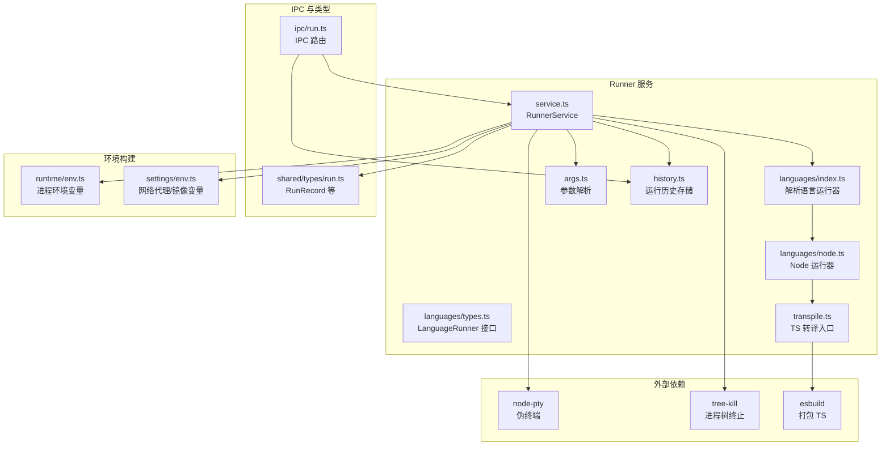

**图表来源**
- [src/main/services/runner/service.ts:1-147](file://src/main/services/runner/service.ts#L1-L147)
- [src/main/services/runner/languages/index.ts:1-15](file://src/main/services/runner/languages/index.ts#L1-L15)
- [src/main/services/runner/languages/node.ts:1-20](file://src/main/services/runner/languages/node.ts#L1-L20)
- [src/main/services/runner/languages/types.ts:1-26](file://src/main/services/runner/languages/types.ts#L1-L26)
- [src/main/services/runner/args.ts:1-49](file://src/main/services/runner/args.ts#L1-L49)
- [src/main/services/runner/history.ts:1-94](file://src/main/services/runner/history.ts#L1-L94)
- [src/main/services/runner/transpile.ts:1-67](file://src/main/services/runner/transpile.ts#L1-L67)
- [src/main/ipc/run.ts:1-19](file://src/main/ipc/run.ts#L1-L19)
- [src/shared/types/run.ts:1-28](file://src/shared/types/run.ts#L1-L28)
- [src/main/services/runtime/env.ts:1-28](file://src/main/services/runtime/env.ts#L1-L28)
- [src/main/services/settings/env.ts:1-73](file://src/main/services/settings/env.ts#L1-L73)

**章节来源**
- [src/main/services/runner/service.ts:1-147](file://src/main/services/runner/service.ts#L1-L147)
- [src/main/ipc/run.ts:1-19](file://src/main/ipc/run.ts#L1-L19)
- [src/shared/types/run.ts:1-28](file://src/shared/types/run.ts#L1-L28)

## 核心组件
- RunnerService：管理活动运行实例、生命周期、事件广播、进程控制与资源清理。
- LanguageRunner 抽象：将脚本映射到具体命令与运行时版本，支持扩展新语言。
- Node 运行器：基于已解析的 Node 运行时路径，准备入口并注入环境变量。
- 参数解析器：POSIX 风格解析命令行参数，支持引号与转义。
- 历史存储：记录每次运行的元数据与日志，支持读取尾部日志、清理与恢复。
- 转译器：对 TypeScript 脚本进行打包，保持相对路径语义并提供 CJS/ESM 兼容。
- IPC 路由：将前端请求映射到 RunnerService 与 historyStore 的方法。
- 环境变量构建：合并宿主环境变量、网络设置与脚本自定义变量，确保 PATH 指向受管运行时。

**章节来源**
- [src/main/services/runner/service.ts:20-147](file://src/main/services/runner/service.ts#L20-L147)
- [src/main/services/runner/languages/types.ts:1-26](file://src/main/services/runner/languages/types.ts#L1-L26)
- [src/main/services/runner/languages/node.ts:1-20](file://src/main/services/runner/languages/node.ts#L1-L20)
- [src/main/services/runner/args.ts:1-49](file://src/main/services/runner/args.ts#L1-L49)
- [src/main/services/runner/history.ts:1-94](file://src/main/services/runner/history.ts#L1-L94)
- [src/main/services/runner/transpile.ts:1-67](file://src/main/services/runner/transpile.ts#L1-L67)
- [src/main/ipc/run.ts:1-19](file://src/main/ipc/run.ts#L1-L19)
- [src/main/services/runtime/env.ts:1-28](file://src/main/services/runtime/env.ts#L1-L28)
- [src/main/services/settings/env.ts:1-73](file://src/main/services/settings/env.ts#L1-L73)

## 架构总览
Runner 服务作为主进程中的协调者，接收来自 IPC 的运行指令，解析脚本与参数，选择语言运行器，构造环境变量，使用 node-pty 启动子进程，并将 stdout/stderr 输出写入历史文件并广播给渲染进程。运行结束时更新状态、清理资源并持久化历史记录。

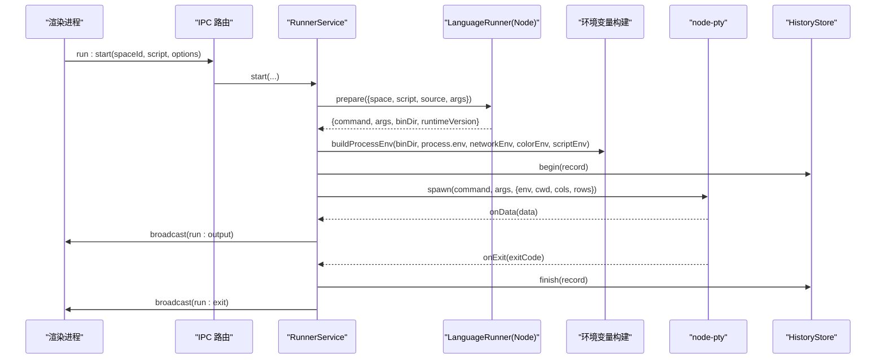

**图表来源**
- [src/main/ipc/run.ts:4-17](file://src/main/ipc/run.ts#L4-L17)
- [src/main/services/runner/service.ts:44-88](file://src/main/services/runner/service.ts#L44-L88)
- [src/main/services/runner/languages/node.ts:9-18](file://src/main/services/runner/languages/node.ts#L9-L18)
- [src/main/services/runtime/env.ts:10-26](file://src/main/services/runtime/env.ts#L10-L26)
- [src/main/services/runner/history.ts:19-28](file://src/main/services/runner/history.ts#L19-L28)

## 详细组件分析

### RunnerService：生命周期与进程控制
- 活动运行管理：以 Map 维护当前活动运行，包含记录、pty、日志流与停止标记。
- 启动流程：
  - 校验脚本存在性；
  - 解析运行配置参数；
  - 调用语言运行器 prepare 获取命令与运行时信息；
  - 构建环境变量（PATH 优先指向受管运行时 bin）；
  - 创建历史记录并开始写入；
  - 使用 node-pty 启动伪终端，绑定 onData/onExit；
  - 广播初始运行信息与实时输出。
- 进程终止：
  - Windows 直接 kill pty；
  - 其他平台先发送 SIGTERM，并在 3 秒后强制 SIGKILL；
  - 停止时标记 stopRequested，影响最终状态。
- 资源清理：
  - 结束日志流；
  - 从活动表移除；
  - 持久化历史记录；
  - 广播退出事件。

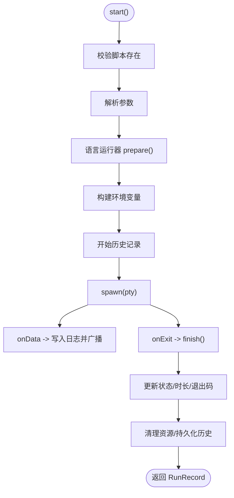

**图表来源**
- [src/main/services/runner/service.ts:44-88](file://src/main/services/runner/service.ts#L44-L88)
- [src/main/services/runner/service.ts:127-143](file://src/main/services/runner/service.ts#L127-L143)

**章节来源**
- [src/main/services/runner/service.ts:20-147](file://src/main/services/runner/service.ts#L20-L147)

### 语言运行器抽象与 Node 运行器
- LanguageRunner 接口：
  - id：运行器标识；
  - supports：根据脚本名判断是否支持；
  - prepare：将脚本转换为可执行命令与环境信息。
- Node 运行器：
  - 通过 runtimeService 解析 Node 版本与路径；
  - 调用 transpile.prepareEntry 生成入口文件；
  - 返回 command=Node 可执行路径、args=[入口, ...用户参数]、binDir=运行时 bin 目录、runtimeVersion=版本号。

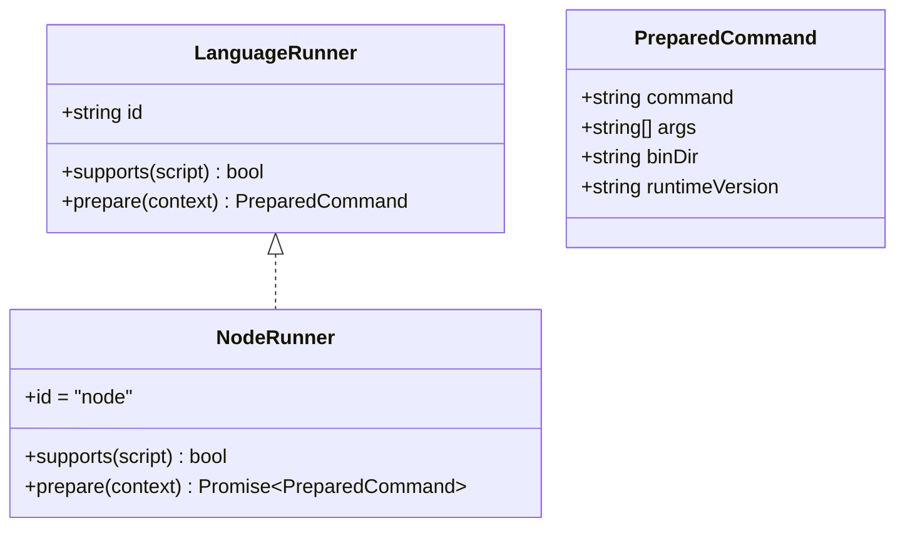

**图表来源**
- [src/main/services/runner/languages/types.ts:1-26](file://src/main/services/runner/languages/types.ts#L1-L26)
- [src/main/services/runner/languages/node.ts:1-20](file://src/main/services/runner/languages/node.ts#L1-L20)

**章节来源**
- [src/main/services/runner/languages/index.ts:1-15](file://src/main/services/runner/languages/index.ts#L1-L15)
- [src/main/services/runner/languages/node.ts:1-20](file://src/main/services/runner/languages/node.ts#L1-L20)
- [src/main/services/runner/languages/types.ts:1-26](file://src/main/services/runner/languages/types.ts#L1-L26)

### 参数解析逻辑
- parseArgs 实现 POSIX 风格的命令行参数拆分：
  - 支持单双引号包裹；
  - 支持反斜杠转义；
  - 按空白分隔 token；
  - 忽略未闭合引号的边界情况。

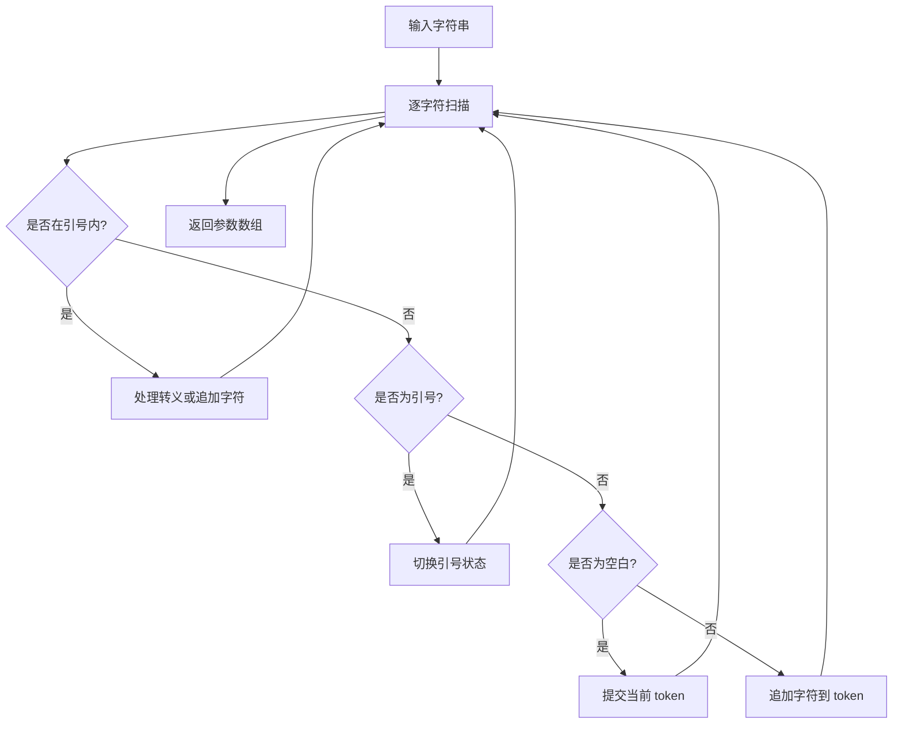

**图表来源**
- [src/main/services/runner/args.ts:5-47](file://src/main/services/runner/args.ts#L5-L47)

**章节来源**
- [src/main/services/runner/args.ts:1-49](file://src/main/services/runner/args.ts#L1-L49)

### 环境变量构建策略
- buildProcessEnv：
  - 过滤可能干扰子进程的环境变量（如 ELECTRON_*、NODE_OPTIONS、NODE_PATH、npm_*、VITE_*）；
  - 合并额外环境变量（网络设置、颜色设置、脚本自定义变量）；
  - 将运行时 bin 目录置于 PATH 首位，确保优先使用受管运行时。
- buildNetworkEnv：
  - 根据网络设置注入 npm registry、代理与二进制镜像变量；
  - 同时兼容大小写键名与 npm 专用变量。

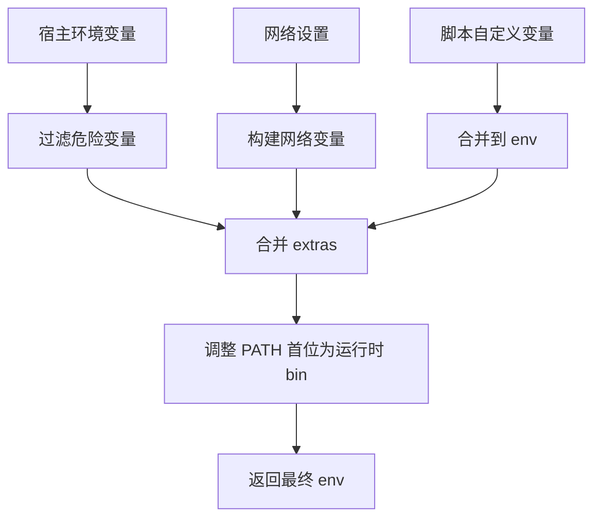

**图表来源**
- [src/main/services/runtime/env.ts:10-26](file://src/main/services/runtime/env.ts#L10-L26)
- [src/main/services/settings/env.ts:21-50](file://src/main/services/settings/env.ts#L21-L50)

**章节来源**
- [src/main/services/runtime/env.ts:1-28](file://src/main/services/runtime/env.ts#L1-L28)
- [src/main/services/settings/env.ts:1-73](file://src/main/services/settings/env.ts#L1-L73)

### 运行历史机制
- begin：
  - 确保历史目录存在；
  - 写入运行元数据 JSON；
  - 返回日志写入流。
- finish：
  - 更新元数据；
  - 按配置裁剪历史数量。
- list/readLog/remove/clear/recoverStale/prune：
  - 列表按开始时间倒序；
  - 大日志只读取尾部固定长度；
  - 清理运行中以外的历史；
  - 恢复崩溃导致的“running”状态为“stopped”。

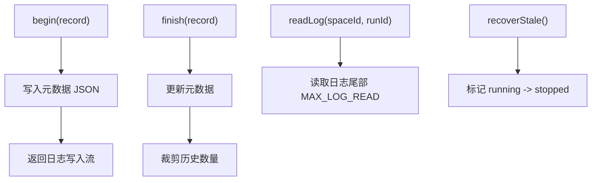

**图表来源**
- [src/main/services/runner/history.ts:19-28](file://src/main/services/runner/history.ts#L19-L28)
- [src/main/services/runner/history.ts:43-60](file://src/main/services/runner/history.ts#L43-L60)
- [src/main/services/runner/history.ts:73-92](file://src/main/services/runner/history.ts#L73-L92)

**章节来源**
- [src/main/services/runner/history.ts:1-94](file://src/main/services/runner/history.ts#L1-L94)

### 转译与入口准备
- prepareEntry：
  - 非 TypeScript 直接返回源路径；
  - TypeScript 使用 esbuild 打包到 .scriptbox/build；
  - 区分 CJS/ESM 输出格式；
  - 注入 __dirname/__filename/import.meta.url 等常量以保持相对路径语义；
  - 为 ESM 提供 globalThis.require 兼容；
  - 捕获构建错误并抛出 AppError('BUILD_FAILED')。

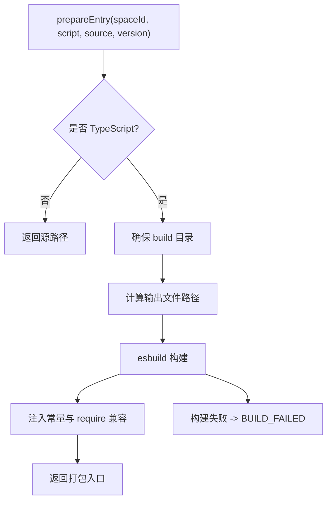

**图表来源**
- [src/main/services/runner/transpile.ts:18-66](file://src/main/services/runner/transpile.ts#L18-L66)

**章节来源**
- [src/main/services/runner/transpile.ts:1-67](file://src/main/services/runner/transpile.ts#L1-L67)

### IPC 与事件模型
- 注册 IPC：
  - run:start/run:stop/run:active/run:write/run:resize；
  - history:list/history:log/history:remove/history:clear；
  - 监听 runnerService 的 output/exit 事件并广播给渲染进程。
- 事件类型：
  - RunOutputEvent：runId + data；
  - RunExitEvent：record。

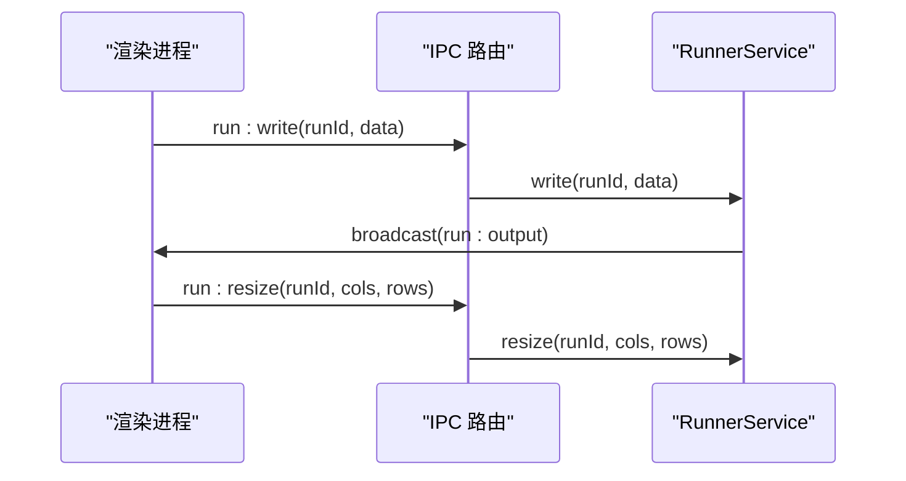

**图表来源**
- [src/main/ipc/run.ts:4-17](file://src/main/ipc/run.ts#L4-L17)
- [src/shared/types/run.ts:15-27](file://src/shared/types/run.ts#L15-L27)

**章节来源**
- [src/main/ipc/run.ts:1-19](file://src/main/ipc/run.ts#L1-L19)
- [src/shared/types/run.ts:1-28](file://src/shared/types/run.ts#L1-L28)

## 依赖关系分析
- RunnerService 依赖：
  - node-pty：伪终端会话；
  - tree-kill：跨平台进程树终止；
  - runtime/env：环境变量构建；
  - settings/env：网络环境变量；
  - script/space：脚本路径与空间信息；
  - languages：语言运行器解析；
  - history：运行历史；
  - transpile：TS 转译。
- 语言运行器依赖：
  - runtimeService：解析 Node 运行时；
  - transpile：准备入口。
- IPC 依赖：
  - runnerService 与 historyStore；
  - helpers：handle/listen/broadcast。

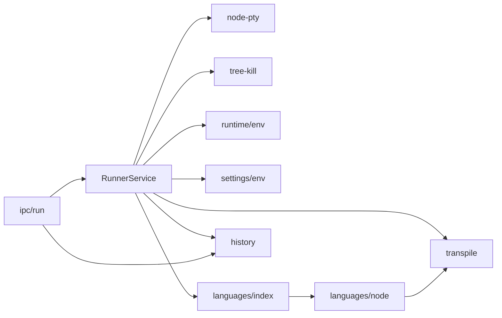

**图表来源**
- [src/main/services/runner/service.ts:1-18](file://src/main/services/runner/service.ts#L1-L18)
- [src/main/services/runner/languages/index.ts:1-11](file://src/main/services/runner/languages/index.ts#L1-L11)
- [src/main/services/runner/languages/node.ts:1-18](file://src/main/services/runner/languages/node.ts#L1-L18)
- [src/main/ipc/run.ts:1-17](file://src/main/ipc/run.ts#L1-L17)

**章节来源**
- [src/main/services/runner/service.ts:1-18](file://src/main/services/runner/service.ts#L1-L18)
- [src/main/services/runner/languages/index.ts:1-11](file://src/main/services/runner/languages/index.ts#L1-L11)
- [src/main/services/runner/languages/node.ts:1-18](file://src/main/services/runner/languages/node.ts#L1-L18)
- [src/main/ipc/run.ts:1-17](file://src/main/ipc/run.ts#L1-L17)

## 性能与并发特性
- 并发执行：
  - 每个运行拥有独立 pty 与日志流，Map 索引保证并发安全；
  - 批量停止通过遍历 keys 逐个终止。
- I/O 优化：
  - 日志采用追加写入流，避免频繁打开关闭；
  - 读取日志仅取尾部固定长度，降低大文件开销。
- 资源清理：
  - 退出时立即结束日志流并从活动表移除；
  - 异步保存历史，异常不影响主流程。
- 建议：
  - 合理限制历史保留数量；
  - 对超大日志考虑分片或压缩；
  - 监控 pty 内存占用与句柄泄漏。

[本节为通用指导，不直接分析具体文件]

## 故障排查指南
- 脚本未找到：
  - 检查脚本名称与空间路径是否正确；
  - 确认脚本文件存在。
- 构建失败：
  - 查看构建错误消息，定位 TS 编译问题；
  - 检查目标 Node 版本与语法兼容性。
- 进程无法终止：
  - Windows 下直接 kill pty；
  - 其他平台先 SIGTERM，3 秒后 SIGKILL；
  - 若子进程忽略信号，需检查业务逻辑。
- 环境变量异常：
  - 检查网络代理与镜像配置；
  - 确认 PATH 首位为受管运行时 bin。
- 历史丢失或不一致：
  - 重启后 recoverStale 会将残留 running 标记修正；
  - 检查 historyLimit 配置是否过短。

**章节来源**
- [src/main/services/runner/service.ts:101-115](file://src/main/services/runner/service.ts#L101-L115)
- [src/main/services/runner/transpile.ts:58-64](file://src/main/services/runner/transpile.ts#L58-L64)
- [src/main/services/runner/history.ts:73-86](file://src/main/services/runner/history.ts#L73-L86)

## 结论
Runner 服务通过清晰的职责划分与可扩展的语言运行器抽象，实现了脚本的统一执行、终端交互、历史管理与并发控制。其环境变量构建策略确保了受管运行时的优先级与网络设置的正确注入，IPC 层提供了简洁的前端集成点。对于新增语言支持，只需实现 LanguageRunner 接口并注册即可无缝接入现有体系。

[本节为总结性内容，不直接分析具体文件]

## 附录：扩展语言运行器与集成示例

### 如何添加新的脚本语言支持
- 步骤概览：
  - 在 languages 目录下新增运行器实现，遵循 LanguageRunner 接口；
  - 在 languages/index.ts 的 runners 列表中注册该运行器；
  - 根据需要扩展 transpile 或 interop 能力；
  - 通过 IPC 与 RunnerService 自动复用现有生命周期与历史机制。

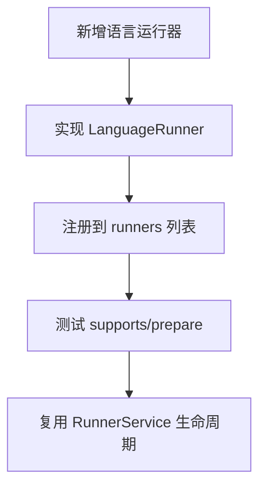

**图表来源**
- [src/main/services/runner/languages/types.ts:20-25](file://src/main/services/runner/languages/types.ts#L20-L25)
- [src/main/services/runner/languages/index.ts:5-11](file://src/main/services/runner/languages/index.ts#L5-L11)

**章节来源**
- [src/main/services/runner/languages/types.ts:1-26](file://src/main/services/runner/languages/types.ts#L1-L26)
- [src/main/services/runner/languages/index.ts:1-15](file://src/main/services/runner/languages/index.ts#L1-L15)

### 运行时事件与状态管理
- 事件：
  - output：每次 pty 输出触发，携带 runId 与 data；
  - exit：进程退出时触发，携带完整 RunRecord。
- 状态：
  - running：启动后；
  - success：正常退出且退出码为 0；
  - failed：非零退出码；
  - stopped：主动停止。

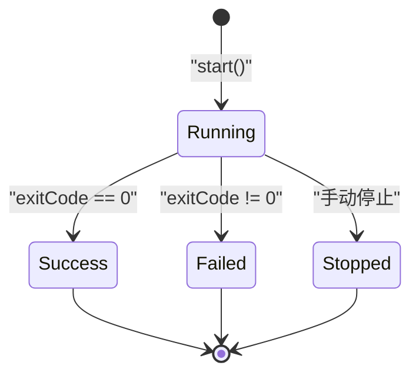

**图表来源**
- [src/main/services/runner/service.ts:127-133](file://src/main/services/runner/service.ts#L127-L133)
- [src/shared/types/run.ts:1-13](file://src/shared/types/run.ts#L1-L13)

**章节来源**
- [src/main/services/runner/service.ts:122-143](file://src/main/services/runner/service.ts#L122-L143)
- [src/shared/types/run.ts:1-28](file://src/shared/types/run.ts#L1-L28)