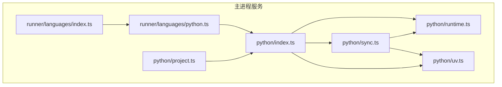
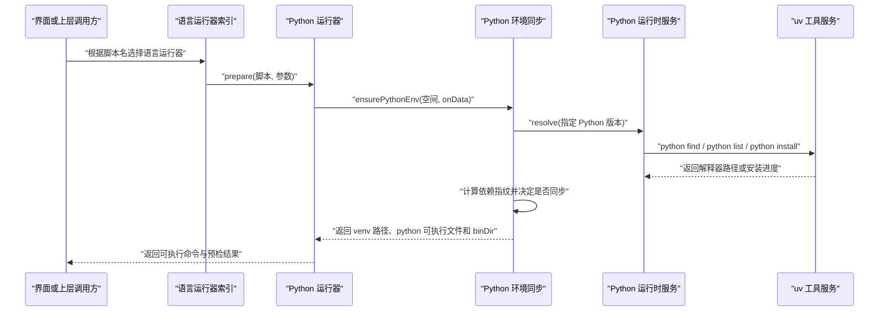
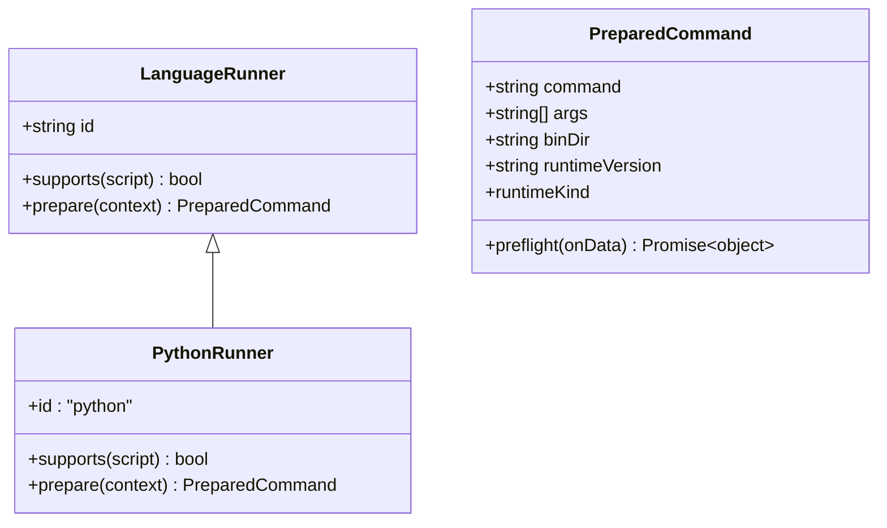
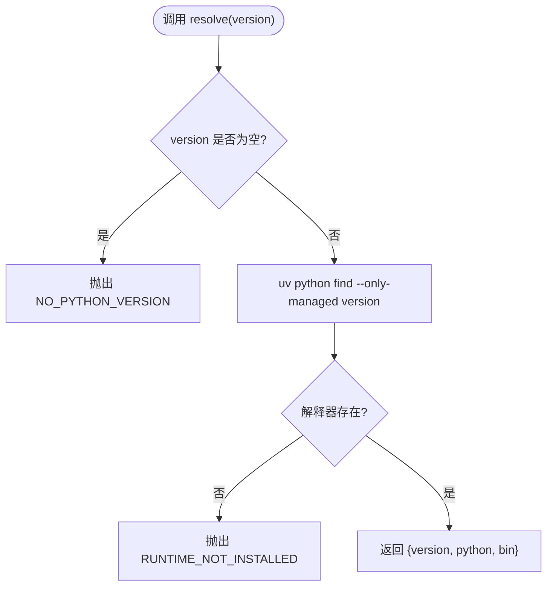
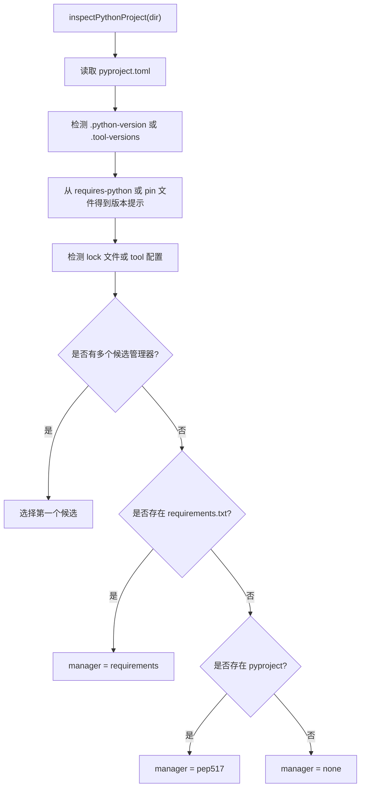
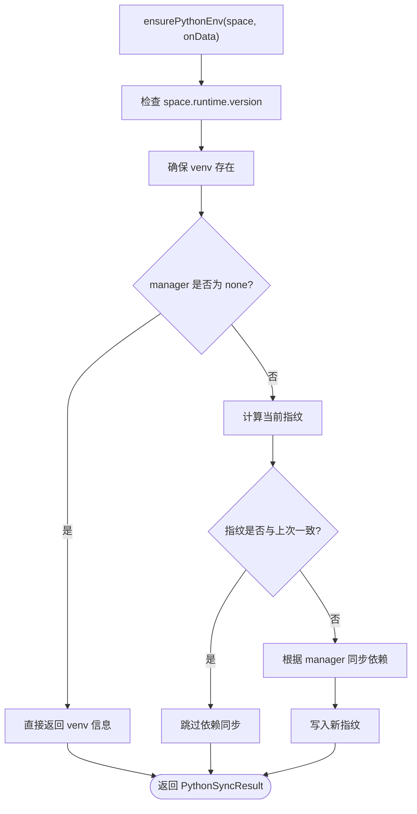
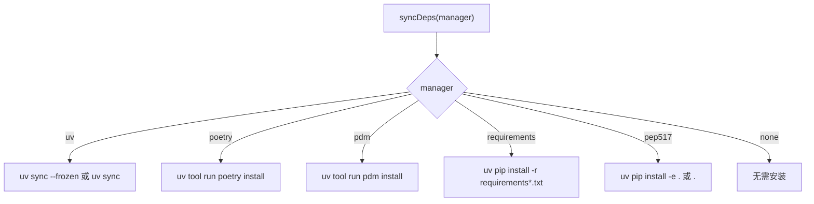
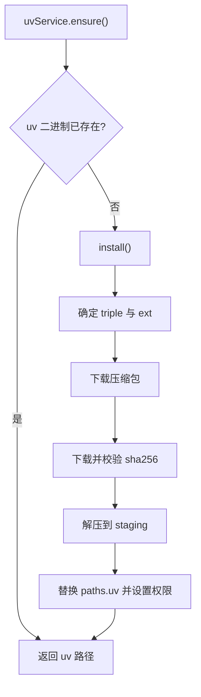
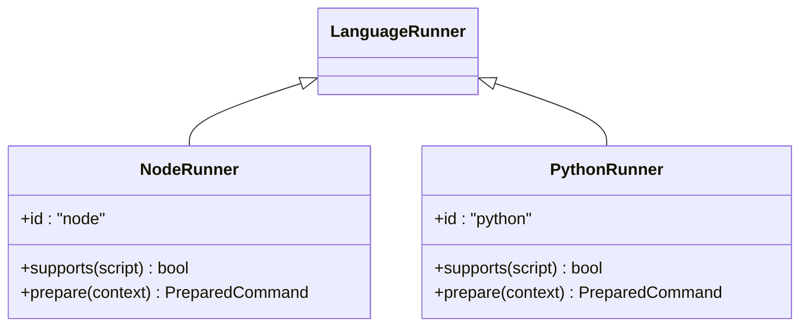
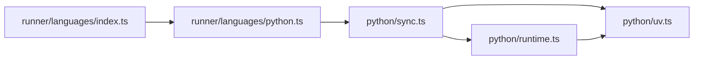

# Python 语言支持

<cite>
**本文引用的文件**   
- [README.md](file://README.md)
- [package.json](file://package.json)
- [src/main/services/python/index.ts](file://src/main/services/python/index.ts)
- [src/main/services/python/runtime.ts](file://src/main/services/python/runtime.ts)
- [src/main/services/python/project.ts](file://src/main/services/python/project.ts)
- [src/main/services/python/sync.ts](file://src/main/services/python/sync.ts)
- [src/main/services/python/uv.ts](file://src/main/services/python/uv.ts)
- [src/main/services/runner/languages/types.ts](file://src/main/services/runner/languages/types.ts)
- [src/main/services/runner/languages/python.ts](file://src/main/services/runner/languages/python.ts)
- [src/main/services/runner/languages/node.ts](file://src/main/services/runner/languages/node.ts)
- [src/main/services/runner/languages/index.ts](file://src/main/services/runner/languages/index.ts)
</cite>

## 目录
1. [简介](#简介)
2. [项目结构](#项目结构)
3. [核心组件](#核心组件)
4. [架构总览](#架构总览)
5. [详细组件分析](#详细组件分析)
6. [依赖关系分析](#依赖关系分析)
7. [性能与缓存特性](#性能与缓存特性)
8. [故障排查指南](#故障排查指南)
9. [结论](#结论)

## 简介
本项目是一个基于 Electron 的脚本运行器，默认以 Node.js 为核心运行时。同时，项目通过独立的 Python 服务层为 `.py` 脚本提供“免安装、可管理版本、按空间隔离依赖”的运行体验。Python 支持由以下能力组成：
- 使用 uv 作为底层工具链，自动下载并校验二进制；
- 管理 Python 解释器版本（受支持的次要版本）；
- 为每个运行空间创建虚拟环境；
- 识别并同步多种 Python 依赖管理方式（uv、Poetry、PDM、requirements.txt、PEP 517）；
- 在通用语言运行器框架中暴露 Python 执行入口。

该实现不改变主应用对 Node.js 的默认行为，而是以插件式语言运行器的形式扩展支持。

**章节来源**
- [README.md:5-29](file://README.md#L5-L29)
- [package.json:1-14](file://package.json#L1-L14)

## 项目结构
Python 相关代码集中在主进程的服务层，主要位于 `src/main/services/python`，并通过 `src/main/services/runner/languages/python.ts` 接入通用运行器体系。

**图表来源**
- [src/main/services/runner/languages/index.ts:1-15](file://src/main/services/runner/languages/index.ts#L1-L15)
- [src/main/services/runner/languages/python.ts:1-22](file://src/main/services/runner/languages/python.ts#L1-L22)
- [src/main/services/python/index.ts:1-6](file://src/main/services/python/index.ts#L1-L6)
- [src/main/services/python/runtime.ts:1-130](file://src/main/services/python/runtime.ts#L1-L130)
- [src/main/services/python/sync.ts:1-226](file://src/main/services/python/sync.ts#L1-L226)
- [src/main/services/python/project.ts:1-103](file://src/main/services/python/project.ts#L1-L103)
- [src/main/services/python/uv.ts:1-154](file://src/main/services/python/uv.ts#L1-L154)

**章节来源**
- [src/main/services/runner/languages/index.ts:1-15](file://src/main/services/runner/languages/index.ts#L1-L15)
- [src/main/services/python/index.ts:1-6](file://src/main/services/python/index.ts#L1-L6)

## 核心组件
- Python 运行器：将 `.py` 脚本转换为可执行的命令，并在启动前准备 Python 环境与依赖。
- Python 运行时服务：负责列出远程版本、已安装版本、安装/卸载、解析具体解释器路径。
- Python 项目探测：读取 `pyproject.toml`、`.python-version`、`.tool-versions` 等，推断项目名称、Python 版本提示和依赖管理器。
- Python 环境同步：为运行空间创建 venv，并根据依赖管理器同步依赖，使用指纹避免重复安装。
- uv 工具服务：自动下载、校验、解压 uv 二进制，并提供统一命令执行接口。

**章节来源**
- [src/main/services/runner/languages/python.ts:1-22](file://src/main/services/runner/languages/python.ts#L1-L22)
- [src/main/services/python/runtime.ts:1-130](file://src/main/services/python/runtime.ts#L1-L130)
- [src/main/services/python/project.ts:1-103](file://src/main/services/python/project.ts#L1-L103)
- [src/main/services/python/sync.ts:1-226](file://src/main/services/python/sync.ts#L1-L226)
- [src/main/services/python/uv.ts:1-154](file://src/main/services/python/uv.ts#L1-L154)

## 架构总览
Python 支持在“语言运行器”与“Python 服务层”之间解耦：语言运行器只关心如何把脚本变成命令；Python 服务层负责解释器、虚拟环境和依赖管理。

**图表来源**
- [src/main/services/runner/languages/index.ts:1-15](file://src/main/services/runner/languages/index.ts#L1-L15)
- [src/main/services/runner/languages/python.ts:1-22](file://src/main/services/runner/languages/python.ts#L1-L22)
- [src/main/services/python/sync.ts:167-225](file://src/main/services/python/sync.ts#L167-L225)
- [src/main/services/python/runtime.ts:93-101](file://src/main/services/python/runtime.ts#L93-L101)
- [src/main/services/python/uv.ts:73-109](file://src/main/services/python/uv.ts#L73-L109)

## 详细组件分析

### Python 语言运行器
Python 运行器是通用语言运行器接口的一个实现，负责：
- 判断脚本是否属于 Python（以 `.py` 结尾）；
- 生成基础命令 `python` 和脚本参数；
- 在真正执行前调用 Python 环境同步逻辑，确保虚拟环境和依赖就绪；
- 将虚拟环境中的 `python` 可执行文件和 `binDir` 回传给运行器框架。

**图表来源**
- [src/main/services/runner/languages/types.ts:1-32](file://src/main/services/runner/languages/types.ts#L1-L32)
- [src/main/services/runner/languages/python.ts:1-22](file://src/main/services/runner/languages/python.ts#L1-L22)

**章节来源**
- [src/main/services/runner/languages/types.ts:1-32](file://src/main/services/runner/languages/types.ts#L1-L32)
- [src/main/services/runner/languages/python.ts:1-22](file://src/main/services/runner/languages/python.ts#L1-L22)

### Python 运行时服务
Python 运行时服务封装了 Python 解释器的生命周期管理：
- 列出远程可用版本，仅保留受支持的次要版本；
- 列出已安装的 Python 版本；
- 安装、取消、卸载指定版本；
- 解析指定版本对应的解释器路径和 bin 目录；
- 通过事件上报安装进度。

**图表来源**
- [src/main/services/python/runtime.ts:93-101](file://src/main/services/python/runtime.ts#L93-L101)

**章节来源**
- [src/main/services/python/runtime.ts:1-130](file://src/main/services/python/runtime.ts#L1-L130)

### Python 项目探测
项目探测用于理解 Python 项目的元信息，包括：
- 项目名称；
- Python 版本提示及其来源；
- 依赖管理器候选列表；
- 最终选择的依赖管理器。

它读取：
- `pyproject.toml`；
- `.python-version`；
- `.tool-versions`；
- `uv.lock`、`poetry.lock`、`pdm.lock`；
- `requirements.txt`。

**图表来源**
- [src/main/services/python/project.ts:41-102](file://src/main/services/python/project.ts#L41-L102)

**章节来源**
- [src/main/services/python/project.ts:1-103](file://src/main/services/python/project.ts#L1-L103)

### Python 环境同步
环境同步是 Python 支持的核心流程，负责：
- 确保虚拟环境存在；
- 根据依赖管理器同步依赖；
- 使用指纹跳过未变更的依赖安装；
- 返回虚拟环境路径、python 可执行文件和 bin 目录。

**图表来源**
- [src/main/services/python/sync.ts:167-225](file://src/main/services/python/sync.ts#L167-L225)

依赖同步分支进一步区分不同管理器：

**图表来源**
- [src/main/services/python/sync.ts:89-158](file://src/main/services/python/sync.ts#L89-L158)

**章节来源**
- [src/main/services/python/sync.ts:1-226](file://src/main/services/python/sync.ts#L1-L226)

### uv 工具服务
uv 工具服务负责：
- 根据平台与架构选择目标二进制；
- 从 GitHub Releases 下载压缩包；
- 校验 SHA-256；
- 解压到临时目录并替换现有 uv 安装；
- 提供统一的命令执行接口，支持标准输出、错误输出、AbortSignal 和 onData 回调。

**图表来源**
- [src/main/services/python/uv.ts:22-51](file://src/main/services/python/uv.ts#L22-L51)
- [src/main/services/python/uv.ts:115-150](file://src/main/services/python/uv.ts#L115-L150)

**章节来源**
- [src/main/services/python/uv.ts:1-154](file://src/main/services/python/uv.ts#L1-L154)

### 与 Node.js 运行器的对比
Node.js 运行器通过运行时服务解析 Node 版本并转译入口，而 Python 运行器则通过 ensurePythonEnv 完成虚拟环境与依赖准备。两者都遵循相同的 `LanguageRunner` 接口，便于扩展更多语言。

**图表来源**
- [src/main/services/runner/languages/node.ts:1-19](file://src/main/services/runner/languages/node.ts#L1-L19)
- [src/main/services/runner/languages/python.ts:1-22](file://src/main/services/runner/languages/python.ts#L1-L22)
- [src/main/services/runner/languages/types.ts:1-32](file://src/main/services/runner/languages/types.ts#L1-L32)

**章节来源**
- [src/main/services/runner/languages/node.ts:1-19](file://src/main/services/runner/languages/node.ts#L1-L19)
- [src/main/services/runner/languages/python.ts:1-22](file://src/main/services/runner/languages/python.ts#L1-L22)

## 依赖关系分析
Python 支持的主要依赖关系如下：
- 语言运行器索引聚合所有语言运行器，并按脚本后缀选择对应实现；
- Python 运行器依赖 Python 环境同步；
- Python 环境同步依赖 Python 运行时服务和 uv 工具服务；
- Python 运行时服务依赖 uv 工具服务；
- uv 工具服务依赖网络下载、设置和网络环境变量构建。

**图表来源**
- [src/main/services/runner/languages/index.ts:1-15](file://src/main/services/runner/languages/index.ts#L1-L15)
- [src/main/services/runner/languages/python.ts:1-22](file://src/main/services/runner/languages/python.ts#L1-L22)
- [src/main/services/python/sync.ts:1-226](file://src/main/services/python/sync.ts#L1-L226)
- [src/main/services/python/runtime.ts:1-130](file://src/main/services/python/runtime.ts#L1-L130)
- [src/main/services/python/uv.ts:1-154](file://src/main/services/python/uv.ts#L1-L154)

**章节来源**
- [src/main/services/runner/languages/index.ts:1-15](file://src/main/services/runner/languages/index.ts#L1-L15)
- [src/main/services/python/index.ts:1-6](file://src/main/services/python/index.ts#L1-L6)

## 性能与缓存特性
- uv 二进制缓存：uv 工具会下载到固定目录，避免重复下载。
- Python 解释器缓存：通过 `UV_PYTHON_INSTALL_DIR` 指向共享的 Python 运行时目录。
- 依赖指纹缓存：每次同步前计算依赖规范文件的哈希，若 Python 版本、依赖管理器和内容哈希未变化，则跳过依赖安装。
- 虚拟环境复用：同一运行空间的虚拟环境路径固定，只要解释器存在就复用。
- 工具缓存：Poetry 和 PDM 通过 uv tool 安装，其工具目录也受 uv 环境变量控制。

这些机制共同减少重复下载、重复编译和重复安装，提升多次运行同一脚本的效率。

**章节来源**
- [src/main/services/python/uv.ts:40-51](file://src/main/services/python/uv.ts#L40-L51)
- [src/main/services/python/sync.ts:22-56](file://src/main/services/python/sync.ts#L22-L56)
- [src/main/services/python/sync.ts:194-224](file://src/main/services/python/sync.ts#L194-L224)

## 故障排查指南
常见错误及定位建议：
- 未指定 Python 版本：当 `space.runtime.version` 为空时，会抛出 `NO_PYTHON_VERSION`。应检查运行空间是否选择了 Python 版本。
- 解释器未安装：解析 Python 解释器时发现路径不存在，会抛出 `RUNTIME_NOT_INSTALLED`。应先安装对应版本。
- 依赖同步失败：依赖安装过程中抛出 `PYTHON_DEPS_FAILED`。可查看 uv/Poetry/PDM/pip 的输出日志，确认 lock 文件、网络代理或包源配置。
- uv 工具失败：uv 子进程非零退出码会抛出 `PYTHON_TOOL_FAILED`。通常与网络、代理、镜像或权限有关。
- 平台不支持：当前 uv 目标映射不包含某些平台架构时会抛出 `PYTHON_VERSION_UNSUPPORTED`。
- 校验失败：下载 uv 后 SHA-256 不一致会抛出 `CHECKSUM_MISMATCH`，应检查网络完整性或镜像源。

建议排查步骤：
1. 确认运行空间已选择 Python 版本；
2. 确认 uv 已成功安装并可执行；
3. 查看 Python 解释器是否已安装；
4. 检查依赖管理器与 lock 文件是否匹配；
5. 检查网络代理、镜像和缓存目录权限；
6. 重新触发依赖同步，观察 onData 输出。

**章节来源**
- [src/main/services/python/sync.ts:172-179](file://src/main/services/python/sync.ts#L172-L179)
- [src/main/services/python/sync.ts:212-224](file://src/main/services/python/sync.ts#L212-L224)
- [src/main/services/python/runtime.ts:93-101](file://src/main/services/python/runtime.ts#L93-L101)
- [src/main/services/python/uv.ts:31-34](file://src/main/services/python/uv.ts#L31-L34)
- [src/main/services/python/uv.ts:123-128](file://src/main/services/python/uv.ts#L123-L128)
- [src/main/services/python/uv.ts:99-107](file://src/main/services/python/uv.ts#L99-L107)

## 结论
Python 语言支持在本项目中以独立服务层的方式实现，既保持与 Node.js 运行器一致的接口，又充分利用 uv 的现代 Python 生态管理能力。通过虚拟环境、依赖指纹和工具缓存，项目在易用性、可维护性和性能之间取得平衡。对于用户而言，这意味着可以在同一个 Script Box 中无缝运行 Python 脚本，而不必手动管理 Python 解释器或全局依赖。