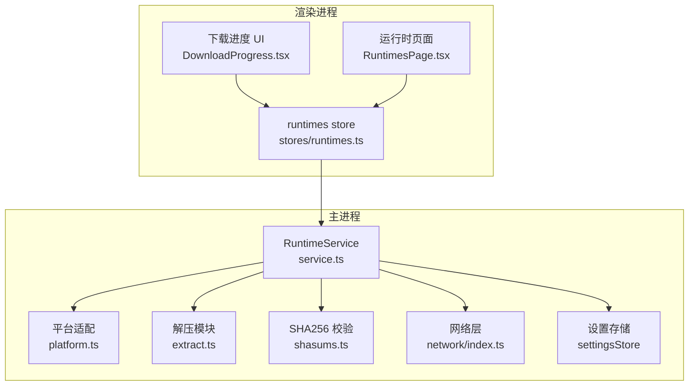
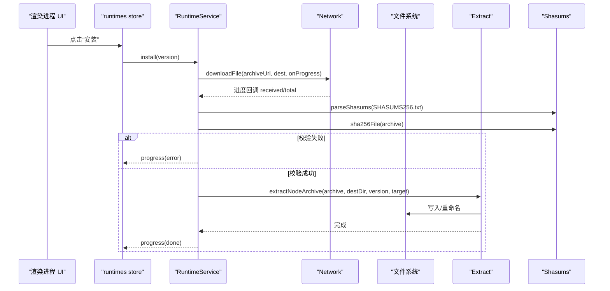
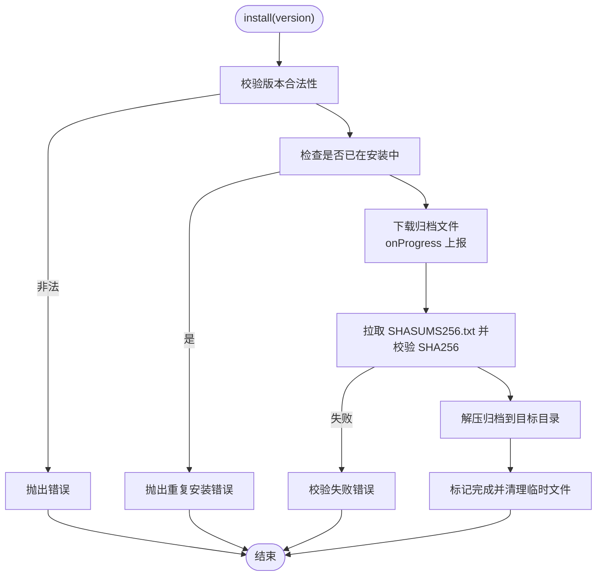
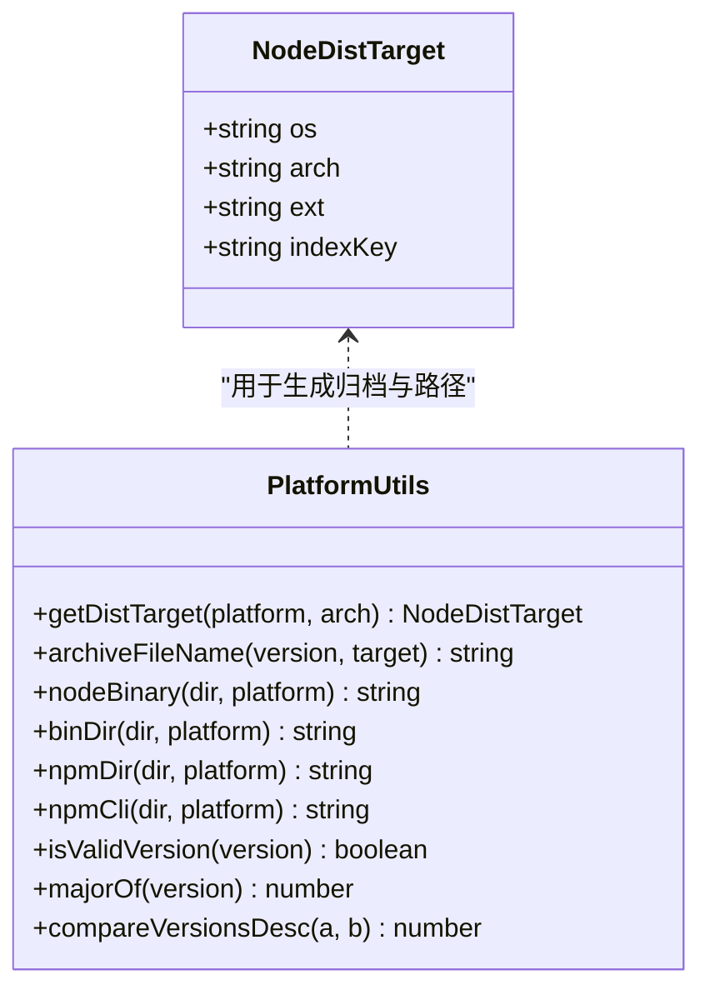
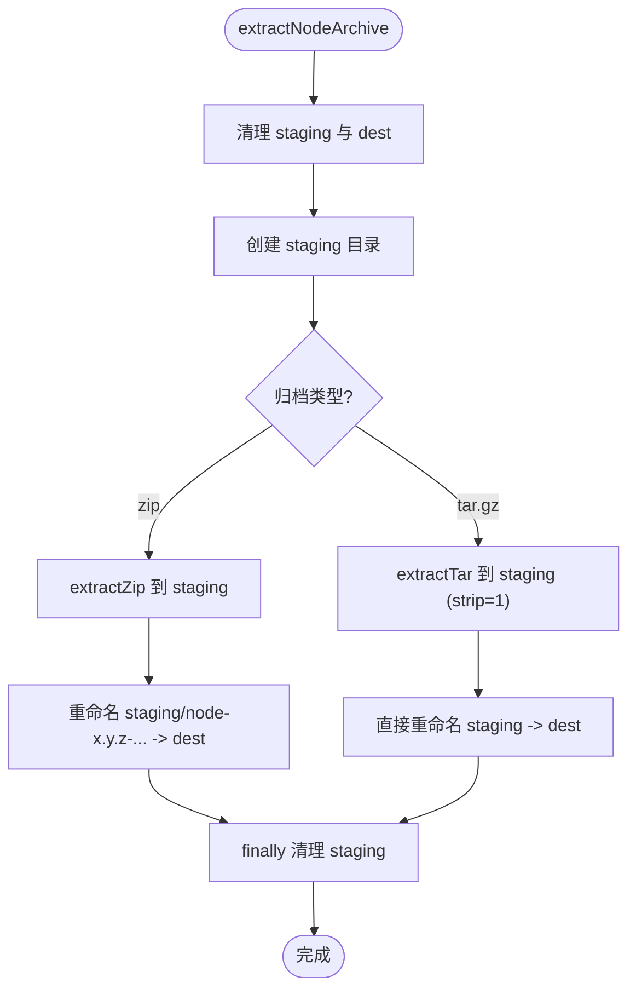
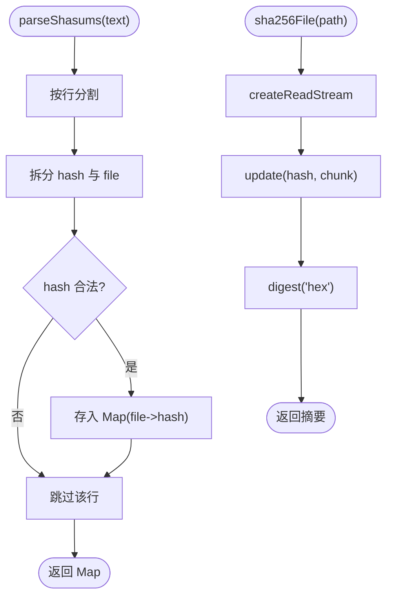
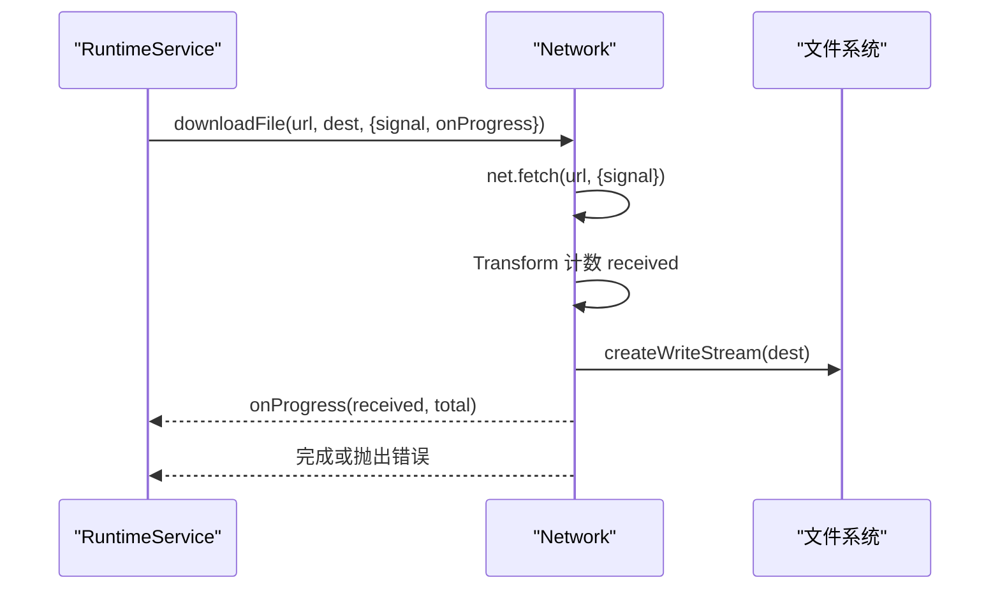
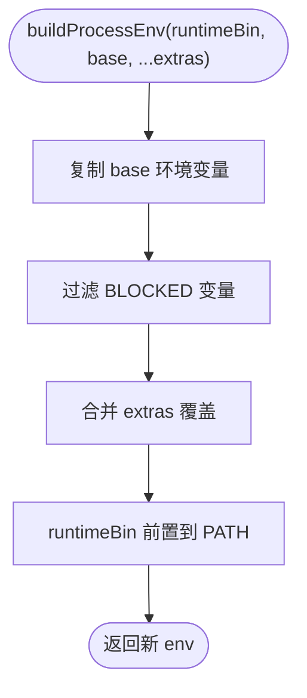
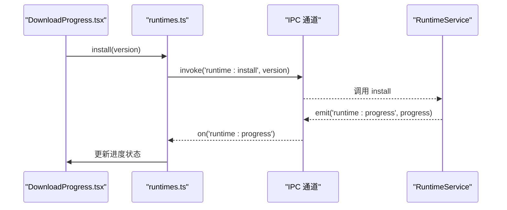
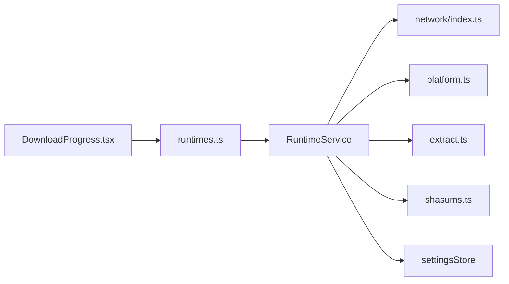

# Runtime 服务（运行时管理）

<cite>
**本文引用的文件**   
- [src/main/services/runtime/service.ts](file://src/main/services/runtime/service.ts)
- [src/main/services/runtime/platform.ts](file://src/main/services/runtime/platform.ts)
- [src/main/services/runtime/extract.ts](file://src/main/services/runtime/extract.ts)
- [src/main/services/runtime/env.ts](file://src/main/services/runtime/env.ts)
- [src/main/services/runtime/shasums.ts](file://src/main/services/runtime/shasums.ts)
- [src/main/services/network/index.ts](file://src/main/services/network/index.ts)
- [src/shared/types/runtime.ts](file://src/shared/types/runtime.ts)
- [src/renderer/src/stores/runtimes.ts](file://src/renderer/src/stores/runtimes.ts)
- [src/renderer/src/components/runtime/DownloadProgress.tsx](file://src/renderer/src/components/runtime/DownloadProgress.tsx)
- [src/renderer/src/pages/runtimes/RuntimesPage.tsx](file://src/renderer/src/pages/runtimes/RuntimesPage.tsx)
</cite>

## 目录
1. [简介](#简介)
2. [项目结构](#项目结构)
3. [核心组件](#核心组件)
4. [架构总览](#架构总览)
5. [详细组件分析](#详细组件分析)
6. [依赖关系分析](#依赖关系分析)
7. [性能与并发特性](#性能与并发特性)
8. [故障排查指南](#故障排查指南)
9. [结论](#结论)
10. [附录：扩展指南](#附录扩展指南)

## 简介
本技术文档聚焦于 Runtime 服务，围绕 Node.js 版本管理机制进行系统化说明。内容涵盖远程版本发现、下载进度跟踪、文件解压与安装验证、平台适配逻辑、镜像源配置、安全校验（SHA256）、环境变量注入、多版本并行管理策略、缓存机制以及版本切换流程。同时提供面向扩展的示例路径，帮助开发者添加新的 Node.js 版本支持与自定义下载器、解压器。

## 项目结构
Runtime 服务位于主进程侧，负责与远端镜像交互、本地文件操作、版本管理与事件上报；渲染进程通过 IPC 调用并展示进度与状态。

**图表来源**
- [src/main/services/runtime/service.ts:37-154](file://src/main/services/runtime/service.ts#L37-L154)
- [src/main/services/runtime/platform.ts:1-83](file://src/main/services/runtime/platform.ts#L1-L83)
- [src/main/services/runtime/extract.ts:1-37](file://src/main/services/runtime/extract.ts#L1-L37)
- [src/main/services/runtime/shasums.ts:1-26](file://src/main/services/runtime/shasums.ts#L1-L26)
- [src/main/services/network/index.ts:1-81](file://src/main/services/network/index.ts#L1-L81)
- [src/renderer/src/stores/runtimes.ts:1-62](file://src/renderer/src/stores/runtimes.ts#L1-L62)
- [src/renderer/src/components/runtime/DownloadProgress.tsx:1-42](file://src/renderer/src/components/runtime/DownloadProgress.tsx#L1-L42)
- [src/renderer/src/pages/runtimes/RuntimesPage.tsx:1-19](file://src/renderer/src/pages/runtimes/RuntimesPage.tsx#L1-L19)

**章节来源**
- [src/main/services/runtime/service.ts:1-155](file://src/main/services/runtime/service.ts#L1-L155)
- [src/main/services/runtime/platform.ts:1-83](file://src/main/services/runtime/platform.ts#L1-L83)
- [src/main/services/runtime/extract.ts:1-37](file://src/main/services/runtime/extract.ts#L1-L37)
- [src/main/services/runtime/shasums.ts:1-26](file://src/main/services/runtime/shasums.ts#L1-L26)
- [src/main/services/network/index.ts:1-81](file://src/main/services/network/index.ts#L1-L81)
- [src/renderer/src/stores/runtimes.ts:1-62](file://src/renderer/src/stores/runtimes.ts#L1-L62)
- [src/renderer/src/components/runtime/DownloadProgress.tsx:1-42](file://src/renderer/src/components/runtime/DownloadProgress.tsx#L1-L42)
- [src/renderer/src/pages/runtimes/RuntimesPage.tsx:1-19](file://src/renderer/src/pages/runtimes/RuntimesPage.tsx#L1-L19)

## 核心组件
- RuntimeService：版本列表获取、已安装版本枚举、版本解析、安装/取消/删除、进度事件上报、远程缓存。
- Platform：平台与架构映射、归档文件名生成、二进制与 npm CLI 路径计算、版本格式校验与排序。
- Extract：统一解压入口，支持 zip 与 tar.gz，使用暂存目录保证原子性。
- Shasums：解析 SHASUMS256.txt 与计算文件 SHA256。
- Network：基于 Electron net 的文本/JSON 拉取、带进度流式下载、代理与连接测试。
- Env：构建子进程环境，屏蔽干扰变量并将运行时 bin 目录优先加入 PATH。
- Renderer Store/UI：订阅安装进度、展示下载进度条、触发安装/取消/删除等操作。

**章节来源**
- [src/main/services/runtime/service.ts:23-154](file://src/main/services/runtime/service.ts#L23-L154)
- [src/main/services/runtime/platform.ts:1-83](file://src/main/services/runtime/platform.ts#L1-L83)
- [src/main/services/runtime/extract.ts:1-37](file://src/main/services/runtime/extract.ts#L1-L37)
- [src/main/services/runtime/shasums.ts:1-26](file://src/main/services/runtime/shasums.ts#L1-L26)
- [src/main/services/network/index.ts:1-81](file://src/main/services/network/index.ts#L1-L81)
- [src/main/services/runtime/env.ts:1-28](file://src/main/services/runtime/env.ts#L1-L28)
- [src/renderer/src/stores/runtimes.ts:1-62](file://src/renderer/src/stores/runtimes.ts#L1-L62)
- [src/renderer/src/components/runtime/DownloadProgress.tsx:1-42](file://src/renderer/src/components/runtime/DownloadProgress.tsx#L1-L42)

## 架构总览
Runtime 服务作为中心协调者，串联网络、平台适配、解压与安全校验，并通过事件向渲染进程推送安装进度。

**图表来源**
- [src/main/services/runtime/service.ts:87-151](file://src/main/services/runtime/service.ts#L87-L151)
- [src/main/services/network/index.ts:34-64](file://src/main/services/network/index.ts#L34-L64)
- [src/main/services/runtime/shasums.ts:4-25](file://src/main/services/runtime/shasums.ts#L4-L25)
- [src/main/services/runtime/extract.ts:13-36](file://src/main/services/runtime/extract.ts#L13-L36)

## 详细组件分析

### RuntimeService：版本管理与安装编排
- 远程版本发现
  - 从配置的镜像地址读取 index.json，按当前平台目标过滤出可用版本，结果在内存中缓存 10 分钟，避免频繁请求。
- 已安装版本枚举
  - 扫描本地 runtimes 目录，过滤合法版本号，跳过正在安装的版本，读取 npm 包信息补充 npmVersion。
- 版本解析
  - 校验版本合法性、是否正在安装、是否存在 node 二进制，返回 ResolvedRuntime（包含 node、npmCli、bin 路径）。
- 安装流程
  - 生成临时归档路径，调用网络层下载，实时上报进度；随后拉取 SHASUMS256.txt 并计算本地 SHA256 进行比对；通过后解压到目标目录；最终清理临时文件并移除安装记录。
- 取消与删除
  - 通过 AbortController 中断下载；删除指定版本的整个目录。

**图表来源**
- [src/main/services/runtime/service.ts:87-151](file://src/main/services/runtime/service.ts#L87-L151)

**章节来源**
- [src/main/services/runtime/service.ts:35-154](file://src/main/services/runtime/service.ts#L35-L154)

### Platform：平台适配与路径计算
- 平台与架构映射
  - 将 process.arch 映射为发行版所需架构名，区分 win/darwin/linux 三种系统，输出 NodeDistTarget（含 os、arch、ext、indexKey）。
- 归档名称与二进制路径
  - 根据版本与目标生成归档文件名；计算 node 可执行文件、bin 目录、npm 目录与 npm-cli.js 路径。
- 版本工具函数
  - 正则校验 vX.Y.Z 格式；提取主版本号；按语义化降序比较。

**图表来源**
- [src/main/services/runtime/platform.ts:3-83](file://src/main/services/runtime/platform.ts#L3-L83)

**章节来源**
- [src/main/services/runtime/platform.ts:1-83](file://src/main/services/runtime/platform.ts#L1-L83)

### Extract：解压实现与原子性保障
- 统一解压入口
  - 针对 zip 与 tar.gz 分别调用对应库；zip 需要重命名内部根目录以匹配预期结构；tar.gz 使用 strip=1 去除顶层目录。
- 原子性
  - 先清理目标与暂存目录，再写入暂存目录，成功后重命名为目标目录，finally 清理暂存目录，确保异常时不留下半安装产物。

**图表来源**
- [src/main/services/runtime/extract.ts:13-36](file://src/main/services/runtime/extract.ts#L13-L36)

**章节来源**
- [src/main/services/runtime/extract.ts:1-37](file://src/main/services/runtime/extract.ts#L1-L37)

### Shasums：SHA256 校验
- 解析 SHASUMS256.txt
  - 逐行解析哈希与文件名，忽略二进制模式前缀，仅接受 64 位十六进制哈希。
- 计算文件 SHA256
  - 流式读取文件并计算摘要，返回十六进制字符串。

**图表来源**
- [src/main/services/runtime/shasums.ts:4-25](file://src/main/services/runtime/shasums.ts#L4-L25)

**章节来源**
- [src/main/services/runtime/shasums.ts:1-26](file://src/main/services/runtime/shasums.ts#L1-L26)

### Network：网络层与代理
- 代理配置
  - 通过 Electron session 设置代理并关闭已有连接，使所有主进程网络流量走代理。
- 文本与 JSON 拉取
  - 封装 fetchText/fetchJson，统一错误处理。
- 流式下载
  - 使用 Readable.fromWeb 与 pipeline 流式写入，节流上报进度（约每 150ms），失败时自动删除部分下载文件。
- 连接测试
  - 对给定 URL 发起 GET 请求，统计耗时与状态。

**图表来源**
- [src/main/services/network/index.ts:34-64](file://src/main/services/network/index.ts#L34-L64)

**章节来源**
- [src/main/services/network/index.ts:1-81](file://src/main/services/network/index.ts#L1-L81)

### Env：环境变量注入
- 屏蔽变量
  - 阻止 ELECTRON_、NODE_OPTIONS、NODE_PATH、npm_*、VITE_* 等可能影响子进程的变量。
- PATH 优先级
  - 将运行时的 bin 目录置于 PATH 最前面，确保子进程优先使用该版本的可执行文件。
- 合并 extras
  - 允许上层传入额外环境变量覆盖默认值。

**图表来源**
- [src/main/services/runtime/env.ts:10-26](file://src/main/services/runtime/env.ts#L10-L26)

**章节来源**
- [src/main/services/runtime/env.ts:1-28](file://src/main/services/runtime/env.ts#L1-L28)

### 渲染进程：状态与进度展示
- Runtimes Store
  - 维护 installed、remote、progress 等状态；提供 loadInstalled/loadRemote/install/cancel/remove/dismiss 等方法；监听 runtime:progress 事件更新 UI。
- DownloadProgress 组件
  - 根据 phase 显示阶段文案与百分比；失败时显示错误并可关闭；下载中显示已接收字节与总量。
- RuntimesPage
  - 组合已安装与远程版本列表页面。

**图表来源**
- [src/renderer/src/stores/runtimes.ts:19-61](file://src/renderer/src/stores/runtimes.ts#L19-L61)
- [src/renderer/src/components/runtime/DownloadProgress.tsx:14-40](file://src/renderer/src/components/runtime/DownloadProgress.tsx#L14-L40)

**章节来源**
- [src/renderer/src/stores/runtimes.ts:1-62](file://src/renderer/src/stores/runtimes.ts#L1-L62)
- [src/renderer/src/components/runtime/DownloadProgress.tsx:1-42](file://src/renderer/src/components/runtime/DownloadProgress.tsx#L1-L42)
- [src/renderer/src/pages/runtimes/RuntimesPage.tsx:1-19](file://src/renderer/src/pages/runtimes/RuntimesPage.tsx#L1-L19)

## 依赖关系分析
- RuntimeService 依赖
  - network：远程索引、SHASUMS 与归档下载。
  - platform：平台目标、归档名、二进制与 npm 路径。
  - extract：解压归档。
  - shasums：SHA256 校验。
  - settingsStore：镜像源配置。
- 渲染进程依赖
  - stores/runtimes.ts：集中管理运行时相关状态与 IPC 调用。
  - components/runtime/DownloadProgress.tsx：进度可视化。

**图表来源**
- [src/main/services/runtime/service.ts:1-22](file://src/main/services/runtime/service.ts#L1-L22)
- [src/main/services/network/index.ts:1-27](file://src/main/services/network/index.ts#L1-L27)
- [src/main/services/runtime/platform.ts:1-10](file://src/main/services/runtime/platform.ts#L1-L10)
- [src/main/services/runtime/extract.ts:1-7](file://src/main/services/runtime/extract.ts#L1-L7)
- [src/main/services/runtime/shasums.ts:1-4](file://src/main/services/runtime/shasums.ts#L1-L4)
- [src/renderer/src/stores/runtimes.ts:1-17](file://src/renderer/src/stores/runtimes.ts#L1-L17)
- [src/renderer/src/components/runtime/DownloadProgress.tsx:1-6](file://src/renderer/src/components/runtime/DownloadProgress.tsx#L1-L6)

**章节来源**
- [src/main/services/runtime/service.ts:1-22](file://src/main/services/runtime/service.ts#L1-L22)
- [src/main/services/network/index.ts:1-27](file://src/main/services/network/index.ts#L1-L27)
- [src/main/services/runtime/platform.ts:1-10](file://src/main/services/runtime/platform.ts#L1-L10)
- [src/main/services/runtime/extract.ts:1-7](file://src/main/services/runtime/extract.ts#L1-L7)
- [src/main/services/runtime/shasums.ts:1-4](file://src/main/services/runtime/shasums.ts#L1-L4)
- [src/renderer/src/stores/runtimes.ts:1-17](file://src/renderer/src/stores/runtimes.ts#L1-L17)
- [src/renderer/src/components/runtime/DownloadProgress.tsx:1-6](file://src/renderer/src/components/runtime/DownloadProgress.tsx#L1-L6)

## 性能与并发特性
- 远程版本缓存
  - 内存缓存 remote list，TTL 为 10 分钟，减少重复请求。
- 下载进度节流
  - 约每 150ms 上报一次进度，降低 UI 刷新频率。
- 多版本并行安装
  - 使用 Map 维护每个版本的 AbortController 与进度对象，支持同时安装多个版本且互不干扰。
- 原子解压
  - 通过 staging 目录与 finally 清理，避免部分解压导致的脏数据。
- 流式 I/O
  - 下载与 SHA256 计算均采用流式处理，降低内存占用。

[本节为通用性能讨论，不直接分析具体文件]

## 故障排查指南
- 常见错误与定位
  - 校验失败：当本地 SHA256 与 SHASUMS256.txt 不一致时抛出错误，需检查网络完整性或镜像源一致性。
  - 下载失败：网络层统一抛出下载失败错误，检查代理配置与网络连接。
  - 未安装版本：resolve 时若版本不存在或正在安装会抛出错误，确认版本是否已安装或安装是否仍在进行中。
  - 重复安装：同一版本同时触发安装会抛错，需等待上一次完成或取消后重试。
- 调试建议
  - 观察渲染进程进度事件，关注 phase 与 error 字段。
  - 检查临时归档是否被正确清理。
  - 确认镜像源与 index.json 结构是否符合预期。

**章节来源**
- [src/main/services/runtime/service.ts:74-108](file://src/main/services/runtime/service.ts#L74-L108)
- [src/main/services/runtime/service.ts:114-151](file://src/main/services/runtime/service.ts#L114-L151)
- [src/main/services/network/index.ts:18-27](file://src/main/services/network/index.ts#L18-L27)
- [src/main/services/network/index.ts:34-64](file://src/main/services/network/index.ts#L34-L64)

## 结论
Runtime 服务通过清晰的职责划分与稳健的错误处理，实现了跨平台的 Node.js 版本管理。其远程缓存、流式下载、SHA256 校验与原子解压共同保证了安全性与可靠性；多版本并行与进度事件则提供了良好的用户体验。结合渲染进程的状态管理与 UI 反馈，整体方案具备可扩展性与可维护性。

[本节为总结性内容，不直接分析具体文件]

## 附录：扩展指南

### 添加新的 Node.js 版本支持
- 步骤概览
  - 确认镜像源 index.json 包含目标平台与架构的 files 条目。
  - 确保 platform.ts 中的 getDistTarget 能识别该平台的 indexKey。
  - 如新增平台或架构，需在 ARCH_MAP 与 switch 分支中添加映射。
  - 验证 SHASUMS256.txt 存在且格式正确。
- 关键路径参考
  - 平台目标与 indexKey：[platform.ts:20-34](file://src/main/services/runtime/platform.ts#L20-L34)
  - 远程列表过滤逻辑：[service.ts:45-57](file://src/main/services/runtime/service.ts#L45-L57)
  - 归档文件名生成：[platform.ts:36-42](file://src/main/services/runtime/platform.ts#L36-L42)

**章节来源**
- [src/main/services/runtime/platform.ts:20-42](file://src/main/services/runtime/platform.ts#L20-L42)
- [src/main/services/runtime/service.ts:45-57](file://src/main/services/runtime/service.ts#L45-L57)

### 自定义下载器
- 替换点
  - 使用自定义下载逻辑替代 service.ts 中对 downloadFile 的调用，保持 onProgress 回调签名一致。
- 注意事项
  - 保留 signal 支持以便取消。
  - 保持进度上报频率与错误处理风格一致。
- 关键路径参考
  - 下载调用位置：[service.ts:114-126](file://src/main/services/runtime/service.ts#L114-L126)
  - 现有下载实现：[network/index.ts:34-64](file://src/main/services/network/index.ts#L34-L64)

**章节来源**
- [src/main/services/runtime/service.ts:114-126](file://src/main/services/runtime/service.ts#L114-L126)
- [src/main/services/network/index.ts:34-64](file://src/main/services/network/index.ts#L34-L64)

### 自定义解压器
- 替换点
  - 在 service.ts 中替换 extractNodeArchive 调用，或在其内部增加新的归档类型分支。
- 注意事项
  - 保持 staging 目录与最终 dest 的原子重命名逻辑。
  - 确保解压后的目录结构与 platform.ts 的路径约定一致（bin、lib、node.exe 等）。
- 关键路径参考
  - 解压调用位置：[service.ts:136-138](file://src/main/services/runtime/service.ts#L136-L138)
  - 解压实现：[extract.ts:13-36](file://src/main/services/runtime/extract.ts#L13-L36)
  - 路径约定：[platform.ts:44-60](file://src/main/services/runtime/platform.ts#L44-L60)

**章节来源**
- [src/main/services/runtime/service.ts:136-138](file://src/main/services/runtime/service.ts#L136-L138)
- [src/main/services/runtime/extract.ts:13-36](file://src/main/services/runtime/extract.ts#L13-L36)
- [src/main/services/runtime/platform.ts:44-60](file://src/main/services/runtime/platform.ts#L44-L60)

### 版本切换流程
- 选择已安装版本
  - 通过 resolve 方法校验并返回 ResolvedRuntime，供脚本运行器使用。
- 切换约束
  - 仅允许切换已安装且不在安装中的版本。
- 关键路径参考
  - 版本解析：[service.ts:74-81](file://src/main/services/runtime/service.ts#L74-L81)
  - 已安装列表：[service.ts:59-72](file://src/main/services/runtime/service.ts#L59-L72)

**章节来源**
- [src/main/services/runtime/service.ts:59-81](file://src/main/services/runtime/service.ts#L59-L81)

### 类型定义参考
- 远程版本、已安装版本、安装进度等类型定义位于共享类型文件中，便于前后端共用。

**章节来源**
- [src/shared/types/runtime.ts:1-23](file://src/shared/types/runtime.ts#L1-L23)