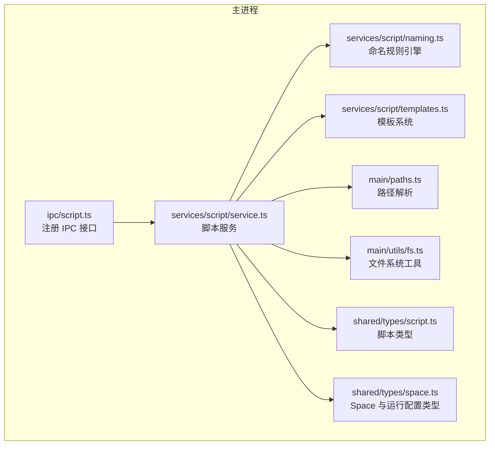
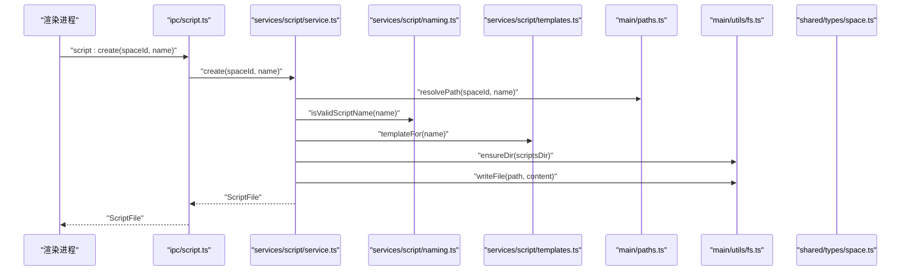
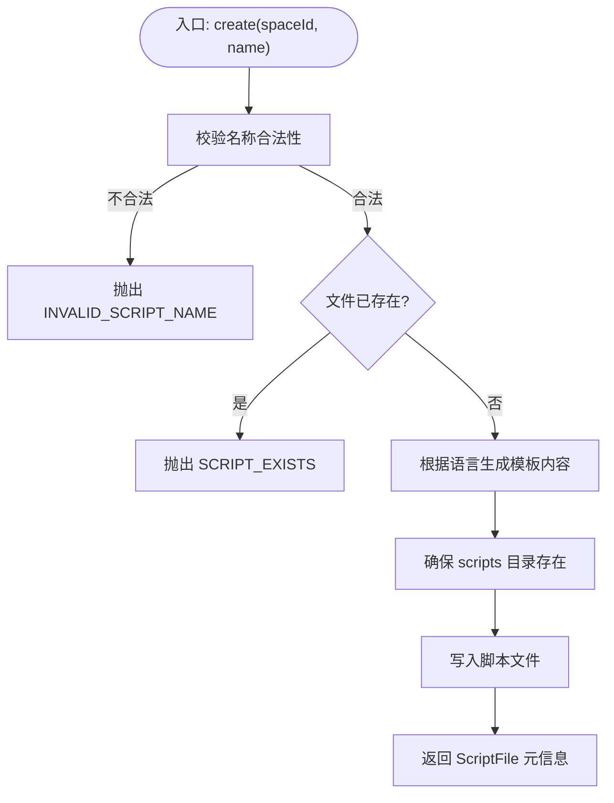
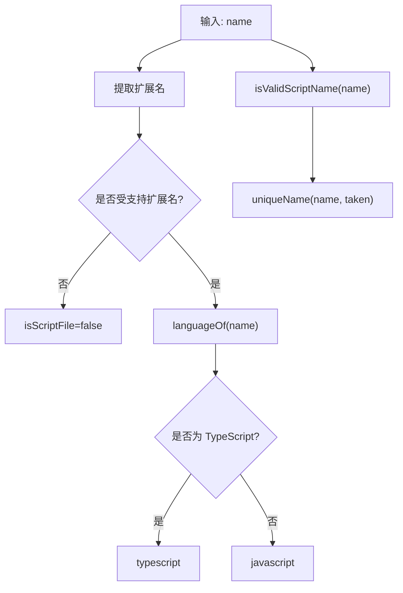
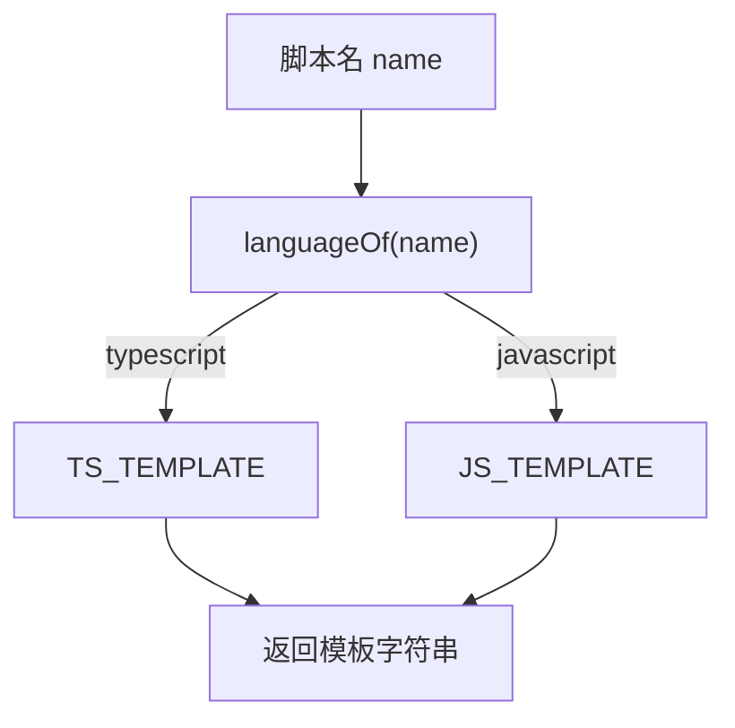
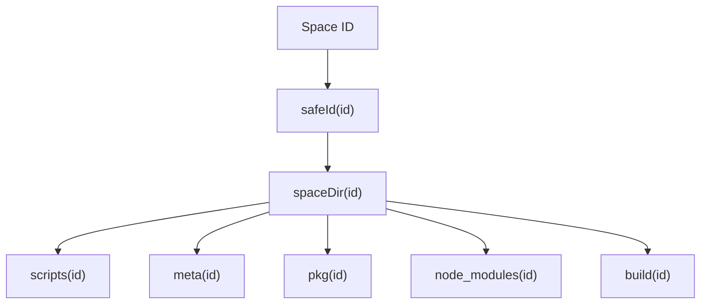
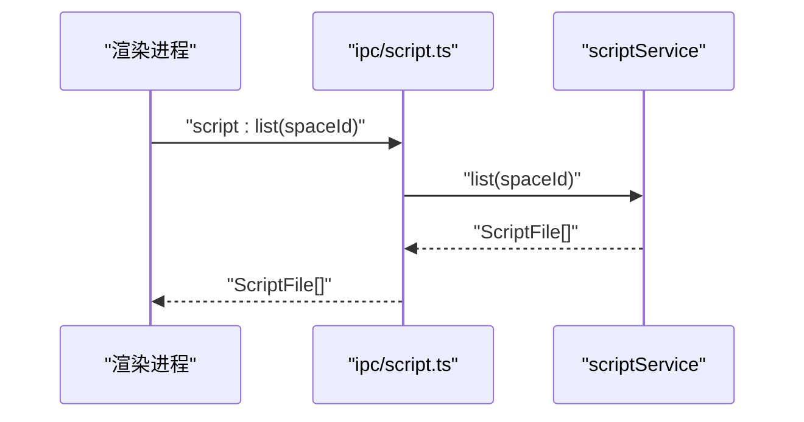
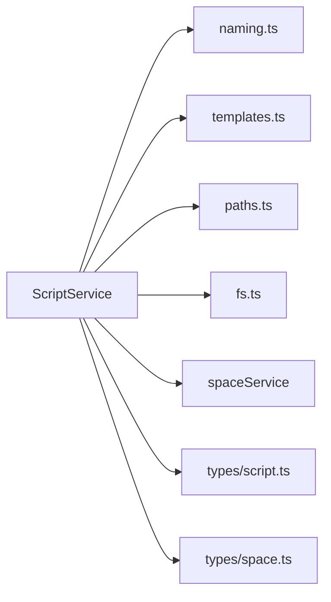

# Script 服务（脚本管理）

<cite>
**本文引用的文件**   
- [service.ts](file://src/main/services/script/service.ts)
- [naming.ts](file://src/main/services/script/naming.ts)
- [templates.ts](file://src/main/services/script/templates.ts)
- [script.ts](file://src/shared/types/script.ts)
- [space.ts](file://src/shared/types/space.ts)
- [paths.ts](file://src/main/paths.ts)
- [fs.ts](file://src/main/utils/fs.ts)
- [script.ts](file://src/main/ipc/script.ts)
</cite>

## 目录
1. [简介](#简介)
2. [项目结构](#项目结构)
3. [核心组件](#核心组件)
4. [架构总览](#架构总览)
5. [详细组件分析](#详细组件分析)
6. [依赖关系分析](#依赖关系分析)
7. [性能与扩展性](#性能与扩展性)
8. [故障排查指南](#故障排查指南)
9. [结论](#结论)
10. [附录：扩展实践](#附录扩展实践)

## 简介
本技术文档聚焦于 Script 服务，围绕以下目标展开：
- 文件系统操作：脚本的创建、读取、写入、导入、重命名、删除与运行配置保存。
- 命名规则引擎：脚本名称合法性校验、扩展名识别、语言推断与唯一名生成。
- 模板系统：按语言选择默认模板内容，用于新建脚本。
- 路径解析与空间隔离：基于 Space 的脚本目录结构与路径安全。
- 元数据管理：脚本在 Space 中的运行参数与环境变量持久化。
- 集成点：IPC 接口暴露给渲染进程使用。

该服务位于主进程侧，通过 IPC 向渲染进程提供稳定的脚本管理能力。

## 项目结构
Script 服务相关代码主要分布在以下位置：
- 主进程服务层：src/main/services/script
- 共享类型定义：src/shared/types
- 路径与工具函数：src/main/paths.ts、src/main/utils/fs.ts
- IPC 注册：src/main/ipc/script.ts

**图表来源**
- [script.ts:1-14](file://src/main/ipc/script.ts#L1-L14)
- [service.ts:1-110](file://src/main/services/script/service.ts#L1-L110)
- [naming.ts:1-47](file://src/main/services/script/naming.ts#L1-L47)
- [templates.ts:1-16](file://src/main/services/script/templates.ts#L1-L16)
- [paths.ts:1-62](file://src/main/paths.ts#L1-L62)
- [fs.ts:1-35](file://src/main/utils/fs.ts#L1-L35)
- [script.ts:1-13](file://src/shared/types/script.ts#L1-L13)
- [space.ts:1-28](file://src/shared/types/space.ts#L1-L28)

**章节来源**
- [script.ts:1-14](file://src/main/ipc/script.ts#L1-L14)
- [service.ts:1-110](file://src/main/services/script/service.ts#L1-L110)

## 核心组件
- ScriptService：封装脚本的生命周期与文件操作，负责路径解析、扫描、模板填充、元数据持久化。
- naming.ts：实现脚本扩展名识别、语言推断、名称合法性校验与唯一名生成。
- templates.ts：根据脚本语言返回默认模板内容。
- paths.ts：提供 Space 根目录、scripts 目录等路径构造方法，并对 ID 进行安全校验。
- fs.ts：提供 exists、ensureDir、readJson、writeJson 等原子化文件操作。
- shared types：定义脚本扩展名集合、语言类型、ScriptFile 元信息、Space 与 RunConfig 等。

**章节来源**
- [service.ts:1-110](file://src/main/services/script/service.ts#L1-L110)
- [naming.ts:1-47](file://src/main/services/script/naming.ts#L1-L47)
- [templates.ts:1-16](file://src/main/services/script/templates.ts#L1-L16)
- [paths.ts:1-62](file://src/main/paths.ts#L1-L62)
- [fs.ts:1-35](file://src/main/utils/fs.ts#L1-L35)
- [script.ts:1-13](file://src/shared/types/script.ts#L1-L13)
- [space.ts:1-28](file://src/shared/types/space.ts#L1-L28)

## 架构总览
Script 服务通过 IPC 暴露能力，调用 Service 层完成具体逻辑；Service 层依赖命名规则、模板系统与路径工具，最终落盘到 Space 的 scripts 目录，并将运行配置持久化到 Space 元数据中。

**图表来源**
- [script.ts:1-14](file://src/main/ipc/script.ts#L1-L14)
- [service.ts:49-58](file://src/main/services/script/service.ts#L49-L58)
- [naming.ts:26-33](file://src/main/services/script/naming.ts#L26-L33)
- [templates.ts:13-15](file://src/main/services/script/templates.ts#L13-L15)
- [paths.ts:43-50](file://src/main/paths.ts#L43-L50)
- [fs.ts:14-17](file://src/main/utils/fs.ts#L14-L17)
- [space.ts:3-11](file://src/shared/types/space.ts#L3-L11)

## 详细组件分析

### 脚本服务（ScriptService）
职责与行为：
- 路径解析：基于 Space ID 与脚本名拼接绝对路径，并在入口处校验名称合法性。
- 列表扫描：确保 scripts 目录存在，枚举文件并过滤出受支持的脚本扩展名，收集 Stat 信息并按名称排序。
- 读写与创建：读取指定脚本内容；写入覆盖；创建时先检查是否存在，再根据语言选择模板内容写入。
- 导入外部文件：对源文件名进行清洗与去重，确保符合命名规则后复制到 scripts 目录。
- 重命名与删除：重命名需保证目标不存在，并同步更新 Space 元数据键；删除会移除文件并从元数据中剔除。
- 运行配置保存：将 args 与 env 保存到 Space.scripts[name].runConfig。

关键流程要点：
- 所有写操作前都会确保 scripts 目录存在。
- 导入时会对非法字符进行替换并生成唯一名，避免覆盖已有脚本。
- 重命名和删除会触发 Space 元数据的变更，保持文件系统与元数据一致。

**图表来源**
- [service.ts:49-58](file://src/main/services/script/service.ts#L49-L58)
- [naming.ts:26-33](file://src/main/services/script/naming.ts#L26-L33)
- [templates.ts:13-15](file://src/main/services/script/templates.ts#L13-L15)

**章节来源**
- [service.ts:11-106](file://src/main/services/script/service.ts#L11-L106)

### 命名规则引擎（naming.ts）
功能说明：
- 扩展名识别：从文件名提取扩展名，判断是否属于受支持的脚本扩展集合。
- 语言推断：根据扩展名区分 TypeScript 与 JavaScript。
- 名称合法性校验：拒绝空名、超长名、以点开头、包含 ..、包含非法字符或前后空白、非受支持扩展名的名称。
- 唯一名生成：若名称冲突，自动追加 -1、-2 等后缀，直到找到可用名称。

复杂度与边界：
- isScriptFile 与 languageOf 为 O(1)。
- uniqueName 在最坏情况下线性探测，但通常很快命中。
- isValidScriptName 包含正则匹配与字符串比较，整体开销低。

**图表来源**
- [naming.ts:8-24](file://src/main/services/script/naming.ts#L8-L24)
- [naming.ts:26-46](file://src/main/services/script/naming.ts#L26-L46)

**章节来源**
- [naming.ts:1-47](file://src/main/services/script/naming.ts#L1-L47)
- [script.ts:1-13](file://src/shared/types/script.ts#L1-L13)

### 模板系统（templates.ts）
设计要点：
- 根据 languageOf 的结果选择 JavaScript 或 TypeScript 模板。
- 模板内容为最小可运行的示例，便于用户快速上手。
- 可扩展为更多语言模板，只需扩展语言推断与模板映射。

**图表来源**
- [templates.ts:1-16](file://src/main/services/script/templates.ts#L1-L16)
- [naming.ts:17-24](file://src/main/services/script/naming.ts#L17-L24)

**章节来源**
- [templates.ts:1-16](file://src/main/services/script/templates.ts#L1-L16)

### 路径解析与空间隔离（paths.ts）
关键点：
- 所有 Space ID 必须匹配 ID_PATTERN，防止路径穿越。
- spacePaths.scripts(id) 返回 scripts 目录绝对路径，供脚本服务使用。
- historyPaths 与 build 路径也遵循相同的安全约束。

**图表来源**
- [paths.ts:31-50](file://src/main/paths.ts#L31-L50)

**章节来源**
- [paths.ts:1-62](file://src/main/paths.ts#L1-L62)

### 文件系统工具（fs.ts）
作用：
- exists：安全检测路径是否存在。
- ensureDir：递归创建目录。
- readJson：读取 JSON 并提供 fallback。
- writeJson：原子写入 JSON（临时文件 + rename），避免崩溃导致半写文件。

**章节来源**
- [fs.ts:1-35](file://src/main/utils/fs.ts#L1-L35)

### IPC 接口（ipc/script.ts）
暴露能力：
- list、read、write、create、import、rename、remove、save-run-config。
- 所有方法均委托给 scriptService 对应方法。

**图表来源**
- [script.ts:1-14](file://src/main/ipc/script.ts#L1-L14)
- [service.ts:23-36](file://src/main/services/script/service.ts#L23-L36)

**章节来源**
- [script.ts:1-14](file://src/main/ipc/script.ts#L1-L14)

## 依赖关系分析
- ScriptService 依赖：
  - naming.ts：名称合法性、扩展名识别、语言推断、唯一名生成。
  - templates.ts：按语言选择模板。
  - paths.ts：Space 与 scripts 目录路径构造。
  - fs.ts：基础文件操作。
  - spaceService：读取 Space 元数据、持久化运行配置。
- 类型依赖：
  - shared/types/script.ts：脚本扩展名集合、语言类型、ScriptFile。
  - shared/types/space.ts：RunConfig、ScriptMeta、Space。

**图表来源**
- [service.ts:1-10](file://src/main/services/script/service.ts#L1-L10)
- [naming.ts:1-4](file://src/main/services/script/naming.ts#L1-L4)
- [templates.ts:1-1](file://src/main/services/script/templates.ts#L1-L1)
- [paths.ts:1-50](file://src/main/paths.ts#L1-L50)
- [fs.ts:1-35](file://src/main/utils/fs.ts#L1-L35)
- [script.ts:1-13](file://src/shared/types/script.ts#L1-L13)
- [space.ts:1-28](file://src/shared/types/space.ts#L1-L28)

**章节来源**
- [service.ts:1-106](file://src/main/services/script/service.ts#L1-L106)

## 性能与扩展性
- 性能特征：
  - list 使用 Promise.all 并行 stat 获取元信息，提升大目录下的扫描速度。
  - writeJson 采用原子写入，降低崩溃风险，代价是额外一次 rename 操作。
  - uniqueName 在大量同名冲突场景下可能多次探测，但一般影响有限。
- 扩展建议：
  - 新增脚本语言：扩展 SCRIPT_EXTENSIONS、languageOf 与 templates.ts 的模板映射。
  - 增强命名规则：可在 isValidScriptName 中增加更严格的白名单策略。
  - 模板系统：可将模板外置为资源文件，按语言分类加载，便于维护与国际化。

[本节为通用指导，不涉及具体文件分析]

## 故障排查指南
常见问题与定位思路：
- 名称非法：
  - 现象：创建或导入时报 INVALID_SCRIPT_NAME。
  - 排查：检查名称是否包含非法字符、以点开头、包含 ..、长度超限或不是受支持扩展名。
  - 参考：[service.ts:11-14](file://src/main/services/script/service.ts#L11-L14)、[naming.ts:26-33](file://src/main/services/script/naming.ts#L26-L33)
- 脚本不存在：
  - 现象：读取时报 SCRIPT_NOT_FOUND。
  - 排查：确认脚本名与 Space 是否正确，路径是否被清理。
  - 参考：[service.ts:38-43](file://src/main/services/script/service.ts#L38-L43)
- 脚本已存在：
  - 现象：创建或重命名时报 SCRIPT_EXISTS。
  - 排查：检查目标名是否已被占用，导入时是否发生冲突未去重。
  - 参考：[service.ts:49-57](file://src/main/services/script/service.ts#L49-L57)、[service.ts:78-85](file://src/main/services/script/service.ts#L78-L85)
- 不支持的脚本类型：
  - 现象：导入时报 UNSUPPORTED_SCRIPT。
  - 排查：确认源文件扩展名是否在 SCRIPT_EXTENSIONS 中。
  - 参考：[service.ts:61-75](file://src/main/services/script/service.ts#L61-L75)、[script.ts:1-13](file://src/shared/types/script.ts#L1-L13)

**章节来源**
- [service.ts:11-14](file://src/main/services/script/service.ts#L11-L14)
- [service.ts:38-43](file://src/main/services/script/service.ts#L38-L43)
- [service.ts:49-57](file://src/main/services/script/service.ts#L49-L57)
- [service.ts:61-75](file://src/main/services/script/service.ts#L61-L75)
- [service.ts:78-85](file://src/main/services/script/service.ts#L78-L85)
- [naming.ts:26-33](file://src/main/services/script/naming.ts#L26-L33)
- [script.ts:1-13](file://src/shared/types/script.ts#L1-L13)

## 结论
Script 服务以清晰的职责划分实现了脚本文件的完整生命周期管理：安全的命名规则、简洁的语言推断、可扩展的模板系统、可靠的文件与元数据操作，并通过 IPC 稳定对外暴露能力。其设计兼顾了安全性（路径与名称校验）、一致性（元数据与文件系统同步）与可扩展性（语言与模板扩展点）。

[本节为总结性内容，不涉及具体文件分析]

## 附录：扩展实践

### 添加新的脚本模板类型
步骤概览：
- 在共享类型中扩展受支持的脚本扩展名集合。
- 在命名规则中扩展语言推断逻辑，使新扩展名映射到新语言。
- 在模板系统中为新语言提供默认模板内容。
- 验证创建与导入流程能正确识别新语言并生成模板。

涉及文件与位置：
- 扩展扩展名集合：[script.ts:1-13](file://src/shared/types/script.ts#L1-L13)
- 扩展语言推断：[naming.ts:17-24](file://src/main/services/script/naming.ts#L17-L24)
- 新增模板分支：[templates.ts:13-15](file://src/main/services/script/templates.ts#L13-L15)

**章节来源**
- [script.ts:1-13](file://src/shared/types/script.ts#L1-L13)
- [naming.ts:17-24](file://src/main/services/script/naming.ts#L17-L24)
- [templates.ts:13-15](file://src/main/services/script/templates.ts#L13-L15)

### 扩展脚本命名规则
可选方向：
- 增加白名单字符集，限制仅允许字母、数字、连字符与下划线。
- 禁止特定前缀或保留名（如 .gitignore、package.json）。
- 调整最大长度或大小写规范化策略。

实施位置：
- 名称合法性校验：[naming.ts:26-33](file://src/main/services/script/naming.ts#L26-L33)
- 导入时的名称清洗与去重：[service.ts:61-75](file://src/main/services/script/service.ts#L61-L75)

**章节来源**
- [naming.ts:26-33](file://src/main/services/script/naming.ts#L26-L33)
- [service.ts:61-75](file://src/main/services/script/service.ts#L61-L75)

### 扩展脚本组织方式
当前组织：
- 每个 Space 拥有独立的 scripts 目录，脚本以扁平文件形式存放。
- 元数据保存在 Space 的 scripts 字段中，键为脚本名。

扩展建议：
- 引入子目录分组：在 resolvePath 与 list 中支持相对路径与层级扫描。
- 引入脚本标签与分类：在 ScriptMeta 中扩展 tags 字段，并在 UI 中展示。
- 引入版本化脚本：在文件名中加入版本号或使用独立版本目录。

涉及位置：
- 路径构造：[paths.ts:43-50](file://src/main/paths.ts#L43-L50)
- 列表扫描与过滤：[service.ts:23-36](file://src/main/services/script/service.ts#L23-L36)
- 元数据结构：[space.ts:9-21](file://src/shared/types/space.ts#L9-L21)

**章节来源**
- [paths.ts:43-50](file://src/main/paths.ts#L43-L50)
- [service.ts:23-36](file://src/main/services/script/service.ts#L23-L36)
- [space.ts:9-21](file://src/shared/types/space.ts#L9-L21)