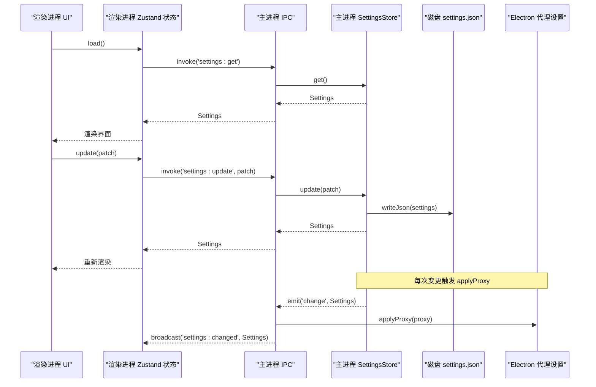
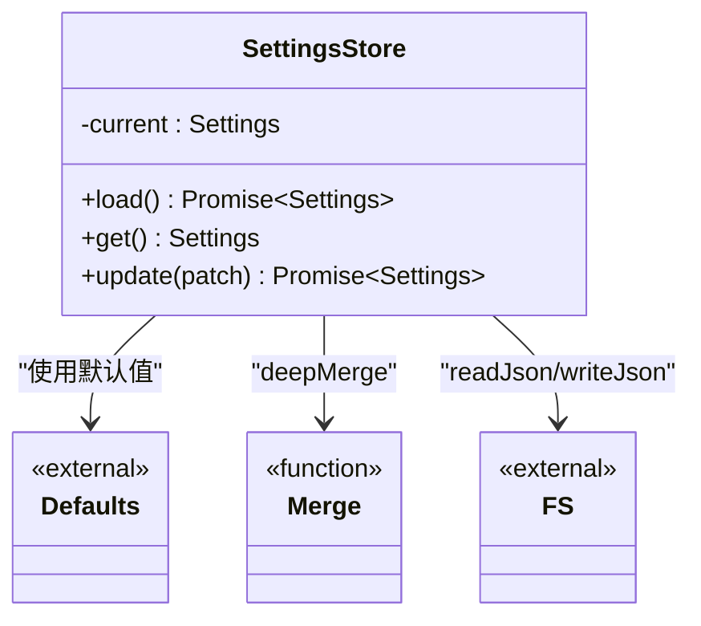
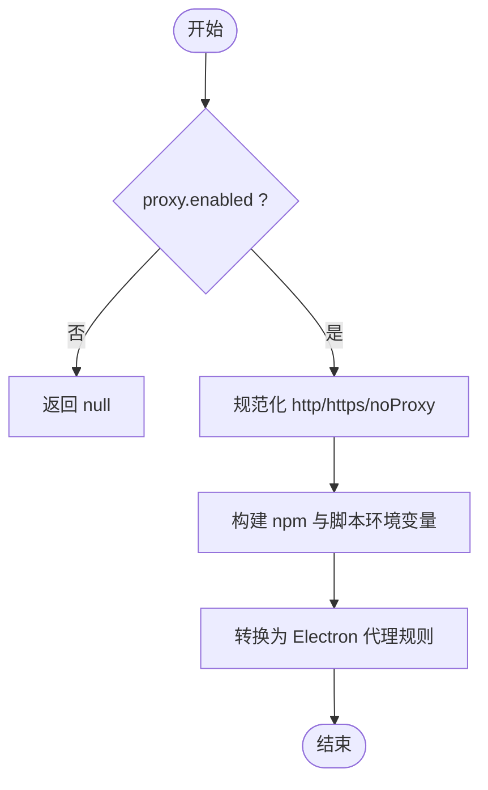
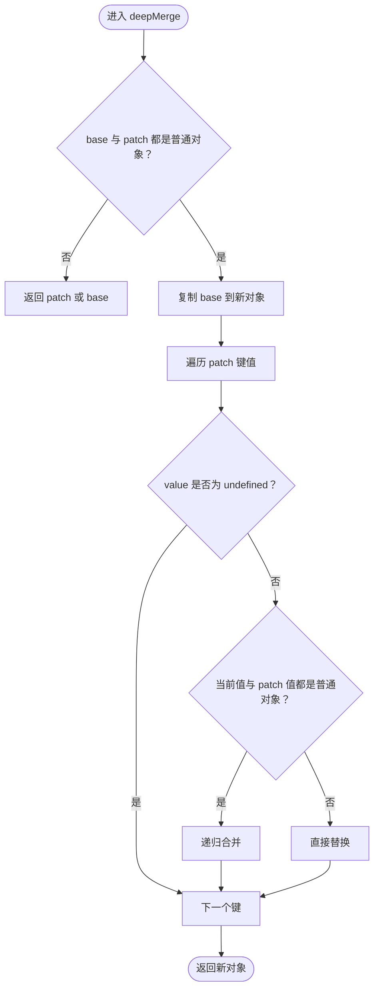
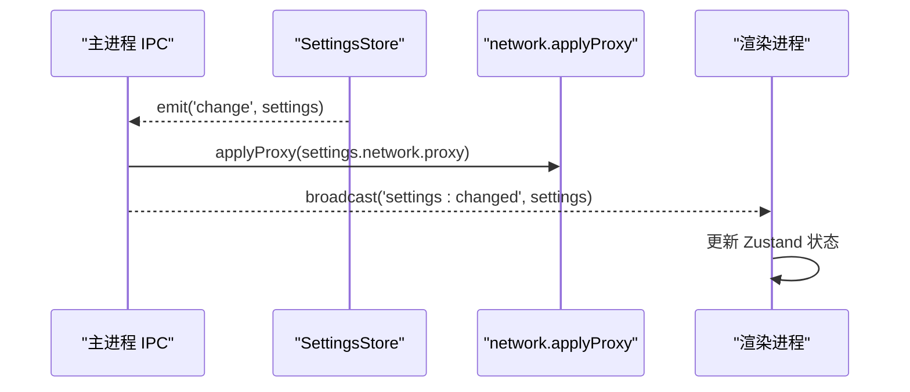
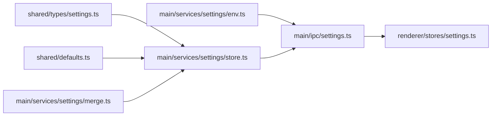

# Settings 服务（配置管理）

<cite>
**本文引用的文件**   
- [src/main/services/settings/index.ts](file://src/main/services/settings/index.ts)
- [src/main/services/settings/store.ts](file://src/main/services/settings/store.ts)
- [src/main/services/settings/env.ts](file://src/main/services/settings/env.ts)
- [src/main/services/settings/merge.ts](file://src/main/services/settings/merge.ts)
- [src/main/ipc/settings.ts](file://src/main/ipc/settings.ts)
- [src/renderer/src/stores/settings.ts](file://src/renderer/src/stores/settings.ts)
- [src/renderer/src/pages/settings/useSettingsUpdate.ts](file://src/renderer/src/pages/settings/useSettingsUpdate.ts)
- [src/shared/types/settings.ts](file://src/shared/types/settings.ts)
- [src/shared/defaults.ts](file://src/shared/defaults.ts)
</cite>

## 目录
1. [简介](#简介)
2. [项目结构](#项目结构)
3. [核心组件](#核心组件)
4. [架构总览](#架构总览)
5. [详细组件分析](#详细组件分析)
6. [依赖关系分析](#依赖关系分析)
7. [性能与扩展性](#性能与扩展性)
8. [故障排查指南](#故障排查指南)
9. [结论](#结论)
10. [附录：新增配置项与验证扩展示例](#附录新增配置项与验证扩展示例)

## 简介
本技术文档聚焦于 Settings 服务，系统性说明其配置存储机制、环境变量处理、配置合并策略、持久化方案、默认值管理、网络代理设置、环境变量注入以及配置热重载机制。同时提供面向开发者的实践指引，包括如何添加新的配置项以及如何扩展配置验证和转换逻辑。

## 项目结构
Settings 服务位于主进程侧，负责配置的加载、合并、持久化、变更广播以及与 Electron 代理设置的集成；渲染进程通过 IPC 暴露的接口读取和更新配置，并在本地状态中保持最新值。

```mermaid
graph TB
subgraph "主进程"
A["settings/index.ts<br/>导出模块"] --> B["settings/store.ts<br/>配置存储与事件"]
A --> C["settings/env.ts<br/>网络环境与代理转换"]
D["ipc/settings.ts<br/>IPC 注册与代理应用"] --> B
D --> E["services/network<br/>applyProxy/testConnection"]
end
subgraph "渲染进程"
F["stores/settings.ts<br/>Zustand 状态"]
G["pages/settings/useSettingsUpdate.ts<br/>带错误提示的更新 Hook"]
end
H["shared/types/settings.ts<br/>类型定义"]
I["shared/defaults.ts<br/>默认值"]
F --> |invoke('settings:get'|'settings:update')| D
G --> F
B --> |change 事件| D
B --> |写入 JSON| J["磁盘: settings.json"]
C --> E
H -.-> B
H -.-> C
I -.-> B
```

图表来源
- [src/main/services/settings/index.ts:1-3](file://src/main/services/settings/index.ts#L1-L3)
- [src/main/services/settings/store.ts:1-30](file://src/main/services/settings/store.ts#L1-L30)
- [src/main/services/settings/env.ts:1-73](file://src/main/services/settings/env.ts#L1-L73)
- [src/main/ipc/settings.ts:1-15](file://src/main/ipc/settings.ts#L1-L15)
- [src/renderer/src/stores/settings.ts:1-26](file://src/renderer/src/stores/settings.ts#L1-L26)
- [src/renderer/src/pages/settings/useSettingsUpdate.ts:1-27](file://src/renderer/src/pages/settings/useSettingsUpdate.ts#L1-L27)
- [src/shared/types/settings.ts:1-58](file://src/shared/types/settings.ts#L1-L58)
- [src/shared/defaults.ts:1-44](file://src/shared/defaults.ts#L1-L44)

章节来源
- [src/main/services/settings/index.ts:1-3](file://src/main/services/settings/index.ts#L1-L3)
- [src/main/services/settings/store.ts:1-30](file://src/main/services/settings/store.ts#L1-L30)
- [src/main/services/settings/env.ts:1-73](file://src/main/services/settings/env.ts#L1-L73)
- [src/main/ipc/settings.ts:1-15](file://src/main/ipc/settings.ts#L1-L15)
- [src/renderer/src/stores/settings.ts:1-26](file://src/renderer/src/stores/settings.ts#L1-L26)
- [src/renderer/src/pages/settings/useSettingsUpdate.ts:1-27](file://src/renderer/src/pages/settings/useSettingsUpdate.ts#L1-L27)
- [src/shared/types/settings.ts:1-58](file://src/shared/types/settings.ts#L1-L58)
- [src/shared/defaults.ts:1-44](file://src/shared/defaults.ts#L1-L44)

## 核心组件
- 配置存储层（store.ts）
  - 职责：从磁盘加载已保存的配置，与默认值进行深度合并，维护内存中的当前配置，支持增量更新并持久化到磁盘，同时触发 change 事件。
  - 关键点：使用 EventEmitter 发布变更；读写 JSON 文件；基于 deepMerge 实现安全的增量合并。
- 环境变量与代理工具（env.ts）
  - 职责：根据网络配置生成 npm 与脚本可用的环境变量；将代理设置转换为 Electron 可识别的代理规则。
  - 关键点：统一清理 URL 尾部斜杠；支持 http/https/noProxy 映射；二进制镜像键值对注入。
- 配置合并器（merge.ts）
  - 职责：递归合并补丁对象到基础对象；数组与原始值直接替换，避免意外拼接。
- IPC 桥接（ipc/settings.ts）
  - 职责：注册 get/update/test-connection 等 IPC 通道；监听 store.change 以应用代理并广播给渲染进程。
- 渲染进程状态（stores/settings.ts, useSettingsUpdate.ts）
  - 职责：封装调用 IPC 获取/更新配置；订阅 settings:changed 事件同步 UI；提供带错误提示的更新 Hook。

章节来源
- [src/main/services/settings/store.ts:1-30](file://src/main/services/settings/store.ts#L1-L30)
- [src/main/services/settings/env.ts:1-73](file://src/main/services/settings/env.ts#L1-L73)
- [src/main/services/settings/merge.ts:1-22](file://src/main/services/settings/merge.ts#L1-L22)
- [src/main/ipc/settings.ts:1-15](file://src/main/ipc/settings.ts#L1-L15)
- [src/renderer/src/stores/settings.ts:1-26](file://src/renderer/src/stores/settings.ts#L1-L26)
- [src/renderer/src/pages/settings/useSettingsUpdate.ts:1-27](file://src/renderer/src/pages/settings/useSettingsUpdate.ts#L1-L27)

## 架构总览
Settings 服务采用“主进程集中式存储 + 渲染进程轻量状态”的架构。主进程负责数据一致性、持久化与系统级能力（如 Electron 代理），渲染进程仅持有最近一次拉取的快照并通过 IPC 发起变更请求。



图表来源
- [src/renderer/src/stores/settings.ts:11-25](file://src/renderer/src/stores/settings.ts#L11-L25)
- [src/main/ipc/settings.ts:5-13](file://src/main/ipc/settings.ts#L5-L13)
- [src/main/services/settings/store.ts:11-26](file://src/main/services/settings/store.ts#L11-L26)

## 详细组件分析

### 配置存储层（SettingsStore）
- 数据结构
  - current：内存中的当前配置，类型为 Settings。
  - DEFAULT_SETTINGS：来自共享默认值，作为合并基线。
- 生命周期
  - load：读取磁盘 JSON，与默认值深度合并后赋值给 current。
  - get：返回当前内存配置。
  - update：对 current 执行增量合并，写回磁盘，emit change 事件。
- 并发与一致性
  - 单实例单线程操作，无显式锁；适用于桌面应用主进程场景。
- 错误处理
  - 读写异常由上层 fs 工具抛出，调用方需捕获。



图表来源
- [src/main/services/settings/store.ts:1-30](file://src/main/services/settings/store.ts#L1-L30)
- [src/main/services/settings/merge.ts:1-22](file://src/main/services/settings/merge.ts#L1-L22)
- [src/shared/defaults.ts:22-44](file://src/shared/defaults.ts#L22-L44)

章节来源
- [src/main/services/settings/store.ts:1-30](file://src/main/services/settings/store.ts#L1-L30)

### 环境变量与代理工具（Network Env & Proxy）
- 环境变量构建
  - 根据 network.npmRegistry 设置 npm registry 环境变量。
  - 根据 proxy 配置注入 HTTP_PROXY/HTTPS_PROXY 及其小写别名，以及 npm 专用变量。
  - 遍历 binaryMirrors 注入自定义键值对，常用于二进制下载镜像。
- 代理解析
  - resolveProxy：校验 enabled 与地址有效性，返回标准化 http/https/noProxy。
  - toElectronProxyConfig：将代理配置转换为 Electron session.setProxy 所需的固定服务器模式。
- 典型流程



图表来源
- [src/main/services/settings/env.ts:7-15](file://src/main/services/settings/env.ts#L7-L15)
- [src/main/services/settings/env.ts:21-50](file://src/main/services/settings/env.ts#L21-L50)
- [src/main/services/settings/env.ts:54-71](file://src/main/services/settings/env.ts#L54-L71)

章节来源
- [src/main/services/settings/env.ts:1-73](file://src/main/services/settings/env.ts#L1-L73)

### 配置合并器（deepMerge）
- 行为约定
  - 仅当 base 与 patch 均为普通对象时递归合并。
  - 若 patch 值为 undefined，跳过该键。
  - 数组与原始类型直接替换，不合并。
- 复杂度
  - 时间复杂度 O(N)，N 为 patch 对象键数；空间复杂度取决于嵌套层级。



图表来源
- [src/main/services/settings/merge.ts:3-21](file://src/main/services/settings/merge.ts#L3-L21)

章节来源
- [src/main/services/settings/merge.ts:1-22](file://src/main/services/settings/merge.ts#L1-L22)

### IPC 桥接与热重载
- IPC 接口
  - settings:get：返回当前 Settings。
  - settings:update：接收 DeepPartial<Settings> 并持久化。
  - settings:test-connection：测试网络连接。
- 热重载机制
  - 监听 store.change，自动调用 applyProxy 应用代理，并向渲染进程广播 settings:changed。
  - 渲染进程通过 on('settings:changed') 同步本地状态，无需刷新页面。



图表来源
- [src/main/ipc/settings.ts:5-13](file://src/main/ipc/settings.ts#L5-L13)
- [src/renderer/src/stores/settings.ts:25-25](file://src/renderer/src/stores/settings.ts#L25-L25)

章节来源
- [src/main/ipc/settings.ts:1-15](file://src/main/ipc/settings.ts#L1-L15)
- [src/renderer/src/stores/settings.ts:1-26](file://src/renderer/src/stores/settings.ts#L1-L26)

### 渲染进程状态与更新 Hook
- Zustand 状态
  - 提供 load 与 update 方法，分别调用 IPC 获取与更新配置。
  - 订阅 settings:changed 事件，保持 UI 与主进程一致。
- useSettingsUpdate Hook
  - 封装 update 调用，失败时通过消息提示展示错误信息。

章节来源
- [src/renderer/src/stores/settings.ts:1-26](file://src/renderer/src/stores/settings.ts#L1-L26)
- [src/renderer/src/pages/settings/useSettingsUpdate.ts:1-27](file://src/renderer/src/pages/settings/useSettingsUpdate.ts#L1-L27)

## 依赖关系分析
- 类型与默认值
  - Settings、NetworkSettings、ProxySettings、EnvVar 等类型定义在 shared/types/settings.ts。
  - 默认值在 shared/defaults.ts，包含语言、主题、网络、运行与更新相关默认配置。
- 模块耦合
  - store.ts 依赖 merge.ts、defaults.ts、fs 工具与路径常量。
  - env.ts 依赖 types 中的网络相关类型。
  - ipc/settings.ts 依赖 store.ts 与 services/network。
  - 渲染端 stores/settings.ts 依赖 IPC 与 zustand。



图表来源
- [src/shared/types/settings.ts:1-58](file://src/shared/types/settings.ts#L1-L58)
- [src/shared/defaults.ts:1-44](file://src/shared/defaults.ts#L1-L44)
- [src/main/services/settings/store.ts:1-30](file://src/main/services/settings/store.ts#L1-L30)
- [src/main/services/settings/merge.ts:1-22](file://src/main/services/settings/merge.ts#L1-L22)
- [src/main/services/settings/env.ts:1-73](file://src/main/services/settings/env.ts#L1-L73)
- [src/main/ipc/settings.ts:1-15](file://src/main/ipc/settings.ts#L1-L15)
- [src/renderer/src/stores/settings.ts:1-26](file://src/renderer/src/stores/settings.ts#L1-L26)

章节来源
- [src/shared/types/settings.ts:1-58](file://src/shared/types/settings.ts#L1-L58)
- [src/shared/defaults.ts:1-44](file://src/shared/defaults.ts#L1-L44)
- [src/main/services/settings/store.ts:1-30](file://src/main/services/settings/store.ts#L1-L30)
- [src/main/services/settings/merge.ts:1-22](file://src/main/services/settings/merge.ts#L1-L22)
- [src/main/services/settings/env.ts:1-73](file://src/main/services/settings/env.ts#L1-L73)
- [src/main/ipc/settings.ts:1-15](file://src/main/ipc/settings.ts#L1-L15)
- [src/renderer/src/stores/settings.ts:1-26](file://src/renderer/src/stores/settings.ts#L1-L26)

## 性能与扩展性
- 性能特征
  - 配置体积通常较小，JSON 读写开销可忽略；合并操作为线性复杂度。
  - 变更广播为事件驱动，渲染进程按需更新，避免全量重绘。
- 可扩展点
  - 新增配置字段：在 shared/types/settings.ts 扩展类型，在 shared/defaults.ts 补充默认值，必要时在 env.ts 增加环境变量注入逻辑。
  - 配置验证：可在 IPC 层或 store.update 前加入校验函数，拦截非法输入。
  - 迁移策略：可在 load 阶段检测版本字段并进行向后兼容迁移。

[本节为通用指导，不涉及具体文件分析]

## 故障排查指南
- 代理未生效
  - 检查 proxy.enabled 与 http/https 是否填写正确。
  - 确认 toElectronProxyConfig 生成的 rules 与 bypass 列表是否符合预期。
  - 查看主进程日志中 applyProxy 的错误输出。
- 环境变量未注入
  - 检查 network.binaryMirrors 的 key/value 是否正确。
  - 确认 buildNetworkEnv 生成的环境变量名与目标程序期望一致。
- 配置未持久化
  - 检查 paths.settings 指向的文件路径是否存在且可写。
  - 确认 writeJson 调用未被异常中断。
- 渲染进程未收到变更
  - 确认 settings:changed 事件是否被 on 监听。
  - 检查 IPC 广播是否在 change 事件中触发。

章节来源
- [src/main/ipc/settings.ts:10-13](file://src/main/ipc/settings.ts#L10-L13)
- [src/main/services/settings/env.ts:54-71](file://src/main/services/settings/env.ts#L54-L71)
- [src/main/services/settings/env.ts:21-50](file://src/main/services/settings/env.ts#L21-L50)
- [src/main/services/settings/store.ts:21-26](file://src/main/services/settings/store.ts#L21-L26)
- [src/renderer/src/stores/settings.ts:25-25](file://src/renderer/src/stores/settings.ts#L25-L25)

## 结论
Settings 服务通过清晰的职责划分与稳健的合并策略，实现了跨进程的配置管理与热重载。其环境变量与代理工具链为 npm、脚本与 Electron 提供了统一的网络访问能力。整体设计简洁、可测试性强，便于后续扩展新的配置项与验证规则。

[本节为总结性内容，不涉及具体文件分析]

## 附录：新增配置项与验证扩展示例

### 新增配置项步骤
- 定义类型
  - 在 shared/types/settings.ts 中添加新字段到 Settings 或对应子对象。
- 设置默认值
  - 在 shared/defaults.ts 的 DEFAULT_SETTINGS 中为新字段提供默认值。
- 可选：注入环境变量
  - 若新配置需要影响外部进程（如 npm、脚本），在 env.ts 的 buildNetworkEnv 中追加环境变量注入逻辑。
- 可选：代理或系统集成
  - 若新配置影响 Electron 代理或其他系统设置，在 env.ts 的 toElectronProxyConfig 或 ipc/settings.ts 的 change 回调中处理。
- 渲染端适配
  - 在渲染端 stores/settings.ts 与 useSettingsUpdate.ts 中无需改动即可消费新字段；如需 UI 展示，可在相应页面组件中使用。

章节来源
- [src/shared/types/settings.ts:36-42](file://src/shared/types/settings.ts#L36-L42)
- [src/shared/defaults.ts:22-44](file://src/shared/defaults.ts#L22-L44)
- [src/main/services/settings/env.ts:21-50](file://src/main/services/settings/env.ts#L21-L50)
- [src/main/services/settings/env.ts:54-71](file://src/main/services/settings/env.ts#L54-L71)
- [src/main/ipc/settings.ts:10-13](file://src/main/ipc/settings.ts#L10-L13)
- [src/renderer/src/stores/settings.ts:11-22](file://src/renderer/src/stores/settings.ts#L11-L22)

### 扩展配置验证与转换逻辑
- 在 IPC 层添加校验
  - 在 ipc/settings.ts 的 'settings:update' 处理器中，先对 patch 进行校验，再调用 settingsStore.update。
- 在 store 层添加转换
  - 在 store.ts 的 update 方法中，可对 patch 进行规范化（例如去除空白、标准化 URL）。
- 在 env 层添加转换
  - 在 env.ts 的工具函数中增加针对新字段的转换逻辑，确保生成的环境变量或代理规则符合下游期望。

章节来源
- [src/main/ipc/settings.ts:5-8](file://src/main/ipc/settings.ts#L5-L8)
- [src/main/services/settings/store.ts:21-26](file://src/main/services/settings/store.ts#L21-L26)
- [src/main/services/settings/env.ts:7-15](file://src/main/services/settings/env.ts#L7-L15)