# Space 服务（项目空间管理）

<cite>
**本文引用的文件**   
- [src/main/services/space/service.ts](file://src/main/services/space/service.ts)
- [src/main/services/space/project.ts](file://src/main/services/space/project.ts)
- [src/main/services/space/templates.ts](file://src/main/services/space/templates.ts)
- [src/main/ipc/space.ts](file://src/main/ipc/space.ts)
- [src/main/paths.ts](file://src/main/paths.ts)
- [src/shared/types/space.ts](file://src/shared/types/space.ts)
- [src/main/services/script/service.ts](file://src/main/services/script/service.ts)
- [src/main/services/script/project-files.ts](file://src/main/services/script/project-files.ts)
- [src/main/services/script/templates.ts](file://src/main/services/script/templates.ts)
- [src/main/services/runner/service.ts](file://src/main/services/runner/service.ts)
- [src/main/services/python/project.ts](file://src/main/services/python/project.ts)
- [src/renderer/src/pages/spaces/SpaceFormModal.tsx](file://src/renderer/src/pages/spaces/SpaceFormModal.tsx)
</cite>

## 更新摘要
**变更内容**   
- 新增 Python 项目检测与识别功能，支持自动检测 Python 版本要求和依赖管理器
- 增强空间创建和编辑界面，支持 Python 项目的智能导入和配置
- 扩展项目信息读取能力，包括 Python 项目元数据解析和版本要求检测
- 新增 Python 模板系统，支持 pyproject.toml 生成和欢迎脚本创建
- 完善 IPC 接口，支持 Python 项目的实时检测和配置预填充

## 目录
1. [简介](#简介)
2. [项目结构](#项目结构)
3. [核心组件](#核心组件)
4. [架构总览](#架构总览)
5. [详细组件分析](#详细组件分析)
6. [项目检测与识别系统](#项目检测与识别系统)
7. [Python 项目检测系统](#python-项目检测系统)
8. [依赖关系分析](#依赖关系分析)
9. [性能与并发特性](#性能与并发特性)
10. [配置与数据模型](#配置与数据模型)
11. [路径解析与数据隔离](#路径解析与数据隔离)
12. [模板系统与初始化流程](#模板系统与初始化流程)
13. [版本兼容性与扩展指南](#版本兼容性与扩展指南)
14. [故障排查](#故障排查)
15. [结论](#结论)

## 简介
Space 服务负责"项目空间"的完整生命周期管理，包括空间的创建、读取、更新、删除，以及脚本与运行环境的关联。它通过 IPC 层暴露给渲染进程，使用文件系统持久化空间元数据、包配置和脚本内容，并通过 runner 与 deps 服务协调运行期资源占用，确保删除操作不会破坏正在运行的任务或依赖安装过程。

**更新** 新增了强大的项目检测能力，能够自动识别现有项目、检测包管理器类型、解析 Node.js 和 Python 版本要求，并支持将现有项目直接导入为空间进行管理。特别增强了 Python 项目支持，包括 pyproject.toml 解析、Python 版本自动检测和多种依赖管理器的识别。

## 项目结构
Space 相关代码主要分布在以下位置：
- 主进程服务：`src/main/services/space`
- Python 项目检测模块：`src/main/services/python/project.ts`
- 项目检测模块：`src/main/services/space/project.ts`
- IPC 接口注册：`src/main/ipc/space.ts`
- 路径与 ID 校验：`src/main/paths.ts`
- 共享类型定义：`src/shared/types/space.ts`
- 脚本管理与模板：`src/main/services/script`
- 运行器与环境构建：`src/main/services/runner`
- 前端界面：`src/renderer/src/pages/spaces`

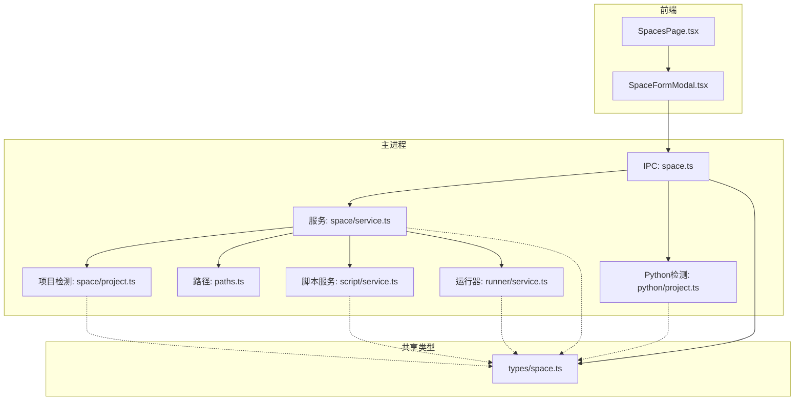

**图表来源**
- [src/main/ipc/space.ts:1-81](file://src/main/ipc/space.ts#L1-L81)
- [src/main/services/space/service.ts:10-212](file://src/main/services/space/service.ts#L10-L212)
- [src/main/services/python/project.ts:1-103](file://src/main/services/python/project.ts#L1-L103)
- [src/main/services/space/project.ts:1-152](file://src/main/services/space/project.ts#L1-L152)
- [src/renderer/src/pages/spaces/SpaceFormModal.tsx:1-183](file://src/renderer/src/pages/spaces/SpaceFormModal.tsx#L1-L183)

**章节来源**
- [src/main/ipc/space.ts:1-81](file://src/main/ipc/space.ts#L1-L81)
- [src/main/services/space/service.ts:10-212](file://src/main/services/space/service.ts#L10-L212)
- [src/main/services/python/project.ts:1-103](file://src/main/services/python/project.ts#L1-L103)
- [src/main/services/space/project.ts:1-152](file://src/main/services/space/project.ts#L1-L152)
- [src/renderer/src/pages/spaces/SpaceFormModal.tsx:1-183](file://src/renderer/src/pages/spaces/SpaceFormModal.tsx#L1-L183)

## 核心组件
- SpaceService：提供空间 CRUD、并发安全的元数据更新、以及与历史目录和脚本目录的联动清理，新增项目导入功能和 Python 项目脚手架支持。
- PythonProjectDetector：Python 项目检测模块，负责 pyproject.toml 解析、Python 版本检测、依赖管理器识别。
- ProjectDetector：项目检测模块，负责包管理器识别、Node.js 版本解析、项目信息扫描。
- ScriptService：管理空间内脚本文件的增删改查、导入、重命名、运行配置保存，支持项目空间模式。
- RunnerService：启动脚本进程、维护运行记录、写入历史、并感知空间是否仍有活跃任务。
- IPC 层：将前端调用映射到后端服务方法，并在删除前检查运行器和依赖服务的占用状态，新增 Python 项目信息查询接口。
- Path 模块：统一空间根目录、脚本目录、构建目录、历史目录等路径生成，并对 ID 进行安全校验。
- 模板模块：提供默认 .npmrc、Python 模板与欢迎脚本；脚本模板根据语言自动选择 JS 或 TS 模板。

**章节来源**
- [src/main/services/space/service.ts:10-212](file://src/main/services/space/service.ts#L10-L212)
- [src/main/services/python/project.ts:1-103](file://src/main/services/python/project.ts#L1-L103)
- [src/main/services/space/project.ts:1-152](file://src/main/services/space/project.ts#L1-L152)
- [src/main/services/script/service.ts:16-228](file://src/main/services/script/service.ts#L16-L228)
- [src/main/services/runner/service.ts:29-146](file://src/main/services/runner/service.ts#L29-L146)
- [src/main/ipc/space.ts:1-81](file://src/main/ipc/space.ts#L1-L81)
- [src/main/paths.ts:7-56](file://src/main/paths.ts#L7-L56)
- [src/main/services/space/templates.ts:1-34](file://src/main/services/space/templates.ts#L1-L34)
- [src/main/services/script/templates.ts:1-15](file://src/main/services/script/templates.ts#L1-L15)

## 架构总览
Space 服务作为"空间"这一业务实体的核心，向上通过 IPC 暴露 API，向下通过文件系统持久化数据，并与脚本服务和运行器协作完成脚本执行与历史记录。新增的项目检测系统使得 Space 服务能够智能识别和管理现有的 JavaScript/TypeScript 和 Python 项目。

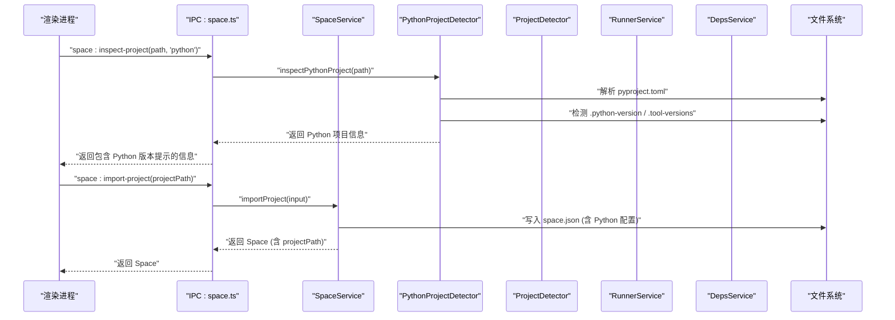

**图表来源**
- [src/main/ipc/space.ts:47-70](file://src/main/ipc/space.ts#L47-L70)
- [src/main/services/python/project.ts:92-102](file://src/main/services/python/project.ts#L92-L102)
- [src/main/services/space/service.ts:93-112](file://src/main/services/space/service.ts#L93-L112)

## 详细组件分析

### SpaceService：空间生命周期与并发安全
- 列表：扫描 `paths.spaces`，过滤合法 ID，并行读取每个空间的 `space.json`，按更新时间倒序返回。
- 获取：校验 ID 格式后读取 `space.json`，不存在则抛出未找到错误。
- 创建：生成 UUID 作为 id，创建脚本目录、`package.json`、`.npmrc`、欢迎脚本，最后写入 `space.json`。**新增** 支持 Python 项目脚手架，自动生成 `pyproject.toml` 和 Python 欢迎脚本。
- **新增** 导入项目：`importProject` 方法允许将现有项目目录引用为空间，仅写入 `space.json` 元数据，不修改原项目文件。支持 Python 项目的 `pythonManager` 和 `pythonVersionSource` 字段。
- 更新：基于 mutate 串行化更新，仅更新传入字段，并刷新 `updatedAt`。
- 删除：先校验存在性，再递归删除空间根目录和历史目录。
- 并发控制：通过 per-space 的 Promise 链保证同一空间的元数据读写串行化，避免竞态。

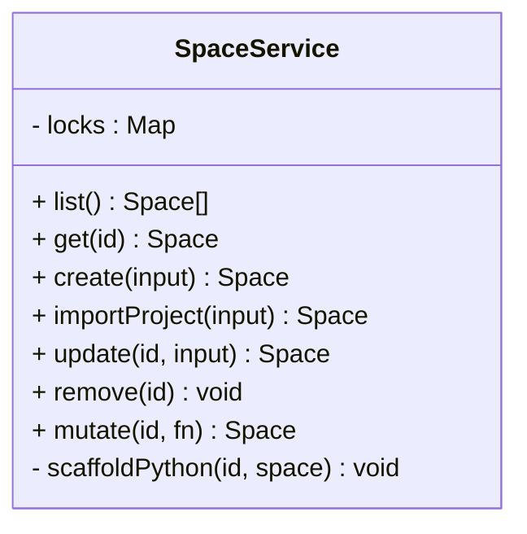

**图表来源**
- [src/main/services/space/service.ts:10-212](file://src/main/services/space/service.ts#L10-L212)

**章节来源**
- [src/main/services/space/service.ts:14-212](file://src/main/services/space/service.ts#L14-L212)

### PythonProjectDetector：Python 项目检测与识别系统
**新增** Python 项目检测模块提供完整的 Python 项目识别能力：

- **Python 版本检测**：`detectPythonPin` 函数从 `.python-version`、`.tool-versions` 中解析精确的 Python 版本，支持 cpython 前缀处理。
- **pyproject.toml 解析**：`readPyproject` 函数解析现代 Python 项目的配置文件，提取项目名称、Python 版本要求和依赖信息。
- **依赖管理器检测**：`detectManagers` 函数识别 uv、poetry、pdm、requirements.txt 和 pep517 等多种 Python 依赖管理器。
- **项目信息整合**：`inspectPythonProject` 函数收集项目的完整信息，包括 Python 版本提示、依赖管理器候选列表、项目名称。
- **优先级处理**：优先使用 `.python-version` 中的精确版本，回退到 `requires-python` 范围要求。

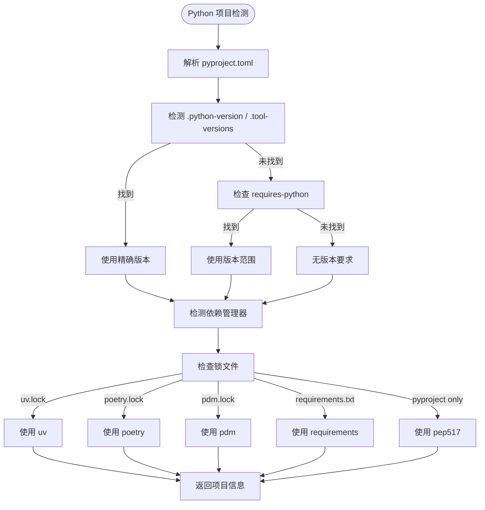

**图表来源**
- [src/main/services/python/project.ts:50-102](file://src/main/services/python/project.ts#L50-L102)

**章节来源**
- [src/main/services/python/project.ts:1-103](file://src/main/services/python/project.ts#L1-L103)

### ProjectDetector：JavaScript/TypeScript 项目检测与识别系统
**新增** 项目检测模块提供完整的 JavaScript/TypeScript 项目识别能力：

- **包管理器检测**：`detectPackageManager` 函数优先检查 `packageManager` 字段，然后回退到锁文件检测（pnpm-lock.yaml、yarn.lock、bun.lock、package-lock.json），默认使用 npm。
- **Node.js 版本解析**：`parseNodeVersionHint` 函数从 `.nvmrc`、`.node-version`、`engines.node` 中解析 Node.js 版本要求，支持语义化版本、范围版本和 LTS 别名。
- **项目信息读取**：`readProjectInfo` 函数收集项目的完整信息，包括包管理器、脚本、Node.js 版本要求、包名、PnP 支持状态。
- **脚本扫描**：`scanProjectScripts` 函数递归扫描项目中的 package.json 文件，收集所有可执行的脚本命令。
- **路径规范化**：`normalizeProjectPath` 确保项目路径的有效性，验证目录存在且包含 package.json。

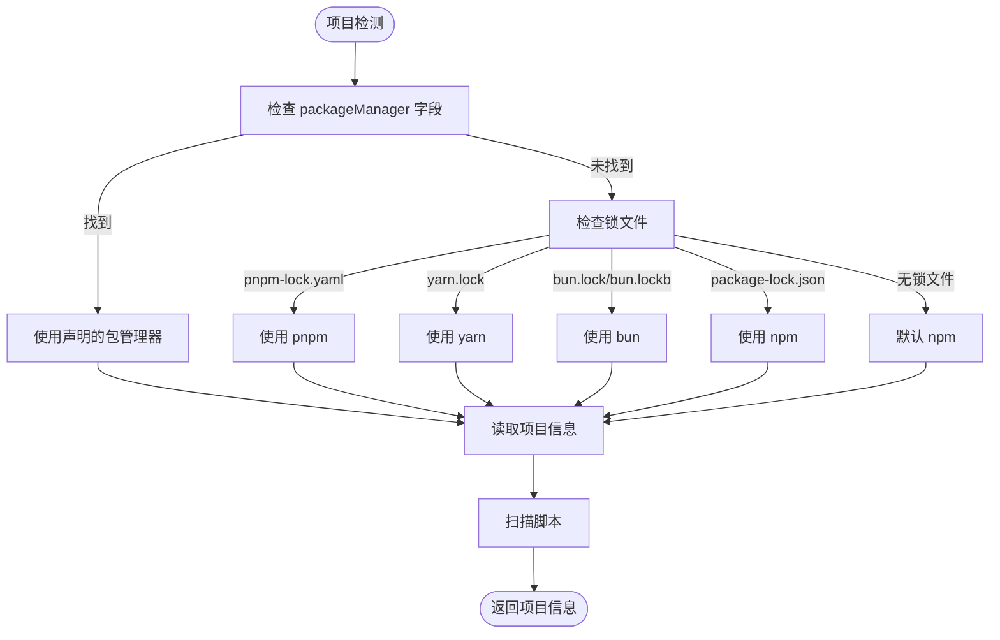

**图表来源**
- [src/main/services/space/project.ts:34-50](file://src/main/services/space/project.ts#L34-L50)
- [src/main/services/space/project.ts:73-88](file://src/main/services/space/project.ts#L73-L88)

**章节来源**
- [src/main/services/space/project.ts:1-152](file://src/main/services/space/project.ts#L1-L152)

### IPC 层：API 映射与删除保护
- 注册 `space:list/get/create/update/remove/open-dir` 等事件处理器。
- **新增** Python 项目检测接口：`space:inspect-project` 支持 Python 项目检测，返回包含 Python 版本提示、依赖管理器信息的完整项目信息。
- **新增** 项目信息查询：`space:project-info` 和 `space:inspect-project` 接口提供项目详细信息和脚本扫描结果。
- 删除前检查 `runnerService.hasActiveInSpace` 与 `depsService.isBusy`，任一为真则拒绝删除并抛出 `SPACE_BUSY`。
- 打开目录时先校验空间存在，再通过 Electron shell 打开空间根目录。

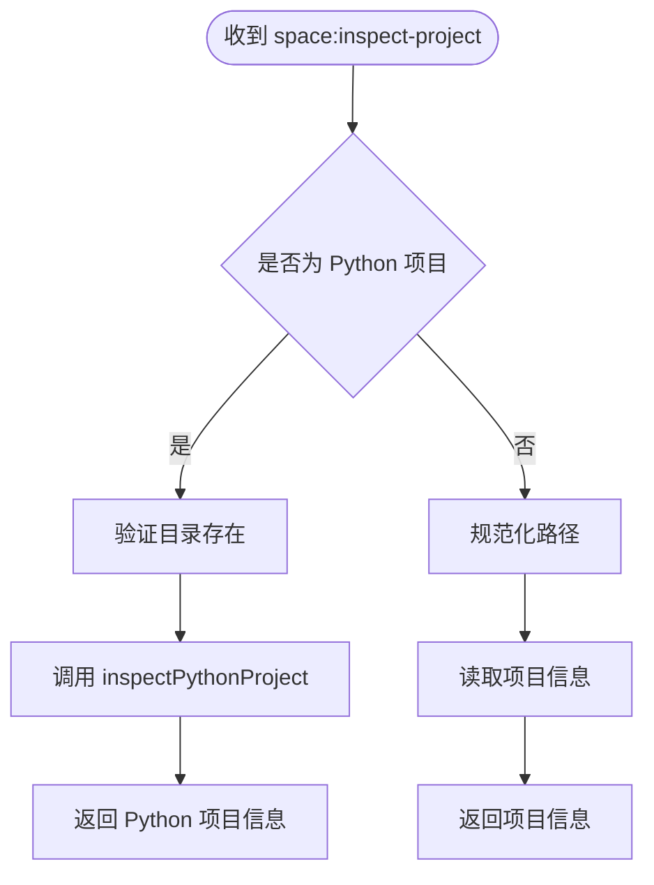

**图表来源**
- [src/main/ipc/space.ts:47-70](file://src/main/ipc/space.ts#L47-L70)

**章节来源**
- [src/main/ipc/space.ts:1-81](file://src/main/ipc/space.ts#L1-L81)

### ScriptService：脚本与运行配置
- 路径解析：在空间脚本目录下拼接脚本名，并进行名称合法性校验。
- 列表/读取/写入：基于 `spacePaths.scripts` 访问脚本文件。
- 创建：根据文件名推断语言并注入对应模板。
- 导入：将外部脚本复制到空间脚本目录，处理冲突命名与非法字符。
- 重命名/删除：同步更新 `space.scripts` 元数据。
- 运行配置：通过 `saveRunConfig` 将 args/env 保存到 `space.scripts[name].runConfig`。
- **新增** 项目空间支持：当空间引用外部项目时，直接扫描项目文件而非复制。

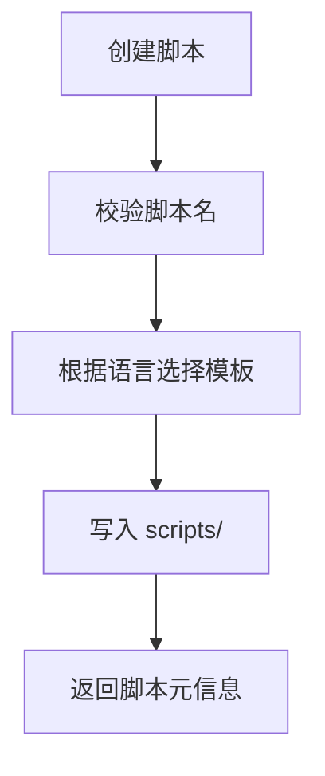

**图表来源**
- [src/main/services/script/service.ts:49-58](file://src/main/services/script/service.ts#L49-L58)
- [src/main/services/script/templates.ts:1-15](file://src/main/services/script/templates.ts#L1-L15)

**章节来源**
- [src/main/services/script/service.ts:16-228](file://src/main/services/script/service.ts#L16-L228)
- [src/main/services/script/templates.ts:1-15](file://src/main/services/script/templates.ts#L1-L15)

### RunnerService：运行环境与进程管理
- 启动：加载空间与脚本，解析运行参数，准备语言运行时，构建环境变量，设置工作目录为空间根目录。
- 输出与历史：通过 pty 捕获输出，写入历史存储，结束时更新记录状态并持久化。
- 停止：跨平台终止进程，必要时强制 kill。

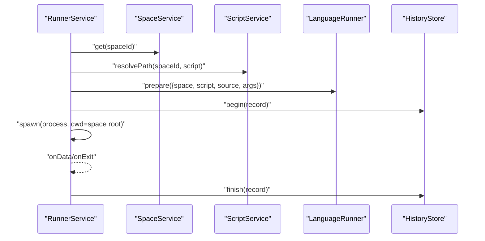

**图表来源**
- [src/main/services/runner/service.ts:44-88](file://src/main/services/runner/service.ts#L44-L88)
- [src/main/services/runner/service.ts:127-142](file://src/main/services/runner/service.ts#L127-L142)

**章节来源**
- [src/main/services/runner/service.ts:29-146](file://src/main/services/runner/service.ts#L29-L146)

## 项目检测与识别系统

### 包管理器自动检测
系统支持多种包管理器的自动识别，优先级如下：

1. **packageManager 字段**：优先使用 package.json 中的 `packageManager` 字段
2. **锁文件检测**：按顺序检查 pnpm-lock.yaml、yarn.lock、bun.lock/bun.lockb、package-lock.json
3. **默认回退**：如果以上都未检测到，默认使用 npm

支持的包管理器包括：npm、pnpm、yarn、bun。

### Node.js 版本解析
系统能够从多个来源解析 Node.js 版本要求：

1. **.nvmrc 文件**：最高优先级，支持精确版本如 `v22.11.0`
2. **.node-version 文件**：次高优先级，支持简化版本如 `22`
3. **engines.node 字段**：最低优先级，支持语义化版本范围如 `>=18`

解析后的版本格式统一为标准形式：精确版本保持 `v22.11.0`，主版本号提取为 `22`，不支持的版本返回 null。

### 项目信息扫描
项目信息扫描功能收集以下关键信息：

- **脚本集合**：从所有 package.json 文件中提取可执行脚本
- **包管理器类型**：自动检测使用的包管理器
- **Node.js 版本要求**：从配置文件中提取版本要求
- **包名称**：用于预填充导入对话框
- **PnP 支持**：检测 Yarn Plug'n'Play 项目
- **脚本截断标志**：指示脚本列表是否因大小限制而被截断

**章节来源**
- [src/main/services/space/project.ts:17-50](file://src/main/services/space/project.ts#L17-L50)
- [src/main/services/space/project.ts:52-62](file://src/main/services/space/project.ts#L52-L62)
- [src/main/services/space/project.ts:73-88](file://src/main/services/space/project.ts#L73-L88)

## Python 项目检测系统

### Python 版本检测
系统支持多种 Python 版本配置源的自动检测，优先级如下：

1. **.python-version 文件**：最高优先级，支持精确版本如 `3.12.5`，自动处理 `cpython-` 前缀
2. **.tool-versions 文件**：次高优先级，支持 asdf 格式如 `python 3.11.8`
3. **requires-python 字段**：最低优先级，支持语义化版本范围如 `>=3.11`

### 依赖管理器自动检测
系统支持多种 Python 依赖管理器的自动识别，优先级如下：

1. **uv.lock 文件**：优先检测 uv 项目管理器
2. **poetry.lock 文件**：其次检测 Poetry 项目管理器
3. **pdm.lock 文件**：再次检测 PDM 项目管理器
4. **requirements.txt 文件**：基础 requirements 文件支持
5. **pyproject.toml**：PEP 517 标准支持
6. **tool 部分检测**：从 pyproject.toml 的 tool.uv/poetry/pdm 部分检测

### Python 项目信息扫描
Python 项目信息扫描功能收集以下关键信息：

- **项目名称**：从 pyproject.toml 的 project.name 字段提取
- **Python 版本要求**：从多个配置源解析版本要求
- **依赖管理器**：自动检测项目使用的依赖管理工具
- **管理器候选列表**：列出所有可能的依赖管理器（用于冲突场景）
- **版本来源标识**：指示版本要求的具体来源文件

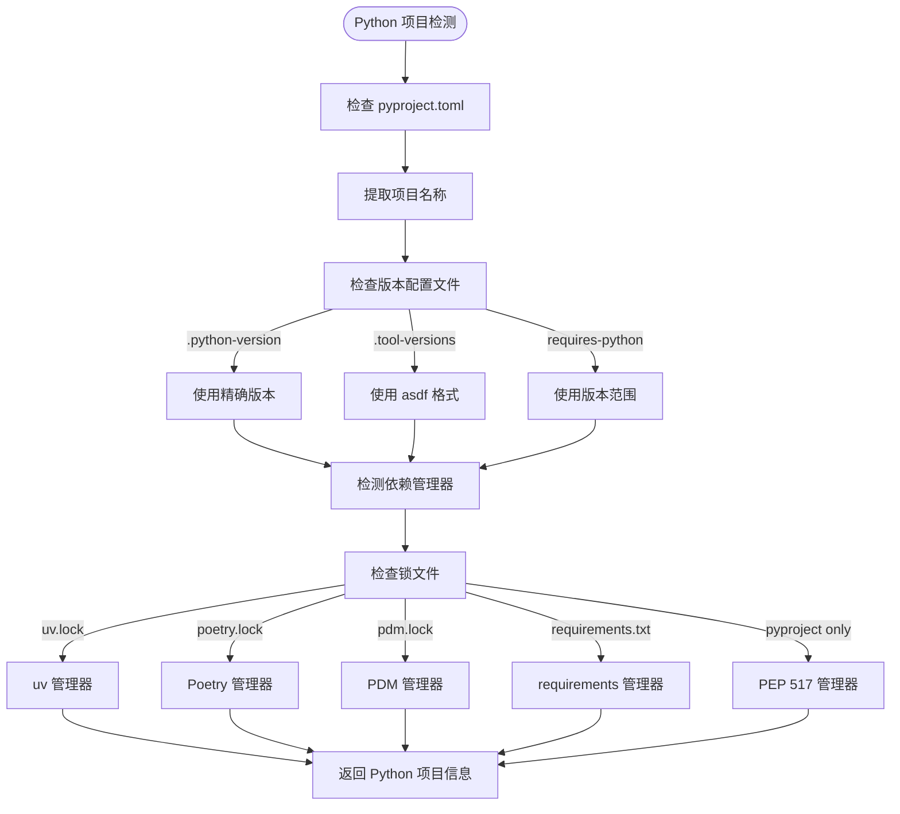

**图表来源**
- [src/main/services/python/project.ts:92-102](file://src/main/services/python/project.ts#L92-L102)

**章节来源**
- [src/main/services/python/project.ts:1-103](file://src/main/services/python/project.ts#L1-L103)

## 依赖关系分析
- SpaceService 依赖：
  - 路径模块：`paths`、`spacePaths`、`historyPaths`、`ID_PATTERN`
  - 文件系统工具：`ensureDir`、`exists`、`readJson`、`writeJson`
  - 模板常量：`SPACE_NPMRC`、`WELCOME_SCRIPT`、`WELCOME_SCRIPT_NAME`、`PYTHON_WELCOME_SCRIPT`、`PYTHON_PYPROJECT_TEMPLATE`
  - **新增** 项目检测：`normalizeProjectPath`、`projectExists`
- PythonProjectDetector 依赖：
  - 文件系统工具：`readFile`、`realpath`、`stat`
  - TOML 解析器：`smol-toml`
  - 路径工具：`dirname`、`isAbsolute`、`join`
  - 类型定义：`PythonDependencyManager`、`PythonProjectInfo`
- ProjectDetector 依赖：
  - 文件系统工具：`readFile`、`realpath`、`stat`
  - 路径工具：`dirname`、`isAbsolute`、`join`
  - 脚本工具：`resolveProjectDirectory`、`walkProject`
  - 类型定义：`PackageManager`、`ProjectInfo`、`ProjectScriptGroup`
- IPC 层依赖：
  - SpaceService、RunnerService、DepsService、Electron shell
  - **新增** Python 项目检测：`inspectPythonProject`
  - **新增** 项目检测工具：`readProjectInfo`、`scanProjectScripts`
- ScriptService 依赖：
  - SpaceService、path、fs、naming、templates
  - **新增** 项目检测：`assertProjectDir`、`resolveProjectScript`
- RunnerService 依赖：
  - SpaceService、ScriptService、RuntimeEnv、Settings、HistoryStore、LanguageRunner

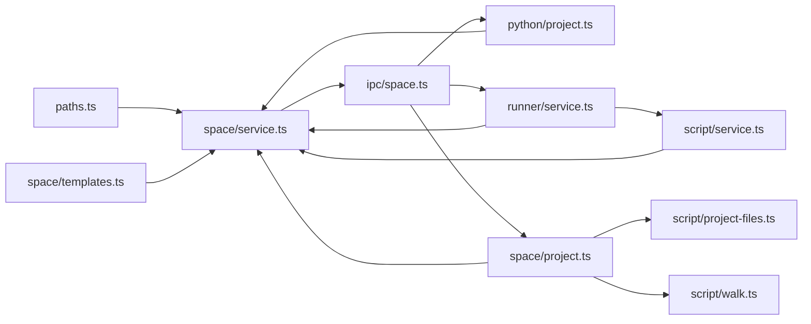

**图表来源**
- [src/main/paths.ts:7-56](file://src/main/paths.ts#L7-L56)
- [src/main/services/space/service.ts:1-212](file://src/main/services/space/service.ts#L1-L212)
- [src/main/services/python/project.ts:1-103](file://src/main/services/python/project.ts#L1-L103)
- [src/main/services/space/project.ts:1-152](file://src/main/services/space/project.ts#L1-L152)
- [src/main/services/space/templates.ts:1-34](file://src/main/services/space/templates.ts#L1-L34)
- [src/main/ipc/space.ts:1-81](file://src/main/ipc/space.ts#L1-L81)
- [src/main/services/script/service.ts:1-228](file://src/main/services/script/service.ts#L1-L228)
- [src/main/services/runner/service.ts:1-146](file://src/main/services/runner/service.ts#L1-L146)

**章节来源**
- [src/main/services/space/service.ts:1-212](file://src/main/services/space/service.ts#L1-L212)
- [src/main/services/python/project.ts:1-103](file://src/main/services/python/project.ts#L1-L103)
- [src/main/services/space/project.ts:1-152](file://src/main/services/space/project.ts#L1-L152)
- [src/main/ipc/space.ts:1-81](file://src/main/ipc/space.ts#L1-L81)
- [src/main/services/script/service.ts:1-228](file://src/main/services/script/service.ts#L1-L228)
- [src/main/services/runner/service.ts:1-146](file://src/main/services/runner/service.ts#L1-L146)

## 性能与并发特性
- 列表操作：对每个空间元数据并行读取，提升 IO 吞吐。
- 元数据更新：通过 per-space 的 Promise 链串行化，避免并发写覆盖。
- 删除操作：递归删除空间与历史目录，注意大目录场景下的耗时。
- 运行器：pty 输出流式写入历史，避免内存堆积。
- **新增** 项目扫描：使用 `walkProject` 限制最大文件数为 1000，避免大型项目导致的性能问题。
- **新增** 包管理器检测：缓存检测结果，避免重复的文件系统操作。
- **新增** Python 项目检测：异步解析 pyproject.toml，避免阻塞主线程。

[本节为通用性能讨论，不直接分析具体文件]

## 配置与数据模型
- 空间元数据 `Space`：包含 id、name、description、runtime、createdAt、updatedAt、scripts，**新增** pythonManager、pythonVersionSource、projectPath 和 projectMissing 字段。
- 脚本元数据 `ScriptMeta`：包含 `runConfig`，即命令行参数与环境变量。
- 运行配置 `RunConfig`：args 为原始参数字符串，env 为键值对数组。
- **新增** Python 项目信息 `PythonProjectInfo`：包含项目名称、Python 版本提示、版本来源、依赖管理器及候选列表。
- **新增** 项目信息 `ProjectInfo`：包含脚本组、包管理器、Node.js 版本提示、Python 版本提示、包名、截断标志、PnP 支持状态。
- **新增** 包管理器类型 `PackageManager`：支持 'npm' | 'pnpm' | 'yarn' | 'bun'。
- **新增** Python 依赖管理器类型 `PythonDependencyManager`：支持 'uv' | 'poetry' | 'pdm' | 'requirements' | 'pep517' | 'none'。

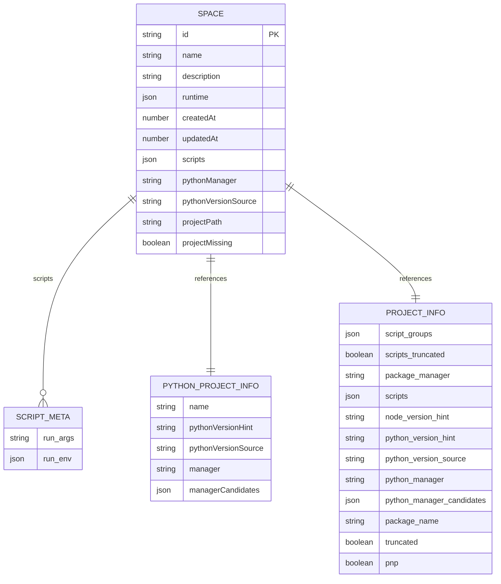

**图表来源**
- [src/shared/types/space.ts:14-80](file://src/shared/types/space.ts#L14-L80)

**章节来源**
- [src/shared/types/space.ts:1-120](file://src/shared/types/space.ts#L1-L120)

## 路径解析与数据隔离
- 根目录：基于 Electron `app.getPath('userData')` 确定应用数据根。
- 空间目录：`paths.spaces` 下以合法 ID 命名的子目录。
- 关键路径：
  - 元数据：`spacePaths.meta(id)` -> `<spaces>/<id>/space.json`
  - 包配置：`spacePaths.pkg(id)` -> `<spaces>/<id>/package.json`
  - 依赖目录：`spacePaths.nodeModules(id)` -> `<spaces>/<id>/node_modules`
  - 脚本目录：`spacePaths.scripts(id)` -> `<spaces>/<id>/scripts`
  - 构建目录：`spacePaths.build(id)` -> `<spaces>/<id>/.scriptbox/build`
- 历史目录：`historyPaths.dir(spaceId)` -> `<history>/<spaceId>`
- ID 安全：所有 ID 经过 `safeId` 校验，防止路径穿越。
- **新增** 项目路径安全：`claimProjectPath` 确保项目不在 spaces 目录内，防止意外删除。

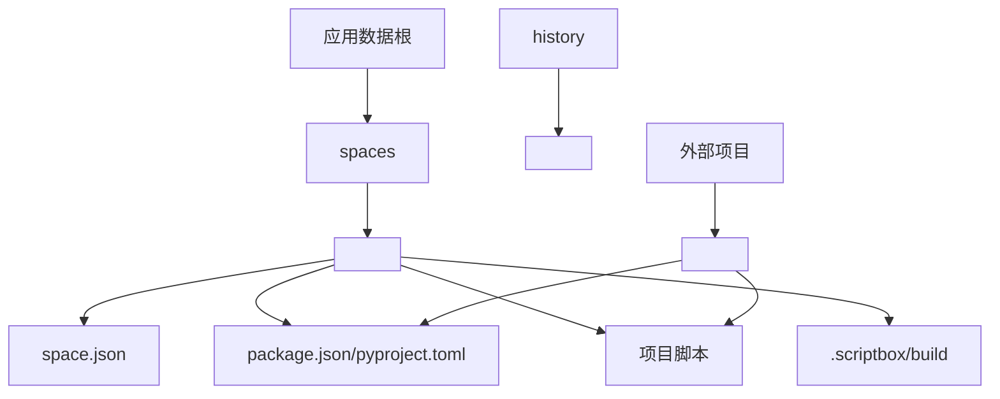

**图表来源**
- [src/main/paths.ts:7-56](file://src/main/paths.ts#L7-L56)
- [src/main/services/space/service.ts:202-209](file://src/main/services/space/service.ts#L202-L209)

**章节来源**
- [src/main/paths.ts:7-56](file://src/main/paths.ts#L7-L56)
- [src/main/services/space/service.ts:202-209](file://src/main/services/space/service.ts#L202-L209)

## 模板系统与初始化流程
- 空间模板：
  - `.npmrc`：禁用 fund/audit/update-notifier，启用 package-lock。
  - 欢迎脚本：`hello.ts`，演示 readline 交互与 Node 版本输出。
  - **新增** Python 欢迎脚本：`hello.py`，演示 sys.version 输出。
  - **新增** Python 项目模板：`pyproject.toml`，包含项目名称、版本和 requires-python 配置。
- 脚本模板：
  - JS 模板：简单 console 示例。
  - TS 模板：带 process.argv 的示例。
- 初始化流程（创建空间）：
  1. 生成 id 与时间戳。
  2. 根据运行时类型创建相应环境。
  3. **新增** Python 项目：创建 `pyproject.toml` 和 `hello.py`。
  4. **新增** Node.js 项目：创建 `package.json`、`.npmrc` 和 `hello.ts`。
  5. 写入 `space.json`。
- **新增** 项目导入流程：
  1. 验证项目路径有效性。
  2. 检查项目是否在 spaces 目录外。
  3. 确保项目未被其他空间引用。
  4. **新增** Python 项目检测：解析 pyproject.toml 和版本配置。
  5. 仅写入 `space.json` 元数据。

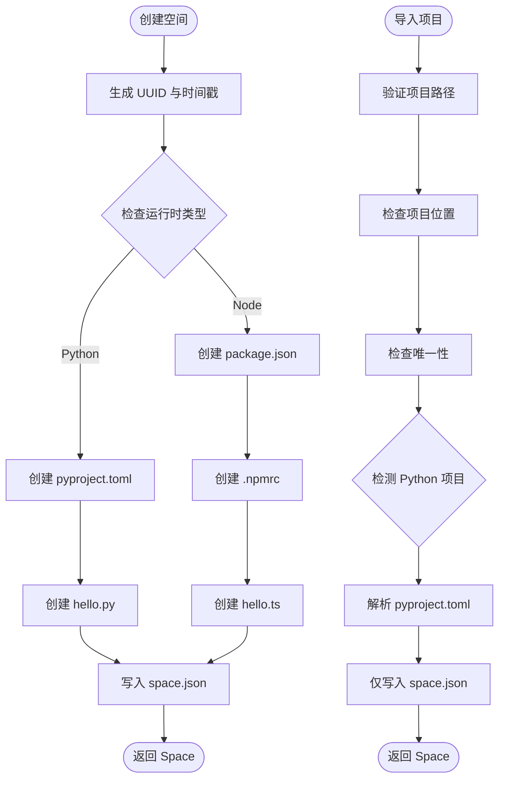

**图表来源**
- [src/main/services/space/service.ts:64-87](file://src/main/services/space/service.ts#L64-L87)
- [src/main/services/space/service.ts:93-112](file://src/main/services/space/service.ts#L93-L112)
- [src/main/services/space/service.ts:202-209](file://src/main/services/space/service.ts#L202-L209)
- [src/main/services/space/templates.ts:19-34](file://src/main/services/space/templates.ts#L19-L34)

**章节来源**
- [src/main/services/space/service.ts:64-112](file://src/main/services/space/service.ts#L64-L112)
- [src/main/services/space/service.ts:202-209](file://src/main/services/space/service.ts#L202-L209)
- [src/main/services/space/templates.ts:1-34](file://src/main/services/space/templates.ts#L1-L34)
- [src/main/services/script/templates.ts:1-15](file://src/main/services/script/templates.ts#L1-L15)

## 版本兼容性与扩展指南
- 兼容性要点：
  - ID 格式限制：仅允许字母、数字、下划线与连字符，长度 1-64。
  - 元数据结构：新增字段需考虑旧版本空间迁移策略（当前实现未显式做迁移逻辑）。
  - 脚本模板：JS/TS 模板由语言推断，可扩展更多语言模板。
  - **新增** 项目路径安全：项目不能位于 spaces 目录内，避免意外删除。
  - **新增** 包管理器支持：支持 npm、pnpm、yarn、bun 的自动检测。
  - **新增** Python 依赖管理器支持：支持 uv、poetry、pdm、requirements、pep517 的自动检测。
- 自定义空间模板：
  - 修改欢迎脚本与 `.npmrc`：在 `space/templates.ts` 中替换常量。
  - **新增** Python 模板：在 `space/templates.ts` 中修改 `PYTHON_WELCOME_SCRIPT` 和 `PYTHON_PYPROJECT_TEMPLATE`。
  - 扩展脚本模板：在 `script/templates.ts` 中添加新语言模板，并在命名规则中支持相应后缀。
- 扩展现有空间管理功能：
  - 新增空间属性：在 `SpaceInput` 与 `Space` 类型中扩展字段，并在 `update/mutate` 中处理。
  - 增加空间级配置：可在空间根目录新增配置文件（如 `config.json`），并在 Service 中提供读写方法。
  - 扩展删除保护：在 IPC 层增加更多占用检查（例如打包任务、缓存清理等）。
- **新增** 项目检测扩展：
  - 添加新的包管理器支持：在 `LOCKFILES` 数组中添加新的锁文件映射。
  - 扩展 Node.js 版本解析：在 `parseNodeVersionHint` 中添加新的版本格式支持。
  - **新增** Python 依赖管理器扩展：在 `detectManagers` 函数中添加新的依赖管理器检测逻辑。
  - **新增** Python 版本解析扩展：在 `detectPythonPin` 函数中添加新的版本配置文件支持。
  - 自定义项目信息扫描：重写 `readProjectInfo` 函数以支持额外的项目配置。

[本节为概念性指导，不直接分析具体文件]

## 故障排查
- 常见错误：
  - `SPACE_NOT_FOUND`：空间不存在或 ID 不合法。
  - `SCRIPT_NOT_FOUND`：脚本不存在。
  - `SCRIPT_EXISTS`：脚本已存在。
  - `INVALID_SCRIPT_NAME`：脚本名不符合规范。
  - `UNSUPPORTED_SCRIPT`：导入的文件不被识别为脚本。
  - `SPACE_BUSY`：空间仍有活跃运行或依赖安装中，无法删除。
  - **新增** `PROJECT_NOT_FOUND`：项目目录不存在或无效。
  - **新增** `INVALID_PROJECT`：项目路径无效或位于 spaces 目录内。
  - **新增** `PROJECT_ALREADY_IMPORTED`：项目已被其他空间引用。
- 定位建议：
  - 检查 `paths.spaces` 与 `paths.history` 是否存在对应目录。
  - 确认 `space.json` 与 `package.json` 是否被正确写入。
  - 查看运行器日志与历史存储，确认进程是否正常结束。
  - **新增** 验证项目路径的有效性和唯一性。
  - **新增** 检查包管理器检测是否正确识别了项目使用的工具。
  - **新增** 检查 Python 项目检测是否正确解析了 pyproject.toml 和版本配置文件。

**章节来源**
- [src/main/services/space/service.ts:26-30](file://src/main/services/space/service.ts#L26-L30)
- [src/main/services/script/service.ts:38-42](file://src/main/services/script/service.ts#L38-L42)
- [src/main/services/script/service.ts:49-57](file://src/main/services/script/service.ts#L49-L57)
- [src/main/services/script/service.ts:61-75](file://src/main/services/script/service.ts#L61-L75)
- [src/main/ipc/space.ts:15-19](file://src/main/ipc/space.ts#L15-L19)
- [src/main/services/space/project.ts:132-147](file://src/main/services/space/project.ts#L132-L147)

## 结论
Space 服务以清晰的职责边界与稳健的路径/ID 校验机制，提供了可靠的空间管理能力。通过 IPC 层与 Runner/Deps 服务的协作，确保了删除操作的原子性与安全性。新增的项目检测系统显著增强了服务的智能化水平，能够自动识别和管理现有的 JavaScript/TypeScript 和 Python 项目，支持多种包管理器和 Node.js/Python 版本的自动检测。模板系统简化了空间初始化与脚本开发体验，特别是新增的 Python 项目支持使得开发者可以更轻松地管理和运行 Python 项目。未来可通过扩展模板、增强迁移策略、增加更多包管理器支持和优化项目扫描性能来进一步提升系统的可维护性与健壮性。