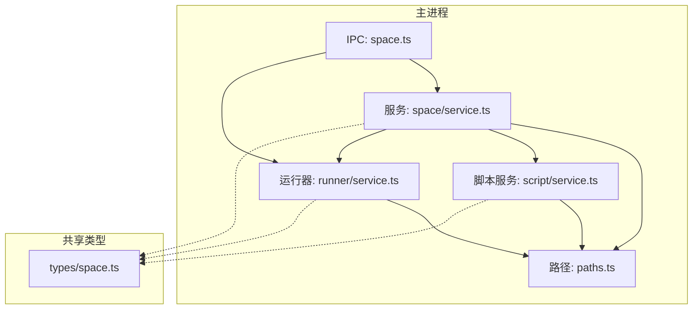
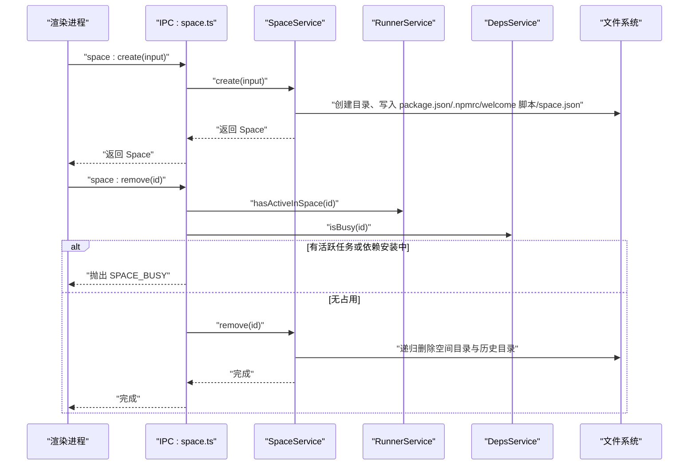
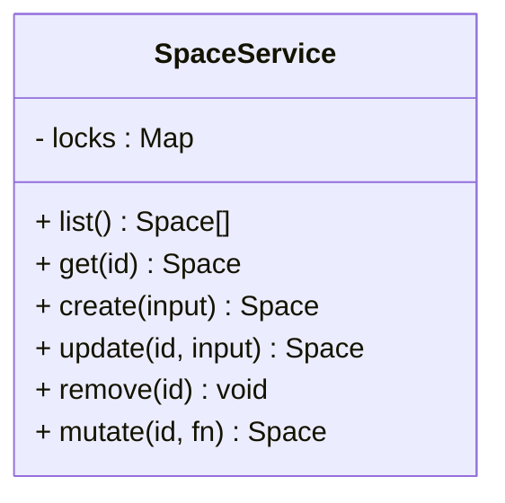
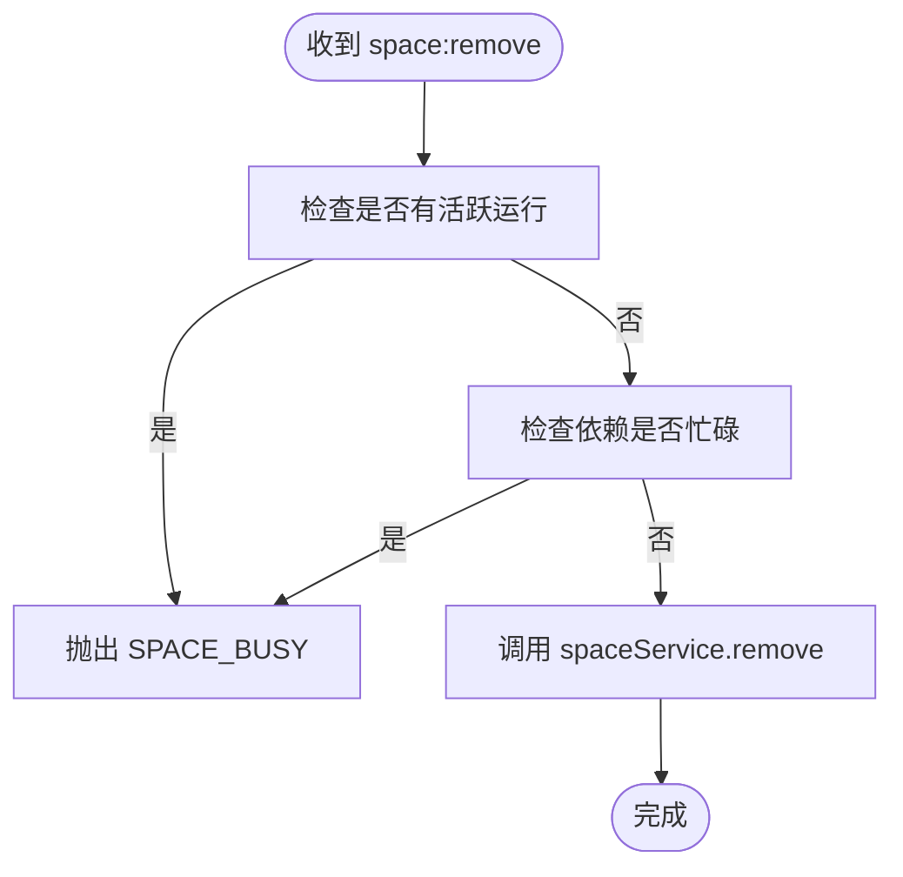
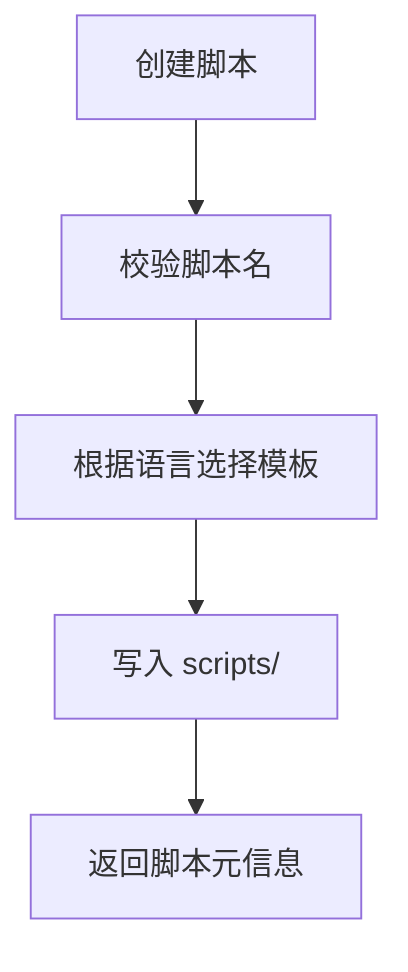
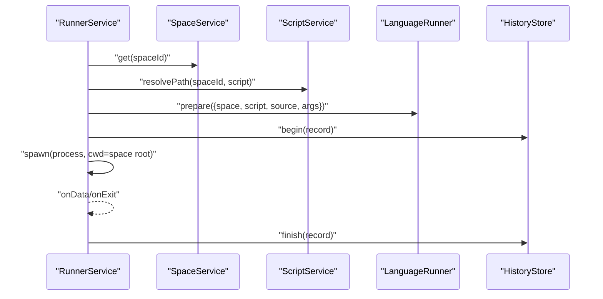
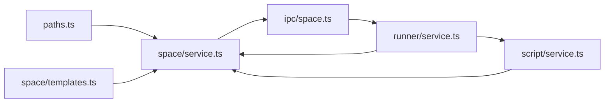
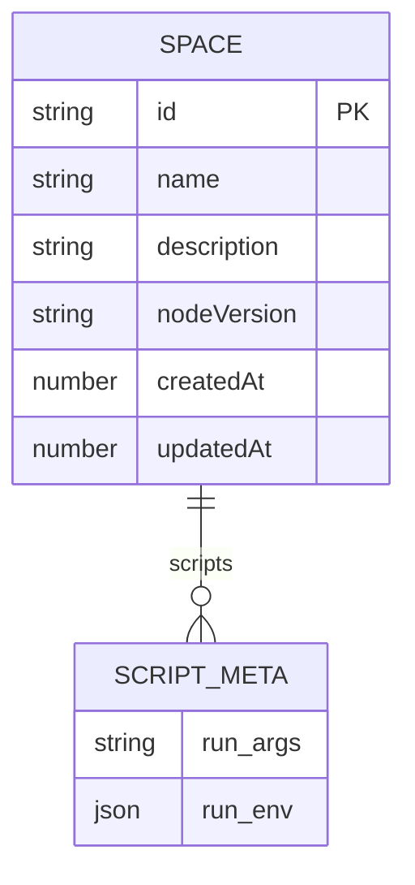
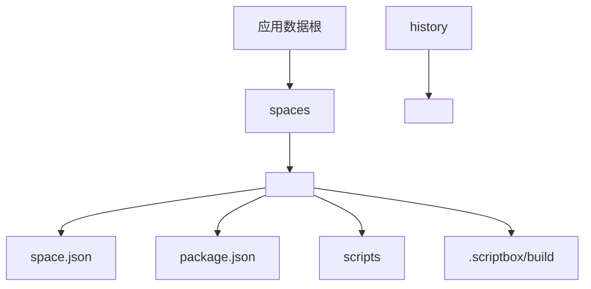
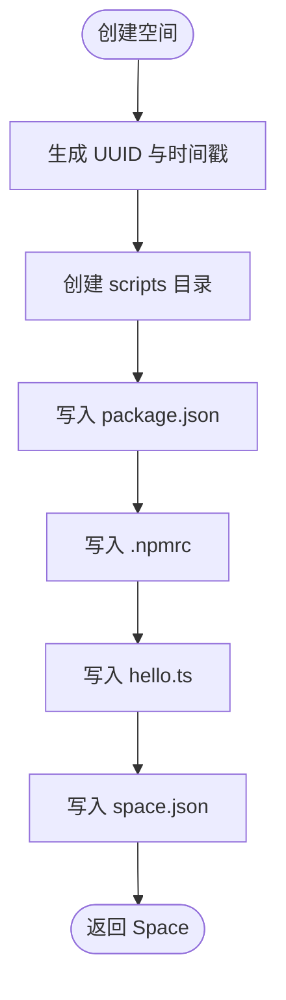

# Space 服务（项目空间管理）

<cite>
**本文引用的文件**   
- [src/main/services/space/service.ts](file://src/main/services/space/service.ts)
- [src/main/services/space/templates.ts](file://src/main/services/space/templates.ts)
- [src/main/ipc/space.ts](file://src/main/ipc/space.ts)
- [src/main/paths.ts](file://src/main/paths.ts)
- [src/shared/types/space.ts](file://src/shared/types/space.ts)
- [src/main/services/script/service.ts](file://src/main/services/script/service.ts)
- [src/main/services/script/templates.ts](file://src/main/services/script/templates.ts)
- [src/main/services/runner/service.ts](file://src/main/services/runner/service.ts)
</cite>

## 目录
1. [简介](#简介)
2. [项目结构](#项目结构)
3. [核心组件](#核心组件)
4. [架构总览](#架构总览)
5. [详细组件分析](#详细组件分析)
6. [依赖关系分析](#依赖关系分析)
7. [性能与并发特性](#性能与并发特性)
8. [配置与数据模型](#配置与数据模型)
9. [路径解析与数据隔离](#路径解析与数据隔离)
10. [模板系统与初始化流程](#模板系统与初始化流程)
11. [版本兼容性与扩展指南](#版本兼容性与扩展指南)
12. [故障排查](#故障排查)
13. [结论](#结论)

## 简介
Space 服务负责“项目空间”的完整生命周期管理，包括空间的创建、读取、更新、删除，以及脚本与运行环境的关联。它通过 IPC 层暴露给渲染进程，使用文件系统持久化空间元数据、包配置和脚本内容，并通过 runner 与 deps 服务协调运行期资源占用，确保删除操作不会破坏正在运行的任务或依赖安装过程。

## 项目结构
Space 相关代码主要分布在以下位置：
- 主进程服务：`src/main/services/space`
- IPC 接口注册：`src/main/ipc/space.ts`
- 路径与 ID 校验：`src/main/paths.ts`
- 共享类型定义：`src/shared/types/space.ts`
- 脚本管理与模板：`src/main/services/script`
- 运行器与环境构建：`src/main/services/runner`

**图表来源**
- [src/main/ipc/space.ts:9-25](file://src/main/ipc/space.ts#L9-L25)
- [src/main/services/space/service.ts:10-90](file://src/main/services/space/service.ts#L10-L90)
- [src/main/paths.ts:7-56](file://src/main/paths.ts#L7-L56)
- [src/main/services/script/service.ts:16-109](file://src/main/services/script/service.ts#L16-L109)
- [src/main/services/runner/service.ts:29-146](file://src/main/services/runner/service.ts#L29-L146)
- [src/shared/types/space.ts:1-28](file://src/shared/types/space.ts#L1-L28)

**章节来源**
- [src/main/ipc/space.ts:9-25](file://src/main/ipc/space.ts#L9-L25)
- [src/main/services/space/service.ts:10-90](file://src/main/services/space/service.ts#L10-L90)
- [src/main/paths.ts:7-56](file://src/main/paths.ts#L7-L56)
- [src/shared/types/space.ts:1-28](file://src/shared/types/space.ts#L1-L28)

## 核心组件
- SpaceService：提供空间 CRUD、并发安全的元数据更新、以及与历史目录和脚本目录的联动清理。
- ScriptService：管理空间内脚本文件的增删改查、导入、重命名、运行配置保存。
- RunnerService：启动脚本进程、维护运行记录、写入历史、并感知空间是否仍有活跃任务。
- IPC 层：将前端调用映射到后端服务方法，并在删除前检查运行器和依赖服务的占用状态。
- Path 模块：统一空间根目录、脚本目录、构建目录、历史目录等路径生成，并对 ID 进行安全校验。
- 模板模块：提供默认 .npmrc 与欢迎脚本；脚本模板根据语言自动选择 JS 或 TS 模板。

**章节来源**
- [src/main/services/space/service.ts:10-90](file://src/main/services/space/service.ts#L10-L90)
- [src/main/services/script/service.ts:16-109](file://src/main/services/script/service.ts#L16-L109)
- [src/main/services/runner/service.ts:29-146](file://src/main/services/runner/service.ts#L29-L146)
- [src/main/ipc/space.ts:9-25](file://src/main/ipc/space.ts#L9-L25)
- [src/main/paths.ts:7-56](file://src/main/paths.ts#L7-L56)
- [src/main/services/space/templates.ts:1-18](file://src/main/services/space/templates.ts#L1-L18)
- [src/main/services/script/templates.ts:1-15](file://src/main/services/script/templates.ts#L1-L15)

## 架构总览
Space 服务作为“空间”这一业务实体的核心，向上通过 IPC 暴露 API，向下通过文件系统持久化数据，并与脚本服务和运行器协作完成脚本执行与历史记录。

**图表来源**
- [src/main/ipc/space.ts:9-25](file://src/main/ipc/space.ts#L9-L25)
- [src/main/services/space/service.ts:33-73](file://src/main/services/space/service.ts#L33-L73)
- [src/main/services/runner/service.ts:40-42](file://src/main/services/runner/service.ts#L40-L42)

## 详细组件分析

### SpaceService：空间生命周期与并发安全
- 列表：扫描 `paths.spaces`，过滤合法 ID，并行读取每个空间的 `space.json`，按更新时间倒序返回。
- 获取：校验 ID 格式后读取 `space.json`，不存在则抛出未找到错误。
- 创建：生成 UUID 作为 id，创建脚本目录、`package.json`、`.npmrc`、欢迎脚本，最后写入 `space.json`。
- 更新：基于 mutate 串行化更新，仅更新传入字段，并刷新 `updatedAt`。
- 删除：先校验存在性，再递归删除空间根目录和历史目录。
- 并发控制：通过 per-space 的 Promise 链保证同一空间的元数据读写串行化，避免竞态。

**图表来源**
- [src/main/services/space/service.ts:10-90](file://src/main/services/space/service.ts#L10-L90)

**章节来源**
- [src/main/services/space/service.ts:14-87](file://src/main/services/space/service.ts#L14-L87)

### IPC 层：API 映射与删除保护
- 注册 `space:list/get/create/update/remove/open-dir` 等事件处理器。
- 删除前检查 `runnerService.hasActiveInSpace` 与 `depsService.isBusy`，任一为真则拒绝删除并抛出 `SPACE_BUSY`。
- 打开目录时先校验空间存在，再通过 Electron shell 打开空间根目录。

**图表来源**
- [src/main/ipc/space.ts:15-19](file://src/main/ipc/space.ts#L15-L19)

**章节来源**
- [src/main/ipc/space.ts:9-25](file://src/main/ipc/space.ts#L9-L25)

### ScriptService：脚本与运行配置
- 路径解析：在空间脚本目录下拼接脚本名，并进行名称合法性校验。
- 列表/读取/写入：基于 `spacePaths.scripts` 访问脚本文件。
- 创建：根据文件名推断语言并注入对应模板。
- 导入：将外部脚本复制到空间脚本目录，处理冲突命名与非法字符。
- 重命名/删除：同步更新 `space.scripts` 元数据。
- 运行配置：通过 `saveRunConfig` 将 args/env 保存到 `space.scripts[name].runConfig`。

**图表来源**
- [src/main/services/script/service.ts:49-58](file://src/main/services/script/service.ts#L49-L58)
- [src/main/services/script/templates.ts:1-15](file://src/main/services/script/templates.ts#L1-L15)

**章节来源**
- [src/main/services/script/service.ts:16-109](file://src/main/services/script/service.ts#L16-L109)
- [src/main/services/script/templates.ts:1-15](file://src/main/services/script/templates.ts#L1-L15)

### RunnerService：运行环境与进程管理
- 启动：加载空间与脚本，解析运行参数，准备语言运行时，构建环境变量，设置工作目录为空间根目录。
- 输出与历史：通过 pty 捕获输出，写入历史存储，结束时更新记录状态并持久化。
- 停止：跨平台终止进程，必要时强制 kill。

**图表来源**
- [src/main/services/runner/service.ts:44-88](file://src/main/services/runner/service.ts#L44-L88)
- [src/main/services/runner/service.ts:127-142](file://src/main/services/runner/service.ts#L127-L142)

**章节来源**
- [src/main/services/runner/service.ts:29-146](file://src/main/services/runner/service.ts#L29-L146)

## 依赖关系分析
- SpaceService 依赖：
  - 路径模块：`paths`、`spacePaths`、`historyPaths`、`ID_PATTERN`
  - 文件系统工具：`ensureDir`、`exists`、`readJson`、`writeJson`
  - 模板常量：`SPACE_NPMRC`、`WELCOME_SCRIPT`、`WELCOME_SCRIPT_NAME`
- IPC 层依赖：
  - SpaceService、RunnerService、DepsService、Electron shell
- ScriptService 依赖：
  - SpaceService、path、fs、naming、templates
- RunnerService 依赖：
  - SpaceService、ScriptService、RuntimeEnv、Settings、HistoryStore、LanguageRunner

**图表来源**
- [src/main/paths.ts:7-56](file://src/main/paths.ts#L7-L56)
- [src/main/services/space/service.ts:1-90](file://src/main/services/space/service.ts#L1-L90)
- [src/main/services/space/templates.ts:1-18](file://src/main/services/space/templates.ts#L1-L18)
- [src/main/ipc/space.ts:1-25](file://src/main/ipc/space.ts#L1-L25)
- [src/main/services/script/service.ts:1-109](file://src/main/services/script/service.ts#L1-L109)
- [src/main/services/runner/service.ts:1-146](file://src/main/services/runner/service.ts#L1-L146)

**章节来源**
- [src/main/services/space/service.ts:1-90](file://src/main/services/space/service.ts#L1-L90)
- [src/main/ipc/space.ts:1-25](file://src/main/ipc/space.ts#L1-L25)
- [src/main/services/script/service.ts:1-109](file://src/main/services/script/service.ts#L1-L109)
- [src/main/services/runner/service.ts:1-146](file://src/main/services/runner/service.ts#L1-L146)

## 性能与并发特性
- 列表操作：对每个空间元数据并行读取，提升 IO 吞吐。
- 元数据更新：通过 per-space 的 Promise 链串行化，避免并发写覆盖。
- 删除操作：递归删除空间与历史目录，注意大目录场景下的耗时。
- 运行器：pty 输出流式写入历史，避免内存堆积。

[本节为通用性能讨论，不直接分析具体文件]

## 配置与数据模型
- 空间元数据 `Space`：包含 id、name、description、nodeVersion、createdAt、updatedAt、scripts。
- 脚本元数据 `ScriptMeta`：包含 `runConfig`，即命令行参数与环境变量。
- 运行配置 `RunConfig`：args 为原始参数字符串，env 为键值对数组。

**图表来源**
- [src/shared/types/space.ts:3-27](file://src/shared/types/space.ts#L3-L27)

**章节来源**
- [src/shared/types/space.ts:1-28](file://src/shared/types/space.ts#L1-L28)

## 路径解析与数据隔离
- 根目录：基于 Electron `app.getPath('userData')` 确定应用数据根。
- 空间目录：`paths.spaces` 下以合法 ID 命名的子目录。
- 关键路径：
  - 元数据：`spacePaths.meta(id)` -> `<spaces>/<id>/space.json`
  - 包配置：`spacePaths.pkg(id)` -> `<spaces>/<id>/package.json`
  - 依赖目录：`spacePaths.nodeModules(id)` -> `<spaces>/<id>/node_modules`
  - 脚本目录：`spacePaths.scripts(id)` -> `<spaces>/<id>/scripts`
  - 构建目录：`spacePaths.build(id)` -> `<spaces>/<id>/.scriptbox/build`
- 历史目录：`historyPaths.dir(spaceId)` -> `<history>/<spaceId>`
- ID 安全：所有 ID 经过 `safeId` 校验，防止路径穿越。

**图表来源**
- [src/main/paths.ts:7-56](file://src/main/paths.ts#L7-L56)

**章节来源**
- [src/main/paths.ts:7-56](file://src/main/paths.ts#L7-L56)

## 模板系统与初始化流程
- 空间模板：
  - `.npmrc`：禁用 fund/audit/update-notifier，启用 package-lock。
  - 欢迎脚本：`hello.ts`，演示 readline 交互与 Node 版本输出。
- 脚本模板：
  - JS 模板：简单 console 示例。
  - TS 模板：带 process.argv 的示例。
- 初始化流程（创建空间）：
  1. 生成 id 与时间戳。
  2. 创建脚本目录。
  3. 写入 `package.json`（私有包、空依赖）。
  4. 写入 `.npmrc`。
  5. 写入欢迎脚本。
  6. 写入 `space.json`。

**图表来源**
- [src/main/services/space/service.ts:33-55](file://src/main/services/space/service.ts#L33-L55)
- [src/main/services/space/templates.ts:1-18](file://src/main/services/space/templates.ts#L1-L18)
- [src/main/services/script/templates.ts:1-15](file://src/main/services/script/templates.ts#L1-L15)

**章节来源**
- [src/main/services/space/service.ts:33-55](file://src/main/services/space/service.ts#L33-L55)
- [src/main/services/space/templates.ts:1-18](file://src/main/services/space/templates.ts#L1-L18)
- [src/main/services/script/templates.ts:1-15](file://src/main/services/script/templates.ts#L1-L15)

## 版本兼容性与扩展指南
- 兼容性要点：
  - ID 格式限制：仅允许字母、数字、下划线与连字符，长度 1-64。
  - 元数据结构：新增字段需考虑旧版本空间迁移策略（当前实现未显式做迁移逻辑）。
  - 脚本模板：JS/TS 模板由语言推断，可扩展更多语言模板。
- 自定义空间模板：
  - 修改欢迎脚本与 `.npmrc`：在 `space/templates.ts` 中替换常量。
  - 扩展脚本模板：在 `script/templates.ts` 中添加新语言模板，并在命名规则中支持相应后缀。
- 扩展现有空间管理功能：
  - 新增空间属性：在 `SpaceInput` 与 `Space` 类型中扩展字段，并在 `update/mutate` 中处理。
  - 增加空间级配置：可在空间根目录新增配置文件（如 `config.json`），并在 Service 中提供读写方法。
  - 扩展删除保护：在 IPC 层增加更多占用检查（例如打包任务、缓存清理等）。

[本节为概念性指导，不直接分析具体文件]

## 故障排查
- 常见错误：
  - `SPACE_NOT_FOUND`：空间不存在或 ID 不合法。
  - `SCRIPT_NOT_FOUND`：脚本不存在。
  - `SCRIPT_EXISTS`：脚本已存在。
  - `INVALID_SCRIPT_NAME`：脚本名不符合规范。
  - `UNSUPPORTED_SCRIPT`：导入的文件不被识别为脚本。
  - `SPACE_BUSY`：空间仍有活跃运行或依赖安装中，无法删除。
- 定位建议：
  - 检查 `paths.spaces` 与 `paths.history` 是否存在对应目录。
  - 确认 `space.json` 与 `package.json` 是否被正确写入。
  - 查看运行器日志与历史存储，确认进程是否正常结束。

**章节来源**
- [src/main/services/space/service.ts:26-30](file://src/main/services/space/service.ts#L26-L30)
- [src/main/services/script/service.ts:38-42](file://src/main/services/script/service.ts#L38-L42)
- [src/main/services/script/service.ts:49-57](file://src/main/services/script/service.ts#L49-L57)
- [src/main/services/script/service.ts:61-75](file://src/main/services/script/service.ts#L61-L75)
- [src/main/ipc/space.ts:15-19](file://src/main/ipc/space.ts#L15-L19)

## 结论
Space 服务以清晰的职责边界与稳健的路径/ID 校验机制，提供了可靠的空间管理能力。通过 IPC 层与 Runner/Deps 服务的协作，确保了删除操作的原子性与安全性。模板系统简化了空间初始化与脚本开发体验。未来可通过扩展模板、增强迁移策略与增加更多占用检查来进一步提升系统的可维护性与健壮性。