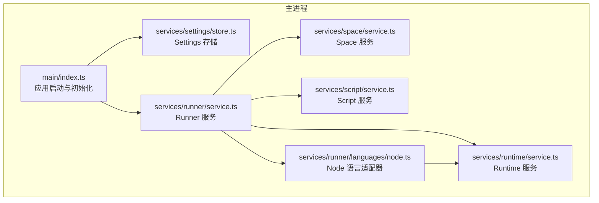
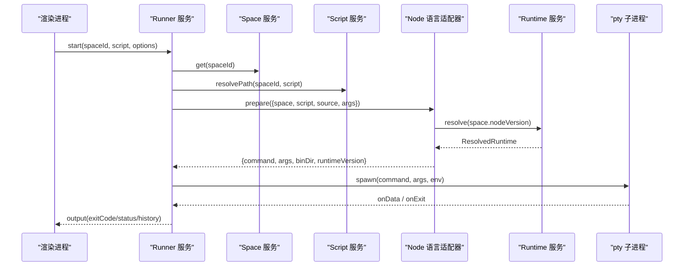
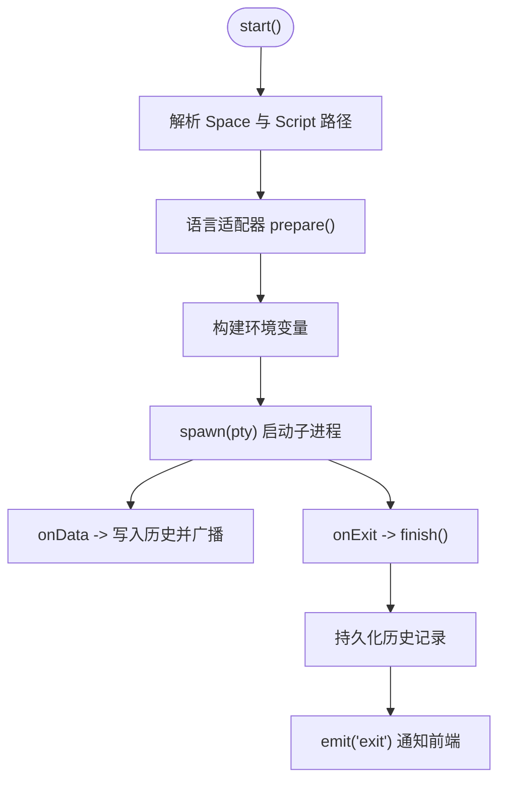
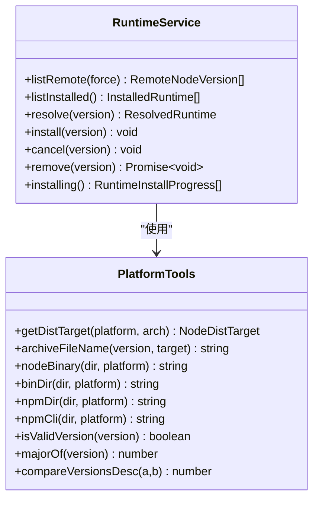
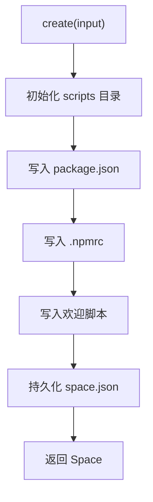
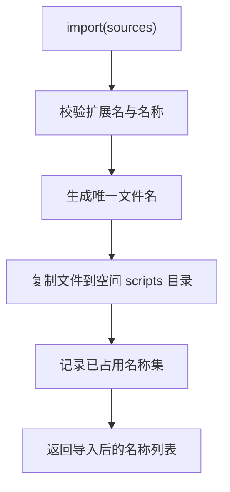
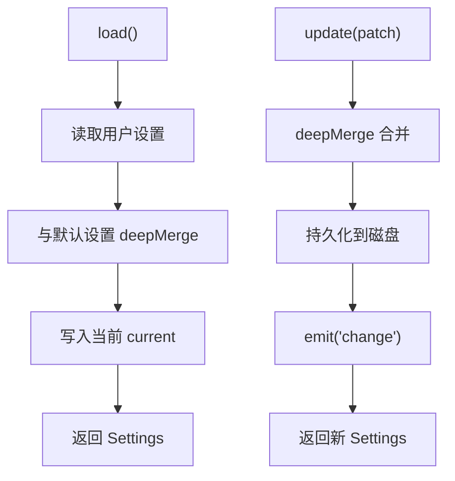
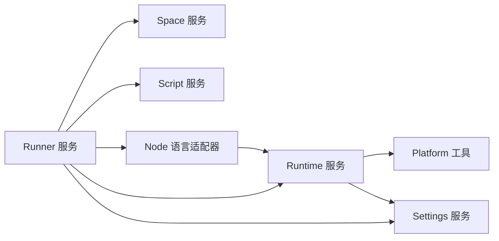

# 核心服务层

<cite>
**本文引用的文件**   
- [src/main/index.ts](file://src/main/index.ts)
- [src/main/services/runner/service.ts](file://src/main/services/runner/service.ts)
- [src/main/services/runner/languages/node.ts](file://src/main/services/runner/languages/node.ts)
- [src/main/services/runtime/service.ts](file://src/main/services/runtime/service.ts)
- [src/main/services/runtime/platform.ts](file://src/main/services/runtime/platform.ts)
- [src/main/services/space/service.ts](file://src/main/services/space/service.ts)
- [src/main/services/script/service.ts](file://src/main/services/script/service.ts)
- [src/main/services/settings/store.ts](file://src/main/services/settings/store.ts)
- [src/shared/types/space.ts](file://src/shared/types/space.ts)
- [src/shared/types/script.ts](file://src/shared/types/script.ts)
- [src/shared/types/settings.ts](file://src/shared/types/settings.ts)
</cite>

## 目录
1. [简介](#简介)
2. [项目结构](#项目结构)
3. [核心组件](#核心组件)
4. [架构总览](#架构总览)
5. [详细组件分析](#详细组件分析)
6. [依赖关系分析](#依赖关系分析)
7. [性能考量](#性能考量)
8. [故障排查指南](#故障排查指南)
9. [结论](#结论)

## 简介
本文件为 Script Box 的核心服务层技术文档，聚焦以下服务：Runner（脚本执行生命周期管理）、Runtime（Node.js 版本管理）、Space（项目空间管理）、Script（脚本文件管理）、Settings（配置管理）与 Deps（依赖包管理）。文档从职责、接口、实现细节、数据流转、错误处理与使用模式等维度进行系统化说明，并辅以架构图、时序图与流程图帮助理解。

## 项目结构
核心服务位于 src/main/services 下，按功能域划分：
- runner：脚本运行器与语言适配
- runtime：Node.js 运行时安装、解析与平台工具
- space：项目空间元数据与资源管理
- script：脚本文件的创建、读取、导入、重命名、删除与运行配置保存
- settings：应用设置持久化与变更事件
- deps：依赖包安装、卸载、更新与类型库提供（在 IPC 层暴露）

图表来源
- [src/main/index.ts:10-23](file://src/main/index.ts#L10-L23)
- [src/main/services/runner/service.ts:44-88](file://src/main/services/runner/service.ts#L44-L88)
- [src/main/services/runtime/service.ts:74-81](file://src/main/services/runtime/service.ts#L74-L81)
- [src/main/services/space/service.ts:14-31](file://src/main/services/space/service.ts#L14-L31)
- [src/main/services/script/service.ts:16-21](file://src/main/services/script/service.ts#L16-L21)
- [src/main/services/settings/store.ts:11-14](file://src/main/services/settings/store.ts#L11-L14)
- [src/main/services/runner/languages/node.ts:6-18](file://src/main/services/runner/languages/node.ts#L6-L18)

章节来源
- [src/main/index.ts:10-23](file://src/main/index.ts#L10-L23)

## 核心组件
- Runner 服务：负责脚本的启动、输出转发、终止、历史记录写入与活跃运行状态管理；通过语言适配器选择具体执行方式。
- Runtime 服务：负责远程 Node.js 版本列表获取、本地已安装版本枚举、指定版本解析、下载/校验/解压安装、进度上报与取消。
- Space 服务：负责项目空间的 CRUD、元数据序列化读写、并发安全更新与脚本目录初始化。
- Script 服务：负责脚本文件的生命周期操作（列出、读取、写入、创建、导入、重命名、删除）以及脚本运行配置保存。
- Settings 服务：负责默认设置合并、持久化读写与变更事件广播。
- Deps 服务：通过 IPC 暴露依赖安装、卸载、更新、扫描缺失依赖与类型库能力（本节重点在前端交互与服务暴露，后端实现不在本文展开）。

章节来源
- [src/main/services/runner/service.ts:29-146](file://src/main/services/runner/service.ts#L29-L146)
- [src/main/services/runtime/service.ts:37-154](file://src/main/services/runtime/service.ts#L37-L154)
- [src/main/services/space/service.ts:10-90](file://src/main/services/space/service.ts#L10-L90)
- [src/main/services/script/service.ts:16-109](file://src/main/services/script/service.ts#L16-L109)
- [src/main/services/settings/store.ts:8-29](file://src/main/services/settings/store.ts#L8-L29)

## 架构总览
Runner 作为统一入口协调各服务：
- 启动前：根据 Space 与 Script 信息准备参数与环境变量，调用 Language Runner 生成命令与二进制路径。
- 执行期：通过 pty 子进程执行，实时转发输出到历史存储与前端。
- 结束期：记录退出码、状态与耗时，清理内存中的活跃任务，触发退出事件。

图表来源
- [src/main/services/runner/service.ts:44-88](file://src/main/services/runner/service.ts#L44-L88)
- [src/main/services/runner/languages/node.ts:6-18](file://src/main/services/runner/languages/node.ts#L6-L18)
- [src/main/services/runtime/service.ts:74-81](file://src/main/services/runtime/service.ts#L74-L81)

## 详细组件分析

### Runner 服务（脚本执行生命周期管理）
- 职责
  - 维护活跃运行实例 Map，支持查询、停止、批量停止。
  - 解析脚本路径与运行参数，构建环境变量（网络代理、颜色终端、用户自定义环境变量）。
  - 通过语言适配器准备可执行命令与二进制目录，使用 pty 启动子进程。
  - 将 stdout/stderr 输出写入历史文件并广播给前端。
  - 进程结束时计算耗时、判定状态（成功/失败/被停止），清理资源并持久化历史。
- 关键接口
  - start(spaceId, script, options): Promise<RunRecord>
  - write(runId, data): void
  - resize(runId, cols, rows): void
  - stop(runId): void
  - stopAll(): void
  - active(): RunRecord[]
  - isActive(runId): boolean
  - hasActiveInSpace(spaceId): boolean
- 错误处理
  - 脚本不存在时抛出“脚本未找到”错误。
  - 历史持久化失败仅记录日志，不影响主流程。
- 使用模式
  - 在应用启动时注册 IPC，由渲染进程发起 start 请求。
  - 在窗口关闭或应用退出时调用 stopAll 确保子进程被清理。

图表来源
- [src/main/services/runner/service.ts:44-88](file://src/main/services/runner/service.ts#L44-L88)
- [src/main/services/runner/service.ts:122-143](file://src/main/services/runner/service.ts#L122-L143)

章节来源
- [src/main/services/runner/service.ts:29-146](file://src/main/services/runner/service.ts#L29-L146)

### Runtime 服务（Node.js 版本管理）
- 职责
  - 拉取远程版本索引（带镜像与缓存 TTL）。
  - 列举本地已安装版本（过滤无效版本与未完成安装）。
  - 解析指定版本为 ResolvedRuntime（包含 node、npmCli、bin 路径）。
  - 后台下载安装：下载 -> 校验 SHASUMS -> 解压 -> 清理临时文件。
  - 支持取消安装与移除已安装版本。
- 关键接口
  - listRemote(force?): Promise<RemoteNodeVersion[]>
  - listInstalled(): Promise<InstalledRuntime[]>
  - resolve(version): Promise<ResolvedRuntime>
  - install(version): void
  - cancel(version): void
  - remove(version): Promise<void>
  - installing(): RuntimeInstallProgress[]
- 错误处理
  - 未指定版本、版本不存在、校验和失败、安装中重复安装等场景抛出明确错误。
  - 安装失败或取消会更新进度状态（error/canceled）。
- 平台工具
  - 根据操作系统与架构映射分发目标、压缩包名、二进制路径、npm 路径等。

图表来源
- [src/main/services/runtime/service.ts:37-154](file://src/main/services/runtime/service.ts#L37-L154)
- [src/main/services/runtime/platform.ts:20-82](file://src/main/services/runtime/platform.ts#L20-L82)

章节来源
- [src/main/services/runtime/service.ts:37-154](file://src/main/services/runtime/service.ts#L37-L154)
- [src/main/services/runtime/platform.ts:20-82](file://src/main/services/runtime/platform.ts#L20-L82)

### Space 服务（项目空间管理）
- 职责
  - 列举、获取、创建、更新、删除项目空间。
  - 保证同一空间的元数据更新串行化（避免并发覆盖）。
  - 初始化 package.json、.npmrc 与欢迎脚本。
- 关键接口
  - list(): Promise<Space[]>
  - get(id): Promise<Space>
  - create(input): Promise<Space>
  - update(id, input): Promise<Space>
  - remove(id): Promise<void>
  - mutate(id, fn): Promise<Space>
- 数据结构
  - Space：包含 id、name、description、nodeVersion、时间戳与 scripts 元数据映射。

图表来源
- [src/main/services/space/service.ts:33-55](file://src/main/services/space/service.ts#L33-L55)

章节来源
- [src/main/services/space/service.ts:10-90](file://src/main/services/space/service.ts#L10-L90)
- [src/shared/types/space.ts:1-28](file://src/shared/types/space.ts#L1-L28)

### Script 服务（脚本文件管理）
- 职责
  - 校验脚本名称与扩展名，解析绝对路径。
  - 列出、读取、写入、创建、导入、重命名、删除脚本。
  - 保存脚本的运行配置（args、env）到 Space 元数据。
- 关键接口
  - resolvePath(spaceId, name): string
  - list(spaceId): Promise<ScriptFile[]>
  - read(spaceId, name): Promise<string>
  - write(spaceId, name, content): Promise<void>
  - create(spaceId, name): Promise<ScriptFile>
  - import(spaceId, sources): Promise<string[]>
  - rename(spaceId, from, to): Promise<void>
  - remove(spaceId, name): Promise<void>
  - saveRunConfig(spaceId, name, config): Promise<Space>
- 数据结构
  - ScriptFile：包含 name、language、size、mtime。
  - SCRIPT_EXTENSIONS：支持的脚本扩展名集合。

图表来源
- [src/main/services/script/service.ts:60-76](file://src/main/services/script/service.ts#L60-L76)

章节来源
- [src/main/services/script/service.ts:16-109](file://src/main/services/script/service.ts#L16-L109)
- [src/shared/types/script.ts:1-13](file://src/shared/types/script.ts#L1-L13)

### Settings 服务（配置管理）
- 职责
  - 加载并合并默认设置与用户设置。
  - 提供 get/update 接口，并在更新后持久化与广播 change 事件。
- 关键接口
  - load(): Promise<Settings>
  - get(): Settings
  - update(patch): Promise<Settings>
- 数据结构
  - Settings：包含 locale、theme、network、run、update 等配置项。

图表来源
- [src/main/services/settings/store.ts:11-25](file://src/main/services/settings/store.ts#L11-L25)

章节来源
- [src/main/services/settings/store.ts:8-29](file://src/main/services/settings/store.ts#L8-L29)
- [src/shared/types/settings.ts:1-58](file://src/shared/types/settings.ts#L1-L58)

### Deps 服务（依赖包管理）
- 职责（IPC 暴露）
  - 列举、安装、卸载、更新依赖。
  - 批量安装、取消任务、扫描缺失依赖、获取类型库与 Node 类型库。
  - 通过事件通道向渲染进程推送任务进度与输出。
- 典型 IPC 通道
  - deps:list、deps:install、deps:uninstall、deps:update、deps:install-all、deps:cancel、deps:active、deps:scan-missing、deps:types、deps:node-types
- 事件模型
  - task: start/data/exit，携带 taskId、spaceId、data/code 等字段。

章节来源
- [src/main/ipc/deps.ts:1-17](file://src/main/ipc/deps.ts#L1-L17)

## 依赖关系分析
- Runner 依赖
  - Space：获取空间元数据与脚本运行配置。
  - Script：解析脚本路径与内容。
  - Runtime：解析 Node.js 版本与二进制路径。
  - Settings：注入网络代理与额外环境变量。
  - Language Adapter（Node）：根据脚本扩展名决定执行策略。
- Runtime 依赖
  - Platform：平台与架构映射、路径构造、版本比较。
  - Network：下载与 JSON 文本获取。
  - Settings：镜像地址与代理配置。
- Space 与 Script
  - Script 依赖 Space 以校验空间存在性与更新脚本元数据。
- Settings
  - 被 Runner、Runtime 等广泛消费，用于网络与运行行为控制。

图表来源
- [src/main/services/runner/service.ts:44-88](file://src/main/services/runner/service.ts#L44-L88)
- [src/main/services/runner/languages/node.ts:6-18](file://src/main/services/runner/languages/node.ts#L6-L18)
- [src/main/services/runtime/service.ts:74-81](file://src/main/services/runtime/service.ts#L74-L81)
- [src/main/services/runtime/platform.ts:20-82](file://src/main/services/runtime/platform.ts#L20-L82)

章节来源
- [src/main/services/runner/service.ts:44-88](file://src/main/services/runner/service.ts#L44-L88)
- [src/main/services/runner/languages/node.ts:6-18](file://src/main/services/runner/languages/node.ts#L6-L18)
- [src/main/services/runtime/service.ts:74-81](file://src/main/services/runtime/service.ts#L74-L81)
- [src/main/services/runtime/platform.ts:20-82](file://src/main/services/runtime/platform.ts#L20-L82)

## 性能考量
- Runner
  - 使用 pty 子进程执行，避免阻塞主线程；输出流式写入历史文件，降低内存占用。
  - 停止逻辑先 SIGTERM，再强制 SIGKILL，兼顾优雅退出与强杀保障。
- Runtime
  - 远程版本列表采用内存缓存（TTL），减少频繁网络请求。
  - 安装过程分阶段报告进度，便于前端展示与取消。
- Space
  - 通过 Promise 链对同一空间的元数据更新串行化，避免竞态条件。
- Script
  - 批量导入时维护已占用名称集合，避免重复拷贝与冲突。
- Settings
  - 深合并默认与用户设置，避免多次 I/O；变更事件驱动 UI 刷新。

## 故障排查指南
- 脚本未找到
  - 现象：Runner 启动时报错。
  - 排查：确认 Space 与 Script 名称正确，路径存在。
  - 参考：[src/main/services/runner/service.ts:44-49](file://src/main/services/runner/service.ts#L44-L49)
- 未安装 Node.js 版本
  - 现象：Runner 无法解析运行时。
  - 排查：检查 Space 的 nodeVersion 是否指向已安装版本。
  - 参考：[src/main/services/runtime/service.ts:74-81](file://src/main/services/runtime/service.ts#L74-L81)
- 校验和不匹配
  - 现象：Runtime 安装失败。
  - 排查：检查镜像源与网络连通性，重试安装。
  - 参考：[src/main/services/runtime/service.ts:130-134](file://src/main/services/runtime/service.ts#L130-L134)
- 历史持久化失败
  - 现象：Runner 结束时报日志错误。
  - 影响：不阻断主流程，但历史可能丢失。
  - 参考：[src/main/services/runner/service.ts:136-141](file://src/main/services/runner/service.ts#L136-L141)
- 空间元数据并发写冲突
  - 现象：同时更新 Space 导致数据覆盖。
  - 机制：mutate 方法通过 Promise 链串行化。
  - 参考：[src/main/services/space/service.ts:75-87](file://src/main/services/space/service.ts#L75-L87)

章节来源
- [src/main/services/runner/service.ts:44-49](file://src/main/services/runner/service.ts#L44-L49)
- [src/main/services/runtime/service.ts:74-81](file://src/main/services/runtime/service.ts#L74-L81)
- [src/main/services/runtime/service.ts:130-134](file://src/main/services/runtime/service.ts#L130-L134)
- [src/main/services/runner/service.ts:136-141](file://src/main/services/runner/service.ts#L136-L141)
- [src/main/services/space/service.ts:75-87](file://src/main/services/space/service.ts#L75-L87)

## 结论
核心服务层围绕 Runner 编排脚本执行生命周期，依托 Runtime 管理 Node.js 环境，借助 Space 与 Script 管理服务对象与文件，Settings 提供全局配置支撑，Deps 通过 IPC 暴露依赖管理能力。整体设计清晰分层、职责单一，具备完善的错误处理与可扩展的语言适配机制。建议在后续迭代中继续强化跨服务的可观测性（如结构化日志与指标），并对高频路径（如历史写入、远程列表缓存）做进一步性能优化。