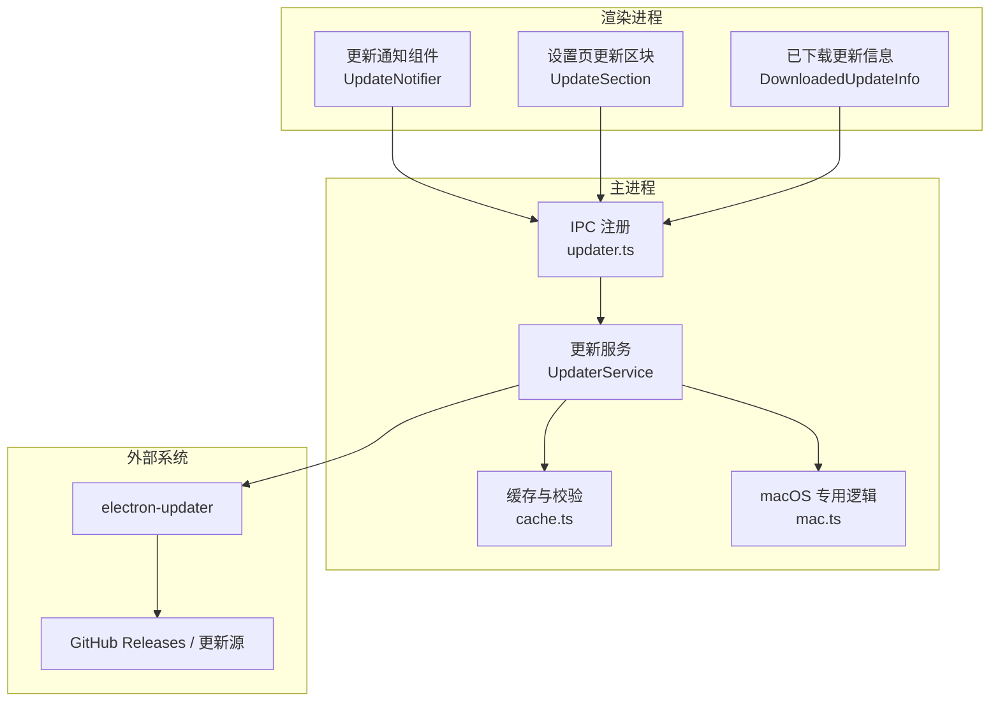
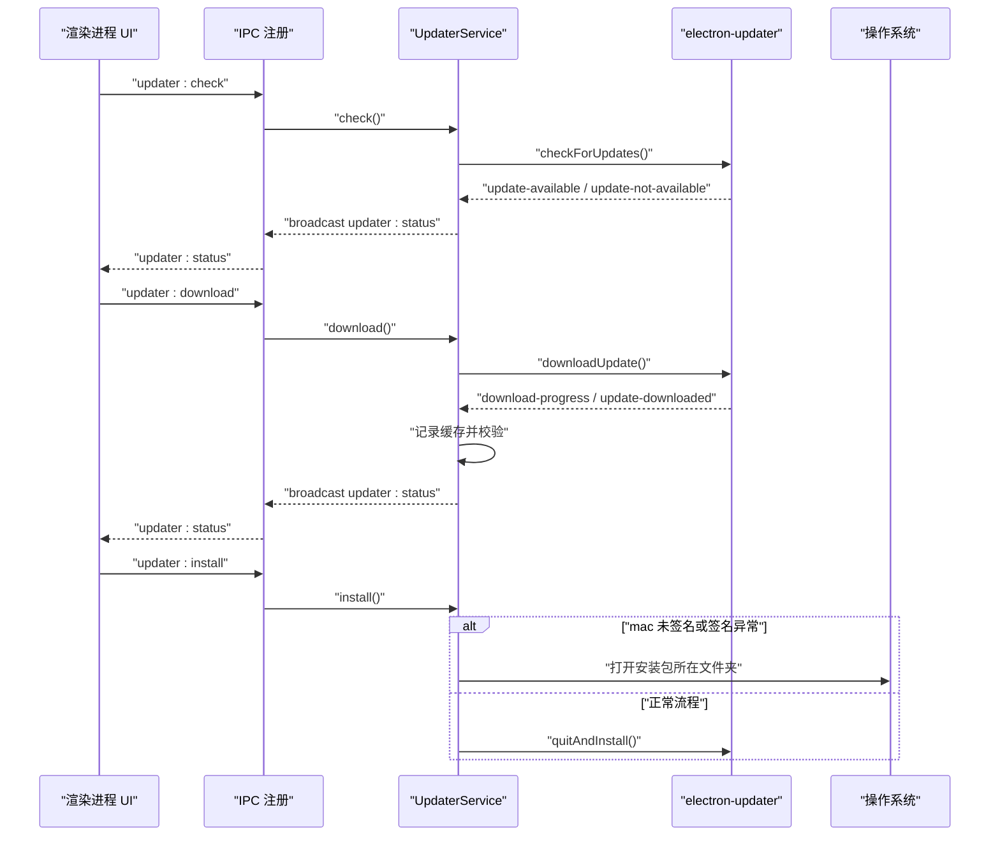
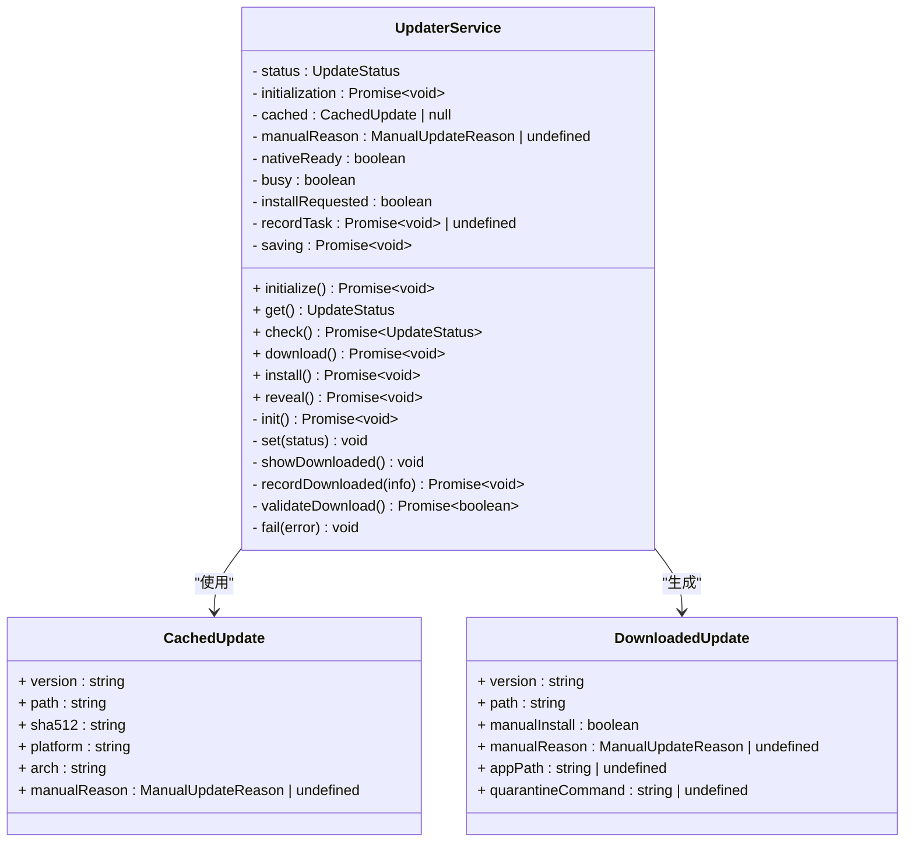
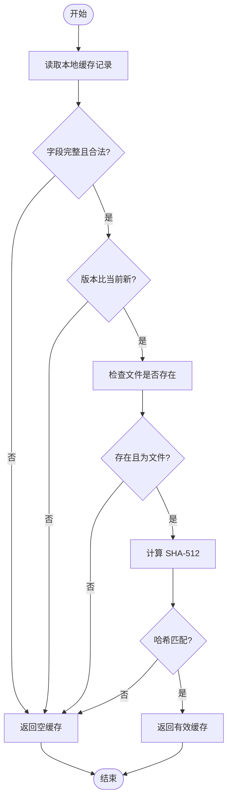
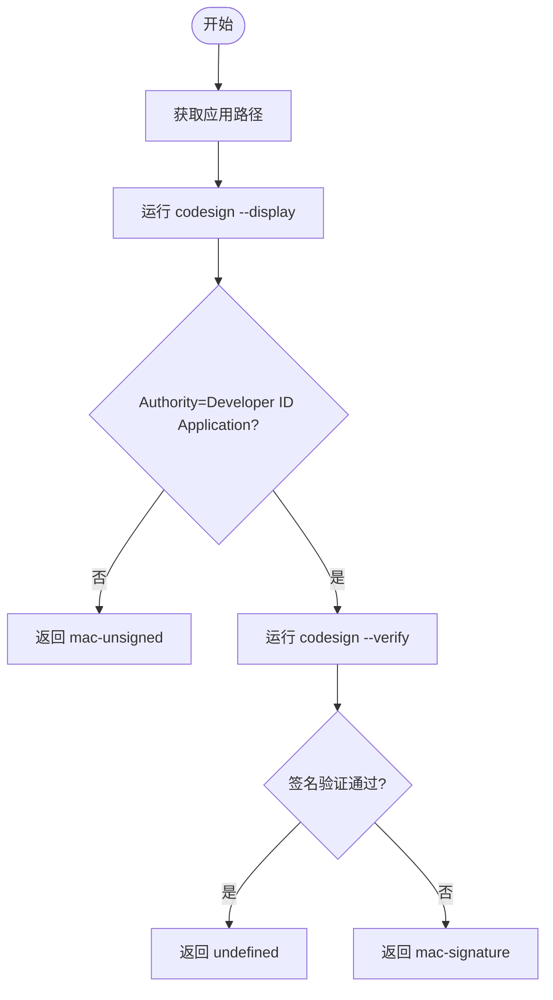
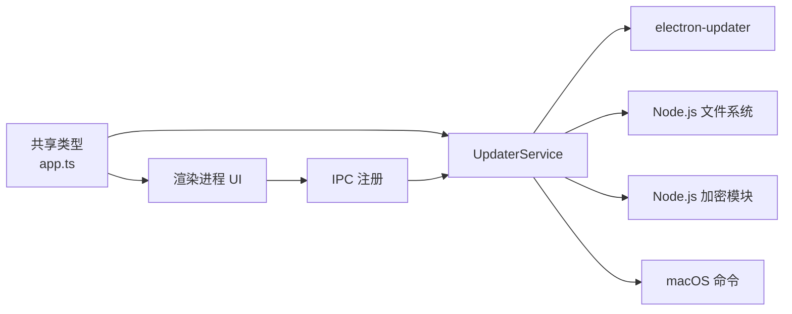

# 自动更新服务架构

<cite>
**本文引用的文件**   
- [README.md](file://README.md)
- [package.json](file://package.json)
- [src/main/services/updater/index.ts](file://src/main/services/updater/index.ts)
- [src/main/services/updater/cache.ts](file://src/main/services/updater/cache.ts)
- [src/main/services/updater/mac.ts](file://src/main/services/updater/mac.ts)
- [src/main/ipc/updater.ts](file://src/main/ipc/updater.ts)
- [src/shared/types/app.ts](file://src/shared/types/app.ts)
- [src/renderer/src/components/common/UpdateNotifier.tsx](file://src/renderer/src/components/common/UpdateNotifier.tsx)
- [src/renderer/src/components/common/DownloadedUpdateInfo.tsx](file://src/renderer/src/components/common/DownloadedUpdateInfo.tsx)
- [src/renderer/src/pages/settings/UpdateSection.tsx](file://src/renderer/src/pages/settings/UpdateSection.tsx)
</cite>

## 目录
1. [简介](#简介)
2. [项目结构定位](#项目结构定位)
3. [核心组件](#核心组件)
4. [架构总览](#架构总览)
5. [详细组件分析](#详细组件分析)
6. [依赖关系分析](#依赖关系分析)
7. [性能与可靠性特性](#性能与可靠性特性)
8. [故障排查指南](#故障排查指南)
9. [结论](#结论)

## 简介
本文件聚焦 Script Box 的“自动更新服务”实现，围绕 Electron 主进程中的 `UpdaterService`、缓存校验、macOS 签名检测、IPC 暴露以及渲染进程的更新通知与设置页展示进行系统化说明。该功能从 GitHub Releases 获取新版本，支持下载、安装、手动安装引导和错误状态反馈，并在 macOS 上对未签名或签名异常场景提供降级流程。

## 项目结构定位
自动更新相关代码主要分布在以下位置：
- 主进程服务：`src/main/services/updater`
- IPC 通道注册：`src/main/ipc/updater.ts`
- 共享类型定义：`src/shared/types/app.ts`
- 渲染进程 UI：`src/renderer/src/components/common/UpdateNotifier.tsx`、`DownloadedUpdateInfo.tsx`、`src/renderer/src/pages/settings/UpdateSection.tsx`

**图表来源**
- [src/main/ipc/updater.ts:1-13](file://src/main/ipc/updater.ts#L1-L13)
- [src/main/services/updater/index.ts:1-269](file://src/main/services/updater/index.ts#L1-L269)
- [src/main/services/updater/cache.ts:1-45](file://src/main/services/updater/cache.ts#L1-L45)
- [src/main/services/updater/mac.ts:1-40](file://src/main/services/updater/mac.ts#L1-L40)
- [src/renderer/src/components/common/UpdateNotifier.tsx:1-86](file://src/renderer/src/components/common/UpdateNotifier.tsx#L1-L86)
- [src/renderer/src/components/common/DownloadedUpdateInfo.tsx:1-45](file://src/renderer/src/components/common/DownloadedUpdateInfo.tsx#L1-L45)
- [src/renderer/src/pages/settings/UpdateSection.tsx:1-98](file://src/renderer/src/pages/settings/UpdateSection.tsx#L1-L98)

**章节来源**
- [README.md:25-30](file://README.md#L25-L30)
- [package.json:31-41](file://package.json#L31-L41)

## 核心组件
- **UpdaterService（更新服务）**：封装检查、下载、安装、显示安装包、状态广播等能力；维护当前状态、缓存记录、是否繁忙、是否需要重启后安装等内部字段。
- **缓存模块（cache.ts）**：负责计算更新包 SHA-512、恢复并验证本地缓存记录，确保平台、架构、版本新旧关系和文件完整性。
- **macOS 专用模块（mac.ts）**：提供应用路径、隔离标记清理命令、签名错误识别、自动检测是否需要手动安装。
- **IPC 层（ipc/updater.ts）**：将更新服务的查询、检查、下载、安装、显示安装包等操作暴露给渲染进程，并广播状态变更。
- **渲染进程 UI**：全局更新通知、设置页更新区块、已下载更新信息展示，统一通过 IPC 调用主进程并订阅状态事件。

**章节来源**
- [src/main/services/updater/index.ts:32-120](file://src/main/services/updater/index.ts#L32-L120)
- [src/main/services/updater/cache.ts:7-44](file://src/main/services/updater/cache.ts#L7-L44)
- [src/main/services/updater/mac.ts:9-39](file://src/main/services/updater/mac.ts#L9-L39)
- [src/main/ipc/updater.ts:4-12](file://src/main/ipc/updater.ts#L4-L12)
- [src/renderer/src/components/common/UpdateNotifier.tsx:12-82](file://src/renderer/src/components/common/UpdateNotifier.tsx#L12-L82)
- [src/renderer/src/pages/settings/UpdateSection.tsx:26-97](file://src/renderer/src/pages/settings/UpdateSection.tsx#L26-L97)

## 架构总览
自动更新整体流程如下：
1. 渲染进程初始化时订阅 `updater:status` 事件，并主动拉取一次状态。
2. 用户点击“检查更新”，IPC 调用主进程 `check()`。
3. 主进程通过 `electron-updater` 检查版本，触发可用、不可用、下载进度、下载完成、错误等事件。
4. 主进程根据平台与签名情况决定是否自动安装，或在 macOS 无签名时进入手动安装流程。
5. 下载完成后持久化缓存记录，包含版本、路径、SHA-512、平台、架构及手动原因。
6. 渲染进程根据状态展示通知或设置页内容，并提供下载、安装、显示安装包等操作入口。

**图表来源**
- [src/main/ipc/updater.ts:4-12](file://src/main/ipc/updater.ts#L4-L12)
- [src/main/services/updater/index.ts:175-265](file://src/main/services/updater/index.ts#L175-L265)
- [src/renderer/src/components/common/UpdateNotifier.tsx:17-82](file://src/renderer/src/components/common/UpdateNotifier.tsx#L17-L82)
- [src/renderer/src/pages/settings/UpdateSection.tsx:32-91](file://src/renderer/src/pages/settings/UpdateSection.tsx#L32-L91)

## 详细组件分析

### UpdaterService：更新服务核心
UpdaterService 是自动更新的中心控制器，负责：
- 初始化更新监听器，绑定 electron-updater 的事件。
- 管理状态机：空闲、不支持、检查中、可用、不可用、下载中、准备中、已下载、错误。
- 处理 macOS 特殊逻辑：检测签名、禁用自动安装、提示手动安装。
- 持久化下载记录，避免重复下载并支持重启后继续安装。
- 对外暴露 `get`、`check`、`download`、`install`、`reveal` 等方法。

**图表来源**
- [src/main/services/updater/index.ts:32-120](file://src/main/services/updater/index.ts#L32-L120)
- [src/main/services/updater/cache.ts:7-14](file://src/main/services/updater/cache.ts#L7-L14)
- [src/shared/types/app.ts:14-32](file://src/shared/types/app.ts#L14-L32)

**章节来源**
- [src/main/services/updater/index.ts:18-120](file://src/main/services/updater/index.ts#L18-L120)
- [src/main/services/updater/index.ts:171-265](file://src/main/services/updater/index.ts#L171-L265)

### 缓存与校验：cache.ts
缓存模块承担两个关键职责：
- 计算更新包的 SHA-512，用于后续完整性校验。
- 恢复并验证本地缓存记录，要求：
  - 记录为对象且字段完整。
  - 路径为绝对路径。
  - 平台与架构匹配当前环境。
  - 版本比当前版本新。
  - 文件存在且哈希一致。
  - 手动原因仅允许特定值。

**图表来源**
- [src/main/services/updater/cache.ts:16-44](file://src/main/services/updater/cache.ts#L16-L44)

**章节来源**
- [src/main/services/updater/cache.ts:7-44](file://src/main/services/updater/cache.ts#L7-L44)

### macOS 专用逻辑：mac.ts
macOS 上的自动更新需要额外处理签名与隔离标记：
- 获取应用 Bundle 路径。
- 生成移除隔离标记的命令字符串，供用户复制执行。
- 识别签名相关错误。
- 检测应用是否由 Developer ID 签名且签名有效；否则返回手动安装原因。

**图表来源**
- [src/main/services/updater/mac.ts:9-39](file://src/main/services/updater/mac.ts#L9-L39)

**章节来源**
- [src/main/services/updater/mac.ts:9-39](file://src/main/services/updater/mac.ts#L9-L39)

### IPC 层：updater.ts
IPC 层将更新服务的能力暴露给渲染进程，包括：
- 查询状态：`updater:status`
- 检查更新：`updater:check`
- 下载更新：`updater:download`
- 安装更新：`updater:install`
- 显示安装包：`updater:reveal`
同时，当服务状态变化时，通过 `broadcast('updater:status', status)` 推送给所有订阅者。

**章节来源**
- [src/main/ipc/updater.ts:1-13](file://src/main/ipc/updater.ts#L1-L13)

### 渲染进程 UI
#### 全局更新通知：UpdateNotifier.tsx
- 订阅 `updater:status` 事件。
- 在“可用”时弹出可关闭的通知，提供“下载”按钮。
- 在“已下载”时弹出成功或警告通知，提供“重启并安装”或“手动安装指南”。
- 在下载、校验或失败后立即销毁旧通知，避免残留无法操作的按钮。

**章节来源**
- [src/renderer/src/components/common/UpdateNotifier.tsx:12-82](file://src/renderer/src/components/common/UpdateNotifier.tsx#L12-L82)

#### 设置页更新区块：UpdateSection.tsx
- 展示自动检查开关。
- 展示更新状态文本与进度条。
- 提供“检查更新”“下载”“重启并安装”按钮。
- 显示手动安装原因与已下载更新信息。

**章节来源**
- [src/renderer/src/pages/settings/UpdateSection.tsx:11-97](file://src/renderer/src/pages/settings/UpdateSection.tsx#L11-L97)

#### 已下载更新信息：DownloadedUpdateInfo.tsx
- 显示版本号与安装包路径。
- 提供“显示安装包”操作。
- 在需要手动安装时，展示步骤说明、安全提示与隔离标记清理命令。

**章节来源**
- [src/renderer/src/components/common/DownloadedUpdateInfo.tsx:8-44](file://src/renderer/src/components/common/DownloadedUpdateInfo.tsx#L8-L44)

## 依赖关系分析
自动更新功能的依赖关系如下：
- 主进程服务依赖 electron-updater 进行版本检查与下载。
- 主进程服务依赖 Node.js 标准库进行文件哈希计算与文件系统访问。
- macOS 专用逻辑依赖系统命令 `codesign` 与 `xattr`。
- 渲染进程通过 IPC 与主进程通信，不直接访问更新源。
- 共享类型定义保证主进程与渲染进程的状态结构一致。

**图表来源**
- [src/shared/types/app.ts:1-32](file://src/shared/types/app.ts#L1-L32)
- [src/main/services/updater/index.ts:1-12](file://src/main/services/updater/index.ts#L1-L12)
- [src/main/services/updater/cache.ts:1-5](file://src/main/services/updater/cache.ts#L1-L5)
- [src/main/services/updater/mac.ts:1-6](file://src/main/services/updater/mac.ts#L1-L6)
- [src/main/ipc/updater.ts:1-3](file://src/main/ipc/updater.ts#L1-L3)

**章节来源**
- [package.json:31-41](file://package.json#L31-L41)
- [src/main/services/updater/index.ts:1-12](file://src/main/services/updater/index.ts#L1-L12)
- [src/main/services/updater/cache.ts:1-5](file://src/main/services/updater/cache.ts#L1-L5)
- [src/main/services/updater/mac.ts:1-6](file://src/main/services/updater/mac.ts#L1-L6)
- [src/main/ipc/updater.ts:1-3](file://src/main/ipc/updater.ts#L1-L3)

## 性能与可靠性特性
- **避免重复下载**：通过缓存记录与 SHA-512 校验，确保同一版本在同一平台与架构下不会重复下载。
- **状态驱动 UI**：渲染进程基于状态变化更新界面，减少不必要的重绘与请求。
- **忙锁保护**：UpdaterService 使用 `busy` 标志防止并发检查、下载、安装造成状态混乱。
- **重启后安装**：在进程重启后先检查版本再复用缓存，避免直接调用安装导致的不一致。
- **macOS 签名降级**：在未签名或签名异常时禁用自动安装，改为手动安装流程，提升用户体验与安全性。

[本节为通用性能与可靠性讨论，不直接分析具体文件]

## 故障排查指南
常见错误与处理策略：
- **无发布版本**：当 GitHub Releases 没有已发布版本时，服务会返回 `no-release` 错误码。
- **macOS 签名问题**：若检测到签名错误或应用未签名，服务会设置 `mac-signature` 或 `mac-unsigned` 原因，并提示手动安装。
- **缓存缺失**：如果本地缓存无效或损坏，服务会返回 `cache-missing` 错误码，需重新下载。
- **网络或代理问题**：自动更新依赖 electron-updater 的网络配置，请确认代理与镜像设置正确。

建议排查步骤：
1. 打开设置页的“更新”区块，查看状态文本与错误码。
2. 如果是 macOS 签名问题，按照提示复制隔离标记清理命令并在终端执行。
3. 使用“显示安装包”确认下载文件是否存在。
4. 检查网络配置，确保能访问 GitHub Releases 与更新源。

**章节来源**
- [src/main/services/updater/index.ts:18-30](file://src/main/services/updater/index.ts#L18-L30)
- [src/main/services/updater/index.ts:153-169](file://src/main/services/updater/index.ts#L153-L169)
- [src/main/services/updater/index.ts:213-220](file://src/main/services/updater/index.ts#L213-L220)
- [src/renderer/src/pages/settings/UpdateSection.tsx:11-24](file://src/renderer/src/pages/settings/UpdateSection.tsx#L11-L24)

## 结论
Script Box 的自动更新服务以 `UpdaterService` 为核心，结合 electron-updater、本地缓存校验与 macOS 签名检测，实现了稳定、可降级、可观测的更新流程。渲染进程通过 IPC 与状态事件获得一致的更新体验，既支持自动安装，也支持手动安装引导。整体设计清晰、职责分离良好，便于扩展与维护。

[本节为总结性内容，不直接分析具体文件]