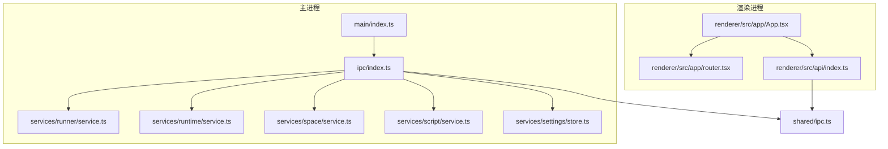
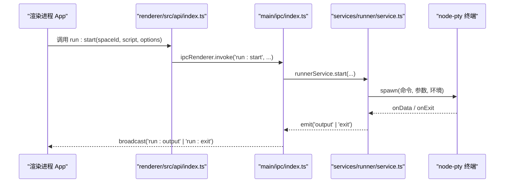
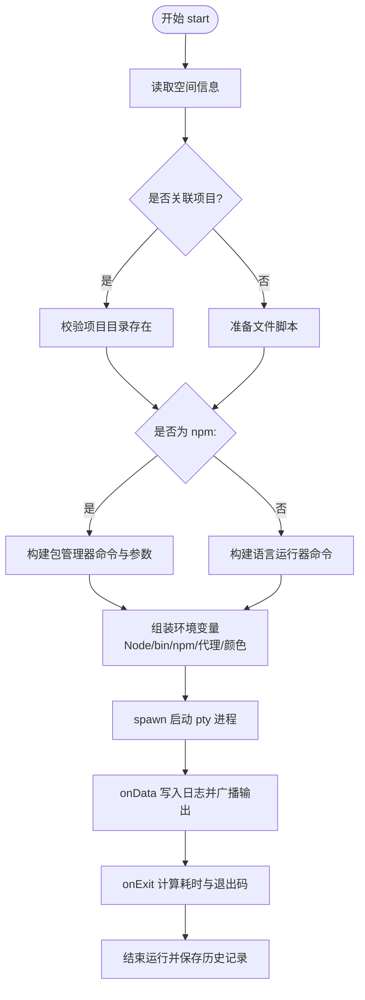
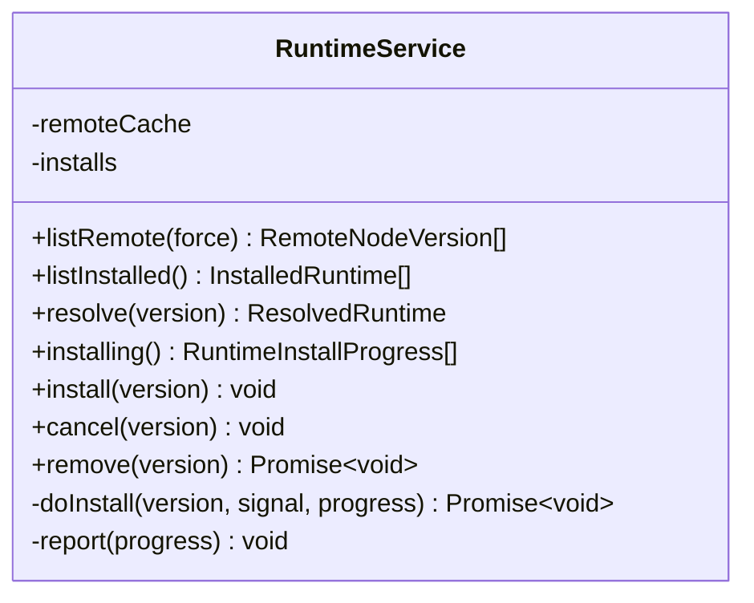
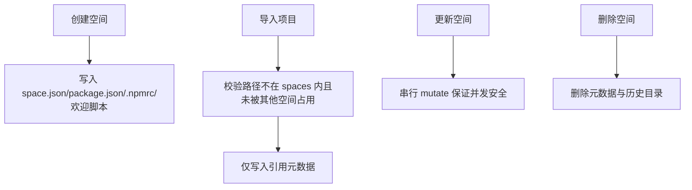
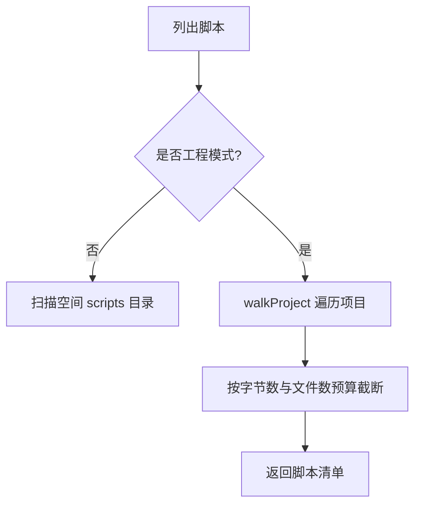
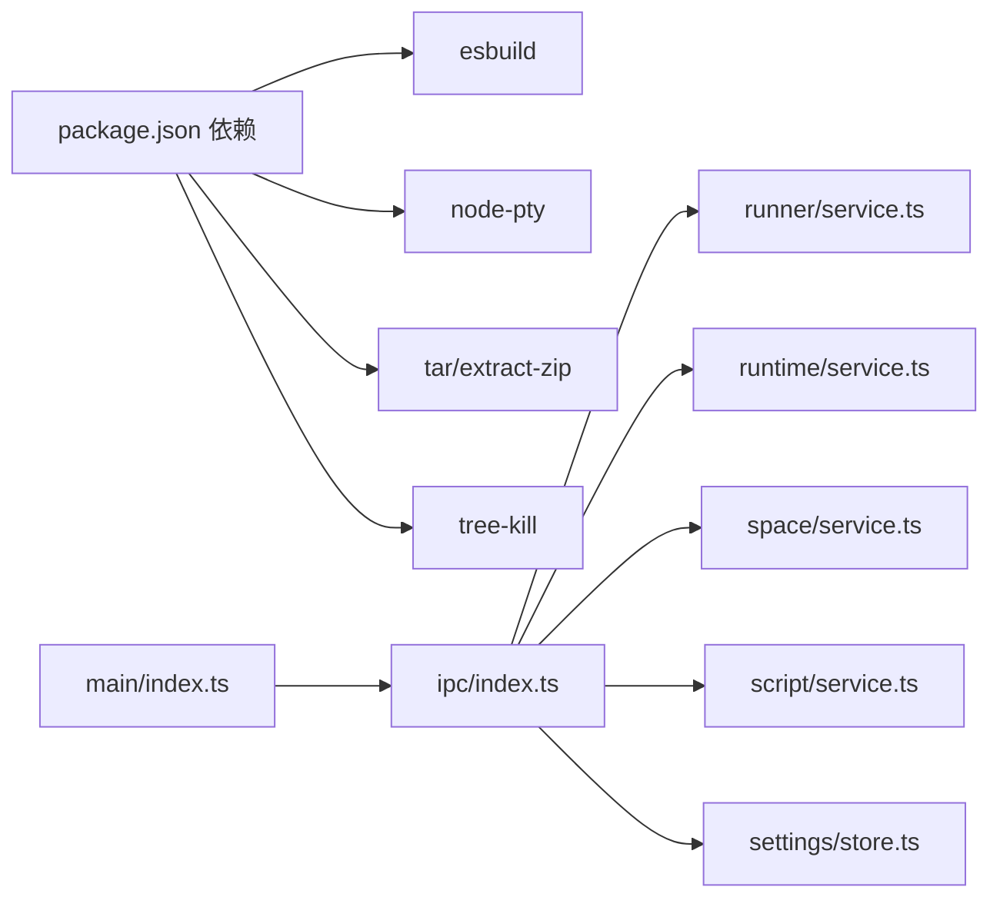

# 项目管理系统

<cite>
**本文引用的文件**   
- [README.md](file://README.md)
- [package.json](file://package.json)
- [electron.vite.config.ts](file://electron.vite.config.ts)
- [src/main/index.ts](file://src/main/index.ts)
- [src/main/ipc/index.ts](file://src/main/ipc/index.ts)
- [src/main/ipc/helpers.ts](file://src/main/ipc/helpers.ts)
- [src/main/ipc/run.ts](file://src/main/ipc/run.ts)
- [src/main/ipc/runtime.ts](file://src/main/ipc/runtime.ts)
- [src/main/ipc/settings.ts](file://src/main/ipc/settings.ts)
- [src/main/ipc/space.ts](file://src/main/ipc/space.ts)
- [src/main/ipc/script.ts](file://src/main/ipc/script.ts)
- [src/main/ipc/deps.ts](file://src/main/ipc/deps.ts)
- [src/main/services/runner/service.ts](file://src/main/services/runner/service.ts)
- [src/main/services/runtime/service.ts](file://src/main/services/runtime/service.ts)
- [src/main/services/space/service.ts](file://src/main/services/space/service.ts)
- [src/main/services/script/service.ts](file://src/main/services/script/service.ts)
- [src/main/services/settings/store.ts](file://src/main/services/settings/store.ts)
- [src/shared/ipc.ts](file://src/shared/ipc.ts)
- [src/renderer/src/api/index.ts](file://src/renderer/src/api/index.ts)
- [src/renderer/src/app/App.tsx](file://src/renderer/src/app/App.tsx)
- [src/renderer/src/app/router.tsx](file://src/renderer/src/app/router.tsx)
- [src/renderer/src/layouts/MainLayout.tsx](file://src/renderer/src/layouts/MainLayout.tsx)
</cite>

## 目录
1. [简介](#简介)
2. [项目结构](#项目结构)
3. [核心组件](#核心组件)
4. [架构总览](#架构总览)
5. [详细组件分析](#详细组件分析)
6. [依赖关系分析](#依赖关系分析)
7. [性能与可扩展性](#性能与可扩展性)
8. [故障排查指南](#故障排查指南)
9. [结论](#结论)

## 简介
本项目是一个基于 Electron 的脚本运行与管理工具，提供“免安装运行时”、多运行空间、依赖管理、交互式终端、运行历史、内置编辑器、网络代理配置、自动更新等能力。主进程负责 IPC、服务编排与系统资源管理；渲染进程使用 React + Ant Design 构建界面；共享类型与 IPC 通道定义位于 shared 层。

## 项目结构
- 主进程：src/main，包含 IPC 路由与各领域服务（settings、network、runtime、space、script、deps、runner、updater）。
- 预加载桥：src/preload，暴露带类型的 window.api。
- 渲染进程：src/renderer，React 应用与页面、组件、状态管理。
- 共享层：src/shared，类型、IPC 通道、默认配置与错误序列化。
- 子项目：script-hub，独立静态脚本中心，与主应用解耦。

图表来源
- [src/main/index.ts:10-28](file://src/main/index.ts#L10-L28)
- [src/main/ipc/index.ts:10-19](file://src/main/ipc/index.ts#L10-L19)
- [src/main/services/runner/service.ts:41-107](file://src/main/services/runner/service.ts#L41-L107)
- [src/main/services/runtime/service.ts:37-155](file://src/main/services/runtime/service.ts#L37-L155)
- [src/main/services/space/service.ts:18-181](file://src/main/services/space/service.ts#L18-L181)
- [src/main/services/script/service.ts:24-228](file://src/main/services/script/service.ts#L24-L228)
- [src/main/services/settings/store.ts:8-30](file://src/main/services/settings/store.ts#L8-L30)
- [src/renderer/src/app/App.tsx:13-33](file://src/renderer/src/app/App.tsx#L13-L33)
- [src/renderer/src/app/router.tsx:8-21](file://src/renderer/src/app/router.tsx#L8-L21)
- [src/renderer/src/api/index.ts:17-35](file://src/renderer/src/api/index.ts#L17-L35)
- [src/shared/ipc.ts:28-133](file://src/shared/ipc.ts#L28-L133)

章节来源
- [README.md:195-203](file://README.md#L195-L203)
- [package.json:11-30](file://package.json#L11-L30)
- [electron.vite.config.ts:1-30](file://electron.vite.config.ts#L1-L30)

## 核心组件
- 启动与生命周期：主进程入口初始化设置、代理、单实例、窗口创建与更新检查。
- IPC 总线：统一封装 handle/listen/broadcast，集中注册各模块 IPC。
- 运行器 RunnerService：解析脚本或 npm script，构造环境变量，通过 node-pty 启动交互式终端，记录日志与退出码。
- 运行时 RuntimeService：远程版本列表、本地已安装版本、下载校验与解压、进度事件。
- 运行空间 SpaceService：空间元数据、导入项目、路径校验、顺序持久化。
- 脚本 ScriptService：脚本 CRUD、工程扫描、源码预算限制、运行配置保存。
- 设置 SettingsStore：合并默认值、持久化、变更广播并触发代理生效。
- 渲染端 API：封装 invoke/send/on，将主进程错误序列化为 ApiError。

章节来源
- [src/main/index.ts:10-54](file://src/main/index.ts#L10-L54)
- [src/main/ipc/helpers.ts:17-46](file://src/main/ipc/helpers.ts#L17-L46)
- [src/main/services/runner/service.ts:41-192](file://src/main/services/runner/service.ts#L41-L192)
- [src/main/services/runtime/service.ts:37-155](file://src/main/services/runtime/service.ts#L37-L155)
- [src/main/services/space/service.ts:18-181](file://src/main/services/space/service.ts#L18-L181)
- [src/main/services/script/service.ts:24-228](file://src/main/services/script/service.ts#L24-L228)
- [src/main/services/settings/store.ts:8-30](file://src/main/services/settings/store.ts#L8-L30)
- [src/renderer/src/api/index.ts:17-35](file://src/renderer/src/api/index.ts#L17-L35)

## 架构总览
应用采用“渲染进程 UI + 主进程服务 + 共享类型/IPC”的分层架构。渲染端通过 bridge.invoke 调用主进程能力，主进程通过 EventEmitter 广播输出与进度事件，再由 helpers.broadcast 推送给所有窗口。

图表来源
- [src/renderer/src/api/index.ts:19-35](file://src/renderer/src/api/index.ts#L19-L35)
- [src/main/ipc/index.ts:10-19](file://src/main/ipc/index.ts#L10-L19)
- [src/main/ipc/run.ts:4-18](file://src/main/ipc/run.ts#L4-L18)
- [src/main/services/runner/service.ts:60-107](file://src/main/services/runner/service.ts#L60-L107)
- [src/main/ipc/helpers.ts:41-46](file://src/main/ipc/helpers.ts#L41-L46)

## 详细组件分析

### 运行器 RunnerService
职责：
- 根据 spaceId 与脚本名解析实际命令（支持文件脚本与 npm script）。
- 组装 Node.js 运行时路径、npm 镜像、代理与环境变量。
- 通过 node-pty 启动交互式终端，实时转发输出，记录历史与退出码。
- 支持停止、批量停止、按列行调整终端尺寸。

图表来源
- [src/main/services/runner/service.ts:60-107](file://src/main/services/runner/service.ts#L60-L107)
- [src/main/services/runner/service.ts:109-134](file://src/main/services/runner/service.ts#L109-L134)
- [src/main/services/runner/service.ts:136-188](file://src/main/services/runner/service.ts#L136-L188)

章节来源
- [src/main/services/runner/service.ts:41-192](file://src/main/services/runner/service.ts#L41-L192)
- [src/main/ipc/run.ts:4-18](file://src/main/ipc/run.ts#L4-L18)

### 运行时 RuntimeService
职责：
- 列出远程 Node.js 版本（带缓存与镜像）。
- 列出本地已安装版本（含 npm 版本）。
- 下载、校验 SHASUMS256、解压归档，并通过事件上报进度。
- 取消安装、删除已安装版本。

图表来源
- [src/main/services/runtime/service.ts:37-155](file://src/main/services/runtime/service.ts#L37-L155)

章节来源
- [src/main/services/runtime/service.ts:37-155](file://src/main/services/runtime/service.ts#L37-L155)
- [src/main/ipc/runtime.ts:4-13](file://src/main/ipc/runtime.ts#L4-L13)

### 运行空间 SpaceService
职责：
- 空间的增删改查、排序持久化。
- 导入外部项目目录（仅引用，不复制），并进行路径合法性与冲突检测。
- 为每个空间生成 package.json、.npmrc 与欢迎脚本。
- 清理时仅删除元数据与历史，不触碰被引用的项目目录。

图表来源
- [src/main/services/space/service.ts:56-101](file://src/main/services/space/service.ts#L56-L101)
- [src/main/services/space/service.ts:103-142](file://src/main/services/space/service.ts#L103-L142)
- [src/main/services/space/service.ts:144-177](file://src/main/services/space/service.ts#L144-L177)

章节来源
- [src/main/services/space/service.ts:18-181](file://src/main/services/space/service.ts#L18-L181)
- [src/main/ipc/space.ts:16-58](file://src/main/ipc/space.ts#L16-L58)

### 脚本 ScriptService
职责：
- 脚本文件的创建、读取、写入、重命名、删除与导入。
- 工程模式下遍历项目文件，提供逐层 entries 与源码预算限制（文件大小与数量上限）。
- 保存运行配置（命令行参数与环境变量），区分普通脚本与 npm script。

图表来源
- [src/main/services/script/service.ts:43-58](file://src/main/services/script/service.ts#L43-L58)
- [src/main/services/script/service.ts:167-194](file://src/main/services/script/service.ts#L167-L194)

章节来源
- [src/main/services/script/service.ts:24-228](file://src/main/services/script/service.ts#L24-L228)
- [src/main/ipc/script.ts:5-18](file://src/main/ipc/script.ts#L5-L18)

### 设置 SettingsStore
职责：
- 加载默认设置与用户设置并深合并。
- 更新后持久化并广播 change 事件，主进程据此重新应用代理。

章节来源
- [src/main/services/settings/store.ts:8-30](file://src/main/services/settings/store.ts#L8-L30)
- [src/main/ipc/settings.ts:5-14](file://src/main/ipc/settings.ts#L5-L14)

### 渲染端 API 与启动流程
- renderer/src/api/index.ts 封装 invoke/send/on，将主进程错误包装为 ApiError。
- App.tsx 在启动时并行加载设置、空间、运行时、运行历史与依赖状态，完成后进入路由。
- router.tsx 定义页面路由，MainLayout.tsx 提供侧边导航。

章节来源
- [src/renderer/src/api/index.ts:17-35](file://src/renderer/src/api/index.ts#L17-L35)
- [src/renderer/src/app/App.tsx:13-33](file://src/renderer/src/app/App.tsx#L13-L33)
- [src/renderer/src/app/router.tsx:8-21](file://src/renderer/src/app/router.tsx#L8-L21)
- [src/renderer/src/layouts/MainLayout.tsx:13-24](file://src/renderer/src/layouts/MainLayout.tsx#L13-L24)

## 依赖关系分析
- 主进程入口依赖：@electron-toolkit/utils、electron、以及内部 services 与 ipc。
- 关键运行时依赖：esbuild（TS 转译）、node-pty（交互式终端）、tar/extract-zip（归档处理）、tree-kill（进程终止）。
- 构建配置：electron-vite 为 main/preload/renderer 分别设置别名与插件。

图表来源
- [package.json:31-40](file://package.json#L31-L40)
- [electron.vite.config.ts:1-30](file://electron.vite.config.ts#L1-L30)
- [src/main/index.ts:1-8](file://src/main/index.ts#L1-L8)
- [src/main/ipc/index.ts:1-19](file://src/main/ipc/index.ts#L1-L19)

章节来源
- [package.json:31-40](file://package.json#L31-L40)
- [electron.vite.config.ts:1-30](file://electron.vite.config.ts#L1-L30)

## 性能与可扩展性
- 运行器：使用 node-pty 实现真正的伪终端，支持交互输入与实时输出；通过 tree-kill 优雅终止进程并在超时后强制终止。
- 运行时下载：远程版本列表带镜像与 TTL 缓存；下载后校验 SHASUMS256，避免损坏二进制。
- 工程源码加载：对大型项目启用字节数与文件数预算，避免阻塞 UI。
- 扩展点：新增语言运行器可在 runner/languages 扩展；新增 IPC 模块在 ipc/* 中注册即可。

[本节为通用指导，不直接分析具体文件]

## 故障排查指南
- 代理未生效：检查 settings:update 后是否触发 applyProxy；确认 settings:changed 广播正常。
- 运行时安装失败：查看 runtime:progress 事件中的 phase 与 error；常见原因为校验失败或网络中断。
- 脚本无法运行：确认脚本名称合法、路径存在；工程模式下需确保 projectPath 有效且未被占用。
- 终端无输出：检查 run:write/run:resize 是否正确发送；确认 pty 已正确 spawn。
- 历史丢失：RunnerService.finish 会异步保存历史，若失败仅记录日志，可重试或检查磁盘权限。

章节来源
- [src/main/ipc/settings.ts:10-13](file://src/main/ipc/settings.ts#L10-L13)
- [src/main/services/runtime/service.ts:114-150](file://src/main/services/runtime/service.ts#L114-L150)
- [src/main/services/script/service.ts:18-37](file://src/main/services/script/service.ts#L18-L37)
- [src/main/services/runner/service.ts:136-188](file://src/main/services/runner/service.ts#L136-L188)

## 结论
该项目以清晰的分层与模块化设计实现了脚本运行与管理的完整闭环：渲染端专注交互，主进程承载业务逻辑与系统能力，共享层统一契约。RunnerService 与 RuntimeService 构成核心执行链，SpaceService 与 ScriptService 提供稳定的数据与文件模型。借助 IPC 的类型化约定与事件广播机制，系统在可维护性与扩展性上具备良好基础。