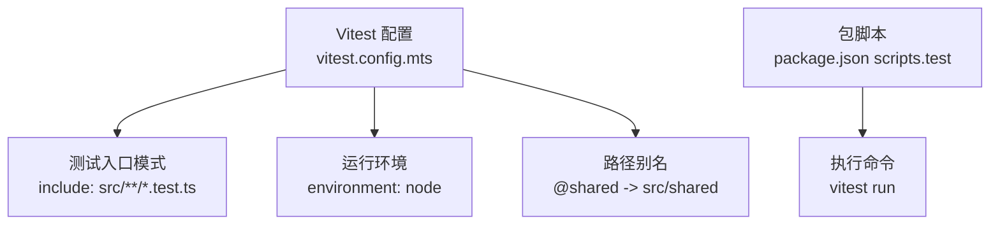
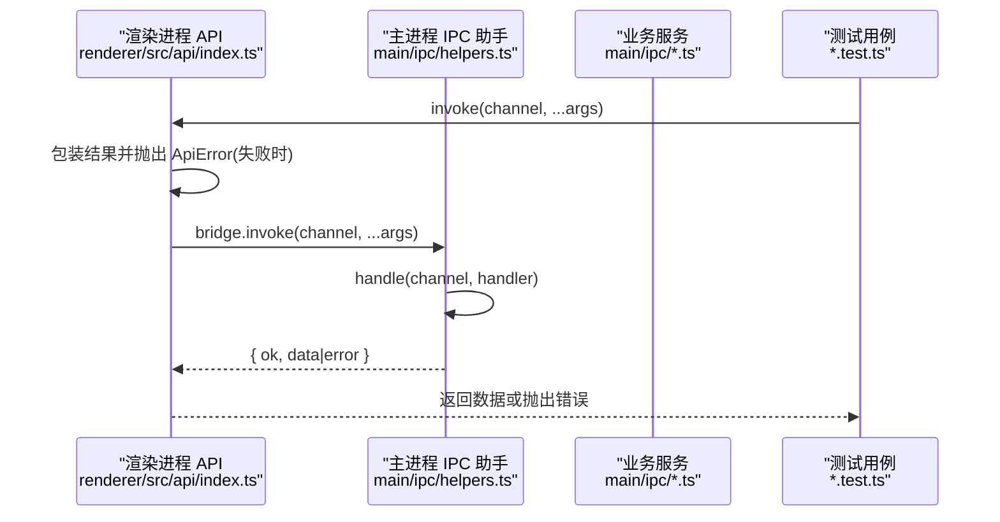
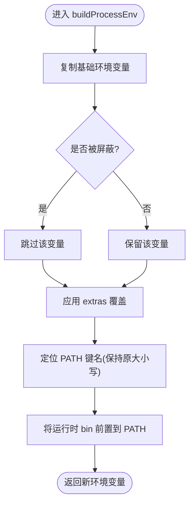
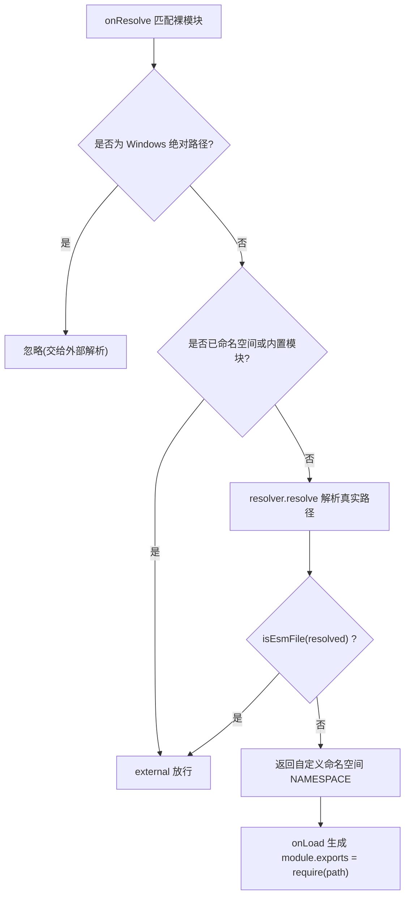
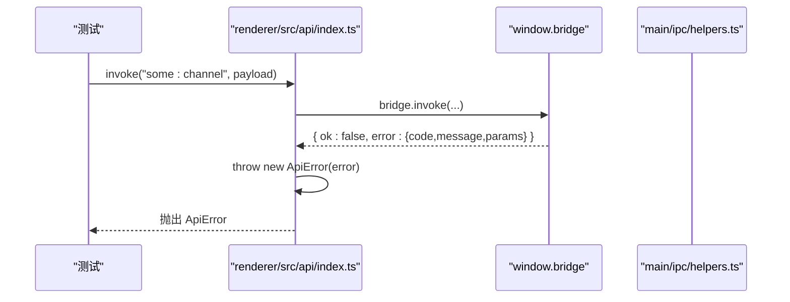
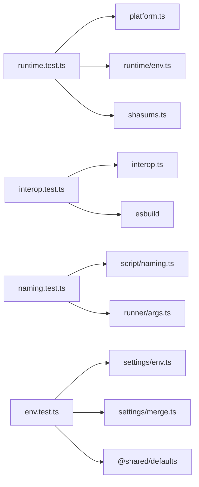

# 测试指南

<cite>
**本文引用的文件**   
- [vitest.config.mts](file://vitest.config.mts)
- [package.json](file://package.json)
- [interop.test.ts](file://src/main/services/runner/interop.test.ts)
- [runtime.test.ts](file://src/main/services/runtime/runtime.test.ts)
- [naming.test.ts](file://src/main/services/script/naming.test.ts)
- [env.test.ts](file://src/main/services/settings/env.test.ts)
- [interop.ts](file://src/main/services/runner/interop.ts)
- [env.ts](file://src/main/services/runtime/env.ts)
- [platform.ts](file://src/main/services/runtime/platform.ts)
- [shasums.ts](file://src/main/services/runtime/shasums.ts)
- [env.ts](file://src/main/services/settings/env.ts)
- [merge.ts](file://src/main/services/settings/merge.ts)
- [helpers.ts](file://src/main/ipc/helpers.ts)
- [index.ts](file://src/renderer/src/api/index.ts)
- [index.ts](file://src/main/ipc/index.ts)
</cite>

## 目录
1. [简介](#简介)
2. [项目结构](#项目结构)
3. [核心组件](#核心组件)
4. [架构总览](#架构总览)
5. [详细组件分析](#详细组件分析)
6. [依赖关系分析](#依赖关系分析)
7. [性能与稳定性考量](#性能与稳定性考量)
8. [故障排查指南](#故障排查指南)
9. [结论](#结论)
10. [附录](#附录)

## 简介
本指南面向 Script Box 项目的测试策略，聚焦基于 Vitest 的测试框架配置、测试组织方式、单元测试最佳实践（Mock、异步、断言）、集成测试方法（IPC 通信与文件系统），以及覆盖率与持续集成建议。文档同时提供常见测试场景示例路径与调试技巧，帮助读者快速建立稳定、可维护的测试体系。

## 项目结构
本项目采用 Electron + Vite 的工程结构，测试统一使用 Vitest，并通过别名 @shared 访问共享类型与默认值。测试文件以 .test.ts 命名并按功能模块就近放置。

图表来源
- [vitest.config.mts:4-11](file://vitest.config.mts#L4-L11)
- [package.json:15-30](file://package.json#L15-L30)

章节来源
- [vitest.config.mts:1-12](file://vitest.config.mts#L1-L12)
- [package.json:15-30](file://package.json#L15-L30)

## 核心组件
- 测试框架与配置：Vitest，Node 环境，包含所有 src/**/*.test.ts，并配置 @shared 别名。
- 现有测试覆盖范围：
  - 运行时平台与环境变量构建
  - CommonJS/ESM 互操作插件
  - 脚本命名与参数解析
  - 网络代理与设置合并

章节来源
- [vitest.config.mts:4-11](file://vitest.config.mts#L4-L11)
- [runtime.test.ts:1-74](file://src/main/services/runtime/runtime.test.ts#L1-L74)
- [interop.test.ts:1-69](file://src/main/services/runner/interop.test.ts#L1-L69)
- [naming.test.ts:1-36](file://src/main/services/script/naming.test.ts#L1-L36)
- [env.test.ts:1-80](file://src/main/services/settings/env.test.ts#L1-L80)

## 架构总览
下图展示从渲染进程到主进程的 IPC 调用链，以及测试中如何验证该链路的行为。

图表来源
- [index.ts:1-37](file://src/renderer/src/api/index.ts#L1-L37)
- [helpers.ts:1-46](file://src/main/ipc/helpers.ts#L1-L46)

章节来源
- [index.ts:1-37](file://src/renderer/src/api/index.ts#L1-L37)
- [helpers.ts:1-46](file://src/main/ipc/helpers.ts#L1-L46)

## 详细组件分析

### 运行时与平台工具测试（Node 分发、环境变量）
- 目标：验证 Node 分发目标映射、归档文件名、二进制路径、npm CLI 路径、版本校验与排序、SHASUMS 解析、子进程环境变量构建。
- 关键点：
  - getDistTarget 对平台/架构映射与异常分支
  - archiveFileName/nodeBinary/binDir/npmCli 的路径构造
  - isValidVersion/compareVersionsDesc 的版本处理
  - parseShasums 对文本/二进制模式的兼容
  - buildProcessEnv 过滤 Electron/npm/VITE 等干扰变量，保留 PATH 原始大小写，并将运行时 bin 前置

图表来源
- [env.ts:1-28](file://src/main/services/runtime/env.ts#L1-L28)

章节来源
- [runtime.test.ts:7-24](file://src/main/services/runtime/runtime.test.ts#L7-L24)
- [runtime.test.ts:26-35](file://src/main/services/runtime/runtime.test.ts#L26-L35)
- [runtime.test.ts:37-45](file://src/main/services/runtime/runtime.test.ts#L37-L45)
- [runtime.test.ts:47-56](file://src/main/services/runtime/runtime.test.ts#L47-L56)
- [runtime.test.ts:58-73](file://src/main/services/runtime/runtime.test.ts#L58-L73)
- [platform.ts:20-60](file://src/main/services/runtime/platform.ts#L20-L60)
- [shasums.ts:5-15](file://src/main/services/runtime/shasums.ts#L5-L15)
- [env.ts:10-27](file://src/main/services/runtime/env.ts#L10-L27)

### CommonJS/ESM 互操作插件测试（esbuild 集成）
- 目标：确保在 ESM 输出下能正确导入 CommonJS 包的具名/默认导出，且内置模块与纯 ESM 包保持原生 import。
- 关键点：
  - isEsmFile 根据扩展名与 package.json type 判断
  - cjsInteropPlugin 通过 createRequire 解析 CJS，并以 namespace 注入 require 包装
  - 测试通过 esbuild 构建后实际执行产物，断言输出数组

图表来源
- [interop.ts:11-34](file://src/main/services/runner/interop.ts#L11-L34)
- [interop.ts:42-70](file://src/main/services/runner/interop.ts#L42-L70)

章节来源
- [interop.test.ts:19-32](file://src/main/services/runner/interop.test.ts#L19-L32)
- [interop.test.ts:34-41](file://src/main/services/runner/interop.test.ts#L34-L41)
- [interop.test.ts:43-68](file://src/main/services/runner/interop.test.ts#L43-L68)
- [interop.ts:26-34](file://src/main/services/runner/interop.ts#L26-L34)
- [interop.ts:42-70](file://src/main/services/runner/interop.ts#L42-L70)

### 脚本命名与参数解析测试
- 目标：验证脚本名称合法性、语言推断、唯一名生成与命令行参数解析。
- 关键点：
  - isValidScriptName 的正则规则与边界情况
  - languageOf 基于扩展名的语言识别
  - uniqueName 冲突时的计数器追加
  - parseArgs 支持空白分割、引号与转义

章节来源
- [naming.test.ts:5-24](file://src/main/services/script/naming.test.ts#L5-L24)
- [naming.test.ts:26-35](file://src/main/services/script/naming.test.ts#L26-L35)

### 网络代理与设置合并测试
- 目标：验证代理解析、环境变量映射、Electron 代理配置转换与深合并行为。
- 关键点：
  - resolveProxy 启用状态与 http/https/noProxy 推导
  - buildNetworkEnv 将 registry/proxy/mirrors 映射为 npm 与系统级环境变量
  - toElectronProxyConfig 转换为 fixed_servers 模式与 bypass 列表
  - deepMerge 递归合并对象、替换数组、忽略 undefined

图表来源
- [env.ts:1-73](file://src/main/services/settings/env.ts#L1-L73)

章节来源
- [env.test.ts:11-21](file://src/main/services/settings/env.test.ts#L11-L21)
- [env.test.ts:23-47](file://src/main/services/settings/env.test.ts#L23-L47)
- [env.test.ts:49-61](file://src/main/services/settings/env.test.ts#L49-L61)
- [env.test.ts:63-79](file://src/main/services/settings/env.test.ts#L63-L79)
- [merge.ts:3-21](file://src/main/services/settings/merge.ts#L3-L21)

### IPC 通信与错误传播（集成测试要点）
- 渲染端 API 封装：invoke/send/on 统一桥接 window.bridge，并在失败时抛出 ApiError。
- 主进程 IPC 助手：handle 统一捕获异常并序列化错误；listen/broadcast 负责事件监听与广播。
- 集成测试建议：
  - 使用 vitest 的 mock 能力模拟 window.bridge.invoke，避免启动完整 Electron 进程
  - 断言成功路径返回数据，失败路径抛出 ApiError 且携带 code/params
  - 结合 ipcMain.handle 注册通道，验证主进程侧的错误序列化与返回值结构

图表来源
- [index.ts:1-37](file://src/renderer/src/api/index.ts#L1-L37)
- [helpers.ts:17-28](file://src/main/ipc/helpers.ts#L17-L28)

章节来源
- [index.ts:1-37](file://src/renderer/src/api/index.ts#L1-L37)
- [helpers.ts:1-46](file://src/main/ipc/helpers.ts#L1-L46)

## 依赖关系分析
- 测试与源码耦合点：
  - runtime.test.ts 依赖 platform.ts、env.ts、shasums.ts
  - interop.test.ts 依赖 interop.ts 与 esbuild
  - naming.test.ts 依赖 runner/args 与 script/naming
  - env.test.ts 依赖 settings/env.ts、settings/merge.ts 与 @shared/types/defaults
- 外部依赖：
  - esbuild（构建与执行产物）
  - electron（IPC 基础设施，测试中通常通过 mock 隔离）

图表来源
- [runtime.test.ts:1-74](file://src/main/services/runtime/runtime.test.ts#L1-L74)
- [interop.test.ts:1-69](file://src/main/services/runner/interop.test.ts#L1-L69)
- [naming.test.ts:1-36](file://src/main/services/script/naming.test.ts#L1-L36)
- [env.test.ts:1-80](file://src/main/services/settings/env.test.ts#L1-L80)

章节来源
- [runtime.test.ts:1-74](file://src/main/services/runtime/runtime.test.ts#L1-L74)
- [interop.test.ts:1-69](file://src/main/services/runner/interop.test.ts#L1-L69)
- [naming.test.ts:1-36](file://src/main/services/script/naming.test.ts#L1-L36)
- [env.test.ts:1-80](file://src/main/services/settings/env.test.ts#L1-L80)

## 性能与稳定性考量
- 测试隔离：
  - 使用临时目录（如 mkdtemp）与 afterAll 清理，避免跨用例污染（参考 interop.test.ts）。
- 异步测试：
  - 对 fs/promises、esbuild、child_process 等异步 API，使用 async/await 与 Vitest 的 expect 自动等待。
- 断言策略：
  - 优先使用 toEqual/toMatchObject 进行结构化比较；对错误对象使用 toThrow 与具体字段断言。
- 覆盖率建议：
  - 关键路径（平台映射、环境变量构建、代理解析、ESM/CJS 互操作）应达到高覆盖率（建议 >90%）。
  - 对异常分支（不支持的平台/架构、无效版本、空代理）必须覆盖。
- 持续集成：
  - 在 CI 中执行 pnpm test（即 vitest run），并开启覆盖率报告（例如 --coverage）。
  - 缓存依赖与 esbuild 构建产物，缩短 CI 时间。

[本节为通用指导，不直接分析具体文件]

## 故障排查指南
- Vitest 找不到测试文件：
  - 确认 include 配置为 src/**/*.test.ts，并确保测试文件位于 src 目录下。
- 别名 @shared 无法解析：
  - 检查 vitest.config.mts 中的 alias 配置是否正确指向 src/shared。
- IPC 测试失败：
  - 渲染端 API 会抛出 ApiError，断言时应捕获并校验 error.code 与 error.params。
  - 主进程 handle 会将异常序列化为 { ok:false, error }，确保测试断言该结构。
- 临时目录未清理：
  - 确保 in beforeAll 创建、afterAll 删除，避免磁盘占用与路径冲突。

章节来源
- [vitest.config.mts:4-11](file://vitest.config.mts#L4-L11)
- [helpers.ts:17-28](file://src/main/ipc/helpers.ts#L17-L28)
- [index.ts:19-27](file://src/renderer/src/api/index.ts#L19-L27)
- [interop.test.ts:19-32](file://src/main/services/runner/interop.test.ts#L19-L32)

## 结论
本项目以 Vitest 为核心测试框架，围绕运行时平台、ESM/CJS 互操作、脚本命名与参数解析、网络代理与设置合并等关键路径建立了清晰的测试基线。建议在后续开发中：
- 延续按功能模块就近放置 .test.ts 的组织方式
- 对 IPC 与文件系统交互采用 Mock 与临时目录策略
- 在 CI 中启用覆盖率阈值，保障关键路径质量

[本节为总结性内容，不直接分析具体文件]

## 附录
- 常用命令
  - 运行测试：pnpm test
  - 类型检查：pnpm typecheck
  - 代码检查：pnpm lint / pnpm lint:fix
- 测试编写清单
  - 是否覆盖正常路径与异常分支
  - 是否对异步 API 使用 await 与合理超时
  - 是否对 IPC 错误进行断言（ApiError.code/params）
  - 是否清理临时文件与资源
  - 是否对关键函数添加覆盖率统计

章节来源
- [package.json:15-30](file://package.json#L15-L30)