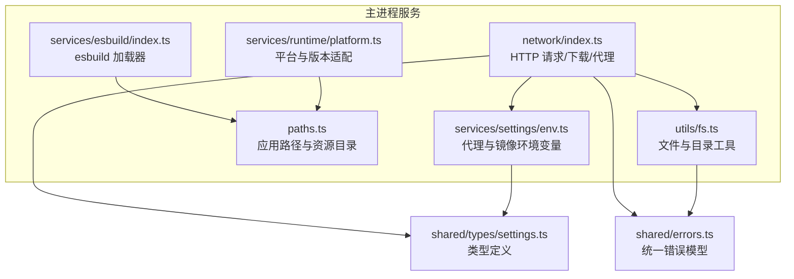
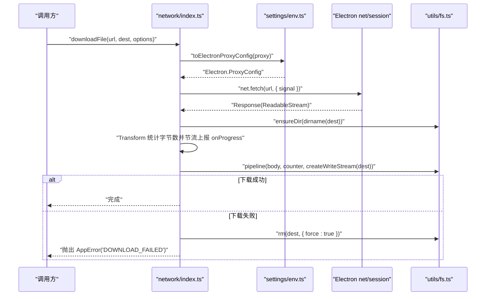
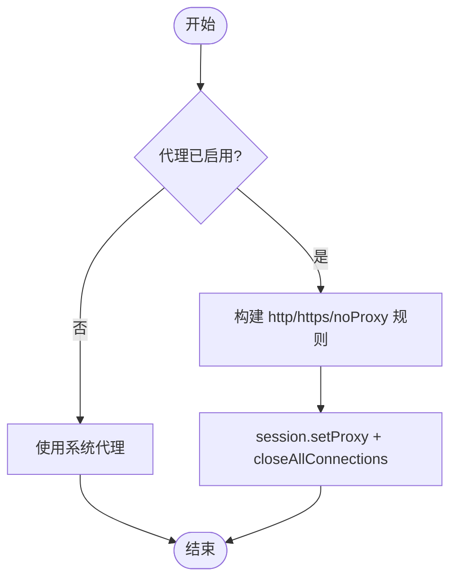
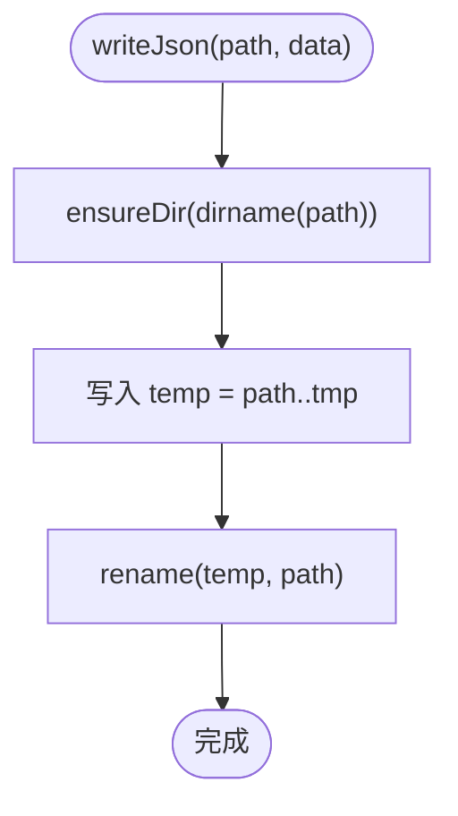
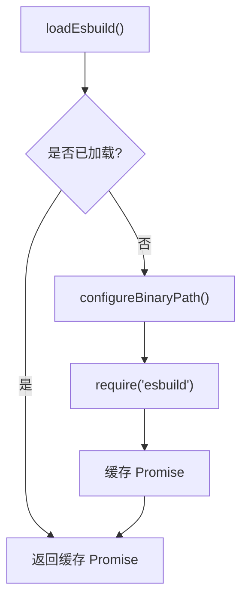
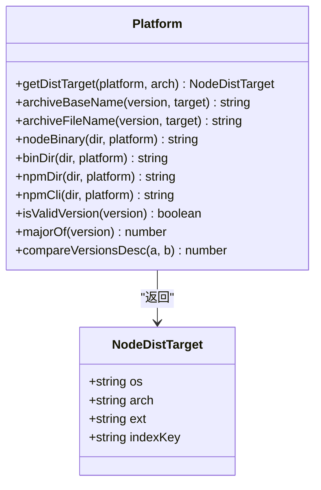
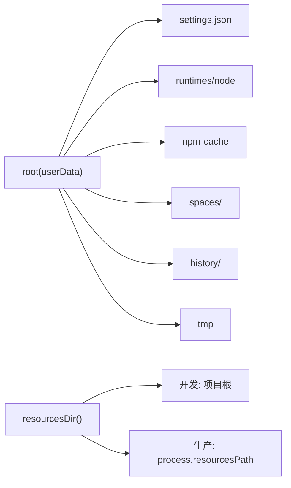
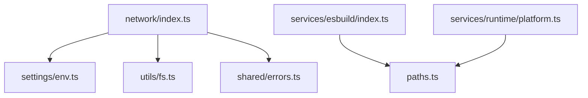

# 网络与工具服务

<cite>
**本文引用的文件**   
- [src/main/services/network/index.ts](file://src/main/services/network/index.ts)
- [src/main/utils/fs.ts](file://src/main/utils/fs.ts)
- [src/main/services/esbuild/index.ts](file://src/main/services/esbuild/index.ts)
- [src/main/services/runtime/platform.ts](file://src/main/services/runtime/platform.ts)
- [src/main/paths.ts](file://src/main/paths.ts)
- [src/main/services/settings/env.ts](file://src/main/services/settings/env.ts)
- [src/shared/types/settings.ts](file://src/shared/types/settings.ts)
- [src/shared/errors.ts](file://src/shared/errors.ts)
</cite>

## 目录
1. [简介](#简介)
2. [项目结构](#项目结构)
3. [核心组件](#核心组件)
4. [架构总览](#架构总览)
5. [详细组件分析](#详细组件分析)
6. [依赖关系分析](#依赖关系分析)
7. [性能考量](#性能考量)
8. [故障排查指南](#故障排查指南)
9. [结论](#结论)
10. [附录：使用示例与扩展方法](#附录使用示例与扩展方法)

## 简介
本技术文档聚焦于主进程中的“网络与工具服务”，覆盖以下关键能力：
- HTTP 请求封装、代理配置与连接测试
- 文件系统操作工具函数（路径处理、文件读写、目录管理）
- esbuild 集成，用于 TypeScript 转译与打包优化
- 平台适配层与跨平台兼容性处理
- 工具函数的使用示例与扩展建议

该模块以 Electron 主进程为运行环境，围绕网络访问、本地文件 I/O、构建工具与平台差异进行抽象，提供稳定、可复用且易于扩展的服务接口。

## 项目结构
与本文相关的代码主要分布在以下位置：
- 网络服务：src/main/services/network/index.ts
- 文件系统工具：src/main/utils/fs.ts
- esbuild 集成：src/main/services/esbuild/index.ts
- 平台适配：src/main/services/runtime/platform.ts
- 路径与资源目录：src/main/paths.ts
- 设置与环境变量转换：src/main/services/settings/env.ts
- 类型定义与错误模型：src/shared/types/settings.ts、src/shared/errors.ts

**图表来源**
- [src/main/services/network/index.ts:1-81](file://src/main/services/network/index.ts#L1-L81)
- [src/main/utils/fs.ts:1-35](file://src/main/utils/fs.ts#L1-L35)
- [src/main/services/esbuild/index.ts:1-28](file://src/main/services/esbuild/index.ts#L1-L28)
- [src/main/services/runtime/platform.ts:1-83](file://src/main/services/runtime/platform.ts#L1-L83)
- [src/main/paths.ts:1-62](file://src/main/paths.ts#L1-L62)
- [src/main/services/settings/env.ts:1-73](file://src/main/services/settings/env.ts#L1-L73)
- [src/shared/types/settings.ts:1-58](file://src/shared/types/settings.ts#L1-L58)
- [src/shared/errors.ts:1-41](file://src/shared/errors.ts#L1-L41)

**章节来源**
- [src/main/services/network/index.ts:1-81](file://src/main/services/network/index.ts#L1-L81)
- [src/main/utils/fs.ts:1-35](file://src/main/utils/fs.ts#L1-L35)
- [src/main/services/esbuild/index.ts:1-28](file://src/main/services/esbuild/index.ts#L1-L28)
- [src/main/services/runtime/platform.ts:1-83](file://src/main/services/runtime/platform.ts#L1-L83)
- [src/main/paths.ts:1-62](file://src/main/paths.ts#L1-L62)
- [src/main/services/settings/env.ts:1-73](file://src/main/services/settings/env.ts#L1-L73)
- [src/shared/types/settings.ts:1-58](file://src/shared/types/settings.ts#L1-L58)
- [src/shared/errors.ts:1-41](file://src/shared/errors.ts#L1-L41)

## 核心组件
- 网络服务
  - 通过 Electron net 模块发起 HTTP 请求，封装文本与 JSON 获取、带进度回调的文件下载、连接测试等能力。
  - 支持将全局代理应用到 Electron 会话，并关闭已有连接以确保生效。
- 文件系统工具
  - 提供存在性检查、目录创建、JSON 安全读写等基础能力；写操作采用临时文件+重命名策略保证原子性。
- esbuild 集成
  - 懒加载 esbuild，自动定位 unpacked 二进制路径，避免在 asar 内执行原生二进制的问题。
- 平台适配层
  - 根据操作系统与 CPU 架构映射 Node.js 发行版目标、压缩包名、二进制路径、npm 路径等。
- 路径与资源目录
  - 集中管理用户数据目录、脚本空间、历史记录、临时目录以及打包后的资源目录。
- 设置与环境变量
  - 将网络设置转换为 Electron 代理配置，并为 npm 与脚本注入代理、镜像与自定义环境变量。

**章节来源**
- [src/main/services/network/index.ts:1-81](file://src/main/services/network/index.ts#L1-L81)
- [src/main/utils/fs.ts:1-35](file://src/main/utils/fs.ts#L1-L35)
- [src/main/services/esbuild/index.ts:1-28](file://src/main/services/esbuild/index.ts#L1-L28)
- [src/main/services/runtime/platform.ts:1-83](file://src/main/services/runtime/platform.ts#L1-L83)
- [src/main/paths.ts:1-62](file://src/main/paths.ts#L1-L62)
- [src/main/services/settings/env.ts:1-73](file://src/main/services/settings/env.ts#L1-L73)

## 架构总览
下图展示了网络请求从调用方到 Electron net 的完整流程，包括代理配置、进度上报与异常清理。

**图表来源**
- [src/main/services/network/index.ts:34-64](file://src/main/services/network/index.ts#L34-L64)
- [src/main/services/settings/env.ts:53-72](file://src/main/services/settings/env.ts#L53-L72)
- [src/main/utils/fs.ts:14-17](file://src/main/utils/fs.ts#L14-L17)

## 详细组件分析

### 网络服务：HTTP 请求封装、代理配置与连接测试
- 功能要点
  - applyProxy：将 ProxySettings 转换为 Electron 代理规则并应用到默认会话，随后关闭所有连接确保立即生效。
  - fetchText/fetchJson：基于 Electron net.fetch 的轻量封装，统一错误码与状态检查。
  - downloadFile：流式下载，按块统计已接收字节，节流触发 onProgress；失败时删除不完整文件。
  - testConnection：GET 探测指定 URL，返回 ok、status、elapsed 与可选 error 信息。
- 代理配置
  - toElectronProxyConfig：将启用的 http/https/noProxy 转为 Electron 固定服务器模式规则，并包含本地绕过。
  - resolveProxy：规范化空 https 回退到 http，过滤无效条目。
- 错误处理
  - 非 2xx 响应或无 body 时抛出 AppError('DOWNLOAD_FAILED')，附带 url 与 status。
- 重试机制说明
  - 当前实现未内置重试逻辑；可在调用方对 testConnection 或 fetch* 进行指数退避重试。

**图表来源**
- [src/main/services/settings/env.ts:7-15](file://src/main/services/settings/env.ts#L7-L15)
- [src/main/services/settings/env.ts:53-72](file://src/main/services/settings/env.ts#L53-L72)
- [src/main/services/network/index.ts:13-16](file://src/main/services/network/index.ts#L13-L16)

**章节来源**
- [src/main/services/network/index.ts:1-81](file://src/main/services/network/index.ts#L1-L81)
- [src/main/services/settings/env.ts:1-73](file://src/main/services/settings/env.ts#L1-L73)
- [src/shared/types/settings.ts:9-25](file://src/shared/types/settings.ts#L9-L25)
- [src/shared/errors.ts:25-34](file://src/shared/errors.ts#L25-L34)

### 文件系统工具：路径处理、文件读写与目录管理
- 能力概览
  - exists：检测路径是否存在。
  - ensureDir：递归创建目录并返回路径。
  - readJson：读取 JSON，失败时返回 fallback。
  - writeJson：先写入临时文件再原子重命名为目标路径，避免崩溃导致半写文件。
- 设计要点
  - 写操作的原子性通过 PID 后缀临时文件 + rename 实现。
  - 目录创建使用递归模式，简化上层调用。
- 复杂度
  - 时间复杂度取决于底层 I/O；空间复杂度与文件大小相关（流式场景由调用方控制）。

**图表来源**
- [src/main/utils/fs.ts:28-34](file://src/main/utils/fs.ts#L28-L34)
- [src/main/utils/fs.ts:14-17](file://src/main/utils/fs.ts#L14-L17)

**章节来源**
- [src/main/utils/fs.ts:1-35](file://src/main/utils/fs.ts#L1-L35)

### esbuild 集成：TypeScript 转译与打包优化
- 关键点
  - 懒加载：首次调用 loadEsbuild 时才加载 esbuild，避免启动开销。
  - 二进制路径：当应用打包后，esbuild 原生二进制位于 app.asar.unpacked，需设置 ESBUILD_BINARY_PATH。
  - require 方式：通过 CommonJS require 加载，确保在 CJS main bundle 中解析正确。
- 适用场景
  - 在脚本构建管线中按需引入 esbuild，进行 TS/JS 转译、压缩与产物输出。

**图表来源**
- [src/main/services/esbuild/index.ts:8-27](file://src/main/services/esbuild/index.ts#L8-L27)

**章节来源**
- [src/main/services/esbuild/index.ts:1-28](file://src/main/services/esbuild/index.ts#L1-L28)
- [src/main/paths.ts:58-61](file://src/main/paths.ts#L58-L61)

### 平台适配层：跨平台兼容性与 Node 分发目标
- 能力概览
  - getDistTarget：根据 platform/arch 映射 Node 发行版的 os、arch、ext 与 indexKey。
  - archiveBaseName/archiveFileName：生成归档基础名与文件名。
  - nodeBinary/binDir/npmDir/npmCli：在不同平台下返回正确的二进制与 npm 路径。
  - isValidVersion/majorOf/compareVersionsDesc：版本号校验、主版本提取与降序比较。
- 设计要点
  - 针对 Windows/macOS/Linux 的路径差异进行分支处理。
  - 架构映射表 ARCH_MAP 统一不同 CPU 架构名称。

**图表来源**
- [src/main/services/runtime/platform.ts:3-8](file://src/main/services/runtime/platform.ts#L3-L8)
- [src/main/services/runtime/platform.ts:20-46](file://src/main/services/runtime/platform.ts#L20-L46)
- [src/main/services/runtime/platform.ts:62-82](file://src/main/services/runtime/platform.ts#L62-L82)

**章节来源**
- [src/main/services/runtime/platform.ts:1-83](file://src/main/services/runtime/platform.ts#L1-L83)

### 路径与资源目录：应用数据与资源定位
- 应用数据目录
  - root：用户数据根目录（userData）。
  - settings/runtimes/npmCache/spaces/history/temp：各业务子目录。
- 空间与历史路径
  - spacePaths：space.json、package.json、node_modules、scripts、build 等。
  - historyPaths：history 下的元数据与日志文件。
- 资源目录
  - resourcesDir：开发环境为项目根，生产环境为 process.resourcesPath。

**图表来源**
- [src/main/paths.ts:5-29](file://src/main/paths.ts#L5-L29)
- [src/main/paths.ts:40-56](file://src/main/paths.ts#L40-L56)
- [src/main/paths.ts:58-61](file://src/main/paths.ts#L58-L61)

**章节来源**
- [src/main/paths.ts:1-62](file://src/main/paths.ts#L1-L62)

## 依赖关系分析
- 模块耦合
  - network 依赖 settings/env 生成代理配置，依赖 fs 进行目录创建与临时文件清理，依赖 errors 抛出统一错误。
  - esbuild 依赖 paths 确定资源目录与二进制路径。
  - runtime/platform 独立性强，仅依赖路径拼接与字符串处理。
- 外部依赖
  - Electron net/session：网络与代理。
  - Node fs/promises、stream：文件与流式 I/O。
  - esbuild：构建工具。
- 潜在循环
  - 当前未见循环依赖；network 与 settings/env 单向依赖。

**图表来源**
- [src/main/services/network/index.ts:1-10](file://src/main/services/network/index.ts#L1-L10)
- [src/main/services/esbuild/index.ts:1-3](file://src/main/services/esbuild/index.ts#L1-L3)
- [src/main/services/runtime/platform.ts:1-2](file://src/main/services/runtime/platform.ts#L1-L2)

**章节来源**
- [src/main/services/network/index.ts:1-10](file://src/main/services/network/index.ts#L1-L10)
- [src/main/services/esbuild/index.ts:1-3](file://src/main/services/esbuild/index.ts#L1-L3)
- [src/main/services/runtime/platform.ts:1-2](file://src/main/services/runtime/platform.ts#L1-L2)

## 性能考量
- 网络下载
  - 使用 Readable.fromWeb 与 pipeline 进行流式传输，避免大文件内存占用。
  - Transform 节流 onProgress 上报频率（约 150ms），降低 UI 更新压力。
- 文件写入
  - writeJson 原子写入减少损坏风险；临时文件命名含 PID，避免并发冲突。
- esbuild 加载
  - 懒加载避免冷启动开销；仅在需要时加载原生二进制。
- 平台适配
  - 路径计算与字符串处理均为 O(1)，开销极低。

[本节为通用性能指导，不直接分析具体文件]

## 故障排查指南
- 下载失败
  - 现象：抛出 DOWNLOAD_FAILED，携带 url 与 status。
  - 排查：检查网络连通性、代理配置是否正确；确认服务端返回状态码。
  - 参考：[src/main/services/network/index.ts:34-37](file://src/main/services/network/index.ts#L34-L37)、[src/shared/errors.ts:25-34](file://src/shared/errors.ts#L25-L34)
- 代理不生效
  - 现象：请求不走代理或旧连接仍走直连。
  - 排查：确认 applyProxy 已调用；检查 toElectronProxyConfig 生成的 rules 与 bypass；必要时重启应用或重新建立会话。
  - 参考：[src/main/services/network/index.ts:13-16](file://src/main/services/network/index.ts#L13-L16)、[src/main/services/settings/env.ts:53-72](file://src/main/services/settings/env.ts#L53-L72)
- esbuild 无法运行
  - 现象：提示找不到 esbuild 二进制或 asar 内执行失败。
  - 排查：确认 ESBUILD_BINARY_PATH 已设置；检查 app.asar.unpacked 路径是否正确。
  - 参考：[src/main/services/esbuild/index.ts:8-16](file://src/main/services/esbuild/index.ts#L8-L16)
- 路径越界或非法 ID
  - 现象：构造空间或历史路径时报错。
  - 排查：ID 必须匹配 ID_PATTERN；避免包含路径分隔符或特殊字符。
  - 参考：[src/main/paths.ts:31-38](file://src/main/paths.ts#L31-L38)

**章节来源**
- [src/main/services/network/index.ts:34-37](file://src/main/services/network/index.ts#L34-L37)
- [src/main/services/network/index.ts:13-16](file://src/main/services/network/index.ts#L13-L16)
- [src/main/services/settings/env.ts:53-72](file://src/main/services/settings/env.ts#L53-L72)
- [src/main/services/esbuild/index.ts:8-16](file://src/main/services/esbuild/index.ts#L8-L16)
- [src/main/paths.ts:31-38](file://src/main/paths.ts#L31-L38)
- [src/shared/errors.ts:25-34](file://src/shared/errors.ts#L25-L34)

## 结论
本模块在主进程中提供了稳定的网络访问、文件 I/O、构建工具与平台适配能力。通过统一的错误模型、代理配置与路径管理，降低了上层业务复杂度，提升了跨平台一致性与可维护性。建议在调用方按需实现重试与超时控制，并结合 UI 展示下载进度与连接测试结果。

[本节为总结性内容，不直接分析具体文件]

## 附录：使用示例与扩展方法

- 网络请求与下载
  - 获取文本/JSON：调用 fetchText/fetchJson，传入 AbortSignal 支持取消。
  - 下载文件：调用 downloadFile，传入 onProgress 回调以显示进度；失败会自动清理目标文件。
  - 连接测试：调用 testConnection 进行连通性与延迟评估。
  - 代理设置：调用 applyProxy 使 Electron 全局流量走代理。
  - 参考路径：
    - [src/main/services/network/index.ts:18-27](file://src/main/services/network/index.ts#L18-L27)
    - [src/main/services/network/index.ts:34-64](file://src/main/services/network/index.ts#L34-L64)
    - [src/main/services/network/index.ts:66-80](file://src/main/services/network/index.ts#L66-L80)
    - [src/main/services/network/index.ts:13-16](file://src/main/services/network/index.ts#L13-L16)

- 文件系统工具
  - 判断存在：exists(path)
  - 创建目录：ensureDir(path)
  - 安全读写 JSON：readJson(path, fallback)/writeJson(path, data)
  - 参考路径：
    - [src/main/utils/fs.ts:4-17](file://src/main/utils/fs.ts#L4-L17)
    - [src/main/utils/fs.ts:19-34](file://src/main/utils/fs.ts#L19-L34)

- esbuild 集成
  - 懒加载：loadEsbuild()
  - 参考路径：
    - [src/main/services/esbuild/index.ts:18-27](file://src/main/services/esbuild/index.ts#L18-L27)

- 平台适配
  - 获取 Node 分发目标：getDistTarget(platform, arch)
  - 生成归档名：archiveBaseName/archiveFileName
  - 获取二进制与 npm 路径：nodeBinary/binDir/npmDir/npmCli
  - 版本号工具：isValidVersion/majorOf/compareVersionsDesc
  - 参考路径：
    - [src/main/services/runtime/platform.ts:20-46](file://src/main/services/runtime/platform.ts#L20-L46)
    - [src/main/services/runtime/platform.ts:62-82](file://src/main/services/runtime/platform.ts#L62-L82)

- 路径与资源
  - 应用数据目录：paths.root/settings/runtimes/npmCache/spaces/history/temp
  - 空间与历史路径：spacePaths/*、historyPaths/*
  - 资源目录：resourcesDir()
  - 参考路径：
    - [src/main/paths.ts:7-29](file://src/main/paths.ts#L7-L29)
    - [src/main/paths.ts:40-56](file://src/main/paths.ts#L40-L56)
    - [src/main/paths.ts:58-61](file://src/main/paths.ts#L58-L61)

- 扩展建议
  - 在网络层增加重试与指数退避，结合 testConnection 结果动态调整策略。
  - 为 downloadFile 增加断点续传与校验和验证（如 SHA256）。
  - 为 writeJson 增加并发锁，防止多进程同时写入同一文件。
  - 为 esbuild 暴露更多构建选项（如 sourcemap、minify、target）。

[本节为使用示例与扩展建议，不直接分析具体文件]