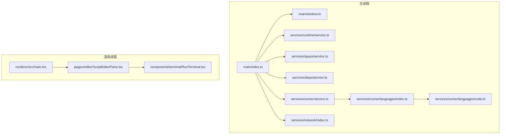
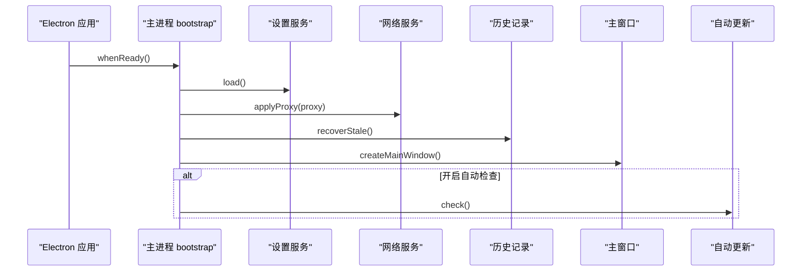
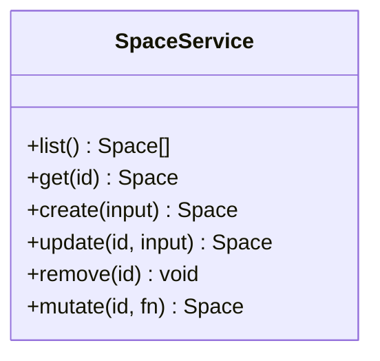
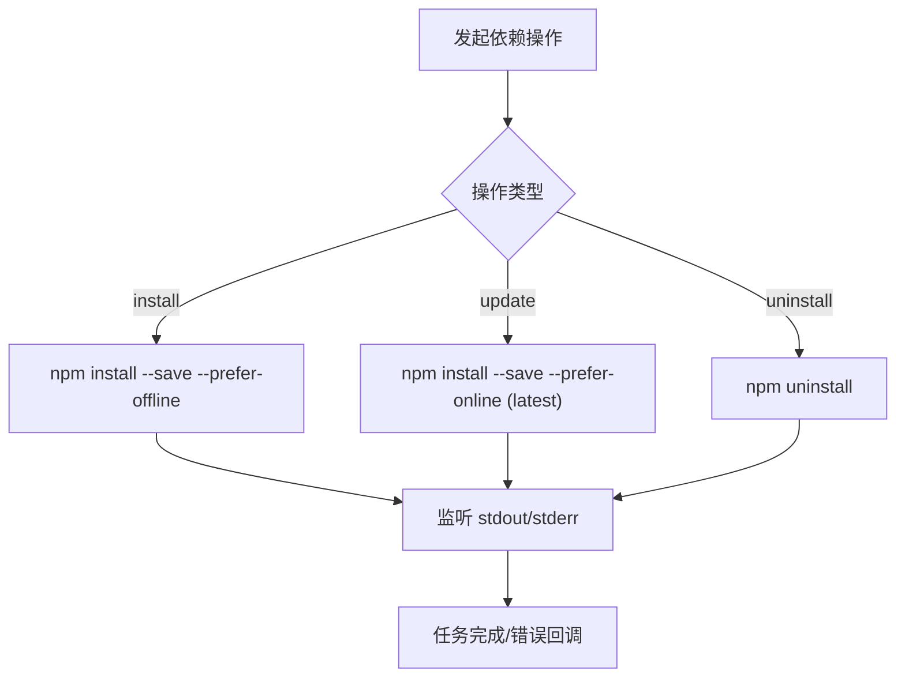
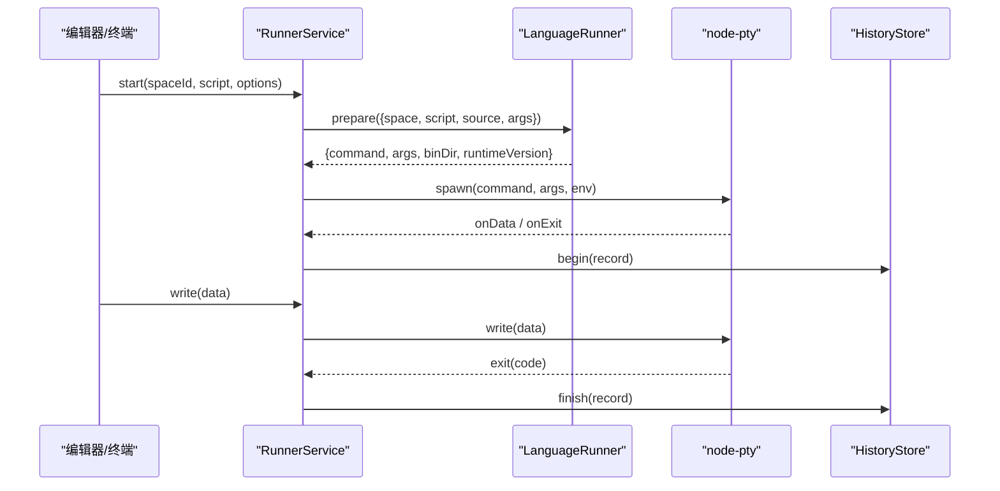
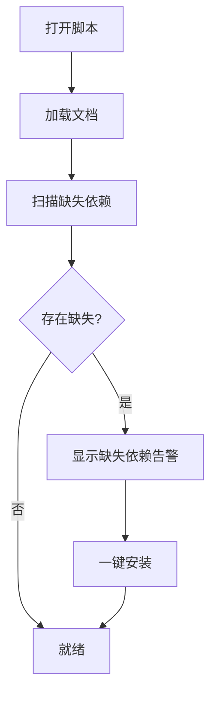
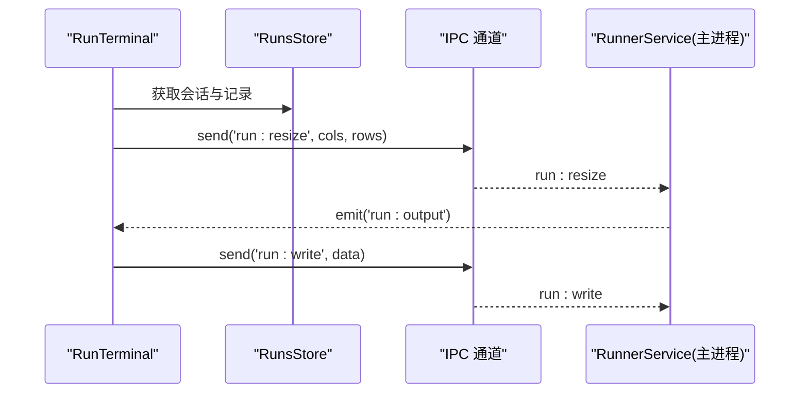
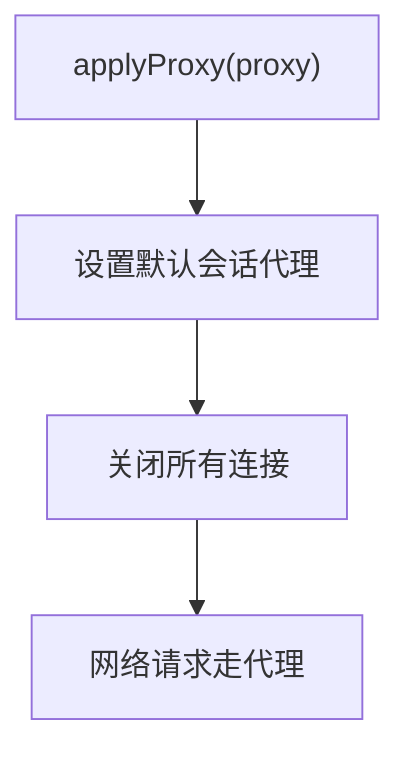

# 应用介绍与特性

<cite>
**本文引用的文件**   
- [README.md](file://README.md)
- [package.json](file://package.json)
- [src/main/index.ts](file://src/main/index.ts)
- [src/main/window.ts](file://src/main/window.ts)
- [src/renderer/src/main.tsx](file://src/renderer/src/main.tsx)
- [src/main/services/runtime/service.ts](file://src/main/services/runtime/service.ts)
- [src/main/services/space/service.ts](file://src/main/services/space/service.ts)
- [src/main/services/deps/service.ts](file://src/main/services/deps/service.ts)
- [src/main/services/network/index.ts](file://src/main/services/network/index.ts)
- [src/main/services/runner/service.ts](file://src/main/services/runner/service.ts)
- [src/main/services/runner/languages/node.ts](file://src/main/services/runner/languages/node.ts)
- [src/main/services/runner/languages/index.ts](file://src/main/services/runner/languages/index.ts)
- [src/renderer/src/pages/editor/ScriptEditorPane.tsx](file://src/renderer/src/pages/editor/ScriptEditorPane.tsx)
- [src/renderer/src/components/terminal/RunTerminal.tsx](file://src/renderer/src/components/terminal/RunTerminal.tsx)
</cite>

## 目录
1. [简介](#简介)
2. [项目结构](#项目结构)
3. [核心功能总览](#核心功能总览)
4. [架构总览](#架构总览)
5. [关键组件详解](#关键组件详解)
6. [依赖关系分析](#依赖关系分析)
7. [性能与体验要点](#性能与体验要点)
8. [常见问题排查](#常见问题排查)
9. [结语](#结语)

## 简介
Script Box 是一个开箱即用的脚本运行器：选中脚本就能运行，无需在电脑上预先安装 Node.js。它通过内置的运行时管理、隔离的运行空间、智能依赖管理、交互式终端、内置编辑器、网络配置和多语言支持，让开发者与运维人员快速编写、调试和运行脚本，同时保持环境干净、可复现。

核心价值
- 免安装运行时：应用内下载并校验 Node.js，支持多版本并存，按运行空间指定版本。
- 隔离运行空间：每个空间拥有独立的 package.json 与 node_modules，互不干扰。
- 智能依赖管理：一键扫描缺失依赖、批量安装/更新/卸载，共享 npm 缓存提升效率。
- 交互式终端：实时输出、支持输入交互、随时停止，支持参数与环境变量。
- 内置编辑器：本地 Monaco 编辑器，离线类型提示，快捷键保存与运行。
- 网络配置：Node 镜像、npm registry、代理等统一配置，适配国内网络。
- 多语言与主题：中英双语，亮色/暗色/跟随系统主题。
- 自动更新：从 GitHub Releases 获取新版本。

适用场景
- 日常脚本开发、自动化任务、CI/CD 辅助工具、临时数据处理、跨平台脚本分发与协作。

## 项目结构
本项目采用 Electron + React 架构，主进程负责系统能力与领域服务，渲染进程提供用户界面，preload 桥接两者并提供带类型的 API。

图示来源
- [src/main/index.ts:10-22](file://src/main/index.ts#L10-L22)
- [src/main/window.ts:6-43](file://src/main/window.ts#L6-L43)
- [src/main/services/runtime/service.ts:37-154](file://src/main/services/runtime/service.ts#L37-L154)
- [src/main/services/space/service.ts:10-90](file://src/main/services/space/service.ts#L10-L90)
- [src/main/services/deps/service.ts:23-137](file://src/main/services/deps/service.ts#L23-L137)
- [src/main/services/runner/service.ts:29-146](file://src/main/services/runner/service.ts#L29-L146)
- [src/main/services/runner/languages/index.ts:1-15](file://src/main/services/runner/languages/index.ts#L1-L15)
- [src/main/services/runner/languages/node.ts:1-20](file://src/main/services/runner/languages/node.ts#L1-L20)
- [src/main/services/network/index.ts:12-80](file://src/main/services/network/index.ts#L12-L80)
- [src/renderer/src/main.tsx:1-12](file://src/renderer/src/main.tsx#L1-L12)
- [src/renderer/src/pages/editor/ScriptEditorPane.tsx:24-78](file://src/renderer/src/pages/editor/ScriptEditorPane.tsx#L24-L78)
- [src/renderer/src/components/terminal/RunTerminal.tsx:1-45](file://src/renderer/src/components/terminal/RunTerminal.tsx#L1-L45)

章节来源
- [README.md:78-86](file://README.md#L78-L86)
- [package.json:1-14](file://package.json#L1-L14)

## 核心功能总览
- 免安装运行时管理
  - 用途：首次启动引导下载 LTS 版本 Node.js；支持多版本并存；按运行空间选择版本；下载后使用 SHASUMS256.txt 校验。
  - 优势：无需系统级安装 Node.js；版本隔离；安全可信。
- 隔离的运行空间
  - 用途：每个空间独立 package.json 与 node_modules；互不影响。
  - 优势：避免依赖冲突；便于团队协作与项目隔离。
- 智能依赖管理
  - 用途：按“包名@版本”安装/卸载/更新；扫描 import/require 缺失依赖；一键安装；共享 npm 缓存。
  - 优势：减少重复下载；降低出错概率；提升开发效率。
- 直接运行 JS/TS
  - 用途：支持 .js/.mjs/.cjs/.ts/.mts/.cts；TS 由 esbuild 转译（不做类型检查）。
  - 优势：开箱即用；快速验证逻辑。
- 交互式终端
  - 用途：基于 node-pty 与 xterm.js；实时输出；stdin 交互；随时停止；支持参数与环境变量；多脚本并发。
  - 优势：接近真实命令行体验；适合调试与自动化。
- 运行历史
  - 用途：记录退出码、耗时与完整日志；可回看。
  - 优势：问题回溯与审计。
- 内置编辑器
  - 用途：Monaco 编辑器；本地资源加载；内置 Node.js 类型；已安装依赖的类型定义自动注入；Ctrl/Cmd+S 保存，F5 运行。
  - 优势：离线可用；智能提示；高效编辑。
- 网络配置
  - 用途：Node 下载镜像、npm registry、HTTP/HTTPS 代理、二进制镜像环境变量；一键“国内预设”。
  - 优势：稳定下载；适配受限网络。
- 多语言与主题
  - 用途：中英双语；亮色/暗色/跟随系统主题。
  - 优势：更友好的用户体验。
- 自动更新
  - 用途：从 GitHub Releases 获取新版本。
  - 优势：持续获得新功能与安全修复。

章节来源
- [README.md:7-30](file://README.md#L7-L30)

## 架构总览
应用以 Electron 为主进程入口，初始化设置、代理、历史记录恢复，注册 IPC，创建主窗口，并在需要时触发自动更新。渲染进程使用 React 构建 UI，通过 preload 暴露类型安全的 window.api。

图示来源
- [src/main/index.ts:10-22](file://src/main/index.ts#L10-L22)
- [src/main/services/network/index.ts:12-16](file://src/main/services/network/index.ts#L12-L16)

章节来源
- [src/main/index.ts:10-22](file://src/main/index.ts#L10-L22)

## 关键组件详解

### 运行时管理（免安装 Node.js）
- 能力
  - 列出远程版本与已安装版本；解析到具体路径；后台安装、取消、删除；进度事件上报；SHASUMS256 校验。
- 关键点
  - 远程列表缓存；目标平台分发目标；归档解压；错误状态与取消处理。
- 典型流程
  - 选择版本 → 下载 → 校验 → 解压 → 完成。

图示来源
- [src/main/services/runtime/service.ts:45-154](file://src/main/services/runtime/service.ts#L45-L154)

章节来源
- [src/main/services/runtime/service.ts:37-154](file://src/main/services/runtime/service.ts#L37-L154)

### 运行空间（隔离环境）
- 能力
  - 列举、获取、创建、更新、删除空间；为每个空间生成 package.json、.npmrc 与欢迎脚本；元数据串行化读写保证一致性。
- 关键点
  - UUID 标识；scripts 索引；updatedAt 时间戳；删除时同步清理历史。
- 使用建议
  - 不同项目或用途使用不同空间；按需切换 Node 版本。

图示来源
- [src/main/services/space/service.ts:10-90](file://src/main/services/space/service.ts#L10-L90)

章节来源
- [src/main/services/space/service.ts:10-90](file://src/main/services/space/service.ts#L10-L90)

### 依赖管理（智能安装/更新/卸载）
- 能力
  - 列出依赖（含 devDependencies）；安装/更新/卸载；一键安装全部；扫描缺失依赖；收集类型库供编辑器使用。
- 关键点
  - 通过 spawnNpm 调用对应空间的 Node/npm；任务并发控制；stdout/stderr 实时输出；错误与关闭事件处理。
- 使用建议
  - 优先使用“一键安装缺失依赖”；批量更新时使用“更新”而非重新安装。

图示来源
- [src/main/services/deps/service.ts:49-133](file://src/main/services/deps/service.ts#L49-L133)

章节来源
- [src/main/services/deps/service.ts:23-137](file://src/main/services/deps/service.ts#L23-L137)

### 脚本运行器（交互式终端）
- 能力
  - 根据脚本扩展名选择语言运行器；准备命令与环境；启动 pty；实时输出；写入 stdin；调整终端尺寸；停止进程（SIGTERM/SIGKILL）；记录历史。
- 关键点
  - 合并网络环境变量与脚本自定义环境变量；颜色输出；多实例并发；退出码与耗时统计。
- 典型流程
  - 选择脚本 → 解析参数与环境 → 准备命令 → 启动 pty → 输出/交互 → 结束并记录。

图示来源
- [src/main/services/runner/service.ts:44-146](file://src/main/services/runner/service.ts#L44-L146)
- [src/main/services/runner/languages/index.ts:7-12](file://src/main/services/runner/languages/index.ts#L7-L12)
- [src/main/services/runner/languages/node.ts:6-18](file://src/main/services/runner/languages/node.ts#L6-L18)

章节来源
- [src/main/services/runner/service.ts:29-146](file://src/main/services/runner/service.ts#L29-L146)
- [src/main/services/runner/languages/index.ts:1-15](file://src/main/services/runner/languages/index.ts#L1-L15)
- [src/main/services/runner/languages/node.ts:1-20](file://src/main/services/runner/languages/node.ts#L1-L20)

### 内置编辑器与缺失依赖提示
- 能力
  - 打开/保存文档；显示缺失依赖告警；一键安装缺失依赖；集成 Monaco 编辑器；快捷键保存与运行。
- 关键点
  - 依赖任务忙闲状态；缺失依赖扫描结果驱动 UI 提示；错误信息格式化展示。

图示来源
- [src/renderer/src/pages/editor/ScriptEditorPane.tsx:24-78](file://src/renderer/src/pages/editor/ScriptEditorPane.tsx#L24-L78)

章节来源
- [src/renderer/src/pages/editor/ScriptEditorPane.tsx:24-78](file://src/renderer/src/pages/editor/ScriptEditorPane.tsx#L24-L78)

### 交互式终端（前端）
- 能力
  - 绑定单个运行会话；显示输出；转发键盘输入；响应终端尺寸变化；生命周期清理。
- 关键点
  - 通过 IPC 发送 run:write/run:resize；订阅 run:output；销毁时重置终端。

图示来源
- [src/renderer/src/components/terminal/RunTerminal.tsx:1-45](file://src/renderer/src/components/terminal/RunTerminal.tsx#L1-L45)

章节来源
- [src/renderer/src/components/terminal/RunTerminal.tsx:1-45](file://src/renderer/src/components/terminal/RunTerminal.tsx#L1-L45)

### 网络配置与代理
- 能力
  - 全局代理生效于下载、自动更新；提供 fetchText/fetchJson/downloadFile/testConnection 等网络工具；支持连接测试。
- 关键点
  - 应用代理后立即关闭所有连接；下载流式传输并上报进度；异常时清理临时文件。

图示来源
- [src/main/services/network/index.ts:12-16](file://src/main/services/network/index.ts#L12-L16)

章节来源
- [src/main/services/network/index.ts:12-80](file://src/main/services/network/index.ts#L12-L80)

## 依赖关系分析
- 主进程入口
  - 初始化设置、代理、历史记录恢复；注册 IPC；创建主窗口；可选自动更新；单实例锁；退出前停止所有运行。
- 窗口与渲染
  - 主窗口启用沙箱与上下文隔离；预加载脚本暴露 API；生产模式加载打包 UI，开发模式加载 dev URL。
- 渲染入口
  - React 根组件挂载；国际化与样式初始化。

图示来源
- [src/main/index.ts:10-54](file://src/main/index.ts#L10-L54)
- [src/main/window.ts:6-43](file://src/main/window.ts#L6-L43)
- [src/renderer/src/main.tsx:1-12](file://src/renderer/src/main.tsx#L1-L12)

章节来源
- [src/main/index.ts:10-54](file://src/main/index.ts#L10-L54)
- [src/main/window.ts:6-43](file://src/main/window.ts#L6-L43)
- [src/renderer/src/main.tsx:1-12](file://src/renderer/src/main.tsx#L1-L12)

## 性能与体验要点
- 运行时下载
  - 使用流式下载与进度上报；校验通过后解压；失败自动清理临时文件。
- 依赖安装
  - 共享 npm 缓存；优先离线安装；任务并发限制避免资源争用。
- 终端交互
  - 仅对活跃会话进行 resize 与写入；及时释放监听与 DOM 资源。
- 编辑器
  - 本地 Monaco 资源；类型定义按需注入；避免 CDN 依赖。
- 网络
  - 代理全局生效；连接测试帮助定位网络问题。

[本节为通用指导，不直接分析具体文件]

## 常见问题排查
- 首次运行无法下载 Node.js
  - 检查网络代理与镜像设置；使用“国内预设”；确认网络连接正常。
- 依赖安装失败
  - 查看依赖面板输出；确认 npm registry 可达；必要时切换到在线更新。
- 脚本运行无输出或卡住
  - 检查脚本是否阻塞；在终端中手动输入交互；必要时停止进程。
- 编辑器缺少类型提示
  - 确保依赖已安装；刷新类型库；确认 Node 版本与依赖匹配。
- 自动更新不可用
  - macOS 未签名时可能受限；检查网络与代理；参考 README 说明。

章节来源
- [README.md:31-42](file://README.md#L31-L42)

## 结语
Script Box 将“选脚本即运行”的理念落地，通过内置运行时、隔离空间、智能依赖、交互式终端与内置编辑器，显著降低脚本开发与调试门槛。配合完善的网络配置与多语言支持，既适合初学者快速上手，也能满足专业用户的复杂需求。

[本节为总结性内容，不直接分析具体文件]