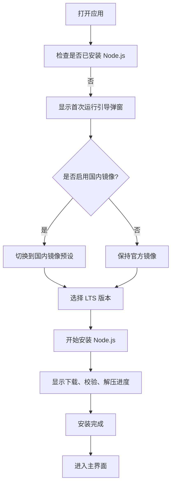
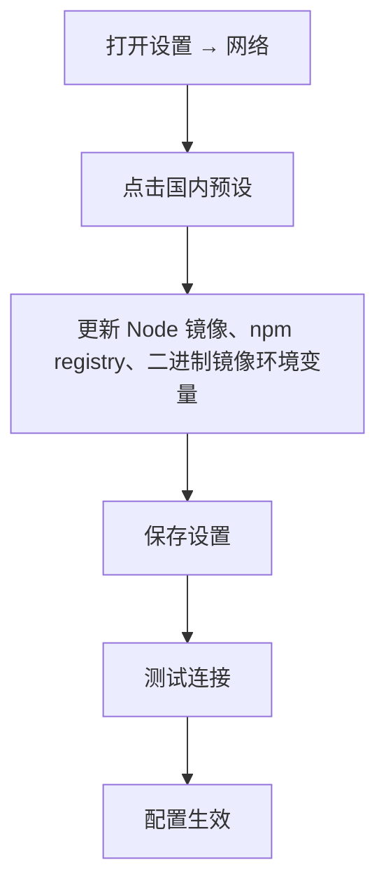
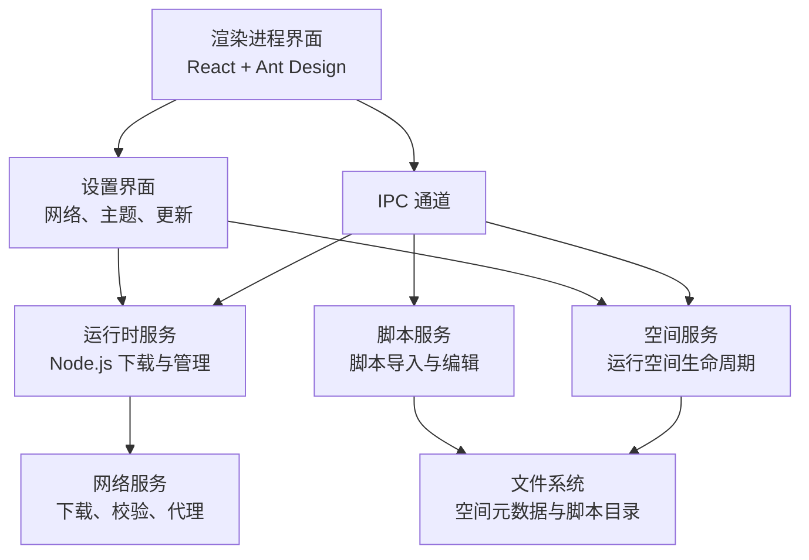

# 快速开始指南

<cite>
**本文引用的文件**   
- [README.md](file://README.md)
- [package.json](file://package.json)
- [FirstRunGuide.tsx](file://src/renderer/src/components/runtime/FirstRunGuide.tsx)
- [NetworkSection.tsx](file://src/renderer/src/pages/settings/NetworkSection.tsx)
- [presets.ts](file://src/renderer/src/utils/presets.ts)
- [defaults.ts](file://src/shared/defaults.ts)
- [runtime service.ts](file://src/main/services/runtime/service.ts)
- [space service.ts](file://src/main/services/space/service.ts)
- [script service.ts](file://src/main/services/script/service.ts)
- [errors.ts](file://src/shared/errors.ts)
</cite>

## 目录
1. [简介](#简介)
2. [5 分钟上手流程](#5-分钟上手流程)
3. [各平台安装说明](#各平台安装说明)
4. [国内网络环境配置](#国内网络环境配置)
5. [核心功能速览](#核心功能速览)
6. [常见问题与故障排除](#常见问题与故障排除)
7. [架构与数据流概览](#架构与数据流概览)
8. [结语](#结语)

## 简介
Script Box 是一个开箱即用的脚本运行器：你可以直接选中并运行脚本，无需在电脑上预先安装 Node.js。应用内置运行时管理、运行空间隔离、依赖扫描与一键安装、交互式终端、运行历史、内置编辑器以及网络镜像和代理设置，适合快速体验 Node.js 脚本开发、自动化任务和工具脚本。

本指南面向新用户，目标是在 5 分钟内完成下载安装、首次启动引导、下载 Node.js、创建运行空间、导入脚本、安装依赖并成功运行第一个脚本。

## 5 分钟上手流程
以下流程覆盖从安装到第一次运行的完整路径。每一步都尽量给出界面操作提示和注意事项。

### 第 1 步：下载安装
- 前往项目的 Releases 页面，根据操作系统下载对应安装包。
- Windows 用户下载 `.exe` 安装包；macOS 用户下载 `.dmg`；Linux 用户可下载 `.AppImage` 或 `.deb`。
- 安装完成后，打开 Script Box。

参考来源
- [README.md:31-41](file://README.md#L31-L41)

### 第 2 步：首次启动引导与下载 Node.js
- 首次启动时，如果未安装任何 Node.js 版本，应用会弹出“首次运行引导”弹窗。
- 在弹窗中，你可以选择是否使用国内镜像。国内用户建议开启“使用国内镜像”。
- 选择一个 LTS 版本的 Node.js，点击“安装”，等待进度条完成。
- 安装成功后，弹窗关闭，进入主界面。

关键行为说明
- 首次运行引导会在没有已安装运行时且未被手动关闭时显示。
- 支持切换国内镜像预设，自动更新 Node 下载源、npm registry 和二进制镜像环境变量。
- 安装过程包含下载、校验、解压等阶段，失败时会显示错误信息。

图示来源
- [FirstRunGuide.tsx:11-93](file://src/renderer/src/components/runtime/FirstRunGuide.tsx#L11-L93)
- [runtime service.ts:87-150](file://src/main/services/runtime/service.ts#L87-L150)

参考来源
- [FirstRunGuide.tsx:11-93](file://src/renderer/src/components/runtime/FirstRunGuide.tsx#L11-L93)
- [runtime service.ts:87-150](file://src/main/services/runtime/service.ts#L87-L150)

### 第 3 步：创建运行空间
- 在主界面中选择“运行空间”相关入口，新建一个空间。
- 为空间命名（例如“我的脚本空间”），可选择描述信息。
- 为该空间指定要使用的 Node.js 版本（如果尚未安装，请先回到首次运行引导安装）。
- 创建后，系统会为每个空间生成独立的 `package.json`、`node_modules` 和脚本目录，确保依赖互不影响。

关键点
- 每个空间拥有独立的工作目录和依赖缓存，避免不同项目之间的冲突。
- 空间元数据保存在应用数据目录中，可在“设置 → 关于”中打开数据目录查看。

参考来源
- [space service.ts:33-55](file://src/main/services/space/service.ts#L33-L55)
- [README.md:51-61](file://README.md#L51-L61)

### 第 4 步：导入脚本
- 在空间中导入脚本，支持拖拽文件或通过按钮选择本地脚本。
- 支持的脚本类型包括 `.js`、`.mjs`、`.cjs`、`.ts`、`.mts`、`.cts`。
- 导入后，脚本会出现在空间的脚本列表中，可直接在内置编辑器中打开。

关键点
- 导入逻辑会对文件名进行安全处理，避免非法字符。
- 不支持的文件类型会被拒绝并提示错误。

参考来源
- [script service.ts:60-76](file://src/main/services/script/service.ts#L60-L76)
- [README.md:15-15](file://README.md#L15-L15)

### 第 5 步：安装依赖
- 打开脚本后，如果编辑器上方提示缺少依赖，点击“一键安装”。
- 应用会扫描脚本中的 `import` 和 `require`，找出缺失的包，并在当前空间的 `node_modules` 中安装。
- 你也可以在“依赖”面板中手动安装，例如输入 `lodash@4`。

关键点
- 依赖扫描基于 esbuild 转译分析，不会执行类型检查。
- 所有空间共享 npm 缓存，同名同版本的包只下载一次，除非手动触发更新。

参考来源
- [README.md:11-14](file://README.md#L11-L14)
- [useMissingDeps.ts:1-31](file://src/renderer/src/pages/editor/useMissingDeps.ts#L1-L31)

### 第 6 步：运行脚本
- 按 `F5` 或点击“运行”按钮执行脚本。
- 输出实时显示在下方终端中，支持交互输入和随时停止。
- 可以配置命令行参数和环境变量，多个脚本可同时运行。
- 运行历史会记录退出码、耗时和完整日志，便于回看。

关键点
- 终端基于 node-pty 和 xterm.js，提供真实进程交互能力。
- 运行结果和日志保存在应用数据目录中。

参考来源
- [README.md:16-20](file://README.md#L16-L20)
- [README.md:51-61](file://README.md#L51-L61)

## 各平台安装说明
### Windows
- 下载 `script-box-x.y.z-setup.exe`。
- 双击安装包，按向导完成安装。
- 首次启动后，按引导安装 Node.js。

### macOS
- 下载 `script-box-x.y.z-arm64.dmg` 或 `script-box-x.y.z-x64.dmg`。
- 将应用拖入“应用程序”文件夹。
- 首次打开可能提示“无法验证开发者”，可在终端执行清理属性命令后再试。
- 注意：当前 macOS 安装包未签名，自动更新不保证可用。

### Linux
- 下载 `script-box-x.y.z-x86_64.AppImage` 或 `script-box-x.y.z-amd64.deb`。
- AppImage 需要赋予执行权限后运行；deb 可通过包管理器安装。
- 首次启动后，按引导安装 Node.js。

参考来源
- [README.md:31-41](file://README.md#L31-L41)

## 国内网络环境配置
如果你在国内网络环境下遇到下载缓慢或失败，建议启用国内镜像预设。

### 推荐配置
- 在“首次运行引导”弹窗中勾选“使用国内镜像”，或在“设置 → 网络”中点击“国内预设”。
- 该预设会自动设置：
  - Node 下载镜像为国内镜像地址。
  - npm registry 为国内镜像地址。
  - 常见二进制镜像环境变量（如 Electron、Sharp、Playwright 等）指向国内镜像。
- 如需自定义代理，可在“设置 → 网络”中启用 HTTP/HTTPS 代理，并配置 bypass 列表。

### 配置项说明
- Node 下载镜像：用于下载 Node.js 二进制包。
- npm registry：用于安装依赖时的包源。
- 代理设置：支持 HTTP、HTTPS 代理和 noProxy 列表。
- 二进制镜像环境变量：为第三方预编译包提供国内镜像地址。

图示来源
- [NetworkSection.tsx:38-41](file://src/renderer/src/pages/settings/NetworkSection.tsx#L38-L41)
- [presets.ts:14-24](file://src/renderer/src/utils/presets.ts#L14-L24)
- [defaults.ts:3-20](file://src/shared/defaults.ts#L3-L20)

参考来源
- [NetworkSection.tsx:38-41](file://src/renderer/src/pages/settings/NetworkSection.tsx#L38-L41)
- [presets.ts:14-24](file://src/renderer/src/utils/presets.ts#L14-L24)
- [defaults.ts:3-20](file://src/shared/defaults.ts#L3-L20)

## 核心功能速览
- 免安装运行时：应用内下载 Node.js，支持多版本并存，每个运行空间可单独指定版本。
- 运行空间隔离：每个空间有独立的 `package.json` 和 `node_modules`，依赖互不影响。
- 依赖管理：支持按包名安装、卸载、更新；自动扫描缺失依赖；共享 npm 缓存。
- 直接运行 JS/TS：支持多种后缀，TS 使用 esbuild 转译，不做类型检查。
- 交互式终端：基于 node-pty 和 xterm.js，支持实时输出、交互输入、停止运行。
- 运行历史：记录退出码、耗时和完整日志。
- 内置编辑器：基于 Monaco，离线智能提示，自动注入已安装依赖的类型定义。
- 网络配置：支持 Node 下载镜像、npm registry、HTTP/HTTPS 代理、二进制镜像环境变量，并提供一键国内预设。
- 中英双语与主题：支持亮色、暗色和跟随系统三种主题。
- 自动更新：从 GitHub Releases 获取新版本。

参考来源
- [README.md:7-29](file://README.md#L7-L29)

## 常见问题与故障排除
### 首次运行引导无法显示或无法安装 Node.js
- 现象：弹窗不出现，或安装过程中报错。
- 排查：
  - 确认已正确安装应用并首次启动。
  - 检查网络连接，必要时启用国内镜像或代理。
  - 查看错误信息，常见错误包括版本不存在、正在安装中、校验失败等。

参考来源
- [FirstRunGuide.tsx:21-51](file://src/renderer/src/components/runtime/FirstRunGuide.tsx#L21-L51)
- [runtime service.ts:87-150](file://src/main/services/runtime/service.ts#L87-L150)
- [errors.ts:1-40](file://src/shared/errors.ts#L1-L40)

### 找不到 Node.js 版本或运行时未安装
- 现象：运行脚本时报错“未找到 Node.js 版本”或“运行时未安装”。
- 排查：
  - 在“首次运行引导”中安装至少一个 LTS 版本。
  - 在空间设置中确认选择了已安装的 Node 版本。
  - 若版本正在安装中，请等待完成或取消后重试。

参考来源
- [runtime service.ts:74-81](file://src/main/services/runtime/service.ts#L74-L81)
- [errors.ts:1-40](file://src/shared/errors.ts#L1-L40)

### 校验失败或下载失败
- 现象：安装 Node.js 时提示校验失败或下载失败。
- 排查：
  - 检查网络连通性，尝试切换国内镜像或代理。
  - 删除临时文件后重试。
  - 查看错误详情，确认是否为校验和匹配失败。

参考来源
- [runtime service.ts:114-150](file://src/main/services/runtime/service.ts#L114-L150)
- [errors.ts:1-40](file://src/shared/errors.ts#L1-L40)

### 导入脚本失败或不被支持
- 现象：导入脚本时报错“不受支持的脚本”或“脚本不存在”。
- 排查：
  - 确认文件后缀为支持的脚本类型。
  - 检查文件名是否包含非法字符。
  - 确认脚本位于正确的运行空间目录下。

参考来源
- [script service.ts:60-76](file://src/main/services/script/service.ts#L60-L76)
- [errors.ts:1-40](file://src/shared/errors.ts#L1-L40)

### 依赖安装失败或缺失依赖检测不准确
- 现象：一键安装失败，或编辑器未检测到缺失依赖。
- 排查：
  - 检查 npm registry 和网络配置是否正确。
  - 清除缓存后重试。
  - 保存脚本内容后再次触发依赖扫描。

参考来源
- [README.md:11-14](file://README.md#L11-L14)
- [useMissingDeps.ts:1-31](file://src/renderer/src/pages/editor/useMissingDeps.ts#L1-L31)

## 架构与数据流概览
Script Box 采用 Electron 架构，主进程负责 IPC 处理和领域服务（设置、网络、运行时、空间、脚本、依赖、运行器、更新），渲染进程提供 React 界面。

图示来源
- [runtime service.ts:1-155](file://src/main/services/runtime/service.ts#L1-L155)
- [space service.ts:1-91](file://src/main/services/space/service.ts#L1-L91)
- [script service.ts:1-110](file://src/main/services/script/service.ts#L1-L110)
- [NetworkSection.tsx:1-95](file://src/renderer/src/pages/settings/NetworkSection.tsx#L1-L95)

## 结语
通过以上步骤，你应该已经完成了 Script Box 的安装、首次运行引导、Node.js 下载、运行空间创建、脚本导入、依赖安装和脚本运行。如果遇到网络问题，优先启用国内镜像预设；如果依赖安装失败，检查 npm registry 和代理设置。更多高级用法可以在“设置”和“运行空间”中探索。