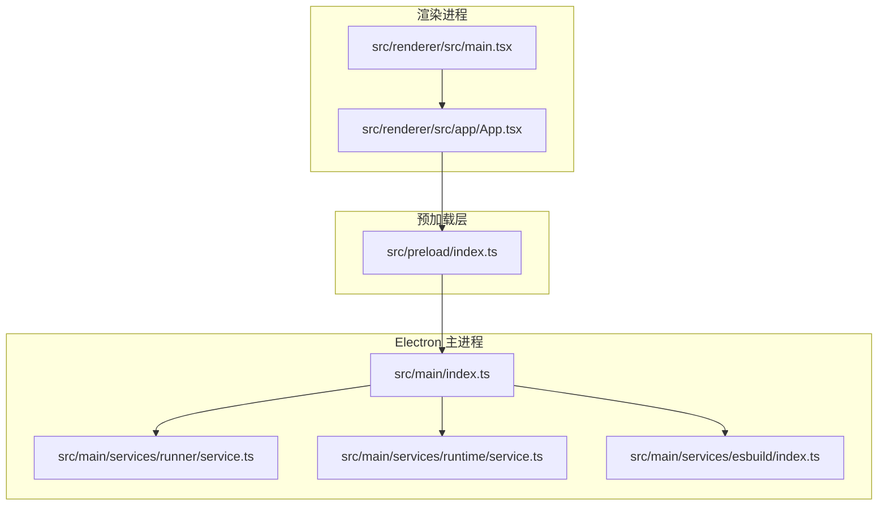
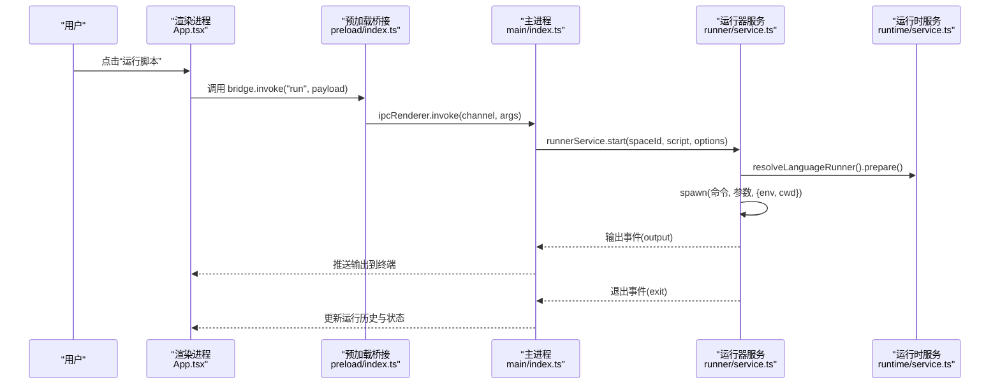
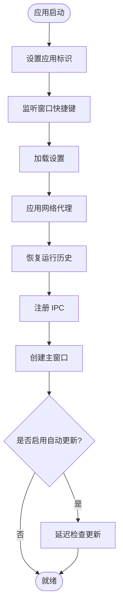
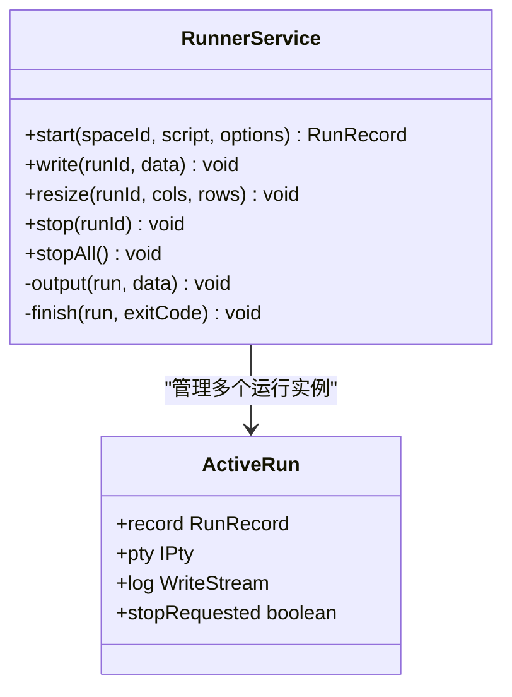
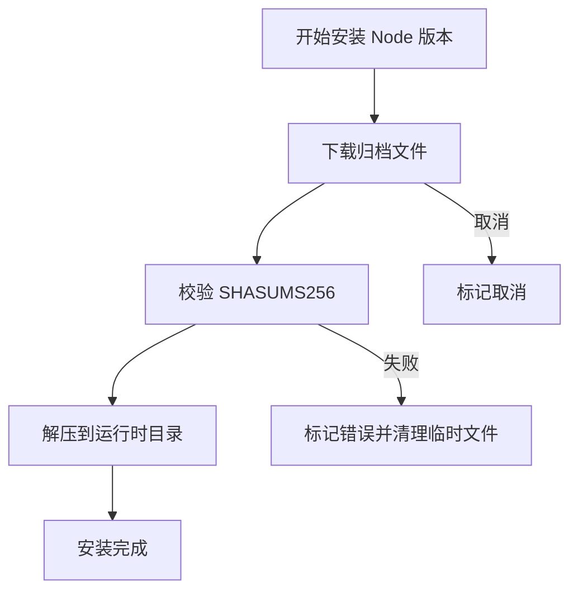
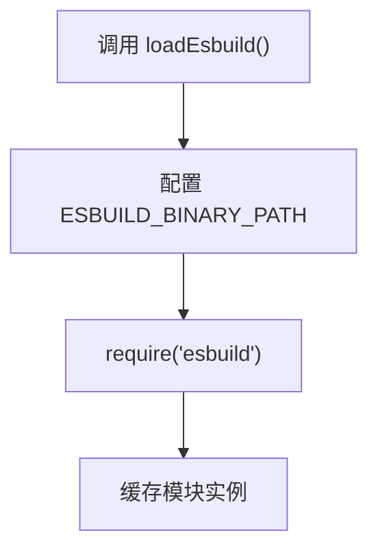
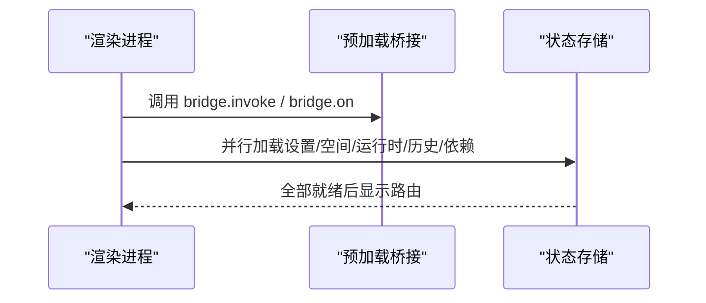
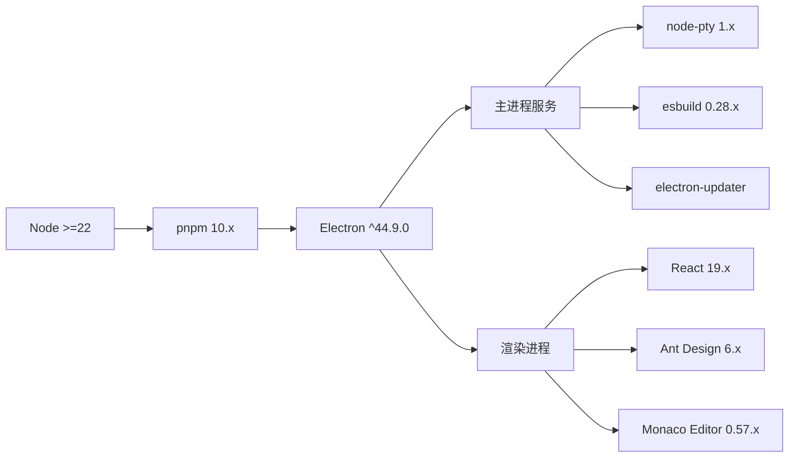

# 技术栈概览

<cite>
**本文引用的文件**   
- [package.json](file://package.json)
- [README.md](file://README.md)
- [electron.vite.config.ts](file://electron.vite.config.ts)
- [src/main/index.ts](file://src/main/index.ts)
- [src/preload/index.ts](file://src/preload/index.ts)
- [src/renderer/src/main.tsx](file://src/renderer/src/main.tsx)
- [src/renderer/src/app/App.tsx](file://src/renderer/src/app/App.tsx)
- [src/main/services/runner/service.ts](file://src/main/services/runner/service.ts)
- [src/main/services/esbuild/index.ts](file://src/main/services/esbuild/index.ts)
- [src/main/services/runtime/service.ts](file://src/main/services/runtime/service.ts)
</cite>

## 目录
1. [引言](#引言)
2. [项目结构](#项目结构)
3. [核心技术选型与选择原因](#核心技术选型与选择原因)
4. [架构总览](#架构总览)
5. [关键组件与技术协作](#关键组件与技术协作)
6. [依赖关系与版本兼容性](#依赖关系与版本兼容性)
7. [性能与构建特性](#性能与构建特性)
8. [故障排查要点](#故障排查要点)
9. [结论](#结论)

## 引言
Script Box 是一个面向脚本开发者的跨平台桌面应用，目标是“开箱即用”：用户无需预先安装 Node.js，即可在应用内管理运行环境、编辑和运行 JavaScript/TypeScript 脚本。项目采用 Electron 作为桌面框架，React 19 作为前端 UI 框架，TypeScript 提供类型安全，Ant Design 提供界面组件，Monaco Editor 提供编辑器能力，node-pty 提供伪终端，esbuild 负责 TS 转译，并通过 electron-vite 统一主进程、预加载脚本与渲染进程的构建流程。

该文档聚焦技术栈概览，说明各技术的选型背景、优势、协作方式、版本兼容性与依赖关系，帮助开发者快速理解整体架构与关键技术决策。

## 项目结构
项目采用 Electron 标准的多进程结构，并结合 Vite 生态进行现代化构建：
- main：Electron 主进程，负责窗口管理、IPC 注册、服务编排（设置、网络、运行时、脚本、依赖、运行器、更新）。
- preload：通过 contextBridge 暴露带类型的桥接 API，供渲染进程调用。
- renderer：基于 React 19 + Ant Design 的界面层，包含路由、页面、组件、状态管理与国际化。
- shared：主进程与渲染进程共享的类型定义、IPC 通道与默认配置。

**图表来源**
- [src/main/index.ts:10-28](file://src/main/index.ts#L10-L28)
- [src/main/services/runner/service.ts:29-89](file://src/main/services/runner/service.ts#L29-L89)
- [src/main/services/runtime/service.ts:37-108](file://src/main/services/runtime/service.ts#L37-L108)
- [src/main/services/esbuild/index.ts:18-26](file://src/main/services/esbuild/index.ts#L18-L26)
- [src/preload/index.ts:5-18](file://src/preload/index.ts#L5-L18)
- [src/renderer/src/main.tsx:7-11](file://src/renderer/src/main.tsx#L7-L11)
- [src/renderer/src/app/App.tsx:13-31](file://src/renderer/src/app/App.tsx#L13-L31)

**章节来源**
- [README.md:78-86](file://README.md#L78-L86)
- [electron.vite.config.ts:7-29](file://electron.vite.config.ts#L7-L29)

## 核心技术选型与选择原因
- Electron（跨平台桌面应用框架）
  - 作用：提供原生窗口、文件系统、系统级能力，并承载渲染进程。
  - 选择原因：Script Box 需要本地运行脚本、管理 Node 运行时、读写用户数据目录，并与操作系统交互；Electron 提供了成熟的桌面应用方案。
  - 在本项目中的体现：主进程入口、窗口生命周期、单实例控制、代理与应用更新等。

- React 19（前端 UI 框架）
  - 作用：声明式 UI 构建与状态管理。
  - 选择原因：生态成熟、组件化良好，配合 Ant Design 可快速搭建复杂桌面应用界面；React 19 带来更现代的特性与性能优化。
  - 在本项目中的体现：渲染进程入口、应用根组件、路由与 Provider 组合。

- TypeScript（类型安全）
  - 作用：为 JS/TS 代码提供编译期类型检查与更好的开发体验。
  - 选择原因：项目涉及多进程通信、IPC 通道、运行时解析、脚本执行等复杂逻辑，类型安全能显著降低错误成本。
  - 在本项目中的体现：shared 类型定义、IPC 事件映射、服务接口与数据结构。

- Ant Design（UI 组件库）
  - 作用：提供丰富的桌面端 UI 组件与设计规范。
  - 选择原因：适合中大型应用的界面一致性需求，减少重复样式与交互实现。
  - 在本项目中的体现：Spin、Drawer、Modal、表单等组件的使用。

- Monaco Editor（代码编辑器）
  - 作用：提供类 VS Code 的代码编辑体验。
  - 选择原因：支持语法高亮、智能提示、离线资源加载，满足脚本编辑与类型提示需求。
  - 在本项目中的体现：编辑器组件封装、模型与类型注入、快捷键绑定。

- node-pty（伪终端）
  - 作用：在主进程中创建伪终端，用于交互式运行脚本。
  - 选择原因：支持实时输出、stdin 交互、进程终止与日志记录，满足终端体验需求。
  - 在本项目中的体现：RunnerService 使用 spawn 创建 pty，处理输出、退出码与停止逻辑。

- esbuild（构建工具）
  - 作用：高性能 JS/TS 转译与打包。
  - 选择原因：速度极快，适合在运行时对 TS 脚本进行即时转译，提升用户体验。
  - 在本项目中的体现：按需加载 esbuild，避免 asar 包内原生二进制问题。

- electron-vite（构建与开发工具链）
  - 作用：统一主进程、预加载与渲染进程的构建配置。
  - 选择原因：简化多进程构建流程，复用 Vite 生态插件与别名配置。
  - 在本项目中的体现：main/preload/renderer 三段配置、@shared 与 @renderer 别名、React 插件启用。

**章节来源**
- [package.json:31-70](file://package.json#L31-L70)
- [README.md:15-28](file://README.md#L15-L28)
- [electron.vite.config.ts:1-31](file://electron.vite.config.ts#L1-L31)

## 架构总览
Script Box 的整体架构遵循 Electron 经典三层：
- 主进程：负责系统级能力与服务编排，包括 IPC 注册、代理配置、历史记录恢复、窗口创建、自动更新检查、运行器与运行时管理等。
- 预加载层：通过 contextBridge 暴露安全的桥接 API，将 IPC 调用与路径转换等方法暴露给渲染进程。
- 渲染进程：React 19 + Ant Design 界面，负责用户交互、状态管理、路由与页面展示。

**图表来源**
- [src/renderer/src/app/App.tsx:16-23](file://src/renderer/src/app/App.tsx#L16-L23)
- [src/preload/index.ts:5-18](file://src/preload/index.ts#L5-L18)
- [src/main/index.ts:10-28](file://src/main/index.ts#L10-L28)
- [src/main/services/runner/service.ts:44-89](file://src/main/services/runner/service.ts#L44-L89)
- [src/main/services/runtime/service.ts:74-81](file://src/main/services/runtime/service.ts#L74-L81)

## 关键组件与技术协作
### 主进程启动与初始化
- 应用标识与窗口快捷键监听。
- 加载设置、应用代理、恢复历史。
- 注册 IPC、创建主窗口、延迟检查更新。
- 单实例锁与二次实例聚焦。

**图表来源**
- [src/main/index.ts:10-28](file://src/main/index.ts#L10-L28)

**章节来源**
- [src/main/index.ts:10-54](file://src/main/index.ts#L10-L54)

### 运行器服务（node-pty 伪终端）
- 根据空间与脚本解析源路径与环境变量。
- 通过语言适配器准备命令与参数。
- 使用 node-pty 创建伪终端，实时输出与日志写入。
- 支持停止、强制终止、多任务并发与历史记录保存。

**图表来源**
- [src/main/services/runner/service.ts:20-25](file://src/main/services/runner/service.ts#L20-L25)
- [src/main/services/runner/service.ts:29-147](file://src/main/services/runner/service.ts#L29-L147)

**章节来源**
- [src/main/services/runner/service.ts:44-147](file://src/main/services/runner/service.ts#L44-L147)

### 运行时服务（Node.js 下载与校验）
- 列出远程 Node 版本列表，支持镜像与缓存。
- 列出已安装的运行时版本。
- 解析指定版本的 Node 与 npm CLI 路径。
- 后台下载安装、SHA256 校验、解压归档、进度事件上报。

**图表来源**
- [src/main/services/runtime/service.ts:114-150](file://src/main/services/runtime/service.ts#L114-L150)

**章节来源**
- [src/main/services/runtime/service.ts:45-108](file://src/main/services/runtime/service.ts#L45-L108)
- [src/main/services/runtime/service.ts:114-150](file://src/main/services/runtime/service.ts#L114-L150)

### esbuild 懒加载与二进制路径配置
- 针对打包后 app.asar 内无法直接运行原生二进制的问题，动态配置 ESBUILD_BINARY_PATH。
- 首次使用时懒加载 esbuild，避免阻塞主进程启动。

**图表来源**
- [src/main/services/esbuild/index.ts:8-16](file://src/main/services/esbuild/index.ts#L8-L16)
- [src/main/services/esbuild/index.ts:18-26](file://src/main/services/esbuild/index.ts#L18-L26)

**章节来源**
- [src/main/services/esbuild/index.ts:1-28](file://src/main/services/esbuild/index.ts#L1-L28)

### 预加载桥接与渲染进程入口
- 预加载层通过 contextBridge 暴露 invoke/send/on 方法与路径转换方法。
- 渲染进程入口使用 React StrictMode 挂载 App 根组件。
- App 根组件在启动时并行加载设置、空间、运行时、运行历史与依赖状态。

**图表来源**
- [src/preload/index.ts:5-18](file://src/preload/index.ts#L5-L18)
- [src/renderer/src/main.tsx:7-11](file://src/renderer/src/main.tsx#L7-L11)
- [src/renderer/src/app/App.tsx:16-23](file://src/renderer/src/app/App.tsx#L16-L23)

**章节来源**
- [src/preload/index.ts:1-19](file://src/preload/index.ts#L1-L19)
- [src/renderer/src/main.tsx:1-12](file://src/renderer/src/main.tsx#L1-L12)
- [src/renderer/src/app/App.tsx:13-31](file://src/renderer/src/app/App.tsx#L13-L31)

## 依赖关系与版本兼容性
- Node.js 引擎要求：>=22。
- 包管理器：pnpm 10.34.7。
- Electron：^44.9.0。
- React 与 ReactDOM：^19.3.x。
- TypeScript：^5.9.3。
- Ant Design：^6.6.6。
- Monaco Editor：^0.57.0。
- node-pty：^1.1.0。
- esbuild：^0.28.2。
- electron-vite：^6.0.0。
- 其他关键依赖：electron-updater、extract-zip、tar、tree-kill、i18next、react-i18next、react-router、zustand、@monaco-editor/react、@xterm/xterm 等。

**图表来源**
- [package.json:12-14](file://package.json#L12-L14)
- [package.json:31-70](file://package.json#L31-L70)

**章节来源**
- [package.json:1-91](file://package.json#L1-L91)

## 性能与构建特性
- 构建工具链：electron-vite 统一主进程、预加载与渲染进程构建，启用 React 插件与 ES Worker 格式。
- 别名配置：@shared 与 @renderer 提高模块引用清晰度与构建效率。
- esbuild 懒加载：避免在 asar 包内直接运行原生二进制导致的启动阻塞。
- node-pty 伪终端：支持多任务并发运行与实时输出，结合 tree-kill 确保进程终止可靠性。
- 运行时下载：支持镜像与 SHA256 校验，保证二进制完整性与下载稳定性。

[本节为通用性能讨论，不直接分析具体文件]

## 故障排查要点
- 代理配置失败：主进程启动时会尝试应用网络代理，若失败会打印错误日志。
- 历史恢复失败：启动阶段恢复运行历史失败会打印错误日志。
- 运行时安装失败：下载或校验失败会标记错误并清理临时文件，同时上报进度事件。
- 脚本运行异常：RunnerService 会在进程退出时记录退出码与耗时，并在保存历史失败时打印错误日志。
- esbuild 二进制路径：打包后需正确配置 ESBUILD_BINARY_PATH，否则可能无法加载 esbuild。

**章节来源**
- [src/main/index.ts:14-16](file://src/main/index.ts#L14-L16)
- [src/main/services/runtime/service.ts:142-150](file://src/main/services/runtime/service.ts#L142-L150)
- [src/main/services/runner/service.ts:127-143](file://src/main/services/runner/service.ts#L127-L143)
- [src/main/services/esbuild/index.ts:8-16](file://src/main/services/esbuild/index.ts#L8-L16)

## 结论
Script Box 的技术栈以 Electron 为核心，结合 React 19、TypeScript、Ant Design、Monaco Editor、node-pty 与 esbuild，形成一套高效、类型安全且具备良好用户体验的桌面脚本运行器。主进程负责系统级能力与服务编排，预加载层提供安全桥接，渲染进程专注 UI 与交互。通过 electron-vite 统一构建流程，项目在开发体验、构建性能与运行时稳定性方面均取得平衡。对于开发者而言，理解各技术选型的原因与协作关系，有助于更好地扩展功能、优化性能与定位问题。