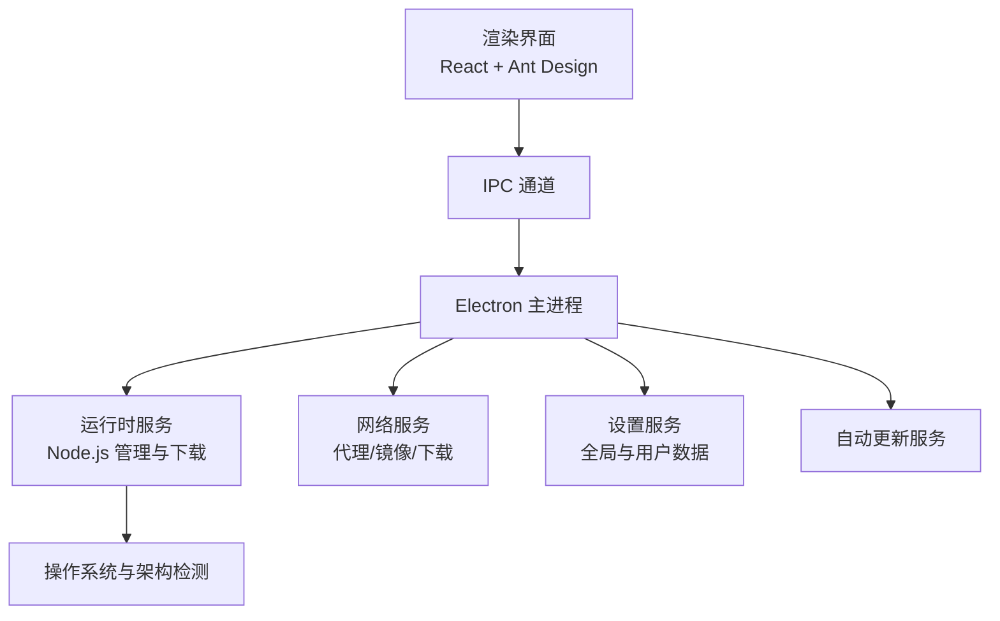
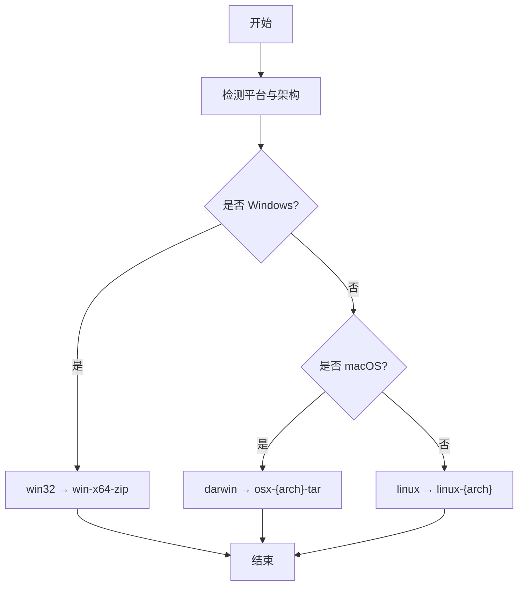
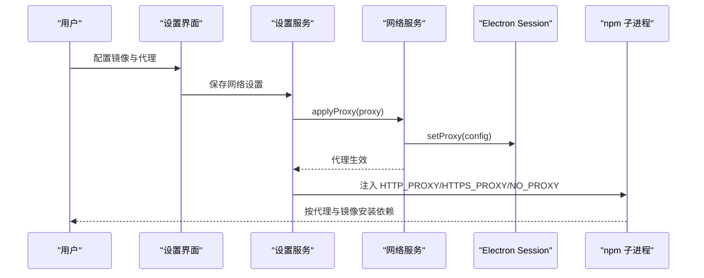
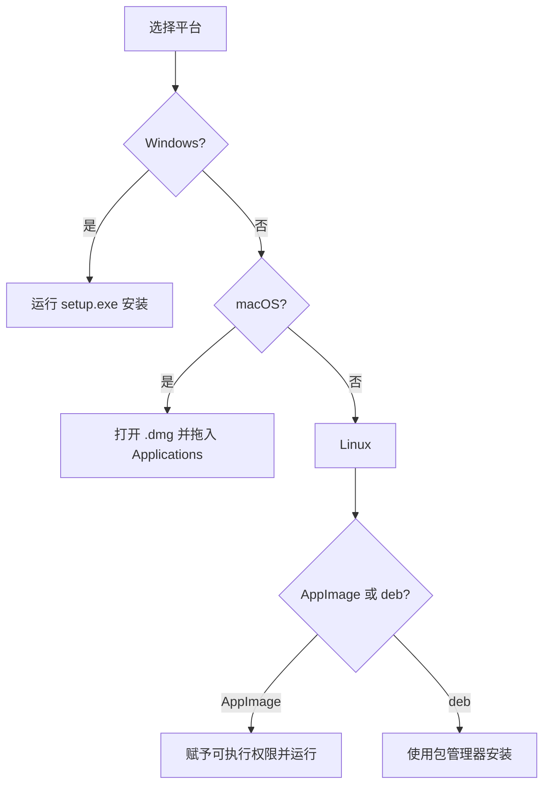
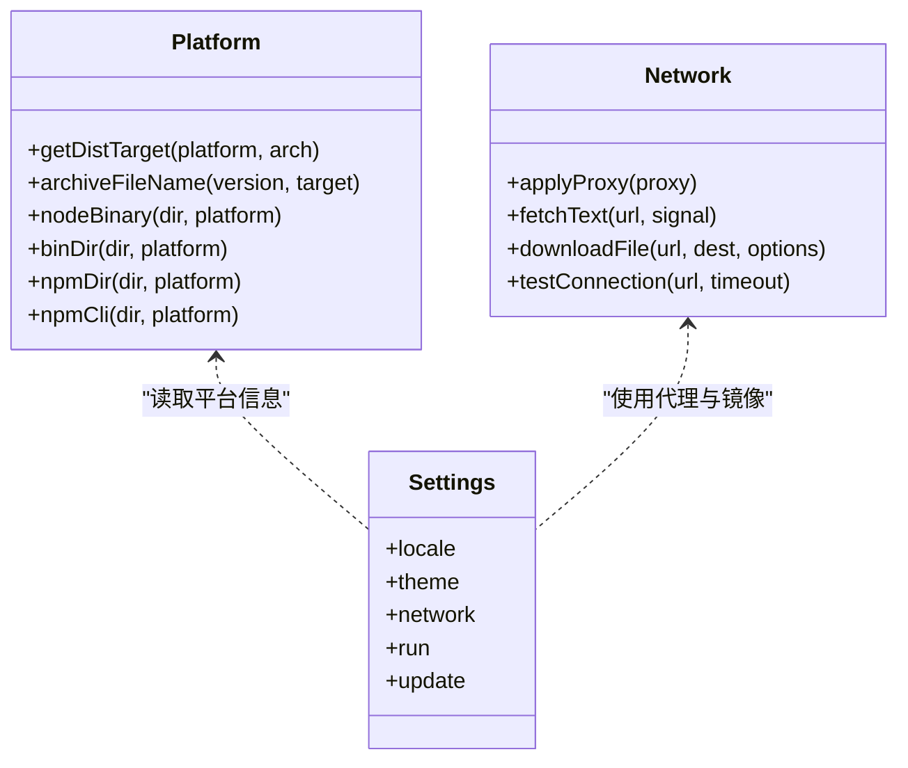

# 系统要求与支持平台

<cite>
**本文引用的文件**   
- [README.md](file://README.md)
- [package.json](file://package.json)
- [electron-builder.yml](file://electron-builder.yml)
- [platform.ts](file://src/main/services/runtime/platform.ts)
- [settings.ts](file://src/shared/types/settings.ts)
- [network/index.ts](file://src/main/services/network/index.ts)
- [settings/env.ts](file://src/main/services/settings/env.ts)
</cite>

## 目录
1. [简介](#简介)
2. [项目结构与定位](#项目结构与定位)
3. [支持的操作系统与架构](#支持的操作系统与架构)
4. [硬件最低要求](#硬件最低要求)
5. [网络要求与镜像代理配置](#网络要求与镜像代理配置)
6. [安装包格式与安装方法](#安装包格式与安装方法)
7. [平台限制与注意事项](#平台限制与注意事项)
8. [兼容性矩阵与版本支持策略](#兼容性矩阵与版本支持策略)
9. [常见问题排查](#常见问题排查)
10. [结论](#结论)

## 简介
本文件为 Script Box 的系统要求与支持平台说明，覆盖操作系统版本、硬件最低要求、网络与镜像代理配置、各平台安装包格式及安装方式、已知平台限制，以及兼容性矩阵和版本支持策略。Script Box 是一个基于 Electron 的脚本运行器，内置 Node.js 运行时下载与管理，并提供多语言、多空间、依赖管理、交互式终端与自动更新能力。

## 项目结构与定位
Script Box 采用 Electron 主进程 + Web 渲染界面架构：
- 主进程负责 IPC、设置、网络、运行时管理、脚本执行与自动更新。
- 渲染层使用 React 与 Ant Design 提供可视化界面。
- 共享类型定义位于 shared 目录，供主进程与渲染进程共用。

**图表来源**
- [README.md:78-86](file://README.md#L78-L86)
- [package.json:11-28](file://package.json#L11-L28)

**章节来源**
- [README.md:78-86](file://README.md#L78-L86)
- [package.json:11-28](file://package.json#L11-L28)

## 支持的操作系统与架构
Script Box 通过 Electron 打包并分发到 Windows、macOS 与 Linux 三个平台，同时支持 x64 与 arm64 架构（具体以构建产物为准）。

- Windows
  - 目标架构：x64
  - 安装包格式：NSIS 安装程序
  - 二进制路径差异：Windows 下 Node 可执行文件为 `node.exe`，bin 目录即为应用根目录；npm 模块目录位于 `node_modules/npm`

- macOS
  - 目标架构：x64、arm64
  - 安装包格式：DMG 与 ZIP
  - 二进制路径差异：非 Windows 平台 Node 可执行文件位于 `bin/node`，bin 目录为 `bin`

- Linux
  - 目标架构：x64
  - 安装包格式：AppImage 与 deb
  - 二进制路径差异：同 macOS，非 Windows 平台 Node 可执行文件位于 `bin/node`

**图表来源**
- [platform.ts:20-33](file://src/main/services/runtime/platform.ts#L20-L33)

**章节来源**
- [platform.ts:3-33](file://src/main/services/runtime/platform.ts#L3-L33)
- [platform.ts:44-59](file://src/main/services/runtime/platform.ts#L44-L59)
- [electron-builder.yml:32-65](file://electron-builder.yml#L32-L65)

## 硬件最低要求
仓库未明确声明内存、磁盘空间或处理器最低要求。根据应用特性与运行时行为，建议如下：

- 内存
  - 基础运行：建议至少 2 GB 可用内存，以保证 Electron 界面与 Node.js 运行时稳定运行。
  - 大型依赖安装或多任务并行时：建议 4 GB 或以上。

- 磁盘空间
  - 应用本体与依赖缓存会占用一定空间。首次安装后，建议预留至少 1–2 GB 空间用于 Node.js 运行时、npm 缓存与多个运行空间的依赖。

- 处理器
  - 无特殊 CPU 指令集要求；x64 与 arm64 均受支持。

注意：以上为通用建议，实际资源占用取决于脚本规模、依赖数量与并发运行数量。

[本节为通用指导，不直接分析具体源码文件]

## 网络要求与镜像代理配置
Script Box 支持配置 Node.js 下载镜像、npm registry、HTTP/HTTPS 代理以及二进制环境变量（如 `ELECTRON_MIRROR`），并提供“国内预设”选项。

- 镜像源
  - Node.js 下载镜像：由运行时服务根据平台与架构选择对应 indexKey 进行下载。
  - npm registry：可通过设置注入 `npm_config_registry`。
  - 二进制镜像环境变量：通过 `binaryMirrors` 注入任意键值对，例如 `ELECTRON_MIRROR`。

- 代理设置
  - Electron 主进程代理：通过 `session.setProxy` 将主进程的网络请求（下载、自动更新）路由至配置的代理。
  - 子进程与环境变量：向 npm 与用户脚本注入 `HTTP_PROXY`、`HTTPS_PROXY`、`NO_PROXY` 等环境变量，确保依赖安装与脚本执行遵循代理规则。

**图表来源**
- [network/index.ts:12-16](file://src/main/services/network/index.ts#L12-L16)
- [settings/env.ts:21-50](file://src/main/services/settings/env.ts#L21-L50)
- [settings/env.ts:53-72](file://src/main/services/settings/env.ts#L53-L72)

**章节来源**
- [README.md:25-28](file://README.md#L25-L28)
- [settings.ts:9-25](file://src/shared/types/settings.ts#L9-L25)
- [network/index.ts:12-16](file://src/main/services/network/index.ts#L12-L16)
- [settings/env.ts:21-50](file://src/main/services/settings/env.ts#L21-L50)
- [settings/env.ts:53-72](file://src/main/services/settings/env.ts#L53-L72)

## 安装包格式与安装方法
各平台提供的安装包格式如下：

- Windows
  - 文件名示例：`script-box-x.y.z-setup.exe`
  - 安装方式：双击 NSIS 安装程序，可选择安装目录并创建桌面快捷方式。

- macOS
  - 文件名示例：`script-box-x.y.z-arm64.dmg` / `script-box-x.y.z-x64.dmg`
  - 安装方式：打开 DMG 后将应用拖入 Applications。若提示“已损坏”或“无法验证开发者”，可在终端执行清理属性命令；未签名时自动更新不保证可用。

- Linux
  - 文件名示例：`script-box-x.y.z-x86_64.AppImage` / `script-box-x.y.z-amd64.deb`
  - 安装方式：
    - AppImage：赋予可执行权限后直接运行。
    - deb：通过包管理器安装。

**图表来源**
- [README.md:35-41](file://README.md#L35-L41)
- [electron-builder.yml:32-65](file://electron-builder.yml#L32-L65)

**章节来源**
- [README.md:35-41](file://README.md#L35-L41)
- [electron-builder.yml:32-65](file://electron-builder.yml#L32-L65)

## 平台限制与注意事项
- macOS 安装包当前未签名
  - 首次打开可能提示“已损坏”或“无法验证开发者”。
  - 未签名情况下，macOS 上的自动更新不保证可用。

- 架构与二进制路径差异
  - Windows 与非 Windows 平台的 Node 可执行文件路径不同，应用内部已做适配。
  - npm 模块目录在 Windows 与非 Windows 平台也不同，应用内部已做适配。

- 开发环境与构建
  - 开发需要 Node.js >= 22 与 pnpm 10。
  - 构建脚本支持 `build:win`、`build:mac`、`build:linux`。

**章节来源**
- [README.md:41-41](file://README.md#L41-L41)
- [platform.ts:44-59](file://src/main/services/runtime/platform.ts#L44-L59)
- [README.md:63-74](file://README.md#L63-L74)

## 兼容性矩阵与版本支持策略
- 操作系统与架构
  - Windows：x64
  - macOS：x64、arm64
  - Linux：x64

- 运行时与依赖
  - 应用内可下载并管理多个 Node.js 版本，每个运行空间可独立指定版本。
  - 依赖安装与缓存共享，同名同版本包只下载一次。

- 自动更新
  - 从 GitHub Releases 获取新版本。
  - macOS 未签名时自动更新不保证可用。

- 版本支持策略
  - 发布流程：推送 `v*` 标签后，GitHub Actions 在 Windows、macOS、Linux 三平台构建，并将安装包上传至草稿 Release。
  - 代码签名可选：需配置相应 Secrets（macOS 与 Windows）。

**图表来源**
- [platform.ts:3-83](file://src/main/services/runtime/platform.ts#L3-L83)
- [settings.ts:36-42](file://src/shared/types/settings.ts#L36-L42)
- [network/index.ts:12-80](file://src/main/services/network/index.ts#L12-L80)

**章节来源**
- [README.md:88-96](file://README.md#L88-L96)
- [platform.ts:3-83](file://src/main/services/runtime/platform.ts#L3-L83)
- [settings.ts:36-42](file://src/shared/types/settings.ts#L36-L42)
- [network/index.ts:12-80](file://src/main/services/network/index.ts#L12-L80)

## 常见问题排查
- 首次启动无法下载 Node.js
  - 检查网络镜像与代理设置是否正确。
  - 使用“连接测试”功能验证镜像可达性。

- 依赖安装失败
  - 确认 npm registry 与代理环境变量已正确注入。
  - 查看运行历史与日志，定位具体错误。

- macOS 无法打开应用
  - 执行清理属性命令以解除安全限制。
  - 未签名时自动更新不可用，需手动下载安装包。

**章节来源**
- [README.md:41-49](file://README.md#L41-L49)
- [network/index.ts:66-80](file://src/main/services/network/index.ts#L66-L80)

## 结论
Script Box 支持 Windows（x64）、macOS（x64/arm64）与 Linux（x64），并通过 Electron 与 node-pty 提供稳定的脚本运行体验。应用内置 Node.js 管理与依赖缓存，支持镜像与代理配置，便于在不同网络环境下工作。由于仓库未明确硬件最低要求，建议根据实际使用场景预留足够的内存与磁盘空间。macOS 未签名时的自动更新限制需在部署前考虑。

[本节为总结性内容，不直接分析具体源码文件]