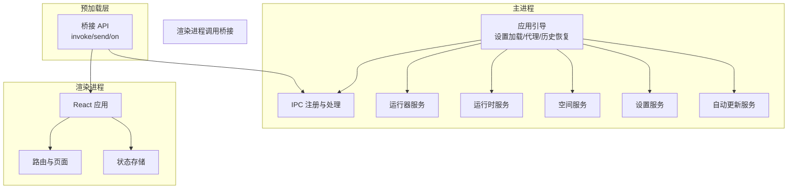
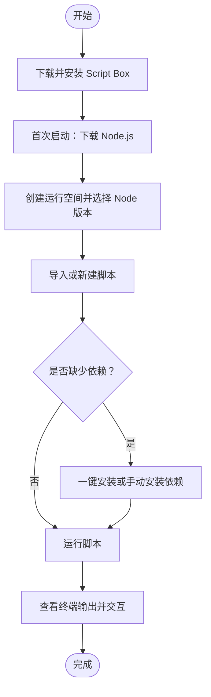
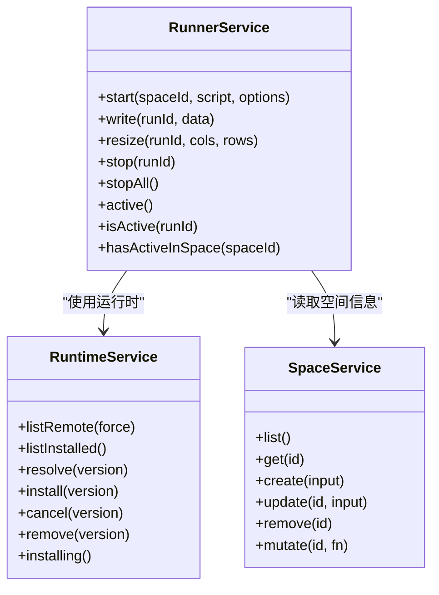
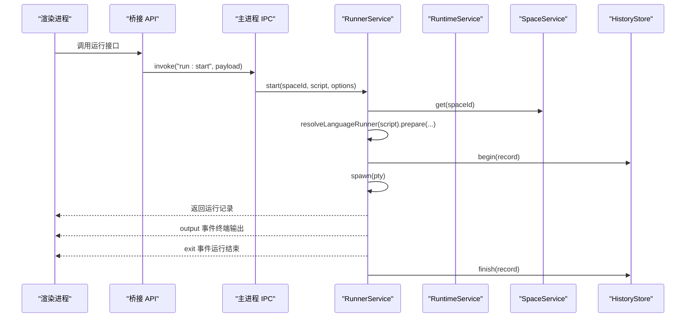

# 项目概述

<cite>
**本文引用的文件**   
- [README.md](file://README.md)
- [package.json](file://package.json)
- [src/main/index.ts](file://src/main/index.ts)
- [src/main/window.ts](file://src/main/window.ts)
- [src/preload/index.ts](file://src/preload/index.ts)
- [src/renderer/src/main.tsx](file://src/renderer/src/main.tsx)
- [src/renderer/src/app/App.tsx](file://src/renderer/src/app/App.tsx)
- [src/main/services/runner/service.ts](file://src/main/services/runner/service.ts)
- [src/main/services/runtime/service.ts](file://src/main/services/runtime/service.ts)
- [src/main/services/space/service.ts](file://src/main/services/space/service.ts)
</cite>

## 目录
1. [简介](#简介)
2. [核心价值主张](#核心价值主张)
3. [主要功能特性](#主要功能特性)
4. [技术栈与架构优势](#技术栈与架构优势)
5. [系统要求与下载](#系统要求与下载)
6. [快速开始指南](#快速开始指南)
7. [核心组件概览](#核心组件概览)
8. [运行流程总览](#运行流程总览)
9. [常见问题与排错](#常见问题与排错)
10. [结语](#结语)

## 简介
Script Box 是一个“开箱即用”的脚本运行器。用户无需在电脑上预先安装 Node.js，即可直接选择并运行 JavaScript 或 TypeScript 脚本。应用内置运行时管理、隔离的运行空间、智能依赖检测与安装、交互式终端、内置编辑器、网络代理配置、自动更新等功能，适合初学者快速上手，也满足有经验的开发者对多版本运行时和隔离环境的需要。

## 核心价值主张
- **免安装运行时**：应用内下载并管理多个 Node.js 版本，每个运行空间可独立指定版本，避免全局环境冲突。
- **隔离运行空间**：每个空间拥有独立的 `package.json` 与 `node_modules`，依赖互不干扰。
- **智能依赖管理**：扫描脚本中的导入语句，提示缺失依赖并提供一键安装；所有空间共享 npm 缓存，同名同版本包只下载一次。
- **交互式终端**：支持实时输出、标准输入交互、随时停止，并可同时运行多个脚本。
- **内置编辑器**：基于 Monaco 编辑器，离线可用，自动注入 Node.js 类型与已安装依赖的类型定义，提供智能提示。
- **网络与镜像配置**：可配置 Node 下载镜像、npm registry、HTTP/HTTPS 代理，并提供国内预设，加速下载与更新。
- **自动更新**：从 GitHub Releases 获取新版本，保持工具始终最新。

这些能力共同构成 Script Box 的核心价值：**让脚本运行变得简单、安全、可重复且可协作**。

**章节来源**
- [README.md:5-30](file://README.md#L5-L30)

## 主要功能特性
- **运行时管理**
  - 按平台与架构下载 Node.js，并通过 SHASUMS256 校验完整性。
  - 支持列出远程版本、本地已安装版本、安装进度与取消安装。
- **运行空间**
  - 为每个空间创建独立元数据、脚本目录、`.npmrc` 与欢迎脚本。
  - 支持命名、描述、Node 版本切换、删除空间及其历史。
- **脚本执行**
  - 支持 `.js/.mjs/.cjs/.ts/.mts/.cts`，TypeScript 通过 esbuild 转译（不做类型检查）。
  - 记录退出码、耗时、完整日志，支持回看运行历史。
- **交互式终端**
  - 基于 node-pty 与 xterm.js，支持实时输出、stdin 输入、窗口尺寸调整。
  - 支持命令行参数与环境变量，多个脚本可同时运行。
- **依赖管理**
  - 按 `包名@版本` 安装、卸载、更新。
  - 扫描脚本导入，一键安装缺失依赖；共享 npm 缓存提升效率。
- **内置编辑器**
  - 资源本地加载，不依赖 CDN；离线也有智能提示。
  - 快捷键保存与运行，集成 Node.js 类型与依赖类型注入。
- **网络配置**
  - 可配置 Node 镜像、npm registry、代理；自动更新与运行时下载均受代理影响。
- **国际化与主题**
  - 支持中英双语；亮色、暗色、跟随系统三种主题。
- **自动更新**
  - 启动后延迟检查更新，从 GitHub Releases 拉取新版本。

**章节来源**
- [README.md:9-30](file://README.md#L9-L30)
- [src/main/services/runtime/service.ts:45-154](file://src/main/services/runtime/service.ts#L45-L154)
- [src/main/services/space/service.ts:14-87](file://src/main/services/space/service.ts#L14-L87)
- [src/main/services/runner/service.ts:44-146](file://src/main/services/runner/service.ts#L44-L146)

## 技术栈与架构优势
- **Electron + React + TypeScript**
  - Electron 提供桌面端能力与主进程/渲染进程通信。
  - React 构建现代化 UI，Ant Design 提供组件库。
  - TypeScript 保证类型安全，提升可维护性。
- **主进程职责清晰**
  - 负责应用生命周期、IPC 注册、网络代理、设置加载、历史记录恢复、自动更新检查、窗口管理与清理。
- **渲染进程专注界面**
  - 通过 preload 暴露带类型的桥接 API，渲染进程仅调用桥接方法，不直接访问 Node API。
- **服务化设计**
  - 将运行时、空间、脚本、依赖、运行器等能力拆分为独立服务，便于测试与维护。
- **安全与稳定性**
  - 启用沙箱与上下文隔离，禁用 Node 集成；外部链接由系统浏览器打开。
  - 单实例锁防止重复启动，退出前统一停止所有运行任务。

**图表来源**
- [src/main/index.ts:10-28](file://src/main/index.ts#L10-L28)
- [src/main/window.ts:6-46](file://src/main/window.ts#L6-L46)
- [src/preload/index.ts:5-16](file://src/preload/index.ts#L5-L16)
- [src/renderer/src/main.tsx:7-11](file://src/renderer/src/main.tsx#L7-L11)
- [src/renderer/src/app/App.tsx:13-33](file://src/renderer/src/app/App.tsx#L13-L33)

**章节来源**
- [package.json:31-70](file://package.json#L31-L70)
- [src/main/index.ts:10-28](file://src/main/index.ts#L10-L28)
- [src/main/window.ts:6-46](file://src/main/window.ts#L6-L46)
- [src/preload/index.ts:5-16](file://src/preload/index.ts#L5-L16)
- [src/renderer/src/main.tsx:7-11](file://src/renderer/src/main.tsx#L7-L11)
- [src/renderer/src/app/App.tsx:13-33](file://src/renderer/src/app/App.tsx#L13-L33)

## 系统要求与下载
- **开发环境要求**
  - Node.js >= 22
  - pnpm 10
- **安装包下载**
  - Windows：`script-box-x.y.z-setup.exe`
  - macOS：`script-box-x.y.z-arm64.dmg` / `script-box-x.y.z-x64.dmg`
  - Linux：`script-box-x.y.z-x86_64.AppImage` / `script-box-x.y.z-amd64.deb`
- **macOS 签名说明**
  - 当前安装包未签名，首次打开可能提示“已损坏”或“无法验证开发者”，可通过终端命令解除隔离属性。
  - 无签名时，自动更新不一定可用。

**章节来源**
- [README.md:31-42](file://README.md#L31-L42)
- [README.md:63-76](file://README.md#L63-L76)

## 快速开始指南
1. **下载安装包**
   - 前往 Releases 页面，根据操作系统下载对应安装包。
2. **首次启动**
   - 按引导下载一个 LTS 版本的 Node.js；国内网络建议开启“使用国内镜像”。
3. **创建运行空间**
   - 新建空间并选择要使用的 Node 版本。
4. **导入或新建脚本**
   - 支持拖拽导入或直接新建脚本。
5. **依赖安装**
   - 若编辑器提示缺少依赖，点击“一键安装”；也可在“依赖”面板手动安装，例如 `lodash@4`。
6. **运行脚本**
   - 按 `F5` 或点击“运行”，查看下方终端输出，可直接在终端输入交互。

[本图为概念流程图，不直接映射具体源码文件]

**章节来源**
- [README.md:43-50](file://README.md#L43-L50)

## 核心组件概览
- **应用引导与生命周期**
  - 设置应用标识、监听窗口快捷键、加载设置、应用网络代理、恢复历史、注册 IPC、创建主窗口、延迟检查更新、单实例锁、退出前停止所有运行任务。
- **窗口与安全策略**
  - 启用沙箱与上下文隔离，禁用 Node 集成；外链由系统浏览器打开；开发模式下加载开发 URL，生产模式加载打包 UI。
- **桥接 API**
  - 通过 contextBridge 暴露 `invoke`、`send`、`on` 等方法，渲染进程以类型安全方式调用主进程能力。
- **运行器服务**
  - 解析脚本路径、准备语言运行器、构建环境变量、启动 pty 终端、记录运行历史、处理输出与退出事件、支持写入与停止。
- **运行时服务**
  - 列出远程版本、本地已安装版本、解析目标运行时、后台安装与校验、解压归档、报告安装进度。
- **空间服务**
  - 列出、读取、创建、更新、删除空间；序列化读写空间元数据，确保并发安全。

**图表来源**
- [src/main/services/runner/service.ts:29-146](file://src/main/services/runner/service.ts#L29-L146)
- [src/main/services/runtime/service.ts:37-154](file://src/main/services/runtime/service.ts#L37-L154)
- [src/main/services/space/service.ts:10-90](file://src/main/services/space/service.ts#L10-L90)

**章节来源**
- [src/main/index.ts:10-54](file://src/main/index.ts#L10-L54)
- [src/main/window.ts:6-46](file://src/main/window.ts#L6-L46)
- [src/preload/index.ts:5-16](file://src/preload/index.ts#L5-L16)
- [src/main/services/runner/service.ts:29-146](file://src/main/services/runner/service.ts#L29-L146)
- [src/main/services/runtime/service.ts:37-154](file://src/main/services/runtime/service.ts#L37-L154)
- [src/main/services/space/service.ts:10-90](file://src/main/services/space/service.ts#L10-L90)

## 运行流程总览
以下序列图展示从渲染进程发起运行到主进程执行脚本并返回结果的典型流程：

**图表来源**
- [src/main/services/runner/service.ts:44-146](file://src/main/services/runner/service.ts#L44-L146)
- [src/main/services/space/service.ts:26-31](file://src/main/services/space/service.ts#L26-L31)

**章节来源**
- [src/main/services/runner/service.ts:44-146](file://src/main/services/runner/service.ts#L44-L146)

## 常见问题与排错
- **macOS 安装包提示“已损坏”**
  - 在终端执行解除隔离属性的命令后重试打开。
  - 无签名时自动更新可能不可用。
- **网络较慢或下载失败**
  - 配置 Node 下载镜像与 npm registry，或使用国内预设。
  - 设置 HTTP/HTTPS 代理，确保运行时下载、npm 与自动更新均生效。
- **依赖缺失或类型提示异常**
  - 在编辑器中点击“一键安装”或在依赖面板手动安装。
  - 确认已安装依赖的类型定义已注入。
- **运行卡住或无法停止**
  - 使用“停止”按钮终止进程；必要时重启应用以确保清理完成。
- **数据目录位置**
  - 可在“设置 → 关于”中打开数据目录，查看 settings、runtimes、npm-cache、spaces、history 等结构。

**章节来源**
- [README.md:31-61](file://README.md#L31-L61)
- [src/main/services/runtime/service.ts:114-150](file://src/main/services/runtime/service.ts#L114-L150)
- [src/main/services/runner/service.ts:101-115](file://src/main/services/runner/service.ts#L101-L115)

## 结语
Script Box 通过“免安装运行时 + 隔离空间 + 智能依赖 + 交互式终端 + 内置编辑器”的组合，显著降低了脚本运行的门槛与复杂度。无论是初学者还是资深开发者，都能借助其清晰的架构与完善的功能，快速、稳定地运行与管理脚本。结合 Electron + React + TypeScript 的技术栈，项目在用户体验、可维护性与扩展性之间取得了良好平衡。